# L2 - VHMKDO2O - Cobroker

| Trường | Nội dung |
| --- | --- |
| Trạng thái | DRAFT — trình thẩm định kiến trúc |
| Phiên bản & lịch sử thay đổi | v0.2 — 14/10/2026 — Chuẩn hóa thiết kế tổng thể Cobroker và bốn phân hệ nghiệp vụ |
| Hệ thống | VHM Agent / Cobroker |
| Phạm vi thiết kế | CoBroker Core, Sales Analytics, Watchlist và tích hợp OCR/eKYC FPT |
| Nhóm chịu trách nhiệm | Backend · Product/Business · Solution Architecture · Integration · ANBM/Security · Data Owner · SRE/DBA |
| Cơ chế thẩm định | Workflow phê duyệt tài liệu; trách nhiệm theo Review Responsibility Matrix |
| Nguồn nghiệp vụ | Bốn SRS tại Appendix B |
| Tài liệu L3 | API/event contract, data migration, security matrix, test specification và runbook theo L3 Artefact Register |
| Tiêu chuẩn tham chiếu | Cấu trúc [L2 OCR/eKYC](https://vin3s.atlassian.net/wiki/spaces/VARW/pages/3014268156); quy chuẩn API, IAM, dữ liệu và vận hành của dự án |

Tài liệu đặc tả kiến trúc mục tiêu của Cobroker, bao gồm ranh giới dịch vụ, quy tắc nghiệp vụ, hợp đồng tích hợp, mô hình dữ liệu và các điều kiện nghiệm thu. Các yêu cầu trong tài liệu là cơ sở triển khai và kiểm thử. Tiến độ hoàn thiện tích hợp và các quyết định nghiệp vụ cần phê duyệt được quản lý tập trung tại mục 16.

**Review Responsibility Matrix**

| Nhóm chịu trách nhiệm | Phạm vi thẩm định | Cổng xác nhận |
| --- | --- | --- |
| Product/Business Owner | Quy tắc xếp hạng, cấm/hạn chế, chu kỳ, vùng và đại lý | Business/UAT |
| Solution Architecture | Ranh giới dịch vụ, dữ liệu, transaction, NFR và ADR | Architecture |
| Integration Architecture | BFF, Profile, Pipeline, OCR/eKYC, History, Notification và File Service | Integration |
| ANBM/Security | Xác thực, phân quyền chức năng/dữ liệu, PII và threat model | Security |
| Data Owner | Mục đích sử dụng, retention, truy cập và xóa dữ liệu | Data production |
| QA / SRE / DBA | Test, dung lượng, migration, dashboard, backup/restore và runbook | UAT/OAT/Go-live |

Reviewer, quyết định, ngày xác nhận và evidence được ghi tại workflow thẩm định. Mỗi hạng mục có một nhóm chịu trách nhiệm chính và tiêu chí đóng cụ thể.

**Governance Gates**

| Chuyển trạng thái | Điều kiện đầu vào |
| --- | --- |
| DRAFT → UNDER REVIEW | Nội dung, sơ đồ và contract đủ phạm vi; quyết định nghiệp vụ và phụ thuộc có ID, owner, tác động và phương án xử lý |
| UNDER REVIEW → APPROVED | Hoàn tất thẩm định nghiệp vụ, kiến trúc, tích hợp và bảo mật; các ngoại lệ có risk acceptance và thời hạn |
| APPROVED → IMPLEMENTATION BASELINE | API/event schema, migration, cấu hình triển khai và test specification được quản lý phiên bản |
| IMPLEMENTATION BASELINE → GO-LIVE | UAT, security, performance, migration và restore đạt tiêu chí; dashboard và runbook sẵn sàng vận hành |

**L3 Artefact Register**

| ID | Artefact | Chủ sở hữu | Nội dung thẩm định / điều kiện nghiệm thu |
| --- | --- | --- | --- |
| L3-API | API nghiệp vụ và ma trận lỗi | Backend/Integration | Mục 6; DTO/OpenAPI versioned; validation và consumer contract tests |
| L3-OCR | Contract OCR/eKYC FPT và media | Core/OCR/Integration | Mục 6.3, 8.2; SDK compatibility, idempotency và source authorization |
| L3-DATA | DDL, migration và backfill | Backend/DBA | Mục 7, 10; unique/version, overlap, đối soát dữ liệu và rollback compatibility |
| L3-INT | Facts, ngày bán, notification, chứng nhận và scope vùng | Integration/BFF | INT-01…INT-05 tại mục 16.2; producer/consumer cùng phiên bản và E2E |
| L3-SEC | Ma trận role/action/resource | Security/Backend | Mục 9; test quyền cho list/detail/export/history/media/config |
| L3-QA | Test specification và test report | QA | Mục 15; report gắn commit/image/môi trường tại quality gate |
| L3-OPS | Deployment, capacity, dashboard và runbook | SRE/DBA | Mục 10–14; OAT và diễn tập khôi phục |

Trạng thái triển khai được quản lý tại delivery register mục 16.2; quyết định sản phẩm tại mục 16.3. L3 artefact và evidence nghiệm thu được gắn vào gate tương ứng.

# 1. Business Objectives & Scope

## 1.1 Business Context & Objectives

Cobroker quản lý vòng đời hồ sơ cộng tác viên/Sale và đại lý: đăng ký, xác minh danh tính, duyệt hồ sơ, cập nhật hồ sơ, nhân sự, chi nhánh và pháp nhân. Bốn năng lực bổ sung đưa việc quản trị hiệu quả bán hàng, kiểm soát điều kiện hoạt động và phân vùng tổ chức vào cùng kiến trúc nghiệp vụ.

| Năng lực | Mục tiêu | Service sở hữu |
| --- | --- | --- |
| Nền tảng Cobroker | Onboarding, OCR/eKYC, hồ sơ, phê duyệt, đại lý, ASA/nhân sự, cập nhật hồ sơ | CoBroker Core |
| 1. Xếp hạng Sale | Báo cáo doanh số quý, phân hạng, cấu hình, vinh danh | Sales Analytics |
| 2. Cấm/hạn chế bán | Quản lý đối tượng, phạm vi tài khoản, công khai/tra cứu, kiểm soát tự động | Watchlist |
| 3. Chu kỳ bán hàng | Chính thức/thử thách, cảnh báo, đề xuất ngừng hợp tác và điều kiện hạn mức | Sales Analytics |
| 4. Vùng/đại lý/liên minh/pháp nhân | Vùng chủ quản, vùng bán theo dự án, liên minh, dự án pháp nhân, hạng đại lý | CoBroker Core |

## 1.2 In Scope

Phạm vi bao gồm nền tảng Cobroker và bốn phân hệ trong **một tài liệu L2 thống nhất**. Tài liệu mô tả trách nhiệm service, quy tắc, API, dữ liệu, luồng thành công/lỗi, quyền, triển khai và kiểm thử.

Tích hợp danh tính sử dụng **FPT qua service OCR/eKYC**. Service OCR/eKYC sở hữu credential, giao thức provider và vòng đời xử lý; Core sở hữu đối soát danh tính và quyết định nghiệp vụ hồ sơ.

## 1.3 Out of Scope

Không thiết kế lại Pipeline/SAP, Profile/IAM, CMS, File Service hoặc nội bộ thuật toán FPT. Không đồng nhất đề xuất chấm dứt chu kỳ với khóa tài khoản. Check-in nằm ngoài phạm vi bản thiết kế này. BFF/UI triển khai theo contract và ma trận quyền của từng phân hệ; nghiệm thu tại Integration và UAT gate.

## 1.4 Assumptions, Constraints & Dependencies

Ngày nghiệp vụ dùng múi giờ Việt Nam. Profile là nguồn nhân sự/đơn vị; Pipeline là nguồn giao dịch; Core sở hữu hồ sơ đại lý và liên kết vùng; Analytics sở hữu projection/báo cáo; Watchlist sở hữu quyết định cấm/hạn chế. Không ghi chéo database giữa các service.

“Vùng” trong cây CMS, vùng chủ quản đại lý và vùng bán dự án là các khái niệm có mapping riêng. “Hạng Sale” Kim cương/Bạch kim/Vàng khác “hạng đại lý” A/B/C. Không sử dụng chung enum hoặc suy ra quyền từ sự giống nhau về tên.

# 2. Architecture Overview & Principles

## 2.1 System Context & Component Diagram

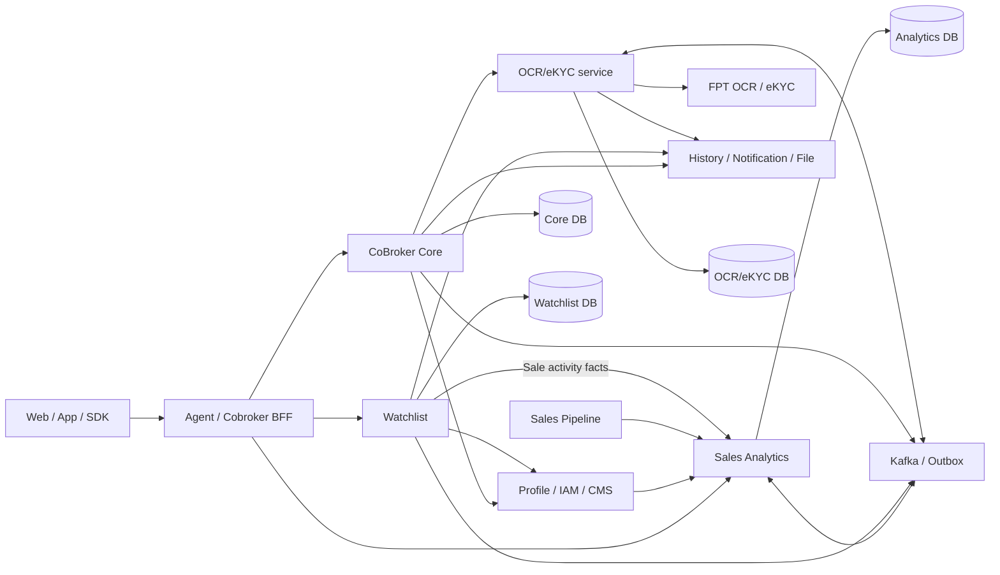

Sơ đồ thể hiện kiến trúc mục tiêu và trách nhiệm tích hợp. Giao thức, chế độ đồng bộ/bất đồng bộ và contract dữ liệu được quy định tại mục 6. Watchlist đọc facts từ Analytics qua INT-01; dữ liệu nghiệp vụ được ghi tại dịch vụ sở hữu.

## 2.2 Architecture Principles

| Nguyên tắc | Áp dụng |
| --- | --- |
| Sở hữu dữ liệu theo domain | Core không tính xếp hạng; Watchlist không thay calculator chu kỳ; OCR/eKYC sở hữu provider integration |
| Tách đọc nguồn, tính toán và ghi kết quả | Calculator ranking/cycle nhận đầu vào; service điều phối transaction; job điều phối lịch |
| Nhất quán trong DB, tích hợp eventual consistency | Ghi domain và outbox trong cùng transaction đối với side effect phát qua outbox; theo dõi delivery độc lập |
| Không giữ transaction khi chờ hệ thống ngoài | OCR chờ provider bằng lịch poll; notification chuẩn bị/gửi/ghi kết quả tách pha |
| Bảo vệ retry theo tác động | Consumer nhận lặp phải an toàn; không tự retry mutation eKYC hoặc submit OCR không rõ kết quả |
| Phân quyền trên dữ liệu | Scope phải đi từ actor tin cậy; list/detail/export đều phải kiểm; filter không thay authorization |
| Lịch sử có hiệu lực | Vùng chủ quản/dự án lưu ngày bắt đầu/kết thúc; không suy quyền hiện tại cho giao dịch lịch sử |

## 2.3 Ranh giới nhất quán

Core dùng transaction và khóa để bảo vệ thay đổi quan hệ, snapshot yêu cầu cập nhật và gán khoảng hiệu lực. Import hạng dùng optimistic version và rollback toàn bộ khi xung đột. Analytics dùng run/batch, facts, result và reconcile; chu kỳ tính riêng từng Sale dưới khóa user. Watchlist dùng khóa định danh, version bản ghi và outbox cho đồng bộ Profile/lịch sử.

Transaction kết thúc tại database của từng dịch vụ. Tích hợp liên dịch vụ sử dụng at-least-once delivery kết hợp idempotency, trạng thái công việc và đối soát. Kết quả commit nghiệp vụ và kết quả thực thi side effect được theo dõi độc lập.

# 3. Functional Requirements

## 3.1 Nền tảng Cobroker

| Nhóm | Quy tắc và kết quả |
| --- | --- |
| Đăng ký và hồ sơ | Tạo hồ sơ theo account; chọn đội nhóm, bổ sung thông tin định danh, chứng chỉ môi giới, ảnh đại diện và tài liệu |
| OCR tài liệu | Chuẩn bị upload, tạo phiên OCR, thăm dò và đối soát CCCD hai mặt/phụ lục lao động; không chờ FPT trong request tạo OCR |
| eKYC SDK | Khởi tạo phiên, SDK OCR/liveness/NFC qua service FPT; Core đọc kết quả theo session và áp dụng kiểm tra hồ sơ |
| Nộp và duyệt | Nộp hồ sơ, nhận xử lý/phân công, phê duyệt, chuyển kiểm tra thủ công hoặc từ chối theo quyền |
| Đại lý | Tạo/xem/cập nhật hồ sơ, nhân sự, chi nhánh, pháp nhân, kích hoạt/ngừng và lịch sử |
| Yêu cầu cập nhật | ARM tạo yêu cầu; ASA cập nhật bản nháp, gửi duyệt; ARM duyệt/phản hồi/từ chối/hủy; job hết hạn |
| Liên kết nhân sự | Quản lý thông tin Sale, tài liệu, chuyển đại lý và trạng thái liên kết; đồng bộ với Profile theo contract |

Yêu cầu cập nhật có trạng thái riêng với đại lý: `PENDING_UPDATE → PENDING_APPROVAL → APPROVED`; phản hồi quay về `PENDING_UPDATE`; `REJECTED`, `CANCELLED`, `EXPIRED` là trạng thái kết thúc. Bản nháp không tự trở thành hồ sơ đang có hiệu lực. Hạng đại lý và trạng thái đại lý phải đi qua nghiệp vụ chuyên biệt, không được cập nhật gián tiếp bằng snapshot hồ sơ.

Kết quả OCR/eKYC `COMPLETED` chỉ thể hiện kết thúc xử lý kỹ thuật. Core phải kiểm outcome, nội dung kết quả và quy tắc đối soát trước khi chấp thuận danh tính; không coi HTTP 2xx hoặc completed là tự động duyệt hồ sơ.

## 3.2 Phân hệ 1 — Xếp hạng Sale theo doanh số

### 3.2.1 Ma trận năng lực

| SRS | Thiết kế | Kết quả nghiệp vụ |
| --- | --- | --- |
| US-01 | Bảng xếp hạng theo quý, thông tin Sale, doanh số, điểm và hạng | Tra cứu tối đa 4 quý; phân biệt kỳ đang tính và kỳ đã công bố |
| US-02 | Từ khóa, đơn vị, trạng thái, quý, hạng và sắp xếp | Bộ lọc luôn giao với phạm vi dữ liệu của người dùng |
| US-03 | Xuất Excel theo bộ lọc và quyền | Tối đa 50.000 Sale; trả dấu hiệu TRUNCATED khi vượt giới hạn |
| US-04 | Quản lý cấu hình theo kỳ/đối tượng, kích hoạt, ngừng và lịch sử | Khóa cấu hình kỳ cũ; kiểm hợp lệ trước tính hạng |
| US-05/06 | Badge hạng quý trước và chứng nhận cá nhân | Chỉ Sale có hạng được tải chứng nhận; thay kỳ hiển thị khi sang quý mới |

### 3.2.2 Công thức và quy tắc

1. Giao dịch xếp hạng phải là mua sơ cấp và có ngày ký HĐMB/VBCN trong kỳ. Contract nguồn ánh xạ `businessType=1`, `serviceType=2`; đây là mã contract nguồn.
2. `netRevenue = gross − VAT − maintenance`. Thiếu thành phần không coi là 0; tiền âm, vượt độ chính xác hoặc thiếu ngày bị loại với lý do.
3. Giao dịch bị hủy sau ký vẫn được tính cho ranking. Không tái sử dụng điều kiện loại giao dịch hủy của chu kỳ.
4. Điểm theo SRS: `a% × doanh số quý trước + b% × doanh số quý hiện tại`. So sánh trên số chính xác; làm tròn 2 chữ số ở hiển thị.
5. Xét lần lượt Kim cương → Bạch kim → Vàng, đồng thời thỏa điểm tối thiểu và quota. Người đủ điểm nhưng vượt quota xét hạng kế tiếp.
6. Áp dụng `ALLOW_TIE`: các Sale đồng điểm tại ranh giới quota cùng nhận hạng. Quota được mở rộng đúng nhóm đồng điểm ở ranh giới.
7. Cấu hình thẩm định quan hệ ngưỡng điểm Kim cương > Bạch kim > Vàng. Tập tùy chọn được công bố cho người dùng tuân theo phạm vi SRS; các chế độ kỹ thuật mở rộng được quản lý tại DEC-06.

Ví dụ minh họa: doanh số quý trước 10 tỷ, quý này 20 tỷ, trọng số 30/70 → 17 tỷ điểm. Có 101 người đủ ngưỡng Kim cương, người thứ 100 và 101 đồng điểm → quota 100 có thể cấp 101 hạng Kim cương theo quy tắc hòa điểm.

## 3.3 Phân hệ 2 — Quản lý Sale cấm bán/hạn chế bán

### 3.3.1 Ma trận năng lực

| Nhóm chức năng | Thiết kế | Kết quả nghiệp vụ |
| --- | --- | --- |
| Danh sách/chi tiết/tìm kiếm/export | Model sale_control phân biệt BANNED/RESTRICTED; lọc và phân trang | Dữ liệu trả về theo quyền chức năng và phạm vi người dùng |
| Tạo/bổ sung/áp dụng lại | Khóa định danh, kiểm trùng, quản lý tài khoản liên kết | Mỗi thao tác lưu quyết định và lịch sử; xử lý đồng thời bằng lock/version |
| Gỡ | Chuyển RELEASED, lưu lý do và phát outbox | Gỡ cấm không tự kích hoạt tài khoản |
| Công khai/ngừng công khai | Quản lý publicStatus độc lập status áp dụng | API thị trường chỉ tra bản ghi ACTIVE/PUBLISHED |
| Import | Upload → staging → validate → confirm → apply | Có kết quả từng dòng và file lỗi |
| Kiểm tra điều kiện | API checks/statuses tại đăng ký, kích hoạt, đổi định danh, gán role và eKYC | Caller thực thi quyết định chặn trước mutation nghiệp vụ |
| Tự động hạn chế bán | Facts → mốc tham chiếu → ngưỡng → ratio guard → outbox | Dry-run trước rollout; chỉ phát lệnh sau khi qua kiểm soát dữ liệu |

### 3.3.2 Định danh, trạng thái và tài khoản

CCCD có 12 chữ số. Số điện thoại được chuẩn hóa về dạng bắt đầu bằng 0, xử lý đầu +84/84. Mã nhân viên được trim và so sánh không phân biệt hoa thường. Validation áp dụng tại API và import, bảo đảm cùng một định danh có cùng biểu diễn chuẩn.

Một bản ghi có loại `BANNED` hoặc `RESTRICTED`, trạng thái `PENDING/ACTIVE/RELEASED/CANCELED`, nguồn `MANUAL/IMPORT/AUTOMATIC`. Công khai dùng `NOT_PUBLISHED/PUBLISHED/UNPUBLISHED`, không phải trạng thái cấm bán.

Cấm bán có thể ghi nhận khi chưa tìm được tài khoản. Luồng thủ công chọn tài khoản liên quan; import áp theo các tài khoản khớp được xử lý. Các tài khoản được chọn và thông tin định danh là hai lớp dữ liệu khác nhau; không mặc định mọi người có cùng tên là cùng đối tượng.

Mô hình persistence duy trì một hồ sơ BANNED theo CCCD/mã nhân viên xuyên vòng đời. Bổ sung sử dụng bản ghi đang áp dụng; áp dụng lại sử dụng bản ghi đã gỡ, bảo toàn lịch sử. DEC-01 quản lý quyết định về tính duy nhất và tương thích SRS BR-03.

### 3.3.3 Công khai, gỡ và kiểm tra điều kiện

Chỉ công khai bản ghi đang áp dụng có CCCD hoặc số điện thoại phù hợp; bản ghi chỉ có mã nhân viên không đủ điều kiện tra cứu công khai. API market phải trả đúng contract cho các trường hợp tìm thấy/không tìm thấy hoặc dữ liệu không được công khai, không lộ lịch sử nội bộ.

Gỡ cấm không đồng nghĩa tự kích hoạt lại tài khoản. Khi phát outbox sang Profile, sender đọc lại tập kiểm soát hiện hành: chỉ DISABLE nếu còn điều kiện đang chặn, chỉ ENABLE trong luồng cho phép khi không còn kiểm soát đang chặn, còn lại NONE. Profile và các caller chịu trách nhiệm thực thi khóa, thu hồi phiên và kiểm soát tại điểm nghiệp vụ; tiêu chí nghiệm thu xuyên dịch vụ được quy định tại INT-05.

### 3.3.4 Hạn chế bán tự động

Mốc tham chiếu ưu tiên ngày cọc hợp lệ gần nhất. Khi không có giao dịch, Đại lý dùng ngày kích hoạt đầu; O2O/Tự doanh dùng ngày tạo tài khoản. Ngưỡng được tính bằng cộng tháng lịch. Quyết định về fallback ngày tạo tài khoản Đại lý được quản lý tại DEC-03, độc lập với công thức ngày kết thúc chu kỳ.

Scanner lập danh sách ứng viên PENDING, kiểm tỷ lệ bất thường trước khi chuyển ACTIVE và phát outbox. Rollout bắt đầu ở chế độ dry-run. Grace được xử lý theo lượt quét: bỏ qua lượt đầu, xóa cờ và đánh giá lại ở lượt kế tiếp. DEC-03 xác định hiệu lực nghiệp vụ của gia hạn; INT-01 quy định chất lượng facts đầu vào.

## 3.4 Phân hệ 3 — Theo dõi chu kỳ bán hàng

### 3.4.1 Ma trận SRS

| SRS | Thiết kế | Kết quả nghiệp vụ |
| --- | --- | --- |
| US-01 | Bảng phân loại và kỳ gần nhất | Hiển thị chính thức, thử thách hoặc đề xuất ngừng hợp tác |
| US-02 | Search, đơn vị, trạng thái, đối tượng, phân loại, sort | Áp dụng scope server-side trước phân trang |
| US-03 | Xuất Excel theo bộ lọc | Tối đa 50.000 Sale và kiểm quyền export |
| US-04 | Cấu hình tháng, chỉ tiêu, lịch nhắc và ngày hiệu lực | IMMEDIATE hoặc SEQUENTIAL; version check khi lưu |
| US-05 | Lịch nhắc/kết thúc trên Web/App | Gửi ngoài transaction, đối soát trạng thái delivery |
| US-06 | Ngày bắt đầu bán và điều chỉnh từ nguồn | Lưu users.sales_start_date; thay đổi hợp lệ kích hoạt tính lại |

### 3.4.2 Ngày và giao dịch

`end = start.plusMonths(months).minusDays(1)`; ngày đầu/cuối đều thuộc kỳ. Đây là phép cộng tháng lịch của Java: 31/01/2026 + 1 tháng − 1 ngày = 27/02/2026; không dùng công thức này cho ngưỡng hạn chế bán của watchlist vốn không trừ một ngày.

Count chỉ lấy facts đúng username, `cycleEligible=true`, ngày ký cọc không sau ngày đang xét. Contract giao dịch ánh xạ mua sơ cấp `businessType=1, serviceType=2`, có deposit date, liquidation `not_liquidated`; `liquidated` bị loại. Mapping được quản lý phiên bản trong contract Pipeline–Analytics.

### 3.4.3 Quy tắc chuyển kỳ

| Điều kiện | Kết quả |
| --- | --- |
| Chưa tới ngày bắt đầu bán | `PENDING`; chưa có quyết định chu kỳ |
| Thiếu ngày bán/cấu hình/dữ liệu bắt buộc | `BLOCKED` với lý do; không tự gán không đạt |
| Chính thức chưa đủ GD | `OFFICIAL_NOT_MET` |
| Chính thức đủ GD giữa kỳ | `OFFICIAL_MET`, giữ đến hết hạn |
| Hết chính thức đã đạt | Ngày kế tiếp mở chính thức mới |
| Hết chính thức chưa đạt | Ngày kế tiếp mở thử thách |
| Thử thách đạt ngày D | Đóng thử thách ở D; chính thức mới từ D+1 |
| Hết thử thách chưa đạt, kể cả đạt 1/2 | D+1 thành `TERMINATION_PROPOSED`, dừng sinh kỳ |

Mọi giao dịch cùng ngày đạt thử thách thuộc kỳ thử thách, không chuyển phần vượt chỉ tiêu sang ngày đầu kỳ mới. Trong ngày D vẫn là thử thách; ngày D+1 mới khôi phục điều kiện chính thức.

`roomExcluded=false` cho chính thức; `true` cho thử thách/đề xuất chấm dứt. Đây là điều kiện loại do chu kỳ, không phải số hạn mức và không phải lệnh thu hồi căn.

### 3.4.4 Đổi cấu hình và dữ liệu nguồn

- Cấu hình mới chỉ được lưu với ngày hiệu lực tương lai, số tháng/chỉ tiêu dương, đối tượng/ngày không trùng; kiểm xung đột bằng `expectedUpdatedAt`.
- `IMMEDIATE`: cắt kỳ đang chạy tại D−1, mở chính thức mới tại D. GD trước D không mang vào kỳ mới.
- `SEQUENTIAL`: hoàn thành kỳ hiện tại rồi chọn cấu hình hiệu lực cho kỳ kế tiếp.
- Giao dịch hủy/đến muộn có thể làm dựng lại lịch sử; giao dịch ký sau khi thử thách đã hết không tự mở lại.
- Đổi ngày bán đã đến dựng lại từ ngày mới; ngày bán tương lai chuyển PENDING và hủy lịch cũ phù hợp.
- Chuyển đối tượng Đại lý/O2O/Tự doanh đưa kết quả về BLOCKED với `AUDIENCE_CHANGE_REQUIRES_REVIEW`; bảo toàn timeline để xử lý theo quyết định DEC-04.
- Sau TERMINATION_PROPOSED, bộ tính dừng sinh kỳ. Chính sách mở lại bằng cấu hình IMMEDIATE được thẩm định riêng tại DEC-04; thao tác đổi cấu hình thông thường không tự mở lại Sale.

## 3.5 Phân hệ 4 — Quản lý vùng, đại lý, liên minh, pháp nhân

### 3.5.1 Ma trận Use Case

| SRS | Thiết kế | Ràng buộc chính |
| --- | --- | --- |
| UC-01 | CRUD vùng, liên kết CMS và lịch sử | Tên duy nhất; ít nhất một vai trò; ID CMS không thuộc hai vùng |
| UC-02 | Ngừng/kích hoạt vùng | Kiểm quan hệ hiện hành/tương lai và tính hợp lệ của CMS |
| UC-03 | Gán dự án theo giai đoạn, quyết định và hiệu lực | Không chồng khoảng cùng cặp vùng–dự án; batch all-or-nothing |
| UC-04 | Miền, vùng chủ quản, vùng bán và import hạng | Chủ quản độc lập dự án; hạng A/B/C; preview/version khi import |
| UC-05 | Liên minh một dự án | Một đại lý không tham gia hai liên minh ACTIVE cùng dự án |
| UC-06 | Dự án pháp nhân | Thuộc tập dự án đại lý; kiểm ASA và overlap |
| UC-07 | Hiển thị/lọc vùng trên Sale | OR trong từng bộ lọc, AND giữa hai nhóm, lọc trước phân trang |
| UC-08 | Quyền theo vùng chủ quản/vùng bán | Hợp phạm vi đọc được cấp; quyền thao tác kiểm riêng từng action |

### 3.5.2 Vùng và dự án vùng bán

Vùng có mã tự sinh, tên chuẩn hóa không trùng, ít nhất một vai trò `OWNER/SELLER`, trạng thái `ACTIVE/INACTIVE`. Một vùng liên kết một hoặc nhiều ID CMS; một ID CMS chỉ thuộc một vùng Agent. Core đọc CMS/Profile để kiểm loại đơn vị, khối và trạng thái; không tạo/sửa cây CMS.

Vùng SELLER được gán dự án trực tiếp. Một cặp vùng–dự án có nhiều bản ghi lịch sử nhưng không được chồng khoảng hiệu lực, kể cả khác giai đoạn. Một dự án có thể đồng thời thuộc nhiều vùng bán. `effectiveTo` là ngày cuối còn hiệu lực; null nghĩa không có ngày kết thúc.

Ngừng vùng bị chặn khi còn quan hệ chủ quản/dự án hiện hành hoặc chờ hiệu lực. Kích hoạt lại phải kiểm liên kết CMS hợp lệ. Ngoại lệ hiệu chỉnh liên kết CMS trên vùng INACTIVE được quản lý tại DEC-05; tên và vai trò bị khóa khi vùng ngừng hoạt động.

### 3.5.3 Đại lý: chủ quản, vùng bán và hạng

Mỗi đại lý có tối đa một vùng chủ quản hiệu lực tại một thời điểm. Chuyển tại D đóng bản ghi cũ D−1 và mở bản ghi mới D; ngày D không trước hôm nay và phải sau ngày bắt đầu bản ghi hiện tại. Không tạo chồng một lịch chuyển tương lai đang tồn tại. Miền Bắc/Trung/Nam độc lập với vùng chủ quản.

Nguồn dự án của đại lý là tập DISTINCT dự án được phân công cho Sale liên kết đang ACTIVE: scope `PROJECT/ASSIGNED/ACTIVE`; không lấy từ vùng chủ quản và không lấy scope `ADDITIONAL`. Vùng bán được suy từ dự án này kết hợp mapping vùng–dự án còn hiệu lực. Thu hồi phân dự án của Sale có thể làm mất dự án/vùng bán suy ra của đại lý. Dự án chưa có mapping vùng vẫn là dự án của đại lý.

Hạng đại lý gồm A/B/C; mặc định C đối với không độc quyền. Hạng A yêu cầu EXCLUSIVE. Import hạng không đổi loại độc quyền, không cập nhật hạng bằng PUT hồ sơ thông thường. File tối đa 5 MB/1.000 dòng; preview có hiệu lực 15 phút, gắn actor/tổ chức và version snapshot. Confirm thành công toàn bộ hoặc rollback toàn bộ nếu dữ liệu đã thay đổi. Đây là hạng đại lý, không liên quan quota hạng Sale.

Form tạo đại lý yêu cầu vùng chủ quản và Miền theo SRS. Cutover gồm backfill dữ liệu cũ, nâng contract caller và áp validation bắt buộc; compatibility của caller cũ được quản lý tại REL-02.

### 3.5.4 Liên minh và pháp nhân

Một liên minh gắn một dự án, một đại lý đứng đầu và từ 1 đến 10 đại lý thành viên. Các đại lý phải đang hoạt động. Một đại lý không đồng thời tham gia nhiều liên minh đang hoạt động trên cùng dự án, kể cả vai trò đứng đầu. Đại lý đứng đầu quản lý; thành viên xem. Không đổi dự án/đại lý đứng đầu trên bản ghi hiện hữu; ngừng/kích hoạt kiểm lại điều kiện. Liên minh không tự cấp quyền bán dự án.

Pháp nhân được gán các dự án thuộc đại lý, lưu lịch sử hiệu lực. Cùng pháp nhân–dự án không chồng ngày; kết thúc bằng ngày hiệu lực cuối, không xóa vật lý lịch sử. Kiểm đại lý/pháp nhân còn hiệu lực và ASA được phân công trước thao tác. Việc gán này không thay quyền dự án của Sale.

### 3.5.5 Hiển thị và phân quyền vùng

Danh sách Sale nhận `ownerRegionIds`, `sellingRegionIds`: OR trong mỗi danh sách, AND giữa hai nhóm; lọc trong DB trước phân trang. Response bổ sung vùng chủ quản/vùng bán với ID, mã, tên. Các count phải chỉ rõ tập Sale và trạng thái liên kết được đếm; count chủ quản và count Sale ACTIVE không mặc định cùng mẫu số.

Quản lý vùng được xác định từ CMS; quyền đọc là hợp các phạm vi được cấp, còn quyền thao tác theo chức năng riêng. Không lấy vùng bán của đại lý để mặc định cấp quyền sửa hồ sơ đại lý hoặc cấu hình ranking/cycle.

# 4. Non-Functional Requirements

Các mục tiêu áp dụng theo từng loại tải. Thời gian provider OCR/eKYC được đo riêng với API nghiệp vụ; batch, import và export có cửa sổ xử lý riêng.

| ID | Hạng mục | Tiêu chí thiết kế / nghiệm thu | Cách đo |
| --- | --- | --- | --- |
| NFR-01 | Chính xác tiền | numeric(24,2); bucket VND × 100; so điểm trước làm tròn; từ chối overflow | Test giá trị biên và đối soát tổng nguồn/bucket |
| NFR-02 | Chính xác thời gian | Tháng lịch, Asia/Ho_Chi_Minh, ngày đầu/cuối inclusive | Test ngày31, năm nhuận, D−1/D+1, chuyển quý/năm |
| NFR-03 | Idempotency | Replay không nhân đôi doanh số, quan hệ hoặc quyết định; same OCR key/payload trả cùng request | Concurrent/replay/crash tests |
| NFR-04 | Phân quyền | Mọi list/detail/export/history/media/config áp action + scope | Negative tests trên BFF và service |
| NFR-05 | Watchlist check latency | Mục tiêu p95 ≤ 50 ms ở 50 rps tại service, không tính mạng bên ngoài | Load test endpoint check trên dữ liệu production-like |
| NFR-06 | Tập dữ liệu lớn | Phân trang DB, batch hữu hạn; ranking/cycle export tối đa 50.000 Sale | Tải đồng thời query/export/import/job, đo heap và query plan |
| NFR-07 | Data freshness | Ranking tổng hợp ngày trước; cycle cập nhật theo job/sự kiện; side effect có delivery status | Đo source watermark, data lag và oldest pending |
| NFR-08 | Provider isolation | OCR accepted sau commit/outbox; eKYC đồng bộ và không auto retry mutation | Contract tests timeout/error/idempotency |
| NFR-09 | Observability | Correlation xuyên HTTP/job/outbox; log không chứa raw PII/credential/signed URL | Trace mẫu, kiểm redaction và dashboard |
| NFR-10 | Recovery | Restore đồng bộ domain data/job/outbox; đối soát side effect sau restore | DR rehearsal theo RTO/RPO tại OPS-01 |

Ranking query có statement timeout 10 giây để bảo vệ tài nguyên DB. SLO theo endpoint, throughput và cấu hình tải được đóng tại OPS-01 bằng capacity report; thông số triển khai được quản lý theo môi trường trong L3-OPS.

# 5. Technology Stack & Justification

| Thành phần | Công nghệ / trách nhiệm | Lý do và giới hạn |
| --- | --- | --- |
| Runtime | Java 25, Spring Boot 4; version patch theo pom từng service | Dependency được quản lý theo version pom của từng service |
| Persistence | PostgreSQL, Spring Data JPA, Liquibase | Transaction, unique/version, lịch sử hiệu lực; migration là artefact quản lý |
| Messaging | Kafka và outbox | Tách tích hợp khỏi request, chấp nhận phát lặp và xử lý idempotent |
| Điều phối | Redis/ShedLock cho ranking; Redisson cho scan; DB background job cho cycle | Khóa lịch chạy và khóa dữ liệu được thiết kế theo đơn vị công việc |
| Excel | Apache POI và file service | Import có staging/preview, export kiểm giới hạn bộ nhớ |
| Media/OCR | File Service và service OCR/eKYC FPT | Credential/provider semantics tách khỏi Core |
| History | Outbox và dịch vụ lịch sử/BI tùy domain | History bên ngoài có độ trễ, không thay transaction nghiệp vụ |
| Quan sát | Logging/metrics/tracing theo nền tảng chung | Correlate request, job và outbox; dashboard theo mục 13 |

Các quyết định công nghệ ưu tiên tính nhất quán nghiệp vụ, khả năng tái xử lý và vận hành độc lập. ADR tại Appendix D ghi quyết định, lý do và hệ quả; hạ tầng triển khai được đặc tả trong L3-OPS.

# 6. Integration Architecture

## 6.1 Integration Catalogue

| Nguồn → đích | Mục đích | Giao thức / chế độ | Dữ liệu / ràng buộc |
| --- | --- | --- | --- |
| BFF → Core | Hồ sơ, đại lý, vùng, liên minh, pháp nhân | REST/HTTPS, sync | Actor/role, organization, resource IDs; gate BFF |
| BFF → Analytics | Ranking/cycle/config/export | REST/HTTPS, sync | ServiceResponse hoặc XLSX; scope tin cậy |
| BFF / caller được cấp → Watchlist | CRUD/check/lookup | REST/HTTPS, sync | Tách realm Internal/Check/Market và CIDR |
| Core → OCR/eKYC | OCR và đọc kết quả eKYC | REST/HTTPS | Basic S2S; referenceId/session; không truyền credential FPT từ client |
| OCR/eKYC → FPT | Submit/poll OCR và SDK eKYC | REST/HTTPS | OCR async orchestration; SDK sync, không auto retry mutation |
| Profile / Pipeline → Analytics | Nhân sự/tổ chức/giao dịch | Import và event | Version nguồn, dữ kiện eligibility riêng từng nghiệp vụ |
| Watchlist → Analytics | Facts quét hạn chế bán | REST, sync theo batch | INT-01: facts theo cursor, source version và mốc giao dịch |
| Watchlist → Profile | sale_controls/trạng thái tài khoản | Outbox → Thrift | Tính lại trạng thái hiệu lực lúc gửi |
| Core / Watchlist → History | Audit nghiệp vụ | Outbox/Kafka; đọc history qua API | Có thể đến trễ, không xác nhận đồng bộ tức thời |
| Core / OCR/eKYC → File Service | Upload/download tài liệu | REST và URL có thời hạn | Private media, quyền theo resource |
| Analytics → Notification | Nhắc chu kỳ/kết thúc | Dispatch ngoài transaction | INT-03: notification ID, receipt và delivery status |

## 6.2 API nền tảng Cobroker

Base `C=/internal/v1/cobrokers/onboarding`, `A=/internal/v1/agencies`, `R=/internal/v1/admin/cobrokers/registrations`. Các path bên dưới là service API, không mặc định là public URL FE.

| Method | Path | Chức năng |
| --- | --- | --- |
| GET / POST | `C/config` / `C/register` | Cấu hình và đăng ký |
| POST | `C/{accountId}/team`, `C/{accountId}/prepare-upload` | Đội nhóm và upload |
| PATCH | `C/{accountId}/identity-data`, `/broker-license`, `/avatar` | Cập nhật thành phần hồ sơ; hai path cuối cùng dưới cùng account |
| POST | `C/{accountId}/submit` | Nộp hồ sơ |
| POST | `C/{accountId}/ocr/prepare-upload`, `C/ocr` | Chuẩn bị tài liệu và tạo OCR |
| GET | `C/ocr/session/{sessionId}/status` | Trạng thái/kết quả OCR qua Core |
| POST | `C/ocr/reconcile`, `C/identity-verification/check` | Đối soát/kiểm tra định danh |
| POST / GET | `C/ekyc/token` / `C/ekyc/token/check` | Quản lý phiên eKYC; còn biến thể theo agencyId |
| POST | `C/ekyc/validate`, `C/ekyc/submit` | Kiểm và nộp eKYC |
| GET | `/internal/v1/cobrokers/profile`, `/profile/{accountId}` | Hồ sơ; path thứ hai dưới `/internal/v1/cobrokers` |
| GET | `R/search`, `R/{registrationId}` | Tìm/chi tiết hồ sơ đăng ký |
| POST | `R/{registrationId}/assign-to-me`, `/assignee`, `/reassign` | Phân công; các action cùng registrationId |
| POST | `R/{registrationId}/approval`, `/manual-review`, `/force-reject` | Xử lý hồ sơ; các action cùng registrationId |
| GET | `R/{registrationId}/ocr/result`, `/iv-logs`, `/iv-history` | Kết quả và lịch sử đối soát |
| GET / POST | `A` | Danh sách / tạo đại lý |
| GET / PUT | `A/{id}` | Chi tiết / cập nhật đại lý |
| GET | `A/options`, `A/team-ids`, `A/classification-count` | Danh mục và thống kê |
| POST | `A/{id}/activate`, `A/{id}/deactivate` | Đổi trạng thái |
| GET / POST | `A/{id}/branches` | Chi nhánh |
| PUT / DELETE | `A/{id}/branches/{branchId}` | Sửa/xóa chi nhánh theo quyền/trạng thái |
| GET / POST | `A/{id}/update-requests` | Danh sách / tạo yêu cầu cập nhật |
| GET / PUT | `A/{id}/update-requests/{requestId}` / `.../{requestId}/draft` | Chi tiết / lưu nháp |
| POST | `A/{id}/update-requests/{requestId}/{action}` | action: claim, reassign, submit-approval, approve, feedback, reject, cancel |
| GET | `A/{id}/history`, `A/cobrokers/{cobrokerProfileId}/history` | Lịch sử đại lý/Sale |
| GET / POST | `A/cobrokers` | Danh sách/tạo Sale theo contract hiện hữu |
| POST | `A/{id}/cobrokers`, `A/{id}/cobrokers/from-ocr` | Thêm Sale vào đại lý |
| PUT | `A/{id}/cobrokers/{cobrokerProfileId}` | Cập nhật Sale |
| POST | `A/{id}/cobrokers/{cobrokerProfileId}/deactivate`, `/reactivate` | Đổi trạng thái liên kết; cùng prefix Sale |
| PUT / POST | `A/cobrokers/{cobrokerProfileId}/phone` / `.../{cobrokerProfileId}/transfer` | Số điện thoại / chuyển đại lý |

Các biến thể `requestId` trên endpoint nhân sự/chi nhánh thao tác snapshot yêu cầu cập nhật, khác cập nhật live. Params/body của từng chế độ được đặc tả riêng trong L3-API; validator phân biệt snapshot và live trước khi ghi dữ liệu.

## 6.3 OCR/eKYC FPT — contract hiện hành

| Method | Path tại OCR/eKYC | Request / kết quả |
| --- | --- | --- |
| POST | `/v1/media/prepare-upload` | Chuẩn bị media refs/URL upload theo contract |
| POST | `/v1/ocrs` | Header Idempotency-Key; media refs CCCD trước/sau và phụ lục; trả accepted |
| GET | `/v1/ocrs/{id}` | Request, outcome/error, normalized result và media theo quyền |
| POST | `/v1/ekyc-sdk/init_session` | Khởi tạo phiên; Core khởi tạo bằng request không có body |
| POST | `/v1/ekyc-sdk/ocr` | Multipart `files`; giữ contract SDK |
| POST | `/v1/ekyc-sdk/face/liveness` | Multipart `selfies` hoặc `video` theo contract |
| POST | `/v1/ekyc-sdk/check_chip` | Dữ liệu NFC theo contract SDK |
| GET | `/v1/ekyc-sdk/by-session/{sessionId}` | Core lấy kết quả/evidence eKYC |
| POST | `/v1/media/{mediaId}/prepare-download` | Chuẩn bị download theo resource và quyền |
| DELETE | `/v1/media` | Chọn request/session/roles cần xóa theo contract |

Core `VhmOcrEKycClient` dùng referenceId làm Idempotency-Key cho OCR. Cùng source/key/fingerprint trả request cũ; cùng key khác fingerprint phải từ chối. Luồng tải media dùng `POST /v1/media/{mediaId}/prepare-download` hoặc media URL trong result được cấp quyền. REL-01 quản lý thay thế call site media legacy trong Core.

eKYC SDK phải giữ payload/status/header trong allowlist; credential FPT do service inject. Không wrap tùy ý SDK raw response bằng JSON nghiệp vụ Core. Khi timeout mutation, đối soát trạng thái trước quyết định gọi lại; không coi timeout là provider chưa xử lý.

Credential FPT, provider audit và media lifecycle thuộc service OCR/eKYC. Chi tiết thuật toán và giao thức provider tham chiếu [TTD OCR/eKYC](https://vin3s.atlassian.net/wiki/spaces/VARW/pages/3014268156).

## 6.4 API xếp hạng Sale

### 6.4.1 Danh mục API

Các path dưới đây là API analytics nội bộ, không phải URL FE. JSON dùng `ServiceResponse`; export trả file XLSX.

| Method | Path | Mục đích |
| --- | --- | --- |
| POST | `/v1/sale-ranking/board/search` | Bảng xếp hạng |
| POST | `/v1/sale-ranking/board/filter-options` | Danh mục lọc theo scope |
| GET | `/v1/sale-ranking/board/sales/{username}` | Một Sale theo danh sách quý |
| POST | `/v1/sale-ranking/board/export` | Xuất cùng bộ lọc, quyền riêng |
| POST | `/v1/sale-ranking/board/visualize` | So sánh/biểu đồ |
| GET | `/v1/sale-ranking/board/visualize/sale/{username}` | Chi tiết nguồn số liệu một Sale |
| GET / POST | `/v1/sale-ranking/configs` | Danh sách / lưu cấu hình |
| GET | `/v1/sale-ranking/configs/{configId}` | Chi tiết cấu hình |
| GET | `/v1/sale-ranking/configs/options`, `/effective`, `/check` | Danh mục, cấu hình hiệu lực, cảnh báo thiếu cấu hình |
| POST | `/v1/sale-ranking/configs/check/submit` | Ghi nhận đã xem cảnh báo |
| POST | `/v1/sale-ranking/configs/{configId}/activate`, `/deactivate` | Đổi trạng thái |
| GET | `/v1/sale-ranking/configs/{configId}/historical` | Lịch sử |

Search nhận `keyword, orgUnit, activityStatuses, cycles, tierFilter, sort, page, size, scope`. Mặc định `page=1, size=20`, quý trước, tên tăng dần; `cycles` tối đa 4. `scope.agencyTeamIds` phải do BFF cấp, không lấy nguyên giá trị từ FE.

```json
{"keyword":"","cycles":[{"cycleYear":2026,"cycleIndex":3}],"page":1,"size":20}
```

Client chọn quý từ danh mục API trả về. Kỳ ngoài phạm vi hoặc đang tính được hiển thị theo trạng thái trả về; giá trị doanh số 0 không được dùng để suy ra trạng thái công bố.

### 6.4.2 Nguồn và bảo vệ contract

- Profile nhập ban đầu qua Thrift và cập nhật sự kiện; Pipeline nhập/cập nhật dữ kiện giao dịch. Timestamp/version nguồn dùng chống ghi lùi.
- Actor ranking qua `X-VHMAgent-UserId` và `X-VHMAgent-Role`, chỉ từ S2S caller được tin cậy.
- Lỗi validation ranking dùng nhóm `19400`; thiếu quyền `19403`; tài nguyên ngoài scope không trả dữ liệu. HTTP status và business code được quy định đồng thời trong error schema L3-API.
- Thay enum, scale tiền, quy tắc hạng hoặc mặc định kỳ là thay đổi contract cần test BFF và báo cáo cũ.

### 6.4.3 Badge và chứng nhận cá nhân

Badge hiển thị hạng của quý liền trước; chuyển kỳ hiển thị tại thời điểm sang quý mới. Chỉ Sale có kết quả hạng đã công bố được sinh và tải chứng nhận.

Luồng sinh chứng nhận tách khỏi request bảng xếp hạng:

1. Quản trị upload nền PNG qua File Service; template được quản lý theo phiên bản.
2. Bước RESOLVE xác định Sale, quý, hạng và nhãn đại lý hoặc vùng/phòng/nhóm theo SRS.
3. Bước RENDER tạo ảnh với font tiếng Việt, căn tên dài và lưu ở vùng file riêng tư.
4. API trả trạng thái chờ, thành công hoặc lỗi; URL tải chỉ được cấp sau kiểm actor/resource.
5. Gửi lại cùng yêu cầu không tạo nhiều chứng nhận có nội dung khác nhau cho cùng bộ dữ liệu công bố.

INT-04 quản lý triển khai contract và pipeline render. OpenAPI xác định request key, trạng thái kết quả, version template và thời hạn tải trước khi tích hợp BFF.

## 6.5 API Watchlist

Base `W=/internal/v1/sale-controls`.

| Method | Path | Contract chính |
| --- | --- | --- |
| POST | `W/search`, `W/export` | Tìm kiếm/phân trang, XLSX theo quyền |
| POST | `W/account-lookups` | Tra tài khoản theo định danh |
| POST / GET | `W` / `W/{id}` | Tạo / chi tiết |
| POST | `W/{id}/reveal` | Mở thông tin bị che theo quyền |
| POST | `W/{id}/supplements`, `/reapplications`, `/accounts` | Bổ sung, áp dụng lại, liên kết tài khoản; cùng prefix ID |
| POST | `W/releases`, `W/publications`, `W/unpublications` | Gỡ, công khai, ngừng công khai |
| GET | `W/{id}/history` | Lịch sử từ hệ thống history |
| POST | `W/checks`, `W/statuses` | Contract cho caller kiểm điều kiện |
| POST | `/internal/v1/market/sale-control-lookups` | Tra cứu thị trường theo định danh |
| POST | `W/profile-sync/preview`, `W/profile-sync` | Xem trước/chạy đối soát Profile; quyền vận hành |
| GET / POST | `W/outbox` / `W/outbox/{id}/retry` | Theo dõi/retry side effect |
| GET / POST | `W/scan-runs` | Xem/chạy scan theo type/dryRun |
| GET | `/internal/v1/imports/template` | Mẫu theo type |
| POST | `/internal/v1/imports/prepare-upload` | Chuẩn bị upload file |
| POST | `/internal/v1/imports` | Tạo import từ file ref, không phải multipart trực tiếp |
| GET | `/internal/v1/imports/{id}`, `.../{id}/items`, `.../{id}/failed-file` | Tiến độ, dòng và file lỗi |
| POST | `/internal/v1/imports/{id}/confirm` | Xác nhận áp dụng |

Caller nội bộ truyền actor context sau xác thực. Quyền PII được kiểm theo action/resource; header `X-User-Id` chỉ định danh actor. Realm Internal, Check và Market sử dụng credential và CIDR theo đúng phạm vi tích hợp.

### 6.5.1 INT-01 — Sale activity facts

Watchlist tiêu thụ `GET /internal/v1/sale-activity-facts?cursor&size` từ Analytics. Hợp đồng tích hợp được quản lý tại L3-INT và delivery register INT-01.

| Nhóm trường | Contract dữ liệu |
| --- | --- |
| Phân trang | items và nextCursor; cursor gắn với lượt đọc để producer kiểm soát tính liên tục |
| Định danh | username, fullName, cccd, phones, employeeCode; quyền đọc giới hạn cho scanner |
| Phân loại tài khoản | channel, accountStatus, roleIds |
| Hoạt động bán | lastValidDepositDate, lastDepositReference; chỉ giao dịch đủ điều kiện của phân hệ hạn chế bán |
| Mốc khởi tạo | firstActivatedAt, accountCreatedAt; giữ null khi nguồn thiếu, không thay bằng ngày hiện tại |

Producer chịu trách nhiệm eligibility và dữ liệu phiên bản; consumer chịu trách nhiệm ngưỡng, grace và ratio guard. L3-INT phải xác định watermark/version, hành vi cursor hết hạn và cách xử lý trang lỗi. Scanner chỉ áp dụng kết quả sau khi đọc hoàn chỉnh tập dữ liệu của lượt quét; report dry-run là điều kiện kích hoạt thực thi.

## 6.6 API chu kỳ bán hàng

### 6.6.1 Danh mục API

Base path `/v1/sales-cycle`, JSON `ServiceResponse`; đây là API analytics nội bộ.

| Method | Path tương đối | Nội dung |
| --- | --- | --- |
| POST | `/statistics` | Danh sách có phân trang |
| POST | `/statistics/{username}` | Chi tiết kỳ/giao dịch, query `periodNo, cycleEligible, page, size` |
| POST | `/export` | XLSX `sales-cycle.xlsx` |
| GET | `/filter-options` | Danh mục lọc |
| GET | `/configs` | Danh sách cấu hình |
| PUT | `/configs` | Lưu danh sách cấu hình |

Statistics nhận `search, regions, departments, teams, bus, statuses, audiences, classifications, sortField, descending, page, size`; mặc định `page=1, size=20, descending=false`. Scope từ actor được giao với bộ lọc trước khi truy vấn; client không được mở rộng phạm vi bằng request body.

Config request gồm `effectiveDate, audience, applyMode, officialMonths, officialTarget, trialMonths, trialTarget, reminderRules, endNoticeTime, expectedUpdatedAt`. Reminder gồm `periodType, daysBefore, time`. Danh sách phải có phần tử, không nhận phần tử null.

### 6.6.2 Nguồn dữ liệu và phụ thuộc bên ngoài

Profile đồng bộ nhân sự và ngày bắt đầu bán vào users; Pipeline đồng bộ giao dịch vào transactions. Ngày bắt đầu bán được truyền theo source version, lưu tại users.sales_start_date và kích hoạt tính lại khi thay đổi. INT-02 quản lý mapping và backfill của contract này.

Sự kiện thay đổi user/transaction/config kích hoạt tính lại; khi chuyển PIC hoặc ngày giao dịch phải tính cả Sale cũ và mới theo thông tin trước/sau. Phiên bản nguồn cũ và message lặp không được làm dữ liệu quay lùi.

INT-03 đặc tả dispatch Web/App với notification ID ổn định, người nhận, template, kỳ và receipt kênh. Chỉ ghi SENT sau xác nhận từ kênh; LOGGED là kết quả của adapter ghi log. Consumer Quỹ căn đọc classification, calculation status và roomExcluded; BLOCKED/null phải được xử lý riêng với đủ hoặc không đủ điều kiện.

### 6.6.3 Contract lỗi và version

Validation phải trả lỗi trường đầu vào; xung đột config khi `expectedUpdatedAt` cũ yêu cầu đọc lại. Kết quả BLOCKED là trạng thái nghiệp vụ thiếu đầu vào, khác lỗi HTTP và khác Sale không đạt.

Thay đổi field nguồn ngày bán, enum phân loại hoặc ý nghĩa `roomExcluded` phải có test tương thích BFF và consumer; không đổi nullable thành false khi thiếu dữ liệu.

## 6.7 API vùng/đại lý/liên minh/pháp nhân

| Method | Path | Nội dung / lưu ý |
| --- | --- | --- |
| GET / POST | `/internal/v1/regions` | CRUD kế thừa list/create |
| GET / PUT | `/internal/v1/regions/{id}` | Chi tiết/cập nhật |
| PATCH | `/internal/v1/regions/{id}/status` | Ngừng/kích hoạt |
| GET | `/internal/v1/regions/team` | Danh mục CMS; path số ít `team` |
| GET | `/internal/v1/regions/{id}/history` | Lịch sử qua framework outbox/history |
| GET | `/internal/v1/regions/projects` | Danh mục dự án |
| POST | `/internal/v1/regions/project-assignments` | Batch vùng × dự án |
| GET | `/internal/v1/regions/{regionId}/projects` | Mapping dự án |
| PUT | `/internal/v1/regions/{regionId}/projects/{id}` | Cập nhật thuộc tính mapping |
| POST | `/internal/v1/regions/{regionId}/projects/{id}/end` | Kết thúc hiệu lực |
| POST | `/internal/v1/regions/decision-files/upload` | Upload quyết định |
| GET | `/internal/v1/regions/{regionId}/projects/{id}/decision-file` | File quyết định theo quyền |
| GET | `/internal/v1/agencies/{id}/owner-region/history` | Lịch sử chủ quản |
| POST | `/internal/v1/agencies/{id}/owner-region/transfer` | Chuyển chủ quản theo ngày hiệu lực |
| GET | `/internal/v1/agencies/{id}/projects`, `.../{id}/selling-regions` | Dự án/vùng bán suy từ Sale được phân dự án |
| GET | `/internal/v1/agencies/rank-imports/template` | Mẫu hạng đại lý |
| POST | `/internal/v1/agencies/rank-imports` | Multipart file, preview |
| GET / POST | `/internal/v1/agencies/rank-imports/{id}/errors` / `.../{id}/confirm` | File lỗi / xác nhận |
| GET / POST | `/internal/v1/agencies/{agencyId}/alliances` | Danh sách/tạo liên minh |
| GET | `.../{agencyId}/alliances/member-options` | Danh mục thành viên |
| GET / PUT | `.../{agencyId}/alliances/{id}` | Chi tiết/cập nhật |
| PATCH | `.../{agencyId}/alliances/{id}/status` | Ngừng/kích hoạt |
| GET / POST | `/internal/v1/agencies/{agencyId}/tax-codes/{legalId}/project-assignments` | Xem/gán dự án pháp nhân |
| GET | `.../{legalId}/projects` | Dự án có thể chọn |
| POST | `.../{legalId}/project-assignments/{id}/end` | Kết thúc gán |
| GET | `/internal/v1/agencies/cobrokers` | Bổ sung query ownerRegionIds/sellingRegionIds |

Prefix `...` kế thừa resource đầy đủ tương ứng trong bảng. Region áp dụng gate BFF; legal kiểm operator/ASA; rank import áp dụng ARM roles 11/1101. Quyền người dùng theo vùng được đặc tả tại mục 9 và nghiệm thu theo INT-05.

## 6.8 Error Contract & Versioning

JSON nghiệp vụ theo response wrapper của từng service; file XLSX và SDK raw response là ngoại lệ có contract riêng. Không đổi HTTP status chỉ từ business code. Xung đột version phải yêu cầu đọc lại/preview lại; lỗi ngoài scope không trả dữ liệu nhạy cảm. Watchlist optimistic conflict có business code 21004/HTTP 409 theo implementation.

Breaking change gồm đổi eligibility, scale tiền, enum hạng/trạng thái, ý nghĩa nullable, ngày hiệu lực, scope hoặc event contract. Mỗi thay đổi phải có consumer contract tests, kế hoạch rollout và backfill/reconcile. OpenAPI/DTO là artefact L3 cho kiểu trường/validation; các bảng L2 này không thay schema machine-readable.

# 7. Data Architecture & Data Flow

## 7.1 Sở hữu và mô hình Core

| Entity/bảng | Dữ liệu chính / quan hệ |
| --- | --- |
| `agency_profiles` | Hồ sơ, trạng thái, hạng, organization và Miền |
| `cobroker_profiles`, `agency_cobroker` | Hồ sơ Sale và quan hệ Sale–đại lý |
| `agency_branch` | Chi nhánh đại lý |
| Pháp nhân / yêu cầu cập nhật | MST/pháp nhân, snapshot yêu cầu, người nhận, phản hồi và trạng thái duyệt theo entity hiện hữu |
| `regions`, `region_teams` | Vùng Agent và liên kết ID CMS duy nhất |
| `region_projects` | Vùng–dự án, giai đoạn, quyết định, ngày hiệu lực |
| `agency_regions` | Đại lý–vùng chủ quản có lịch sử hiệu lực |
| `alliances` | Dự án, đại lý đứng đầu, mảng UUID thành viên, trạng thái |
| `legal_projects` | Pháp nhân–dự án có hiệu lực |
| `user_registered_scope` | Nguồn scope dự án của Sale dùng suy ra dự án đại lý |
| History/outbox | Audit và side effect; không thay bảng quan hệ hiệu lực |

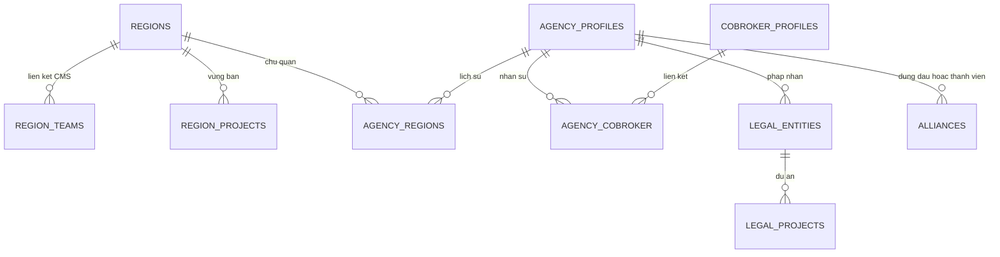

ERD mô tả các aggregate và quan hệ nghiệp vụ. LEGAL_ENTITIES biểu diễn aggregate pháp nhân; mapping bảng vật lý thuộc L3-DATA. Thành viên liên minh được lưu bằng UUID array. Organization scope được kiểm tại agency và resource liên quan; scope vùng được resolve qua CMS và quan hệ vùng.

### 7.1.1 Ràng buộc thời gian và concurrency

Khoảng hiệu lực inclusive: hai khoảng chồng nhau khi start1 ≤ end2 và start2 ≤ end1; null end là vô hạn. Chủ quản đóng D−1 trước khi mở tại D. Các mapping dùng khóa bản ghi cha rồi kiểm overlap trong service/repository. Các mapping sử dụng B-tree index kết hợp khóa cha và overlap query trong migrations 0087/0088/0090. Mọi mutation quan hệ phải đi qua service để duy trì invariant thời gian.

Liên minh khóa agency theo thứ tự ID để giảm deadlock. Import hạng sử dụng snapshot version và optimistic lock; hết hạn preview hoặc version thay đổi yêu cầu preview lại. Transaction commit toàn bộ danh sách hoặc rollback toàn bộ.

## 7.2 Dữ liệu ranking

### 7.2.1 Mô hình dữ liệu

| Bảng/nhóm | Trách nhiệm |
| --- | --- |
| `users`, `organization_units` | Projection nhân sự/đơn vị |
| `transactions` | Dữ kiện giao dịch nguồn, eligibility riêng ranking/cycle |
| `sale_ranking_configs`, `sale_ranking_config_details` | Cấu hình kỳ và các nhóm áp dụng |
| `sale_ranking_month_buckets` | Slot doanh số/số lượng theo ngày trong tháng |
| `sale_ranking_grouping_buckets` | Tổng hợp QUARTER |
| `sale_ranking_aggregation_runs`, `sale_ranking_aggregation_batches` | Tiến độ và trạng thái tổng hợp |
| `sale_ranking_cycle_runs`, `sale_ranking_results` | Lượt xếp hạng, kết quả từng Sale |
| `sale_ranking_bucket_snapshots`, `sale_ranking_transaction_reconciles` | Mốc dữ liệu và hiệu chỉnh |
| `historical_events`, outbox | Lịch sử/công việc tích hợp |

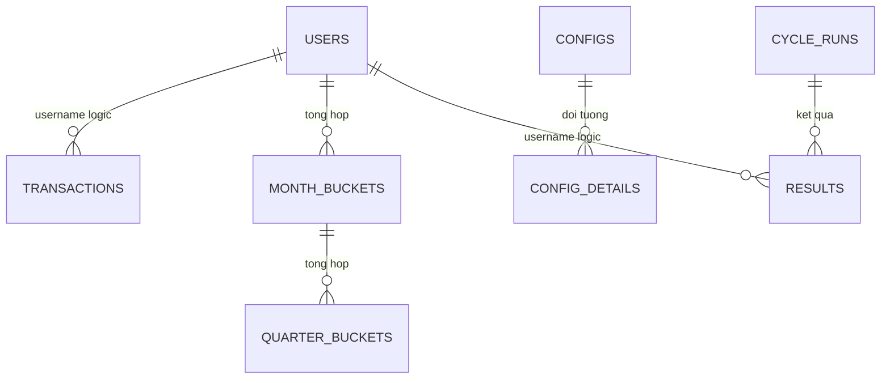

Sơ đồ mô tả quan hệ logic giữa các aggregate; khóa ngoại và index vật lý được quản lý trong Liquibase. Tên rút gọn tương ứng bảng ở trên.

### 7.2.2 Dữ liệu cá nhân và sở hữu

Analytics lưu họ tên, định danh, điện thoại/email và tổ chức phục vụ báo cáo; không là nguồn chỉnh sửa hồ sơ. Hạn chế log các trường này, kiểm soát export và file chứng nhận. Retention được phân loại riêng cho projection, báo cáo, chứng nhận và audit theo mục 7.6.

## 7.3 Dữ liệu Watchlist

| Bảng | Trách nhiệm / thuộc tính |
| --- | --- |
| `sale_control` | UUIDv7, mã CB/HC, type/status/source/publicStatus, CCCD/mã nhân viên, mảng phones/usernames, snapshot accounts, đơn vị, effective_date, content, attributes, version, lý do gỡ |
| `import_job`, `import_item` | File ref, staging từng dòng, lỗi, tiến độ confirm/apply và thời hạn |
| `scan_run` | Loại quét, dry-run, số ứng viên, mẫu số, ratio, trạng thái/kết quả |
| `outbox_message` | PROFILE_SALE_CONTROLS và HISTORY_EVENT, retry/lease/outcome |

History nghiệp vụ được phát sang BI qua Kafka và đọc qua query runner. Watchlist lưu domain state và outbox để theo dõi delivery. CCCD/mã nhân viên BANNED có unique xuyên trạng thái; phone là array và khóa định danh, không có cùng unique constraint đơn giản như CCCD.

Import đi qua PENDING/PROCESSING/VALIDATED/APPLYING/APPLIED hoặc FAILED/EXPIRED theo job. Các dòng phải giữ lỗi và kết quả áp dụng để caller phân biệt validate thành công với đã có tác động nghiệp vụ. Staging hết hạn sau 24 giờ; giới hạn xử lý 20.000 dòng được quản lý tại DEC-02 cùng quyền hiển thị/export dữ liệu.

## 7.4 Dữ liệu chu kỳ bán hàng

### 7.4.1 Mô hình

| Bảng | Dữ liệu chính |
| --- | --- |
| `users` | username, tổ chức/role/status, `sales_start_date`, version nguồn |
| `transactions` | PIC, deposit/contract date, eligibility và lý do loại |
| `sales_cycle_configs` | audience, effective date, mode, tháng/target, reminder |
| `sales_cycle_results` | Một kết quả theo Sale, calculation status/reason, classification, roomExcluded, applied start |
| `sales_cycle_periods` | Các kỳ có số thứ tự, type, start/scheduled end/actual end, target/count/achieved date, config snapshot |
| `sales_cycle_notifications` | Lịch, trạng thái, lease/thử gửi và tham chiếu kỳ |
| `background_jobs` | Lease và checkpoint của công việc nền |
| Outbox | Sự kiện thay đổi dữ liệu; không thay thế bảng lịch thông báo |

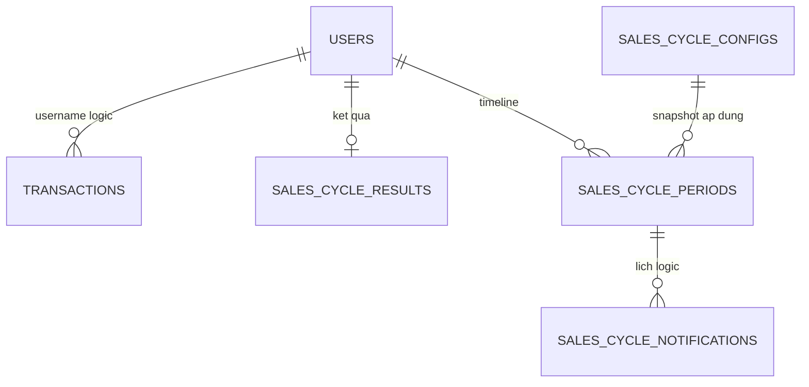

ERD biểu diễn quan hệ logic; snapshot trong kỳ lưu thông số cấu hình đã áp dụng. Khóa và index vật lý được quản lý trong L3-DATA.

### 7.4.2 Hiển thị và dữ liệu thiếu

Đang chính thức: hiển thị kỳ chính thức hiện tại, cột thử thách trống. Đang thử thách: hiển thị chính thức liền trước + thử thách hiện tại. Terminal: hiển thị cặp kỳ cuối.

Query có trạng thái stale khi ngày bán và kết quả áp dụng chưa khớp. BLOCKED có thể giữ lịch sử cũ để đối soát; consumer không được coi lịch sử giữ lại là quyết định mới còn hợp lệ.

### 7.4.3 PII và lưu giữ

Thông tin liên hệ/định danh chỉ phục vụ người có quyền báo cáo. Export chứa dữ liệu cá nhân cần audit truy cập và quản lý file. Kỳ, lịch và receipt gửi thuộc các nhóm retention riêng; audit export lưu actor, thời điểm và phạm vi dữ liệu theo mục 7.6.

## 7.5 Data Flow và dữ liệu cá nhân

| Dữ liệu | Nguồn chuẩn → bản sao/đích | Kiểm soát |
| --- | --- | --- |
| Nhân sự, role, đơn vị | Profile → Core/Analytics/Watchlist theo contract | Source version, đối soát thiếu user; không sửa projection như nguồn chuẩn |
| Giao dịch | Pipeline → Analytics → facts cho các nghiệp vụ | Ngày cọc khác ngày hợp đồng; eligibility riêng; correction/replay |
| Chủ quản/vùng bán | Core mapping và scope dự án → API tiêu thụ | Theo ngày hiệu lực, không suy ngược chủ quản từ dự án |
| Định danh/media | Người dùng → File/OCR/eKYC → kết quả Core | Private refs, source/resource authorization, URL ngắn hạn |
| Cấm/hạn chế | Watchlist → Profile/caller check/market | Outbox lag, tập kiểm soát hiện hành, công khai đúng trạng thái |
| Chu kỳ/hạn mức | Analytics result → consumer | BLOCKED/null không được chuyển thành đủ điều kiện |

CCCD, điện thoại, email, giấy tờ, selfie/video và nội dung vi phạm cần kiểm soát theo mục đích truy cập. Không log raw request/response, signed URL hoặc credential. Xóa media không mặc định xóa lịch sử quyết định; giữ lịch sử không đồng nghĩa cho phép giữ media vô thời hạn.

## 7.6 Retention, Consent & Ownership

| Nhóm dữ liệu | Chủ sở hữu | Quy tắc quản lý |
| --- | --- | --- |
| Hồ sơ, CCCD, liên hệ, hợp đồng | Core/Data Owner | Giới hạn mục đích, quyền truy cập và thời hạn lưu theo loại hồ sơ |
| Media và kết quả OCR/eKYC | OCR/eKYC/Data Owner | Private storage; mã hóa result/audit; xóa theo request/session và chính sách dữ liệu |
| Facts/projection và kết quả ranking/cycle | Analytics/Data Owner | Giữ dữ liệu đủ cho đối soát và tái dựng; purge theo kỳ và quan hệ phụ thuộc |
| Sale control và lịch sử quyết định | Watchlist/Data Owner | Bảo toàn lịch sử áp dụng/gỡ; công khai tuân theo status và quyền |
| Quan hệ vùng/đại lý/pháp nhân | Core/Data Owner | Lưu lịch sử hiệu lực phục vụ kiểm toán; thay đổi bằng nghiệp vụ có audit |
| File import/export/chứng nhận | Service tạo file | File riêng tư, download có thời hạn, audit và cleanup |

SEC-01 quản lý lịch retention, legal hold, quyền xóa và kiểm soát mã hóa theo nhóm dữ liệu. Purge phải xử lý cả record, object và bản sao được quản lý, đồng thời giữ audit tối thiểu của thao tác. Chính sách dữ liệu được phê duyệt tại Data production gate trước vận hành dữ liệu thật.

# 8. Luồng nghiệp vụ chi tiết

## 8.1 Tổng hợp luồng

| ID | Luồng | Điểm commit / kết quả |
| --- | --- | --- |
| CB-01 | OCR/eKYC và onboarding | Kết quả đối soát → hồ sơ nộp/duyệt theo nghiệp vụ |
| CB-02 | Yêu cầu cập nhật hồ sơ | Snapshot → duyệt → hồ sơ live; terminal không sửa tiếp |
| RANK-01 | Tổng hợp/tính hạng quý | Run/batch hoàn tất, công bố results |
| WL-01 | Tạo/gỡ/công khai | Sale control + outbox; side effect theo dõi riêng |
| WL-02 | Import/quét tự động | Validate/dry-run trước áp dụng, ratio guard |
| CYCLE-01 | Tính lại kỳ/lịch | Transaction từng Sale, result + periods + lịch |
| REGION-01 | Gán/chuyển quan hệ | Hiệu lực, overlap, lịch sử trong transaction |
| REGION-02 | Import hạng đại lý | Preview → kiểm version → commit toàn bộ |

## 8.2 OCR/eKYC và phê duyệt hồ sơ

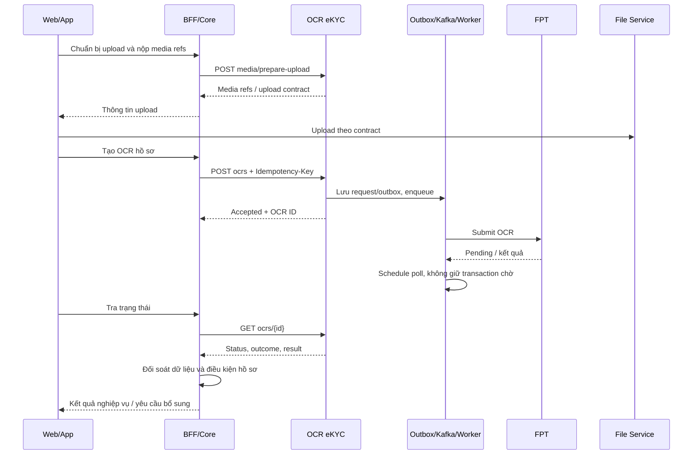

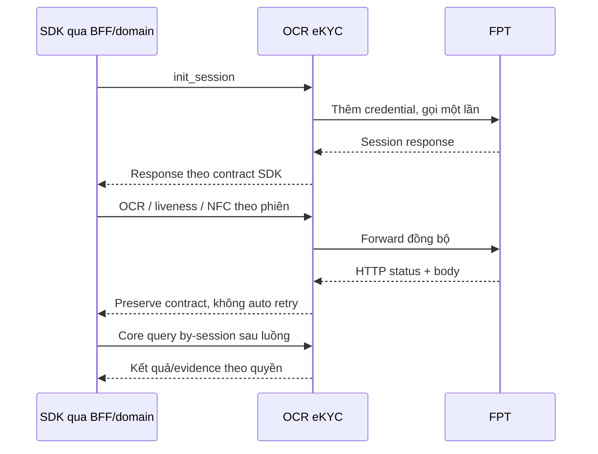

eKYC không đi qua Kafka OCR worker. Evidence có thể hoàn tất sau response SDK; Core phải xử lý trạng thái thiếu/chưa có media mà không tự tạo kết quả xác minh thành công.

### 8.2.1 Yêu cầu cập nhật hồ sơ

ARM tạo yêu cầu và snapshot → ASA chỉnh nháp → gửi duyệt → ARM xem diff và xử lý. Duyệt thành công mới áp dữ liệu hợp lệ lên hồ sơ live; phản hồi mở lại chỉnh sửa; từ chối/hủy/hết hạn kết thúc yêu cầu. Thao tác cạnh tranh với job hết hạn hoặc reviewer khác phải kiểm trạng thái/version trước commit. Email/history ngoài DB không được dùng làm điều kiện xác định hồ sơ đã commit.

## 8.3 Xếp hạng Sale

### 8.3.1 Tổng hợp và xếp hạng cuối quý

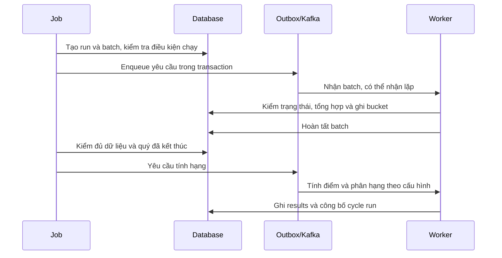

Sweeper xử lý công việc treo/phát lại theo trạng thái DB. Không cộng thêm doanh thu chỉ vì nhận lại cùng message.

### 8.3.2 Tra cứu và xuất

BFF xác thực → analytics kiểm actor/role → resolve scope → giao scope với bộ lọc → truy vấn có phân trang → trả số liệu và trạng thái kỳ. Export giữ cùng tiêu chí và bỏ phân trang UI, áp giới hạn riêng. Bộ phận hiển thị lấy từ projection tổ chức hiện hành. Hạng/doanh số được đọc theo kỳ công bố; hai chiều thời gian này được tách rõ trong contract báo cáo.

### 8.3.3 Ma trận lỗi

| Tình huống | Xử lý |
| --- | --- |
| Thiếu config cho nhóm | Không gán hạng giả; trả trạng thái/remark và cảnh báo |
| Giao dịch thiếu tiền/ngày | Gắn lý do loại; đối soát nguồn |
| Message lặp hoặc batch cũ | Kiểm trạng thái/lease; tránh ghi lặp |
| Nguồn đến muộn | Reconcile theo chính sách source; quan sát kết quả công bố |
| Không có scope | Từ chối, không fallback toàn hệ thống |
| Chứng nhận đang xử lý hoặc render lỗi | Trả trạng thái tương ứng; chỉ cấp URL khi file sẵn sàng và actor có quyền |

## 8.4 Watchlist: ghi nhận, đồng bộ, import và scan

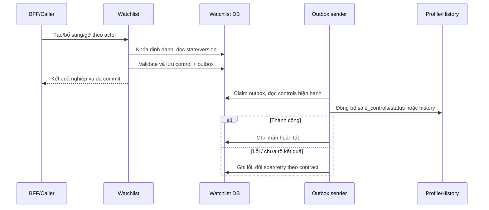

Identity locks được lấy theo thứ tự ổn định để serialize các yêu cầu trùng CCCD/mã nhân viên/phone. Version cũ trả xung đột; không silently overwrite. Sender đọc dữ liệu hiện hành để tránh outbox DISABLE cũ khóa lại người đã được gỡ nếu không còn kiểm soát chặn.

Import: lấy mẫu → prepare-upload → upload file → tạo job bằng file ref → validate từng dòng → xem lỗi → confirm → apply và xem kết quả. Không dùng trạng thái VALIDATED để báo “đã cấm bán”. File XLSX tối đa 10 MB; giới hạn dòng và chính sách dữ liệu theo DEC-02.

Scan: khóa chạy → lấy facts theo cursor → xác định mốc và ngưỡng → ghi ứng viên → tính tỷ lệ → nếu bất thường thì hủy ứng viên, không phát hành → nếu dry-run chỉ báo cáo → nếu thực thi mới ACTIVE và outbox. Bản ghi gracePending được bỏ qua lượt đầu và xóa cờ, lượt sau đánh giá lại. INT-01 phải đạt contract test và đối soát dry-run trước khi bật quét thực thi.

## 8.5 Chu kỳ bán hàng và lịch thông báo

### 8.5.1 Tính lại một Sale

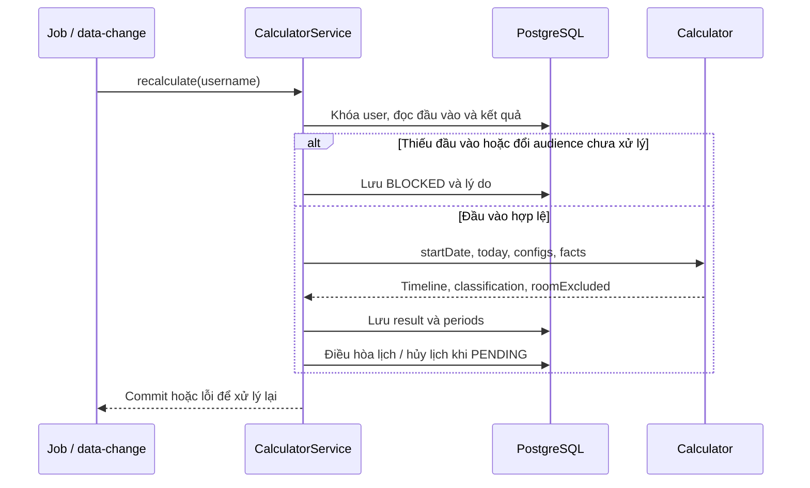

### 8.5.2 Trạng thái nghiệp vụ

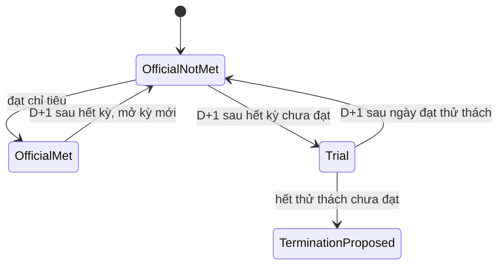

Sơ đồ mô tả diễn tiến khi nguồn không đổi; tái tính do sửa/hủy giao dịch hoặc ngày bắt đầu bán có thể dựng lại toàn timeline, không phải thao tác chuyển trạng thái tuyến tính.

### 8.5.3 Lịch thông báo

Nhắc trước x ngày: ngày gửi không trước đầu kỳ; x vượt độ dài kỳ thì nhắc ngày đầu. Kết thúc: gửi ngày sau kết thúc vào giờ cấu hình. Đạt chỉ tiêu thì ngừng nhắc; lịch trùng cùng kỳ/loại/thời điểm được gộp.

Job chuẩn bị bằng dữ liệu mới dưới khóa, gửi ngoài transaction rồi ghi kết quả. BLOCKED giữ lịch nhưng tạm không gửi và không tăng số lần thử; PENDING do ngày bán tương lai hủy lịch không còn phù hợp. Chỉ bù trong ngày; không tự gửi thông báo quá hạn ngày trước.

Nếu kênh đã nhận nhưng ghi receipt thất bại, công việc chuyển UNKNOWN theo cơ chế lease để đối soát. Retry sử dụng notification ID ổn định; kênh đích phải hỗ trợ dedup hoặc truy vấn receipt trước khi gửi lại.

### 8.5.4 Ca biên

| Ca | Expected |
| --- | --- |
| Đúng ngày cuối kỳ | Kỳ còn được tính đến hết ngày |
| Thử thách đạt D | D vẫn thử thách; D+1 chính thức |
| Có 1/2 GD lúc thử thách hết hạn | Đề xuất chấm dứt |
| GD ký trong kỳ nhưng đến muộn | Tính lại theo ngày ký, có thể sửa kết quả cũ |
| GD ký sau terminal | Không tự mở lại |
| Thiếu config ở giữa timeline | BLOCKED, không tự chọn cấu hình tương lai |
| Sale inactive | Chu kỳ tiếp tục chạy |
| Reset tại D | Kỳ cũ hết D−1, không có GD của D trong kỳ cũ |

## 8.6 Vùng, chủ quản, liên minh và pháp nhân

### 8.6.1 Gán dự án cho vùng

1. Đọc danh mục dự án/CMS và kiểm actor; nhận vùng, dự án, giai đoạn, ngày hiệu lực, quyết định.
2. Kiểm vùng ACTIVE có SELLER; ngày kết thúc không trước bắt đầu; file quyết định đúng contract.
3. Khóa quan hệ cha, kiểm overlap từng cặp trong batch và dữ liệu hiện có.
4. Tạo N bản ghi vùng × dự án và lịch sử trong transaction; một phần tử sai thì không lưu một phần batch.
5. API đọc vùng bán suy theo mapping mới; consumer cập nhật scope/cache theo contract; UI đọc lại dữ liệu sau mutation và tại mốc thay đổi hiệu lực.

### 8.6.2 Chuyển vùng chủ quản

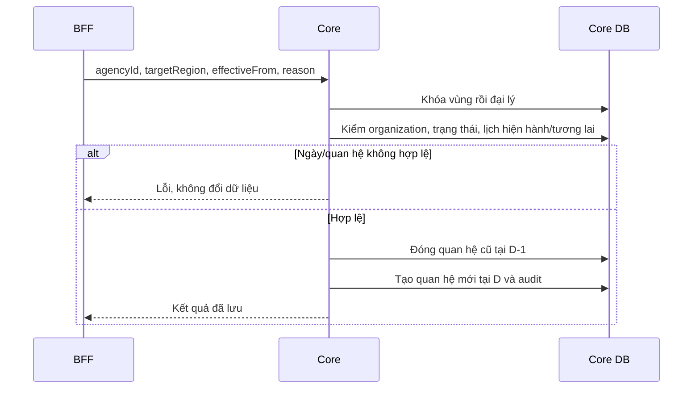

Chuyển chủ quản không thay tập dự án/vùng bán. Chuyển có hiệu lực tương lai không làm API “chủ quản hiện tại” trả vùng mới trước ngày D.

### 8.6.3 Liên minh / pháp nhân

Liên minh khóa các đại lý theo ID, kiểm đại lý hoạt động và quyền trên đại lý đứng đầu, dự án hợp lệ, số thành viên, trùng tham gia cùng dự án; sau đó lưu. Kích hoạt lại phải kiểm lại membership, không chỉ đổi status. Việc đại lý đứng đầu mất phân dự án cần hiển thị/đối soát theo contract, không tự cấp lại quyền bán vì tồn tại liên minh.

Pháp nhân khóa resource và kiểm ASA được phân công/organization; kiểm dự án thuộc tập dự án đại lý; kiểm ngày và overlap; lưu mapping hoặc kết thúc hiệu lực. Lịch sử được giữ cho đối soát.

### 8.6.4 Import hạng đại lý

Upload XLSX → parse/validate A/B/C và độc quyền → lưu preview Redis gắn actor/organization/version → hiển thị lỗi → confirm còn hạn → đọc và đối chiếu snapshot → cập nhật với optimistic version → commit toàn bộ. Xung đột 409 hoặc mất preview yêu cầu upload/preview lại; không tự cập nhật trên snapshot mới mà chưa cho người dùng xem.

## 8.7 Ma trận xử lý lỗi chung

| Tình huống | Hành vi / phục hồi |
| --- | --- |
| OCR/eKYC timeout mutation | Không tự submit lại; giữ outcome chưa xác định và đối soát |
| OCR completed với provider error | Trả outcome/error; không duyệt hồ sơ từ status |
| Profile/history lỗi sau commit Watchlist | Giữ outbox để xử lý; hiển thị/truy vết độ trễ side effect |
| Thiếu ngày bán/config chu kỳ | BLOCKED có lý do; không coi là không đạt hoặc đủ điều kiện |
| Scan tỷ lệ bất thường / dry-run | Không phát lệnh khóa hàng loạt |
| Overlap vùng/pháp nhân | Từ chối toàn bộ thao tác/batch liên quan |
| Version hồ sơ/import thay đổi | Conflict, yêu cầu đọc/preview lại |
| Mapping/nguồn ngoài không khả dụng | Không tạo dữ liệu thay thế giả; trả lỗi phù hợp và cho thử lại thao tác an toàn |
| Actor không có scope | Từ chối hoặc tập rỗng theo contract; không mở toàn hệ thống |

# 9. Security & Compliance Architecture

## 9.1 Identity & Authentication

BFF xác thực end-user và truyền actor context qua caller nội bộ được tin cậy. Core có gate `hasRole('BFF')` trên các controller liên quan; Analytics dùng security nội bộ và header actor; Watchlist tách Internal/Check/Market. Basic/S2S credential phải dùng trên transport bảo mật, không gửi xuống FE hoặc ghi log.

BFF phải bỏ header actor/scope do FE tự gửi rồi dựng context theo principal đã xác thực. Caller được xác thực không đồng nghĩa người dùng cuối có quyền trên mọi resource. Các API vận hành, import confirm, reveal và retry outbox cần quyền riêng.

## 9.2 Authorization & Access Control

Quyền được đánh giá theo ba lớp: service principal → quyền chức năng của actor → phạm vi resource. Mọi API trả dữ liệu hoặc tạo tác động phải vượt cả ba lớp. Header actor và bộ lọc FE không tự cấp quyền.

| Nhóm resource/action | Quyền và phạm vi thiết kế | Enforcement / tiêu chí nghiệm thu |
| --- | --- | --- |
| Hồ sơ, đại lý, yêu cầu cập nhật | Actor thuộc organization và có quyền trên đại lý/yêu cầu; snapshot theo requestId | Core kiểm ownership và trạng thái trước đọc/ghi; test cross-organization và live/snapshot |
| Ranking list/detail | 11/100 toàn phạm vi; 60 vùng, 23 phòng, 20 nhóm; 21 đơn vị thấp nhất; 64 danh sách đại lý được cấp | Resolver giao scope với bộ lọc; scope rỗng không mở toàn hệ thống |
| Ranking config/export | Config 11/100; export theo role được cấp, role21 đơn lẻ không được xuất | Kiểm quyền độc lập với quyền xem; export giữ cùng predicate dữ liệu |
| Chu kỳ list/detail/export | Phạm vi Sale theo tổ chức/đại lý/vùng của actor | BFF cung cấp context tin cậy; INT-05 nghiệm thu cả list và truy cập trực tiếp detail |
| Chu kỳ config | Quyền quản trị cấu hình riêng | Kiểm actor, ngày hiệu lực và expectedUpdatedAt; audit trước/sau |
| Watchlist | Realm Internal/Check/Market tách biệt; reveal/export/công khai là action riêng | Kiểm action và PII policy DEC-02; caller check chỉ nhận dữ liệu phục vụ quyết định |
| Vùng | PCS/Admin theo UC-08; phạm vi quản lý xác định qua CMS | Core/BFF thực thi action matrix; INT-05 bao phủ vùng ngoài phạm vi |
| Import hạng đại lý | ARM roles11/1101 theo contract; preview gắn actor/organization | Confirm kiểm lại quyền và version; mở rộng role theo DEC-06 |
| Liên minh | Đại lý đứng đầu quản lý; thành viên được xem theo quyền | Kiểm organization, membership và trạng thái trước mutation |
| Pháp nhân/dự án | Operator và ASA được phân công trên đại lý | Kiểm agencyId/legalId/projectId trong cùng phạm vi |
| OCR/eKYC/media | Authenticated source và quyền trên request/session/media | Detail, list, raw audit, download và delete cùng tuân resource policy SEC-01 |

Scope đọc của người có nhiều vai trò là hợp các phạm vi hợp lệ; sau đó giao với bộ lọc yêu cầu. Quyền sửa, công khai, xuất hoặc cấu hình được kiểm riêng từng action. Các mã role trong từng hệ thống được ánh xạ tại L3-SEC; thay mapping phải có compatibility test và audit.

## 9.3 PII, Secrets & Threat Model

| Nguy cơ | Kiểm soát thiết kế / tiêu chí kiểm thử |
| --- | --- |
| Giả actor/scope | S2S trusted caller, header sanitization ở BFF, test request trực tiếp |
| IDOR hồ sơ/media/history | Kiểm resource ownership, organization, source và action trước trả dữ liệu |
| Lộ CCCD/phone qua list/export | Policy masking/reveal/export theo DEC-02; audit actor và phạm vi dữ liệu |
| File độc hại hoặc quá lớn | Allowlist loại/size, kiểm parser/upload, private storage, kiểm quyền download |
| Outbox cũ khóa lại tài khoản | Tính lại kiểm soát hiện hành lúc gửi, đối soát trạng thái Profile |
| Retry provider tạo tác động trùng | Idempotency OCR và không auto retry eKYC mutation |
| Lộ credential / raw provider response | Secret manager theo môi trường; redaction; hạn chế raw audit |
| Quyền vùng sai sau thay mapping | Scope server-side theo ngày hiệu lực, kiểm cả read/export và thao tác |

Credential được quản lý theo môi trường, cấp quyền tối thiểu và rotation có kiểm soát. Secret, raw media và signed URL bị loại khỏi log/event. Mã hóa result/audit OCR/eKYC thuộc service OCR/eKYC; kiểm soát dữ liệu các domain còn lại theo L3-SEC và SEC-01. Thay đổi consent, retention hoặc quyền truy cập đặc quyền phải qua Security/Data production gate.

# 10. Deployment & Infrastructure Topology

## 10.1 Environments & Topology

Core, Analytics, Watchlist và OCR/eKYC được triển khai độc lập. Mỗi dịch vụ sở hữu schema, migration, cấu hình và lifecycle phát hành. API/worker sử dụng PostgreSQL, Kafka và Redis theo phụ thuộc domain; ingress/egress được kiểm soát bằng danh sách caller và đích tích hợp. Deployment manifest L3-OPS xác định namespace, image, replica, resource, probe và secret reference cho từng môi trường.

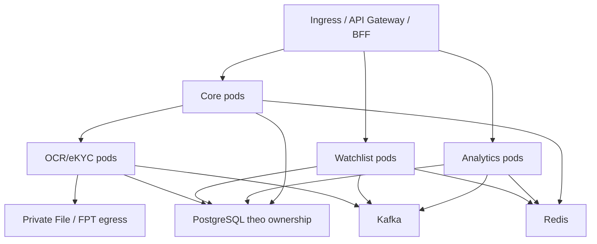

Sơ đồ biểu diễn topology logic. Việc phân bổ database instance, broker và cache theo môi trường được xác định bằng capacity plan và yêu cầu cô lập dữ liệu tại OPS-01.

## 10.2 Configuration & Rollout Controls

| Nhóm | Cấu hình khởi tạo | Điều kiện rollout |
| --- | --- | --- |
| Ranking jobs | SALE_ANALYTICS_JOBS_ENABLED=false; aggregation 02:00 | Kiểm manifest và bật sau import/backfill |
| Kỳ đầu ranking | SALE_RANKING_START_DATE=2026-10-01 | REL-03: cấu hình kỳ đầu Q3/2026 và backfill dữ liệu phục vụ trọng số |
| Cycle | Job 00:00; notification mỗi 30 giây, batch 100 | Lịch chạy độc lập ranking; INT-02 cung cấp ngày bán và dữ liệu đối soát |
| Watchlist scanner | Disabled, dry-run=true; 02:00; batch 500; maxRatio 0,05; minSample 1.000 | INT-01 contract test và dry-run report đạt trước bật thực thi |
| Rank import đại lý | Redis preview 15 phút, 5 MB/1.000 dòng | Kiểm giới hạn gateway và lỗi preview hết hạn |
| Watchlist import | Staging 24 giờ, 20.000 dòng | DEC-02 xác định giới hạn dòng; cleanup theo thời hạn staging |
| OCR/eKYC | Credential FPT server-side, contract SDK/OCR riêng | Xác nhận endpoint/media compatibility và timeout theo service |

## 10.3 Migration & Release Strategy

1. Chốt contract và quyết định mở ảnh hưởng dữ liệu/quyền; pin image, schema và configuration cho từng môi trường.
2. Chạy migration trên bản sao dữ liệu đại diện, kiểm lock/duration/rollback compatibility; không chạy thử destructive migration trên production.
3. Kiểm migrations Core 0086–0090 cho region, project, owner-region, alliance và legal-project. Migration 0086 sử dụng schema `cobroker_db`; release validation phải kiểm schema đích và quyền migration. Các mapping sử dụng khóa cha/overlap query, không phụ thuộc btree_gist.
4. Nhập/đối soát nguồn Profile/Pipeline và quan hệ đại lý/vùng; giữ scanner dry-run, không tạo ngày bán giả để vượt BLOCKED.
5. Triển khai consumer/BFF theo thứ tự tương thích; chạy smoke API và kiểm quyền âm; backfill ranking trước công bố.
6. Bật job/side effect sau kiểm dữ liệu và quan sát backlog; nghiệm thu FPT onboarding/duyệt, Profile và history.

Rollback image chỉ khi tương thích schema hiện tại. Không xóa results, periods hoặc outbox để xử lý nhanh; side effect đã gửi Profile/FPT không được rollback chỉ bằng restore DB.

## 10.4 Network & Infrastructure Security

Ingress chỉ nhận caller được cấp; DB/Redis/Kafka đặt trong mạng riêng. Egress giới hạn theo FPT/File/Profile/History và các tích hợp được đăng ký. Credential tách theo môi trường. L3-OPS quy định NetworkPolicy, TLS, backup/PITR, secret injection, probes và requests/limits; OAT kiểm tra thực thi từng kiểm soát trên cấu hình phát hành.

# 11. Cost & Capacity/Performance

## 11.1 Capacity Model

| Năng lực | Biến tải | Giới hạn/điểm đo |
| --- | --- | --- |
| Core | Hồ sơ, media refs, đại lý/Sale, quan hệ vùng/dự án | p95 list/detail, lock wait, file throughput, số mapping hiệu lực |
| Ranking | N Sale × H tháng; T giao dịch; tối đa 4 quý mỗi query | DB bucket/WAL, batch, export 50.000, timeout query 10 giây |
| Chu kỳ | N Sale × số kỳ + facts mỗi Sale | Batch đọc 500, transaction từng Sale; tài khoản lịch sử dài |
| Watchlist | Số bản ghi/định danh, check rps, scan population, import rows | p95 check, khóa định danh, parser memory, scan duration, outbox lag |
| Vùng/liên minh | Số mapping ngày, dự án và membership | EXISTS trước phân trang, batch enrich, lock contention |
| OCR/eKYC | Số tài liệu/phiên, kích thước file, provider latency | Queue lag, thời gian hoàn tất, concurrency và chi phí provider |

Capacity test sử dụng dữ liệu nhiều năm và chạy đồng thời query, export/import, job cùng cập nhật hồ sơ trên nhiều pod. Đo riêng tài khoản có timeline dài, thời gian giữ khóa và memory khi xuất file. Batch 500 giới hạn số Sale mỗi lượt đọc; preview 15 phút giới hạn thời gian xác nhận thao tác.

## 11.2 Cost Model

Chi phí gồm compute API/worker, PostgreSQL data/index/WAL/backup, Redis, Kafka retention, file storage/egress, observability và phí FPT. Chứng nhận ảnh phát sinh storage/render khi US-05/06 được triển khai. Dự toán được tính từ population, peak traffic, retention và đơn giá môi trường trong capacity report OPS-01; báo cáo ghi chi phí cố định, chi phí biến đổi và dự phòng tăng trưởng.

Capacity report bao gồm N/T theo tháng, tăng trưởng, kích thước file, tỷ lệ retry, lịch sử lưu giữ, cửa sổ batch, peak traffic và ngân sách SRE/FinOps. Kết quả đo là căn cứ chọn replica, partition, DB pool và giới hạn job đồng thời.

# 12. Scalability & Reliability

## 12.1 Scaling Strategy

Scale API theo tải request; worker theo partition, provider quota và khả năng DB. Phân trang/query lọc trước khi tải dữ liệu; tránh N+1 trong enrich vùng/đại lý. Tăng số pod không thay thế kiểm soát khóa/idempotency hoặc tự làm job chạy nhanh hơn.

Ranking dùng Redis/ShedLock kết hợp run/batch DB; cycle dùng background job lease/checkpoint và khóa user; Watchlist scanner dùng Redisson và scan_run. Lease hết hoặc nhận lặp phải kiểm state/version ở DB trước tạo side effect.

## 12.2 Failure & Recovery Boundaries

| Sự cố | Thiết kế phục hồi / giới hạn |
| --- | --- |
| Kafka/outbox gián đoạn | Domain đã commit, side effect chờ; theo dõi oldest pending và retry đúng channel |
| Ranking worker chết | Sweeper/run state kiểm batch treo; không cộng lại doanh số vì message phát lặp |
| Cycle một Sale lỗi | Transaction Sale đó rollback; các Sale khác có thể chạy, checkpoint không vượt lỗi đầu tiên |
| Notification gửi rồi ghi trạng thái lỗi | UNKNOWN để đối soát receipt; chỉ retry với notification ID và cơ chế dedup của kênh |
| Scan facts thiếu/sai | Không dùng dữ liệu thiếu để khóa hàng loạt; dry-run/ratio guard không thay chất lượng facts |
| Redis mất preview | Import hạng yêu cầu preview lại; không confirm từ dữ liệu client tự gửi |
| FPT timeout mutation | Không auto retry; theo runbook OCR/eKYC về UNKNOWN/reconcile |
| Concurrent transfer/membership | Khóa cha/thứ tự khóa, kiểm overlap và version; không bypass bằng SQL |

## 12.3 Backup & Restore

Backup/PITR phải bao gồm facts/config/results/periods/notifications và outbox tương ứng. Sau restore cần đối soát những event đã phát hoặc side effect đã tới Profile/FPT; tránh phát lại mù toàn bộ. File/media backup và DB reference phải đồng bộ về khả năng truy cập. RTO, RPO và retention backup được đăng ký theo lớp dịch vụ tại OPS-01; biên bản diễn tập ghi thời gian khôi phục thực tế, điểm dữ liệu phục hồi và kết quả đối soát.

# 13. Observability & Monitoring

## 13.1 Signals & Dashboard

| Nhóm | Chỉ số bắt buộc | Chiều phân tích |
| --- | --- | --- |
| API | Request rate, p95/p99, 4xx/5xx, timeout, auth deny | Service, route, method, outcome |
| Ranking | Data lag, aggregation oldest pending, reconciles failed, orphan usernames | Run/batch/quarter qua log; metric labels hữu hạn |
| Chu kỳ | COMPLETED/PENDING/BLOCKED theo reason, stale, lease/checkpoint, notification status | Audience, job type, reason và delivery outcome |
| Watchlist | Outbox oldest/failed, Profile sync lag, scan candidates/ratio/abort, import failures | Channel, scan type, dry-run, outcome |
| Core vùng | Overlap/version conflict, history lag, preview expired, CMS unavailable | Action và loại quan hệ |
| OCR/eKYC | Queue age, provider latency/error/UNKNOWN, processing timeout, evidence pending/dead | Operation, provider outcome, media lifecycle |

Application log liên kết request/job/outbox bằng correlation ID và domain ID. Metric không dùng username, CCCD, session ID hoặc giá trị có cardinality không giới hạn. Dashboard phải cho phép đi từ cảnh báo tới log/trace và runbook tương ứng.

## 13.2 Alert Catalogue

| Điều kiện | Tác động | Xử lý |
| --- | --- | --- |
| Dữ liệu ranking ngày trước không hoàn tất vào mốc kiểm soát 04:00 | Bảng số liệu bị trễ | Kiểm source watermark, run/batch và outbox |
| Batch ranking chờ quá 1 giờ | Pipeline tổng hợp tắc | Kiểm lease, worker, DB và sweeper |
| BLOCKED/stale tăng vượt baseline vận hành | Ngày bán/config/facts không hợp lệ | Phân nhóm reason và đối soát producer |
| Scan abort hoặc tỷ lệ ứng viên vượt guard | Nguy cơ khóa sai diện rộng | Giữ dry-run, kiểm mẫu số/mốc ngày/eligibility |
| Profile/history outbox lỗi hoặc backlog tăng | Side effect chậm hơn quyết định nghiệp vụ | Kiểm dependency và retry theo channel |
| Notification UNKNOWN | Outcome delivery không xác định | Đối soát receipt trước retry |
| Provider timeout hoặc evidence dead | Onboarding bị gián đoạn | Áp runbook OCR/eKYC và correlation theo phiên |

Ngưỡng theo môi trường, thời gian duy trì cảnh báo, mức độ và người trực được quản lý tại L3-OPS. Mỗi cảnh báo phải có owner và đường dẫn runbook trước go-live.

## 13.3 SLI/SLO

SLI đo riêng API availability, data freshness, job completion, side-effect delivery và notification delivery. LOGGED được loại khỏi số lượng thông báo gửi thành công. OCR COMPLETED được tách theo outcome; tỷ lệ xác minh danh tính đạt là chỉ số nghiệp vụ riêng.

OPS-01 xác định cửa sổ đo, target và error budget cho từng SLI dựa trên capacity test và yêu cầu vận hành. Dashboard sử dụng cùng định nghĩa với báo cáo nghiệm thu.

# 14. Operational Readiness

## 14.1 Runbook Register

| Sự cố / thao tác | Bước chẩn đoán và phục hồi | Owner |
| --- | --- | --- |
| Onboarding thiếu kết quả/media | Kiểm Core referenceId/session, OCR outcome, evidence pending và quyền; không tự gọi lại mutation | Core + OCR/eKYC |
| Yêu cầu cập nhật kẹt | Kiểm state, assignee, hạn, version và snapshot/live; xử lý qua nghiệp vụ | Core |
| Ranking lệch doanh số | Đối soát eligibility, tiền/scale, contractDate, run/bucket/reconcile; chỉ backfill có phạm vi | Analytics |
| Chu kỳ BLOCKED/stale | Kiểm ngày bán/audience/config/facts/version; tính lại sau sửa nguồn | Analytics + Profile |
| Lịch thông báo UNKNOWN | Đối soát receipt kênh trước retry; giữ notification ID để dedup | Analytics + Notification |
| Watchlist đã gỡ nhưng Profile chưa đúng | Kiểm controls hiện hành, outbox, action và Profile; preview sync trước chạy | Watchlist + Profile |
| Scan abort | Kiểm facts/mẫu số/mốc ngày/ratio, chạy dry-run; không nới guard chỉ để hết lỗi | Watchlist |
| Import hạng conflict | Đọc thay đổi hồ sơ, preview lại và confirm; không override version | Core |
| Vùng sai phạm vi | Kiểm CMS team, ngày mapping, scope dự án Sale và actor; không sửa vùng chủ quản để chữa vùng bán | Core + BFF |
| Restore | Restore domain data/outbox, đối soát side effect, chạy mẫu E2E trước mở lại | SRE/DBA + owners |

## 14.2 Readiness Checklist

- Có owner, release ticket, image/commit và cấu hình của từng service.
- Các quyết định nghiệp vụ/quyền tại mục 16 có người chịu trách nhiệm và trạng thái.
- Contract facts, ngày bán, notification, scope vùng được nghiệm thu trước bật tính năng phụ thuộc.
- Migration/backfill/preview được kiểm trên dữ liệu đại diện; có kế hoạch xử lý dữ liệu cũ thiếu vùng/Miền.
- Scanner chạy dry-run được đối soát; không bật thực thi khi chưa có nguồn tin cậy.
- Dashboard, alert, quyền vận hành, runbook và contact trực đã kiểm.
- RTO/RPO và restore drill được duyệt; rollback không làm phát lại side effect nguy hiểm.

Go-live record ghi kết quả từng tiêu chí, reviewer và evidence của môi trường phát hành. Hạng mục được miễn phải có risk acceptance, biện pháp bù và ngày hết hạn.

# 15. Testing & Quality Strategy

## 15.1 Test Matrix

| Phạm vi | Ca kiểm thử bắt buộc |
| --- | --- |
| Onboarding/FPT | Upload thiếu/sai media; OCR accepted/poll; completed error; key trùng giống/khác fingerprint; SDK timeout không retry; source/session ngoài quyền; evidence đến muộn |
| Hồ sơ cập nhật | Nháp không sửa live; approve/feedback/reject/cancel/expiry; reviewer cạnh tranh; không đổi hạng/trạng thái gián tiếp |
| Ranking tiền/eligibility | contractDate vs depositDate; hủy vẫn tính ranking; thiếu VAT/KPBT; precision/overflow; so điểm không làm tròn |
| Ranking tier | Đúng minScore, quota, hòa điểm ranh giới, dồn hạng, config thiếu; Q4→Q1, Q3/2026, quý hiện tại |
| Ranking API | Tối đa 4 quý, export cắt có thông báo, role21, scope rỗng, agency scope giả, detail ngoài quyền |
| Badge/chứng nhận | Đổi quý, không có hạng, tên có dấu/dài, File Service lỗi, tải ảnh cá nhân; chỉ chạy khi có implementation |
| Watchlist | Định danh chuẩn hóa/trùng; bổ sung/reapply; create/release cùng lúc; account subset; trạng thái công khai; reveal/export quyền âm |
| Watchlist outbox | Release trước sender; nhiều controls cùng tài khoản; retry/Profile lỗi; không tự bật lại do gỡ cấm |
| Watchlist import/scan | File sai/oversize, dòng lỗi/trùng, confirm lặp, hết hạn; dry-run, ratio, grace, ngày cuối tháng, nguồn facts thiếu |
| Cycle calculator | Đạt/chưa đạt, 1/2 GD cuối thử thách, ngày cuối, 29/02, ngày31, nhiều GD cùng ngày đạt |
| Cycle nguồn/config | Late/cancel/đổi PIC/ngày, version cũ, IMMEDIATE/SEQUENTIAL, ngày bán tương lai, đổi audience, thiếu config |
| Cycle job/notice | Nhiều pod, lease mất, checkpoint lỗi đầu, BLOCKED/PENDING, đạt dừng nhắc, lịch trùng, bù trong ngày, crash sau gửi |
| Vùng | CMS trùng/không khả dụng, tên chuẩn hóa, ít nhất một role, stop khi còn lịch tương lai, overlap khác giai đoạn |
| Chủ quản/vùng bán | Chuyển D−1/D, lịch tương lai, hai chuyển đồng thời, không đổi dự án, ASSIGNED khác ADDITIONAL, thu hồi scope |
| Liên minh/pháp nhân | Lead/member quyền, trùng dự án giữa liên minh, kích hoạt lại, giới hạn thành viên, ASA ngoài phạm vi, overlap ngày |
| Import hạng đại lý | A yêu cầu EXCLUSIVE, file/dòng limit, preview expired/khác actor/tổ chức, version conflict rollback toàn bộ |
| UC-07/08 | AND/OR filter trước pagination, count không trùng, union scope đọc, thao tác ngoài quyền vùng |
| Reliability/performance | Replay, DB/Kafka/Redis failover, outbox backlog, load đồng thời import/export/jobs, restore + đối soát |

## 15.2 Quality Gates & Test Evidence

Test specification được tổ chức theo calculator, API, persistence, contract, security và E2E. QA duy trì traceability từ SRS/rule đến test case và kết quả chạy.

| Gate | Điều kiện đạt |
| --- | --- |
| Unit/Persistence | Các rule tiền, ngày, trạng thái, lock/version và transaction có test xác định; toàn bộ test trong phạm vi phát hành pass |
| API/Contract | Schema, validation, error mapping, backward compatibility và consumer contracts pass |
| Security | Test giả actor, ngoài organization/source/scope, export/reveal/media trái quyền bị từ chối |
| Integration/UAT | Hoàn tất INT-01…INT-05 và các quyết định DEC ảnh hưởng nghiệp vụ; kết quả nguồn/đích được đối soát |
| Performance/OAT | Workload mục 11 đạt NFR; migration, retry, backup/restore và alert được diễn tập |

Test report ghi commit/image, cấu hình, dữ liệu, môi trường, thời điểm và kết quả thực thi. Lỗi còn tồn tại phải có mức độ, tác động và quyết định release; report được gắn vào workflow nghiệm thu của phiên bản phát hành.

## 15.3 Test Data & Acceptance

Dùng dữ liệu giả, không đưa CCCD/ảnh/video/credential/signed URL thật vào fixture hoặc report. Tập dữ liệu phải bao gồm ngày cuối tháng, nhiều quý, lịch tương lai, nhiều kiểm soát một tài khoản và user đa role/đa vùng. Contract tests xác minh cả successful và forbidden/conflict/unknown path, không chỉ HTTP 200.

# 16. Risks & Open Issues

## 16.1 Architecture Risks & Controls

| ID | Rủi ro | Tác động | Biện pháp kiểm soát | Chủ sở hữu |
| --- | --- | --- | --- | --- |
| RISK-01 | Scope tổ chức và scope vùng không đồng nhất | Lộ dữ liệu hoặc thao tác sai đại lý/vùng | Action + resource policy; hợp scope đọc, giao bộ lọc; test quyền âm INT-05 | Core/BFF/Security |
| RISK-02 | Facts thiếu, trễ hoặc thay đổi sau quét | Phân loại/khóa tài khoản sai | Version/watermark; đối soát population; dry-run và ratio guard | Analytics/Watchlist |
| RISK-03 | Side effect chậm hơn transaction nghiệp vụ | Profile/history khác trạng thái domain | Outbox delivery status, dashboard lag và runbook reconcile | Backend/Integration |
| RISK-04 | Retry mutation sau timeout | Tạo tác động trùng tại provider hoặc kênh thông báo | OCR idempotency; không auto retry eKYC; UNKNOWN và receipt reconciliation | OCR/Notification |
| RISK-05 | Cập nhật quan hệ đồng thời hoặc bypass writer | Overlap chủ quản/dự án, trùng membership | Khóa cha theo thứ tự, version, overlap query; giới hạn quyền DB | Core/DBA |
| RISK-06 | Restore DB sau khi side effect đã thực thi | Phát lại lệnh, sai trạng thái bên ngoài | Đối soát source/event/outbox/receipt trước mở lại xử lý | SRE/DBA/Integration |

Risk acceptance phải ghi owner, phạm vi ảnh hưởng, biện pháp bù, ngày hết hạn và điều kiện thu hồi. Rủi ro dữ liệu/quyền được thẩm định tại Security/Data production gate.

## 16.2 Integration & Release Register

Bảng này quản lý công việc chuyển thiết kế thành phiên bản triển khai. Mỗi hạng mục có đầu ra kỹ thuật và điều kiện đóng; trạng thái delivery không thay đổi contract mục tiêu ở các mục trên.

| ID | Hạng mục / hiện trạng triển khai | Đầu ra và điều kiện đóng | Chủ sở hữu / gate |
| --- | --- | --- | --- |
| INT-01 | Sale activity facts: Watchlist có client; Analytics phải bổ sung producer endpoint | OpenAPI cursor/watermark/version và eligibility; replay/page-error tests; đối soát dry-run trước bật scanner | Analytics/Watchlist — Integration |
| INT-02 | Ngày bắt đầu bán: users có cột sales_start_date; UserSyncData thiếu mapping | Bổ sung contract Profile, source version, backfill và tính lại; nghiệm thu thay đổi ngày/late event | Profile/Analytics — Integration/UAT |
| INT-03 | Thông báo chu kỳ: adapter hiện trả LOGGED | Adapter Web/App, notification ID, receipt/dedup; nghiệm thu timeout/crash-after-send; quy tắc chuyển lịch LOGGED | Analytics/Notification — Integration/UAT |
| INT-04 | Badge/chứng nhận: triển khai pipeline US-05/06 | API self-access, template version, resolve/render, private file; test đổi quý, tên tiếng Việt và lỗi render | Analytics/BFF — Integration/UAT |
| INT-05 | Phạm vi vùng và điểm chặn liên dịch vụ | Mapping CMS/Core/Analytics; action/resource matrix; E2E list/detail/export, revoke session và checks tại từng mutation | Core/BFF/Profile/Security — Security/UAT |
| REL-01 | Core còn call site media legacy GET /v1/media/{id} | Chuyển sang prepare-download/detail được cấp quyền; test màn quản trị và source isolation | Core/OCR — Integration |
| REL-02 | Caller tạo đại lý cũ cho thiếu region/area | Backfill, nâng contract caller, xác định cutover và bật validation bắt buộc; đo số hồ sơ còn thiếu | Core/BFF — Migration/UAT |
| REL-03 | Default ranking start-date là 01/10/2026; SRS bắt đầu Q3/2026 | Cấu hình kỳ đầu theo SRS, backfill dữ liệu trọng số và đối soát trước công bố | Analytics — Migration/UAT |
| OPS-01 | Capacity, SLO, RTO/RPO và deployment profile | Capacity/cost report, target theo SLI, manifest versioned, dashboard/runbook và restore drill | SRE/DBA — OAT |
| SEC-01 | Retention, PII và source/resource policy | Retention schedule, encryption/access matrix, purge/hold rules; test list/raw audit/media theo source | Data Owner/Security — Data production |

## 16.3 Business Decision Register

Các quyết định dưới đây ảnh hưởng hành vi sản phẩm hoặc compatibility. Phương án kỹ thuật được trình rõ để BO/BA phê duyệt tại Business gate; implementation phải bám quyết định được ghi nhận.

| ID | Quyết định và căn cứ | Phương án trình duyệt | Tác động / tiêu chí đóng | Chủ sở hữu |
| --- | --- | --- | --- | --- |
| DEC-01 | SRS BR-03 chỉ cấm trùng ACTIVE; persistence BANNED unique xuyên trạng thái | Giữ một hồ sơ định danh xuyên vòng đời, dùng supplement/reapply và lưu lịch sử từng lần | BO xác nhận UX/API; nếu cho tạo hồ sơ mới phải đổi unique và migration trước release | BO/Watchlist |
| DEC-02 | BR-17 yêu cầu full PII list/export; service che dữ liệu và tách reveal. Import giới hạn 20.000 dòng | Kiểm full PII theo quyền riêng và audit; giữ giới hạn xử lý file có thông báo rõ | Ma trận role/action, export policy, giới hạn file/dòng được ghi vào SRS và L3-API | BO/Security/Watchlist |
| DEC-03 | Hạn chế bán: mốc fallback Đại lý, lượt khóa sau grace và xử lý GD trong thời gian cấm | Ưu tiên lastValidDepositDate, sau đó firstActivatedAt; xác định riêng fallback, grace effective date và eligibility | Decision table bao phủ thiếu ngày, ngày biên, lượt quét và giao dịch bị hủy; QA lấy cùng expected | BO/Integration |
| DEC-04 | Chu kỳ: ưu tiên IMMEDIATE so với terminal và chuyển audience | Giữ terminal cho tới quyết định mở lại; audience change đưa BLOCKED để bảo toàn lịch sử | BO xác định ngày hiệu lực, chính sách giữ/reset kỳ và thông báo; calculator tests cập nhật đồng bộ | BO/Analytics |
| DEC-05 | Vùng INACTIVE: SRS khóa sửa; service cho hiệu chỉnh CMS links | Cho phép ngoại lệ hiệu chỉnh CMS để khôi phục liên kết hợp lệ; khóa tên/vai trò và audit đầy đủ | BO xác nhận ngoại lệ, actor được cấp và điều kiện kích hoạt lại | BO/Core |
| DEC-06 | Phạm vi tùy chọn và role: ranking mở rộng; rank import 11/1101; count Sale dùng tập trạng thái khác nhau | Công bố ranking theo SRS/ALLOW_TIE; xác định role import và mẫu số từng thống kê; tách bộ lọc dự án thành contract riêng nếu đưa vào phạm vi | Ma trận chức năng/role, metric definition và DTO/OpenAPI được phê duyệt trước UAT | BO/Core/Analytics |

## 16.4 Migration & Compatibility Controls

Tích hợp danh tính chuẩn hóa qua OCR/eKYC FPT; các call site legacy được thay theo REL-01. Hạng đại lý dùng A/B/C; cập nhật hạng qua import có preview/version. Quan hệ vùng/dự án bảo vệ bằng khóa cha và kiểm overlap tại service. Thay đổi schema, quyền hoặc event contract phải có migration, API-diff và consumer compatibility report.

Lịch sử dữ liệu cũ được giữ phục vụ đối soát. Cutover không phát lại notification hoặc lệnh Profile hàng loạt; mỗi side effect được xử lý theo trạng thái thực tế và runbook đã nghiệm thu.

# Appendix

## A. Glossary

| Thuật ngữ | Nghĩa trong tài liệu |
| --- | --- |
| TTD / TDD L2 | Tài liệu thiết kế kỹ thuật hệ thống Cobroker thống nhất |
| ASA / ARM | Vai trò vận hành đại lý / quản lý; quyền chức năng theo L3-SEC |
| Vùng chủ quản | Vùng quản lý đại lý theo quan hệ có hiệu lực |
| Vùng bán | Vùng được gán cho dự án; suy ra từ dự án được phân của Sale/đại lý |
| Hạng Sale | Kim cương/Bạch kim/Vàng theo doanh số/điểm/quota |
| Hạng đại lý | A/B/C, phụ thuộc điều kiện độc quyền và import được cấp quyền |
| BLOCKED / PENDING | Chu kỳ thiếu/xung đột đầu vào / chưa đến ngày bán |
| TERMINATION_PROPOSED | Đề xuất ngừng hợp tác; không phải lệnh khóa tài khoản |
| roomExcluded | Điều kiện loại do chu kỳ; không là số hạn mức hoặc lệnh thu hồi căn |
| UNKNOWN / LOGGED | Outcome side effect không xác định / adapter ghi log; phân biệt với SENT |
| Effective-dated | Lưu lịch sử khoảng ngày bắt đầu/kết thúc hiệu lực |

## B. References & Baselines

| Tài liệu | Phiên bản tham chiếu |
| --- | --- |
| [TTD mẫu OCR/eKYC](https://vin3s.atlassian.net/wiki/spaces/VARW/pages/3014268156) | v29 — 02/10/2026 |
| [TTD Cobroker gốc](https://vin3s.atlassian.net/wiki/spaces/VARW/pages/3000048322) | v5 — 02/10/2026, trước cập nhật |
| [SRS xếp hạng Sale](https://vin3s.atlassian.net/wiki/spaces/BMAS/pages/3174598094) | v33 — 14/10/2026 |
| [SRS cấm/hạn chế bán](https://vin3s.atlassian.net/wiki/spaces/BMAS/pages/3174272140) | v38 — 13/10/2026 |
| [SRS chu kỳ bán hàng](https://vin3s.atlassian.net/wiki/spaces/BMAS/pages/3174532173) | v12 — 08/10/2026 |
| [SRS vùng/đại lý/liên minh/pháp nhân](https://vin3s.atlassian.net/wiki/spaces/BMAS/pages/3196028657) | v6 — 07/10/2026 |

| Repository | Commit tham chiếu | Artefact trọng tâm |
| --- | --- | --- |
| vhm-cobroker-core | b0fb618b044b61b8c87584ff14f4460fcebedda7 | AgencyProfileInternalController; onboarding/admin controllers; VhmOcrEKycClient; Region/AgencyRegion/AgencyRanking/Alliance/LegalProject services; migrations0086–0090 |
| vhm-sales-analytics-service | 438de8d36dc9403dc3e126e90c48ba5ed630a0b2 | ranking/cycle controllers, calculators, PipelineEligibility, UserSyncData, jobs, migrations/config/tests |
| vhm-watchlist-service | 24b3be53165095881788ab1574bcfb3a2454cef0 | SaleControlWriter, ProfileSaleControlsSender, SalesAnalyticsFactsClient, scanner, import/controllers/migrations/tests |
| ocr-ekyc | 8a10f1428414ed0343e64244decfe5bc4d770729 | Ocr/Ekyc/Media controllers; Fpt clients; docs invariants/contracts/workflows/security/reliability; OpenAPI |

Các commit trên là mốc truy vết artefact kỹ thuật. Release record ghi image và cấu hình triển khai; mục 16.2 quản lý các hạng mục tích hợp/cutover. Thiết kế danh tính thống nhất sử dụng FPT qua service OCR/eKYC.

## C. Đầu vào bắt buộc trước production

Go-live package gồm approval record, contract INT-01…INT-05, quyết định DEC-01…DEC-06, backfill Q3, cấu hình job/scanner/FPT, migration rehearsal, report UAT/security/load/restore, SLO, retention và RTO/RPO. Mỗi artefact gắn phiên bản, owner và kết quả nghiệm thu tại Governance Gates.

## D. Danh mục quyết định kiến trúc (ADR)

| ID | Quyết định mô tả trong TTD | Lý do / hệ quả |
| --- | --- | --- |
| ADR-01 | Một TTD, domain thuộc các service riêng | Tránh trùng tài liệu nhưng vẫn giữ ownership dữ liệu |
| ADR-02 | FPT qua OCR/eKYC; OCR async, SDK sync | Core không sở hữu credential; phải giữ hai contract/retry khác nhau |
| ADR-03 | Ranking dùng bucket và run/batch công bố | Đọc nhanh, cần reconcile và giám sát độ trễ |
| ADR-04 | Cycle calculator từ facts, transaction theo Sale | Tái tính được lịch sử, cần đủ nguồn và xử lý late/cancel |
| ADR-05 | Watchlist dùng domain record + outbox, đọc state lúc send | Có độ trễ nhưng tránh lệnh cũ áp sai trạng thái hiện hành |
| ADR-06 | Vùng chủ quản độc lập vùng bán; dự án đại lý từ Sale assigned | Quan hệ rõ ràng, đòi hỏi scope nguồn chính xác |
| ADR-07 | Khoảng hiệu lực kiểm dưới khóa cha | Không phụ thuộc GiST exclusion; phải cấm bypass writer nghiệp vụ |
| ADR-08 | Import hạng preview/version, commit toàn bộ | Người dùng cần preview lại khi dữ liệu thay đổi |
| ADR-09 | Badge/chứng nhận là luồng render riêng | Tách tải render khỏi API bảng; private storage và self-access, delivery theo INT-04 |

ADR là căn cứ triển khai và review thay đổi kiến trúc. Mọi thay đổi quyết định phải cập nhật tác động dữ liệu, contract, migration và tiêu chí kiểm thử liên quan.
