# L2 - VHMKDO2O - Cobroker

| Trường | Nội dung |
| --- | --- |
| Trạng thái | DRAFT — trình thẩm định kiến trúc |
| Phiên bản & lịch sử thay đổi | v0.5 — 14/10/2026 — Hoàn thiện ràng buộc nghiệp vụ, nhất quán dữ liệu, năng lực vận hành và tiêu chí thẩm định |
| Hệ thống | VHM Agent / Cobroker |
| Phạm vi thiết kế | CoBroker Core, Sales Analytics và Watchlist |
| Nhóm chịu trách nhiệm | Backend · Product/Business · Solution Architecture · Integration · ANBM/Security · Data Owner · SRE/DBA |
| Cơ chế thẩm định | Workflow phê duyệt tài liệu; trách nhiệm theo Review Responsibility Matrix |
| Nguồn nghiệp vụ | Bốn SRS tại Appendix B |
| Tài liệu L3 | API/event contract, data migration, security matrix, test specification và runbook theo L3 Artefact Register |

Tài liệu đặc tả kiến trúc mục tiêu của Cobroker, bao gồm ranh giới dịch vụ, quy tắc nghiệp vụ, hợp đồng tích hợp, mô hình dữ liệu và các điều kiện nghiệm thu. Các yêu cầu trong tài liệu là cơ sở triển khai và kiểm thử. Các điều kiện tích hợp và quyết định nghiệp vụ cần phê duyệt được quản lý tập trung tại mục 16.

**Review Responsibility Matrix**

| Nhóm chịu trách nhiệm | Phạm vi thẩm định | Cổng xác nhận |
| --- | --- | --- |
| Product/Business Owner | Quy tắc xếp hạng, cấm/hạn chế, chu kỳ, vùng và đại lý | Business/UAT |
| Solution Architecture | Ranh giới dịch vụ, dữ liệu, transaction, NFR và ADR | Architecture |
| Integration Architecture | BFF, Profile, Pipeline, OCR/eKYC, History, Notification và File Service | Integration |
| ANBM/Security | Xác thực, phân quyền chức năng/dữ liệu, PII và threat model | Security |
| Data Owner | Mục đích sử dụng, retention, truy cập và xóa dữ liệu | Data production |
| QA / SRE / DBA | Test, dung lượng, migration, dashboard, backup/restore và runbook | UAT/OAT/Go-live |

Reviewer, quyết định, ngày xác nhận và evidence được ghi tại workflow thẩm định. Mỗi hạng mục có một nhóm chịu trách nhiệm chính và tiêu chí đóng cụ thể.

**Governance Gates**

| Chuyển trạng thái | Điều kiện đầu vào |
| --- | --- |
| DRAFT → UNDER REVIEW | Nội dung, sơ đồ và contract đủ phạm vi; quyết định nghiệp vụ và phụ thuộc có ID, owner, tác động và phương án xử lý |
| UNDER REVIEW → APPROVED | BO xác nhận các quyết định ảnh hưởng phạm vi; kiến trúc/tích hợp/bảo mật phê duyệt; OpenAPI, mô hình/DDL dự kiến và kịch bản kiểm thử tương thích nhau; mục tiêu NFR và các ngoại lệ có quyết định rõ |
| APPROVED → IMPLEMENTATION BASELINE | Chốt phiên bản OpenAPI/event schema, DDL/migration, actor contract, kế hoạch chuyển đổi và test specification; liên kết cùng baseline và có người phê duyệt |
| IMPLEMENTATION BASELINE → GO-LIVE | UAT, security, performance, migration và restore đạt tiêu chí; dashboard và runbook sẵn sàng vận hành |

**L3 Artefact Register**

| ID | Artefact | Chủ sở hữu | Nội dung thẩm định / điều kiện nghiệm thu |
| --- | --- | --- | --- |
| L3-API | API nghiệp vụ và ma trận lỗi | Backend/Integration | Mục 6; Schema/OpenAPI versioned; validation và consumer contract tests |
| L3-IDV | Hợp đồng xác minh danh tính của Cobroker | Core/Integration | Mục 6.3, 8.2; liên kết kết quả, retry/timeout, circuit breaker, đối soát và xử lý thủ công |
| L3-DATA | DDL, migration và backfill | Backend/DBA | Mục 7, 10; unique/version, exclusion constraint, thành viên liên minh, snapshot, lịch sử tính lại và cutover |
| L3-INT | Facts, ngày bán, notification, chứng nhận và scope vùng | Integration/BFF | INT-01…INT-05 tại mục 16.2; producer/consumer cùng phiên bản và E2E |
| L3-SEC | Ma trận quyền và hợp đồng actor | Security/Backend | Mục 9; actor token, replay, idempotency, enumeration; test quyền đọc/ghi và xuất dữ liệu |
| L3-QA | Test specification và test report | QA | Mục 15; report gắn phiên bản phát hành/môi trường tại quality gate |
| L3-OPS | Deployment, capacity, dashboard và runbook | SRE/DBA | Mục 10–14; OAT và diễn tập khôi phục |

Điều kiện nghiệm thu tích hợp được quy định tại mục 16.2; quyết định sản phẩm tại mục 16.3. L3 artefact và evidence nghiệm thu được gắn vào gate tương ứng.

# 1. Business Objectives & Scope

## 1.1 Business Context & Objectives

Cobroker quản lý vòng đời hồ sơ cộng tác viên/Sale và đại lý: đăng ký, xác minh danh tính, duyệt hồ sơ, cập nhật hồ sơ, nhân sự, chi nhánh và pháp nhân. Bốn năng lực bổ sung đưa việc quản trị hiệu quả bán hàng, kiểm soát điều kiện hoạt động và phân vùng tổ chức vào cùng kiến trúc nghiệp vụ.

| Năng lực | Mục tiêu | Dịch vụ phụ trách |
| --- | --- | --- |
| Nền tảng Cobroker | Đăng ký, xác minh danh tính, hồ sơ, phê duyệt, đại lý, ASA/nhân sự, cập nhật hồ sơ | CoBroker Core |
| 1. Xếp hạng Sale | Báo cáo doanh số quý, phân hạng, cấu hình, vinh danh | Sales Analytics |
| 2. Cấm/hạn chế bán | Quản lý đối tượng, phạm vi tài khoản, công khai/tra cứu, kiểm soát tự động | Watchlist |
| 3. Chu kỳ bán hàng | Chính thức/thử thách, cảnh báo, đề xuất ngừng hợp tác và điều kiện hạn mức | Sales Analytics |
| 4. Vùng/đại lý/liên minh/pháp nhân | Vùng chủ quản, vùng bán theo dự án, liên minh, dự án pháp nhân, hạng đại lý | CoBroker Core |

## 1.2 In Scope

Phạm vi bao gồm nền tảng Cobroker và bốn phân hệ trong **một tài liệu L2 thống nhất**. Tài liệu mô tả trách nhiệm service, quy tắc, API, dữ liệu, luồng thành công/lỗi, quyền, triển khai và kiểm thử.

Cobroker sử dụng **dịch vụ OCR/eKYC** để xác minh danh tính. Dịch vụ này là một hệ thống bên ngoài ranh giới thiết kế: Cobroker gửi yêu cầu, nhận kết quả và đối chiếu với hồ sơ để quyết định bước nghiệp vụ tiếp theo.

## 1.3 Out of Scope

Tài liệu chỉ mô tả giao tiếp giữa Cobroker với OCR/eKYC, Pipeline/SAP, Profile/IAM, CMS và File Service. Thiết kế nội bộ của các dịch vụ này và nghiệp vụ check-in nằm ngoài phạm vi.

Đề xuất ngừng hợp tác từ phân hệ chu kỳ là kết quả phân loại, không phải lệnh khóa tài khoản. BFF và giao diện sử dụng hợp đồng API cùng ma trận quyền của từng phân hệ; việc tích hợp được nghiệm thu trước khi mở tính năng.

## 1.4 Assumptions, Constraints & Dependencies

Ngày nghiệp vụ dùng múi giờ Việt Nam. Profile là nguồn nhân sự/đơn vị; Pipeline là nguồn giao dịch; Core sở hữu hồ sơ đại lý và liên kết vùng; Analytics sở hữu projection/báo cáo; Watchlist sở hữu quyết định cấm/hạn chế. Không ghi chéo database giữa các service.

“Vùng” trong cây CMS, vùng chủ quản đại lý và vùng bán dự án là các khái niệm có mapping riêng. “Hạng Sale” Kim cương/Bạch kim/Vàng khác “hạng đại lý” A/B/C. Không sử dụng chung enum hoặc suy ra quyền từ sự giống nhau về tên.

# 2. Architecture Overview & Principles

## 2.1 System Context & Component Diagram

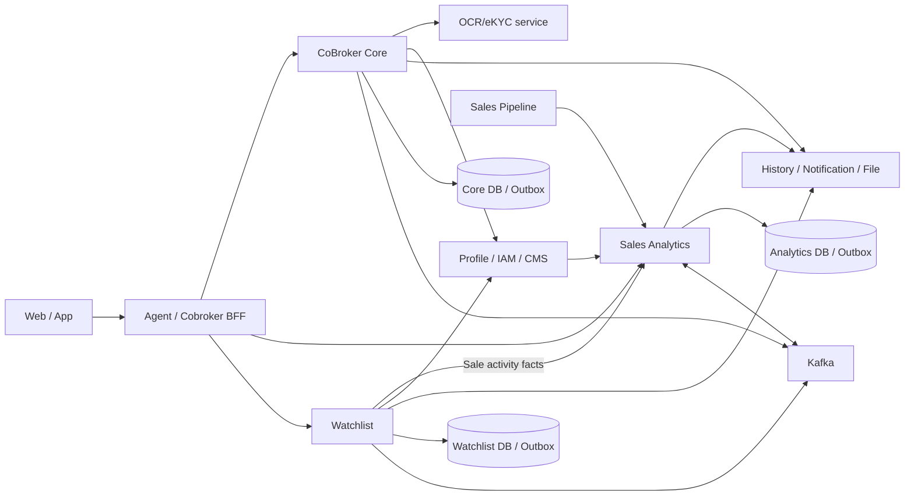

Sơ đồ thể hiện kiến trúc mục tiêu và trách nhiệm tích hợp. Outbox thuộc DB của từng dịch vụ; publisher gửi Kafka sau khi transaction nghiệp vụ đã commit. Giao thức và hợp đồng tích hợp được quy định tại mục 6. Watchlist đọc facts từ Analytics qua INT-01; dữ liệu nghiệp vụ được ghi tại dịch vụ sở hữu.

## 2.2 Architecture Principles

| Nguyên tắc | Áp dụng |
| --- | --- |
| Sở hữu dữ liệu theo domain | Core sở hữu hồ sơ/đại lý; Analytics sở hữu ranking/chu kỳ; Watchlist sở hữu quyết định cấm/hạn chế |
| Tách đọc nguồn, tính toán và ghi kết quả | Calculator ranking/cycle nhận đầu vào; service điều phối transaction; job điều phối lịch |
| Nhất quán trong DB, tích hợp eventual consistency | Ghi domain và outbox trong cùng transaction đối với side effect phát qua outbox; theo dõi delivery độc lập |
| Không giữ transaction khi chờ hệ thống ngoài | Core tách gọi dịch vụ xác minh khỏi transaction hồ sơ; notification tách chuẩn bị/gửi/ghi kết quả |
| Bảo vệ retry theo tác động | Consumer nhận lặp phải an toàn; Core đối soát yêu cầu đã gửi trước khi phát lại thao tác có tác động |
| Phân quyền trên dữ liệu | Scope phải đi từ actor tin cậy; list/detail/export đều phải kiểm; filter không thay authorization |
| Lịch sử có hiệu lực | Vùng chủ quản/dự án lưu khoảng hiệu lực. Quyền đọc báo cáo xét theo phạm vi hiện hành; doanh số và kết quả lịch sử xét theo kỳ, không bị viết lại khi Sale chuyển đơn vị |

## 2.3 Ranh giới nhất quán

Core dùng transaction và khóa để bảo vệ thay đổi quan hệ, snapshot yêu cầu cập nhật và gán khoảng hiệu lực. Import hạng dùng optimistic version và rollback toàn bộ khi xung đột. Analytics dùng run/batch, facts, result và reconcile; chu kỳ tính riêng từng Sale dưới khóa user. Watchlist dùng khóa định danh, version bản ghi và outbox cho đồng bộ Profile/lịch sử.

Transaction kết thúc tại database của từng dịch vụ. Tích hợp liên dịch vụ sử dụng at-least-once delivery kết hợp idempotency, trạng thái công việc và đối soát. Kết quả commit nghiệp vụ và kết quả thực thi side effect được theo dõi độc lập.

# 3. Functional Requirements

## 3.1 Nền tảng Cobroker

| Nhóm | Quy tắc và kết quả |
| --- | --- |
| Đăng ký và hồ sơ | Tạo hồ sơ theo account; chọn đội nhóm, bổ sung thông tin định danh, chứng chỉ môi giới, ảnh đại diện và tài liệu |
| Xác minh danh tính | Liên kết tài liệu và yêu cầu xác minh với hồ sơ; nhận kết quả từ OCR/eKYC, đối chiếu CCCD/thông tin cá nhân và điều kiện hồ sơ |
| Nộp và duyệt | Nộp hồ sơ, nhận xử lý/phân công, phê duyệt, chuyển kiểm tra thủ công hoặc từ chối theo quyền |
| Đại lý | Tạo/xem/cập nhật hồ sơ, nhân sự, chi nhánh, pháp nhân, kích hoạt/ngừng và lịch sử |
| Yêu cầu cập nhật | ARM tạo yêu cầu; ASA cập nhật bản nháp, gửi duyệt; ARM duyệt/phản hồi/từ chối/hủy; job hết hạn |
| Liên kết nhân sự | Quản lý thông tin Sale, tài liệu, chuyển đại lý và trạng thái liên kết; đồng bộ với Profile theo contract |

Yêu cầu cập nhật có trạng thái riêng với đại lý: `PENDING_UPDATE → PENDING_APPROVAL → APPROVED`; phản hồi quay về `PENDING_UPDATE`; `REJECTED`, `CANCELLED`, `EXPIRED` là trạng thái kết thúc. Bản nháp không tự trở thành hồ sơ đang có hiệu lực. Hạng đại lý và trạng thái đại lý phải đi qua nghiệp vụ chuyên biệt, không được cập nhật gián tiếp bằng snapshot hồ sơ.

Kết quả OCR/eKYC `COMPLETED` chỉ thể hiện kết thúc xử lý kỹ thuật. Core phải kiểm outcome, nội dung kết quả và quy tắc đối soát trước khi chấp thuận danh tính; không coi HTTP 2xx hoặc completed là tự động duyệt hồ sơ.

### 3.1.1 Vòng đời hồ sơ đăng ký Sale

Trạng thái hồ sơ đăng ký, trạng thái xác minh và trạng thái hoạt động của Sale được quản lý riêng. Việc nhận xử lý hoặc phân công thay đổi người phụ trách, không tự thay đổi kết quả phê duyệt.

| Trạng thái hiện tại | Thao tác / điều kiện | Trạng thái tiếp theo |
| --- | --- | --- |
| Chưa có hồ sơ | Khởi tạo hồ sơ đăng ký hợp lệ | `DRAFT` |
| `DRAFT` | Lưu thông tin, gửi/tra cứu xác minh | Giữ `DRAFT`; cập nhật kết quả xác minh riêng |
| `DRAFT`, `REQUEST_ADDITIONAL_DOCUMENTS` | Nộp hồ sơ đủ điều kiện; kiểm Watchlist thành công | `AWAITING_APPROVAL` |
| `AWAITING_APPROVAL` | Nhận xử lý/phân công hoặc kiểm tra thủ công | Giữ trạng thái; lưu người phụ trách và kết quả kiểm tra |
| `AWAITING_APPROVAL` | Yêu cầu bổ sung, ghi rõ nội dung | `REQUEST_ADDITIONAL_DOCUMENTS` |
| `AWAITING_APPROVAL` | Người phụ trách phê duyệt, các điều kiện còn hợp lệ | `APPROVED` |
| `AWAITING_APPROVAL` | Người phụ trách từ chối và ghi lý do | `REJECTED` |
| Hồ sơ chưa kết thúc | Hủy hoặc thay thế theo thao tác được cấp quyền và điều kiện chuyển trạng thái | `CANCELLED` hoặc `REPLACED`; hồ sơ thay thế có liên kết truy vết |

`APPROVED`, `REJECTED`, `CANCELLED`, `REPLACED` kết thúc lần đăng ký. Không ghi đè kết quả của lần đã kết thúc. Xác minh chờ/lỗi không phải là từ chối hồ sơ; kết quả kiểm tra thủ công cũng không tự thay thế quyết định duyệt. Mỗi chuyển trạng thái kiểm trạng thái hiện tại, version và quyền người thao tác trong cùng transaction.

### 3.1.2 Trạng thái đại lý và hồ sơ Sale

| Đối tượng | Trạng thái | Quy tắc |
| --- | --- | --- |
| Hồ sơ đại lý | `DRAFT`, `ACTIVE`, `INACTIVE`, `BANNED` | Từ `DRAFT` chỉ chuyển sang `ACTIVE` khi đủ điều kiện; không chuyển ngược về `DRAFT`. Thay đổi giữa các trạng thái còn lại là thao tác chuyên biệt, kiểm quyền và lý do |
| Hồ sơ Sale | `DRAFT`, `ACTIVE`, `INACTIVE`, `FROZEN`, `REQUEST_UPDATE` | Trạng thái hoạt động độc lập với kết quả lần đăng ký và kết quả xác minh; duyệt hồ sơ không được bỏ qua kiểm soát cấm/hạn chế khi kích hoạt |
| Yêu cầu cập nhật đại lý | `PENDING_UPDATE`, `PENDING_APPROVAL`, `APPROVED`, `REJECTED`, `CANCELLED`, `EXPIRED` | Chỉ áp snapshot sau khi duyệt thành công; không sửa hạng hoặc trạng thái đại lý qua snapshot |

Việc chuyển đại lý về `ACTIVE` phải kiểm lại điều kiện hồ sơ và kiểm soát hoạt động. Không tự kích hoạt Sale liên kết chỉ vì đại lý được kích hoạt.

## 3.2 Phân hệ 1 — Xếp hạng Sale theo doanh số

### 3.2.1 Ma trận năng lực

| Mã yêu cầu | Thiết kế | Kết quả nghiệp vụ |
| --- | --- | --- |
| RANK-US-01 | Bảng xếp hạng theo quý, thông tin Sale, doanh số, điểm và hạng | Tra cứu tối đa 4 quý; phân biệt kỳ đang tính và kỳ đã công bố |
| RANK-US-02 | Từ khóa, đơn vị, trạng thái, quý, hạng và sắp xếp | Bộ lọc luôn giao với phạm vi dữ liệu của người dùng |
| RANK-US-03 | Xuất Excel theo bộ lọc và quyền | Tối đa 50.000 Sale; trả dấu hiệu TRUNCATED khi vượt giới hạn |
| RANK-US-04 | Quản lý cấu hình theo kỳ/đối tượng, kích hoạt, ngừng và lịch sử | Khóa cấu hình kỳ cũ; kiểm hợp lệ trước tính hạng |
| RANK-US-05, RANK-US-06 | Badge hạng quý trước và chứng nhận cá nhân | Chỉ Sale có hạng được tải chứng nhận; thay kỳ hiển thị khi sang quý mới |

### 3.2.2 Công thức và quy tắc

1. Giao dịch xếp hạng phải là mua sơ cấp và có ngày ký HĐMB/VBCN trong kỳ. Contract nguồn ánh xạ `businessType=1`, `serviceType=2`; đây là mã contract nguồn.
2. `netRevenue = gross − VAT − maintenance`. Thiếu thành phần không coi là 0; tiền âm, vượt độ chính xác hoặc thiếu ngày bị loại với lý do.
3. Giao dịch bị hủy sau ký vẫn được tính cho ranking. Không tái sử dụng điều kiện loại giao dịch hủy của chu kỳ.
4. Điểm xếp hạng = `a% × doanh số quý trước + b% × doanh số quý hiện tại`. So sánh trên số chính xác; làm tròn 2 chữ số ở hiển thị.
5. Xét lần lượt Kim cương → Bạch kim → Vàng, đồng thời thỏa điểm tối thiểu và quota. Người đủ điểm nhưng vượt quota xét hạng kế tiếp.
6. Áp dụng `ALLOW_TIE`: các Sale đồng điểm tại ranh giới quota cùng nhận hạng. Quota được mở rộng đúng nhóm đồng điểm ở ranh giới.
7. Cấu hình phải bảo đảm quan hệ ngưỡng điểm Kim cương > Bạch kim > Vàng. Phạm vi tùy chọn xếp hạng và quyền sử dụng được quản lý tại DEC-06.

Quota là số Sale tuyệt đối của từng hạng, không phải phần trăm: xét lần lượt 100 Sale Kim cương, 200 Sale Bạch kim tiếp theo và 300 Sale Vàng tiếp theo trong ví dụ cấu hình. Sale đã nhận hạng trên được loại khỏi tập xét hạng dưới. Thiết kế trình duyệt tại DEC-06 giữ quota riêng của từng hạng khi mở rộng nhóm đồng điểm; không dùng khóa phụ để loại một Sale trong nhóm đồng điểm ở ranh giới.

`a`, `b` là số nguyên không âm. Điều kiện `a + b = 100` là phương án chuẩn hóa công thức trình duyệt tại DEC-06, không suy ra chỉ từ ký hiệu phần trăm. Khi nguồn đã đồng bộ đầy đủ và Sale không phát sinh giao dịch quý trước, doanh số quý trước bằng 0; nguồn thiếu/chưa hoàn tất phải trả trạng thái thiếu dữ liệu, không quy thành 0. Thứ tự xét hạng là điểm giảm dần; thứ tự hiển thị ổn định dùng khóa Sale làm khóa phụ sau tiêu chí sắp xếp do người dùng chọn. Khóa phụ không thay đổi kết quả đồng hạng.

Quý đang diễn ra chỉ hiển thị doanh số, số giao dịch và điểm tạm tính; trường hạng chưa có giá trị công bố. Xếp hạng chính thức chỉ được công bố sau khi quý kết thúc và dữ liệu tổng hợp đạt điều kiện đối soát. Kết quả đã công bố được đóng băng; quy tắc xử lý dữ liệu đến muộn và chứng nhận tại mục 8.3.4.

Ví dụ minh họa: doanh số quý trước 10 tỷ, quý này 20 tỷ, trọng số 30/70 → 17 tỷ điểm. Có 101 người đủ ngưỡng Kim cương, người thứ 100 và 101 đồng điểm → quota 100 có thể cấp 101 hạng Kim cương theo quy tắc hòa điểm.

## 3.3 Phân hệ 2 — Quản lý Sale cấm bán/hạn chế bán

### 3.3.1 Ma trận năng lực

| Nhóm chức năng | Thiết kế | Kết quả nghiệp vụ |
| --- | --- | --- |
| Danh sách/chi tiết/tìm kiếm/export | Model sale_control phân biệt BANNED/RESTRICTED; lọc và phân trang | Dữ liệu trả về theo quyền chức năng và phạm vi người dùng |
| Tạo/bổ sung/áp dụng lại | Khóa định danh, kiểm trùng, quản lý tài khoản liên kết | Mỗi thao tác lưu quyết định và lịch sử; xử lý đồng thời bằng lock/version |
| Gỡ | Chuyển RELEASED, lưu lý do và phát outbox | Gỡ cấm không tự kích hoạt tài khoản |
| Công khai/ngừng công khai | Quản lý publicStatus độc lập status áp dụng | API thị trường chỉ tra bản ghi ACTIVE/PUBLISHED |
| Import | Tải tệp → lưu dữ liệu tạm → kiểm tra hợp lệ → xác nhận → ghi dữ liệu chính thức | Có kết quả từng dòng và file lỗi |
| Kiểm tra điều kiện | API checks/statuses tại đăng ký, kích hoạt, đổi định danh, gán role và eKYC | Caller thực thi quyết định chặn trước mutation nghiệp vụ |
| Tự động hạn chế bán | Facts → mốc tham chiếu → ngưỡng → ratio guard → outbox | Dry-run trước rollout; chỉ phát lệnh sau khi qua kiểm soát dữ liệu |

### 3.3.2 Định danh, trạng thái và tài khoản

CCCD có 12 chữ số. Số điện thoại được chuẩn hóa về dạng bắt đầu bằng 0, xử lý đầu +84/84. Mã nhân viên được trim và so sánh không phân biệt hoa thường. Validation áp dụng tại API và import, bảo đảm cùng một định danh có cùng biểu diễn chuẩn.

Một bản ghi có loại `BANNED` hoặc `RESTRICTED`, trạng thái `PENDING/ACTIVE/RELEASED/CANCELED`, nguồn `MANUAL/IMPORT/AUTOMATIC`. Công khai dùng `NOT_PUBLISHED/PUBLISHED/UNPUBLISHED`, không phải trạng thái cấm bán.

Cấm bán có thể ghi nhận khi chưa tìm được tài khoản. Luồng thủ công chọn tài khoản liên quan; import áp theo các tài khoản khớp được xử lý. Các tài khoản được chọn và thông tin định danh là hai lớp dữ liệu khác nhau; không mặc định mọi người có cùng tên là cùng đối tượng.

Mô hình persistence duy trì một hồ sơ BANNED theo CCCD/mã nhân viên xuyên vòng đời. Bổ sung sử dụng bản ghi đang áp dụng; áp dụng lại sử dụng bản ghi đã gỡ, bảo toàn lịch sử. Quyết định về tính duy nhất của hồ sơ và lịch sử áp dụng được quản lý tại DEC-01, truy vết yêu cầu WL-BR-03.

### 3.3.3 Công khai, gỡ và kiểm tra điều kiện

Chỉ công khai bản ghi đang áp dụng có CCCD hoặc số điện thoại phù hợp; bản ghi chỉ có mã nhân viên không đủ điều kiện tra cứu công khai. API market phải trả đúng contract cho các trường hợp tìm thấy/không tìm thấy hoặc dữ liệu không được công khai, không lộ lịch sử nội bộ.

Gỡ cấm không tự kích hoạt lại tài khoản. Trước khi gửi sang Profile, bộ gửi outbox đọc lại toàn bộ quyết định kiểm soát còn hiệu lực của tài khoản. Nếu còn điều kiện chặn, bộ gửi yêu cầu `DISABLE`. Chỉ luồng có quyền mở lại tài khoản và không còn điều kiện chặn mới được gửi `ENABLE`; các trường hợp khác trả quyết định `NONE`.

Profile thực thi trạng thái tài khoản và thu hồi phiên theo hợp đồng. Mỗi dịch vụ gọi Watchlist phải kiểm quyết định tại đúng thao tác nghiệp vụ. INT-05 nghiệm thu toàn bộ luồng từ quyết định đến trạng thái có hiệu lực tại đích.

Tại điểm kiểm soát, caller giới hạn mỗi lần gọi Watchlist ở 500 ms, thử lại tối đa một lần cho lỗi kết nối/timeout với tổng ngân sách 1,2 giây; không giữ transaction nghiệp vụ trong thời gian chờ. Phản hồi không xác định được xử lý theo DEC-07 tại mục 8.7, không dùng kết quả cho phép cũ để cấp thêm quyền.

### 3.3.4 Hạn chế bán tự động

Mốc tham chiếu ưu tiên ngày cọc hợp lệ gần nhất. Khi không có giao dịch, Đại lý dùng ngày kích hoạt đầu; O2O/Tự doanh dùng ngày tạo tài khoản. Ngưỡng được tính bằng cộng tháng lịch. Quyết định về fallback ngày tạo tài khoản Đại lý được quản lý tại DEC-03, độc lập với công thức ngày kết thúc chu kỳ.

Scanner đọc đầy đủ dữ liệu, lập danh sách ứng viên `PENDING`, kiểm chất lượng nguồn và tỷ lệ bất thường trước khi chuyển `ACTIVE` và ghi outbox. Tỷ lệ bằng số tài khoản dự kiến mới bị hạn chế chia cho số tài khoản hợp lệ đã được đánh giá trong cùng lượt quét; tài khoản đã bị hạn chế không tính lại vào tử số. Nếu thiếu trang, thiếu dữ liệu bắt buộc hoặc mẫu số bằng 0, lượt quét không được phát quyết định.

Thiết kế gia hạn sử dụng ngày hết hạn `graceUntil`, theo phương án DEC-03. Trước ngày này scanner bỏ qua việc áp hạn chế; từ ngày này đánh giá lại dựa trên dữ kiện mới nhất. Số lượt chạy thành công/thất bại không làm ngắn hoặc kéo dài gia hạn. BO phải chốt thời lượng, cách tính ngày đầu/cuối và điều kiện cấp lại trước khi bật gia hạn tự động.

Với tập đánh giá từ 1.000 tài khoản trở lên, tỷ lệ vượt 5% chuyển lượt quét sang chờ kiểm tra, không phát lệnh. Với tập nhỏ hơn 1.000, scanner chỉ lập báo cáo và danh sách dự kiến, không tự vượt qua guard. Rollout đầu tiên có tồn đọng được xử lý bằng đợt đối soát có phê duyệt: BO duyệt danh sách, vận hành duyệt thời điểm và giới hạn số lượng; quyền thực thi gắn với mã lượt quét, phiên bản dữ liệu, danh sách và thời hạn. Thay đổi đầu vào làm mất hiệu lực phê duyệt. Đây là ngoại lệ một lần, không thay ngưỡng 5% toàn hệ thống.

## 3.4 Phân hệ 3 — Theo dõi chu kỳ bán hàng

### 3.4.1 Ma trận yêu cầu nghiệp vụ

| Mã yêu cầu | Thiết kế | Kết quả nghiệp vụ |
| --- | --- | --- |
| CYC-US-01 | Bảng phân loại và kỳ gần nhất | Hiển thị chính thức, thử thách hoặc đề xuất ngừng hợp tác |
| CYC-US-02 | Search, đơn vị, trạng thái, đối tượng, phân loại, sort | Áp dụng scope server-side trước phân trang |
| CYC-US-03 | Xuất Excel theo bộ lọc | Tối đa 50.000 Sale và kiểm quyền export |
| CYC-US-04 | Cấu hình tháng, chỉ tiêu, lịch nhắc và ngày hiệu lực | IMMEDIATE hoặc SEQUENTIAL; version check khi lưu |
| CYC-US-05 | Lịch nhắc/kết thúc trên Web/App | Gửi ngoài transaction, đối soát trạng thái delivery |
| CYC-US-06 | Ngày bắt đầu bán và điều chỉnh từ nguồn | Lưu users.sales_start_date; thay đổi hợp lệ kích hoạt tính lại |

### 3.4.2 Ngày và giao dịch

Ngày kết thúc = ngày bắt đầu + số tháng lịch − 1 ngày; ngày đầu/cuối đều thuộc kỳ. Ví dụ: 31/01/2026 + 1 tháng − 1 ngày = 27/02/2026; không dùng công thức này cho ngưỡng hạn chế bán của watchlist vốn không trừ một ngày.

Ngày bắt đầu của kỳ kế tiếp bằng ngày kết thúc thực tế của kỳ trước cộng một ngày. Mỗi kỳ lấy chính ngày bắt đầu của nó làm mốc cộng tháng; không neo lại ngày 31 của kỳ đầu. Ví dụ ba kỳ một tháng liên tiếp, khi mỗi kỳ chính thức đều đạt: 31/01–27/02/2026, 28/02–27/03/2026, 28/03–27/04/2026. Nếu thử thách đạt sớm, kỳ chính thức mới lấy ngày sau ngày đạt làm mốc mới. Kiểm thử phải bao phủ cả chuỗi nhiều kỳ và năm nhuận.

Count chỉ lấy facts đúng username, `cycleEligible=true`, ngày ký cọc không sau ngày đang xét. Contract giao dịch ánh xạ mua sơ cấp `businessType=1, serviceType=2`, có deposit date, liquidation `not_liquidated`; `liquidated` bị loại. Mapping được quản lý phiên bản trong contract Pipeline–Analytics.

### 3.4.3 Trạng thái tính toán và phân loại nghiệp vụ

| Điều kiện đầu vào | Trạng thái tính toán | Phân loại và điều kiện hạn mức |
| --- | --- | --- |
| Chưa tới ngày bắt đầu bán | `PENDING` | Không có phân loại hiện hành; `roomExcluded=null` |
| Thiếu ngày bán/cấu hình hoặc đầu vào bắt buộc | `BLOCKED` kèm lý do | Không phát quyết định mới; lịch sử giữ lại không được dùng như kết quả hiện hành |
| Đầu vào đầy đủ, tính thành công | `COMPLETED` | Áp dụng phân loại ở bảng dưới |

| Điều kiện nghiệp vụ khi tính thành công | Phân loại / chuyển kỳ |
| --- | --- |
| Chính thức chưa đủ giao dịch | `OFFICIAL_NOT_MET` |
| Chính thức đủ giao dịch giữa kỳ | `OFFICIAL_MET`, giữ đến hết hạn |
| Hết chính thức đã đạt | Ngày kế tiếp mở chính thức mới |
| Hết chính thức chưa đạt | Ngày kế tiếp mở thử thách, phân loại `TRIAL` |
| Thử thách đạt ngày D | D vẫn là `TRIAL`; chính thức mới từ D+1 |
| Hết thử thách chưa đạt, kể cả đạt 1/2 | D+1 thành `TERMINATION_PROPOSED`, dừng sinh kỳ |

Mọi giao dịch cùng ngày đạt thử thách thuộc kỳ thử thách, không chuyển phần vượt chỉ tiêu sang kỳ mới. `roomExcluded=false` cho chính thức; `true` cho thử thách và đề xuất chấm dứt. Đây là điều kiện loại do chu kỳ, không phải số hạn mức hoặc lệnh thu hồi căn. Consumer phải kiểm `calculationStatus=COMPLETED` trước sử dụng điều kiện hạn mức.

### 3.4.4 Đổi cấu hình và dữ liệu nguồn

- Cấu hình mới chỉ được lưu với ngày hiệu lực tương lai, số tháng/chỉ tiêu dương, đối tượng/ngày không trùng; kiểm xung đột bằng `expectedUpdatedAt`.
- `IMMEDIATE`: cắt kỳ đang chạy tại D−1 và mở kỳ chính thức mới tại D, áp dụng cả Sale đang thử thách. Kỳ bị cắt được lưu với lý do đổi cấu hình, số giao dịch đến D−1 và trạng thái đạt tại thời điểm cắt; không coi là hết hạn tự nhiên và không sinh thử thách/đề xuất chấm dứt từ phần kỳ bị cắt. Nếu D trùng ngày đầu kỳ thì không tạo kỳ rỗng. Giao dịch trước D không mang sang kỳ mới. Ngoại lệ đối với Sale đã `TERMINATION_PROPOSED` được quản lý riêng tại DEC-04.
- `SEQUENTIAL`: hoàn thành kỳ hiện tại rồi chọn cấu hình hiệu lực cho kỳ kế tiếp.
- Giao dịch hủy/đến muộn có thể làm dựng lại lịch sử; giao dịch ký sau khi thử thách đã hết không tự mở lại.
- Đổi ngày bán đã đến dựng lại từ ngày mới; ngày bán tương lai chuyển PENDING và hủy lịch cũ phù hợp.
- Chuyển đối tượng Đại lý/O2O/Tự doanh đưa kết quả về BLOCKED với `AUDIENCE_CHANGE_REQUIRES_REVIEW`; bảo toàn timeline để xử lý theo quyết định DEC-04.
- Sau TERMINATION_PROPOSED, bộ tính dừng sinh kỳ. Chính sách mở lại bằng cấu hình IMMEDIATE được thẩm định riêng tại DEC-04; thao tác đổi cấu hình thông thường không tự mở lại Sale.

## 3.5 Phân hệ 4 — Quản lý vùng, đại lý, liên minh, pháp nhân

### 3.5.1 Ma trận Use Case

| Mã yêu cầu | Thiết kế | Ràng buộc chính |
| --- | --- | --- |
| REG-UC-01 | CRUD vùng, liên kết CMS và lịch sử | Tên duy nhất; ít nhất một vai trò; ID CMS không thuộc hai vùng |
| REG-UC-02 | Ngừng/kích hoạt vùng | Kiểm quan hệ hiện hành/tương lai và tính hợp lệ của CMS |
| REG-UC-03 | Gán dự án theo giai đoạn, quyết định và hiệu lực | Không chồng khoảng cùng cặp vùng–dự án; batch all-or-nothing |
| REG-UC-04 | Miền, vùng chủ quản, vùng bán và import hạng | Chủ quản độc lập dự án; hạng A/B/C; preview/version khi import |
| REG-UC-05 | Liên minh một dự án | Một đại lý không tham gia hai liên minh ACTIVE cùng dự án |
| REG-UC-06 | Dự án pháp nhân | Thuộc tập dự án đại lý; kiểm ASA và overlap |
| REG-UC-07 | Hiển thị/lọc vùng trên Sale | OR trong từng bộ lọc, AND giữa hai nhóm, lọc trước phân trang |
| REG-UC-08 | Quyền theo vùng chủ quản/vùng bán | Hợp phạm vi đọc được cấp; quyền thao tác kiểm riêng từng action |

### 3.5.2 Vùng và dự án vùng bán

Vùng có mã tự sinh, tên chuẩn hóa không trùng, ít nhất một vai trò `OWNER/SELLER`, trạng thái `ACTIVE/INACTIVE`. Một vùng liên kết một hoặc nhiều ID CMS; một ID CMS chỉ thuộc một vùng Agent. Core đọc CMS/Profile để kiểm loại đơn vị, khối và trạng thái; không tạo/sửa cây CMS.

Vùng SELLER được gán dự án trực tiếp. Một cặp vùng–dự án có nhiều bản ghi lịch sử nhưng không được chồng khoảng hiệu lực, kể cả khác giai đoạn. Một dự án có thể đồng thời thuộc nhiều vùng bán. `effectiveTo` là ngày cuối còn hiệu lực; null nghĩa không có ngày kết thúc.

Ngừng vùng bị chặn khi còn quan hệ chủ quản/dự án hiện hành hoặc chờ hiệu lực. Kích hoạt lại phải kiểm liên kết CMS hợp lệ. Ngoại lệ hiệu chỉnh liên kết CMS trên vùng INACTIVE được quản lý tại DEC-05; tên và vai trò bị khóa khi vùng ngừng hoạt động.

### 3.5.3 Đại lý: chủ quản, vùng bán và hạng

Mỗi đại lý có tối đa một vùng chủ quản hiệu lực tại một thời điểm. Chuyển tại D đóng bản ghi cũ D−1 và mở bản ghi mới D; ngày D không trước hôm nay và phải sau ngày bắt đầu bản ghi hiện tại. Không tạo chồng một lịch chuyển tương lai đang tồn tại. Miền Bắc/Trung/Nam độc lập với vùng chủ quản.

Nguồn dự án của đại lý là tập DISTINCT dự án được phân công cho Sale liên kết đang ACTIVE: scope `PROJECT/ASSIGNED/ACTIVE`; không lấy từ vùng chủ quản và không lấy scope `ADDITIONAL`. Vùng bán được suy từ dự án này kết hợp mapping vùng–dự án còn hiệu lực. Thu hồi phân dự án của Sale có thể làm mất dự án/vùng bán suy ra của đại lý. Dự án chưa có mapping vùng vẫn là dự án của đại lý.

Hạng đại lý gồm A/B/C; mặc định C đối với không độc quyền. Hạng A yêu cầu EXCLUSIVE. Import hạng không đổi loại độc quyền, không cập nhật hạng bằng PUT hồ sơ thông thường. File tối đa 5 MB/1.000 dòng; preview có hiệu lực 15 phút, gắn actor/tổ chức và version snapshot. Confirm thành công toàn bộ hoặc rollback toàn bộ nếu dữ liệu đã thay đổi. Đây là hạng đại lý, không liên quan quota hạng Sale.

Vùng chủ quản và Miền là thông tin bắt buộc khi tạo đại lý. Cutover gồm backfill dữ liệu cũ, nâng contract caller và áp validation bắt buộc; compatibility của caller cũ được quản lý tại REL-02.

### 3.5.4 Liên minh và pháp nhân

Một liên minh gắn một dự án, một đại lý đứng đầu và từ 1 đến 10 đại lý thành viên. Các đại lý phải đang hoạt động. Một đại lý không đồng thời tham gia nhiều liên minh đang hoạt động trên cùng dự án, kể cả vai trò đứng đầu. Đại lý đứng đầu quản lý; thành viên xem. Không đổi dự án/đại lý đứng đầu trên bản ghi hiện hữu; ngừng/kích hoạt kiểm lại điều kiện. Liên minh không tự cấp quyền bán dự án.

Pháp nhân được gán các dự án thuộc đại lý, lưu lịch sử hiệu lực. Cùng pháp nhân–dự án không chồng ngày; kết thúc bằng ngày hiệu lực cuối, không xóa vật lý lịch sử. Kiểm đại lý/pháp nhân còn hiệu lực và ASA được phân công trước thao tác. Việc gán này không thay quyền dự án của Sale.

Khi thu hồi phân dự án làm đại lý mất dự án, các liên kết pháp nhân–dự án được đánh dấu cần đối soát và không được dùng để phát sinh nghiệp vụ mới. Quyền sử dụng dự án luôn kiểm lại tập dự án hiện hành của đại lý tại thời điểm thao tác; việc còn bản ghi lịch sử không cấp quyền. Core giữ lịch sử, phát cảnh báo cho người quản lý và cho phép người có quyền kết thúc liên kết với ngày hiệu lực hợp lệ. Không tự xóa lịch sử hoặc tự gán lại dự án cho Sale.

### 3.5.5 Hiển thị và phân quyền vùng

Danh sách Sale nhận `ownerRegionIds`, `sellingRegionIds`: OR trong mỗi danh sách, AND giữa hai nhóm; lọc trong DB trước phân trang. Response bổ sung vùng chủ quản/vùng bán với ID, mã, tên. Các count phải chỉ rõ tập Sale và trạng thái liên kết được đếm; count chủ quản và count Sale ACTIVE không mặc định cùng mẫu số.

Quản lý vùng được xác định từ CMS; quyền đọc là hợp các phạm vi được cấp, còn quyền thao tác theo chức năng riêng. Không lấy vùng bán của đại lý để mặc định cấp quyền sửa hồ sơ đại lý hoặc cấu hình ranking/cycle.

# 4. Non-Functional Requirements

Các mục tiêu áp dụng theo từng loại tải. Thời gian chờ dịch vụ xác minh được đo riêng với API nghiệp vụ Cobroker; batch, import và export có cửa sổ xử lý riêng.

Các chỉ tiêu định lượng dưới đây là **mục tiêu thiết kế sơ bộ để thẩm định**, chưa phải số đo thực tế hoặc cam kết SLA đã ký. Capacity test xác nhận hoặc đề xuất điều chỉnh có phê duyệt; không tự hạ mục tiêu khi phép đo không đạt.

| ID | Hạng mục | Tiêu chí thiết kế / nghiệm thu | Cách đo |
| --- | --- | --- | --- |
| NFR-01 | Chính xác tiền | numeric(24,2); bucket VND × 100; so điểm trước làm tròn; từ chối overflow | Test giá trị biên và đối soát tổng nguồn/bucket |
| NFR-02 | Chính xác thời gian | Tháng lịch, Asia/Ho_Chi_Minh, ngày đầu/cuối inclusive | Test ngày31, năm nhuận, D−1/D+1, chuyển quý/năm |
| NFR-03 | Idempotency | Replay không nhân đôi doanh số, quan hệ, yêu cầu hồ sơ hoặc quyết định phê duyệt | Concurrent/replay/crash tests |
| NFR-04 | Phân quyền | Mọi list/detail/export/history/media/config áp action + scope | Negative tests trên BFF và service |
| NFR-05 | Watchlist check latency | Mục tiêu p95 ≤ 50 ms ở 50 rps tại service, không tính mạng bên ngoài | Load test endpoint check trên dữ liệu production-like |
| NFR-06 | Tập dữ liệu lớn | Phân trang DB, batch hữu hạn; ranking/cycle export tối đa 50.000 Sale | Tải đồng thời query/export/import/job, đo heap và query plan |
| NFR-07 | Data freshness | Ranking tổng hợp ngày trước; cycle cập nhật theo job/sự kiện; side effect có delivery status | Đo mốc đồng bộ dữ liệu nguồn, data lag và oldest pending |
| NFR-08 | Cô lập dịch vụ phụ thuộc | Lỗi/timeout xác minh không tự duyệt hoặc làm mất hồ sơ; kết quả chỉ áp dụng đúng hồ sơ/yêu cầu | Contract tests kết quả thành công, sai lệch, pending và timeout |
| NFR-09 | Observability | Correlation xuyên HTTP/job/outbox; log không chứa raw PII/credential/signed URL | Trace mẫu, kiểm redaction và dashboard |
| NFR-10 | Recovery | RTO ≤ 2 giờ; RPO dữ liệu DB ≤ 5 phút; đối soát tác động bên ngoài trước mở sender | Diễn tập mục 12.3, đo cả thời gian đối soát trong RTO |
| NFR-11 | Availability | API Core/Ranking/Cycle ≥ 99,9%; Watchlist checks ≥ 99,95% theo tháng | Đo tại ingress dịch vụ, tính cả lỗi phụ thuộc làm request thất bại; tách lỗi nghiệp vụ 4xx |
| NFR-12 | Latency nghiệp vụ | Core đọc/ghi p95 ≤ 500 ms; Ranking/Cycle tra cứu p95 ≤ 1 giây, p99 ≤ 2 giây | Tải mục 11; loại thao tác file/batch và đo riêng thời gian chờ OCR/eKYC |
| NFR-13 | Export | 50.000 Sale, tối đa 4 quý: hoàn tất ≤ 120 giây với 2 lượt xuất đồng thời | Đo từ nhận yêu cầu đến tạo/stream xong file; giữ giới hạn heap và phân quyền |
| NFR-14 | Đồng bộ tác động | p95 từ commit đến đích xác nhận ≤ 30 giây; cảnh báo tồn đọng theo ngưỡng 2/5 phút | Metric và cảnh báo mục 13.2.1 |
| NFR-15 | Chu kỳ và thông báo | Tính lại sự kiện p95 ≤ 60 giây sau khi nhận đủ dữ liệu; 50.000 thông báo cùng hạn được gửi trong 15 phút | Test peak, giới hạn kênh và không gửi cho Sale inactive |
| NFR-16 | Kiểm tra overlap | p95 truy vấn ≤ 50 ms; p95 giữ khóa ≤ 200 ms trên tập kiểm thử mục 11 | EXPLAIN ANALYZE và test cạnh tranh; timeout chờ khóa 2 giây |

Ranking query có statement timeout 10 giây để bảo vệ DB; đây là giới hạn dừng truy vấn, không phải mục tiêu latency. Tỷ lệ đáp ứng NFR được đo trong cửa sổ tải ổn định tối thiểu 60 phút và một lượt peak cuối kỳ. OPS-01 ghi kết quả đối chiếu các mục tiêu trên cùng cấu hình tài nguyên đã sử dụng. RTO là giới hạn khôi phục khi thảm họa, không phải thời gian ngừng được miễn khỏi availability; sự cố DR vẫn tiêu thụ error budget và có thể làm vi phạm SLO tháng.

# 5. Technology Stack & Justification

| Thành phần | Công nghệ / trách nhiệm | Lý do và giới hạn |
| --- | --- | --- |
| Runtime | Java 25, Spring Boot 4; phiên bản runtime được quản lý theo tiêu chuẩn nền tảng | Thống nhất nền tảng vận hành và quản lý phiên bản thư viện |
| Persistence | PostgreSQL, Spring Data JPA, Liquibase | Transaction, unique/version, lịch sử hiệu lực; migration là artefact quản lý |
| Messaging | Kafka và outbox | Tách tích hợp khỏi request, chấp nhận phát lặp và xử lý idempotent |
| Điều phối | Redis/ShedLock cho ranking; Redisson cho scan; DB background job cho cycle | Khóa lịch chạy và khóa dữ liệu được thiết kế theo đơn vị công việc |
| Excel | Apache POI và file service | Import có vùng dữ liệu tạm và bước xem trước kết quả; export kiểm giới hạn bộ nhớ |
| Tích hợp hồ sơ | File Service và dịch vụ OCR/eKYC | Core lưu tham chiếu tài liệu, yêu cầu và kết quả phục vụ đối soát |
| History | Outbox và dịch vụ lịch sử/BI tùy domain | History bên ngoài có độ trễ, không thay transaction nghiệp vụ |
| Quan sát | Logging/metrics/tracing theo nền tảng chung | Correlate request, job và outbox; dashboard theo mục 13 |

Các quyết định công nghệ ưu tiên tính nhất quán nghiệp vụ, khả năng tái xử lý và vận hành độc lập. ADR tại Appendix D ghi quyết định, lý do và hệ quả; hạ tầng triển khai được đặc tả trong L3-OPS.

## 5.1 Điều phối công việc và lưu dữ liệu import

| Lựa chọn | Phạm vi và lý do | Giới hạn chung |
| --- | --- | --- |
| ShedLock cho ranking | Chọn một lượt điều phối lịch; tiến độ run/batch bền vững trong DB | Hết lease không cho phép ghi trùng; DB version và idempotency bảo vệ kết quả |
| Redisson cho scanner | Loại trừ lượt quét trùng; dữ liệu lượt quét và quyết định lưu tại DB | Mất khóa phải dừng áp dụng; không coi Redis là nguồn quyết định cấm/hạn chế |
| DB job cho chu kỳ | Cần checkpoint, lease và tiếp tục xử lý riêng từng Sale | Khóa theo Sale; không giữ một khóa toàn hệ thống suốt batch |
| Redis preview hạng đại lý | Tập tối đa 1.000 dòng, vòng đời 15 phút; mất preview có thể tạo lại an toàn | Confirm kiểm lại version và quyền; không lưu quyết định cuối ở Redis |
| Dữ liệu import tạm trong DB Watchlist | Cần kết quả từng dòng, tiến độ, tiếp tục xử lý và thời hạn 24 giờ | Confirm có định danh ổn định; ghi dữ liệu nghiệp vụ và lịch sử nguyên tử |

Các cơ chế khác nhau đáp ứng vòng đời công việc khác nhau. Vận hành thống nhất bộ trường quan sát `jobId`, owner, lease, checkpoint, số lần thử và kết quả; runbook xử lý mất lease, công việc treo và phát lặp theo cùng nguyên tắc. Không bổ sung cơ chế khóa thứ tư cho một lịch chạy tương đương.

# 6. Integration Architecture

## 6.1 Integration Catalogue

| Nguồn → đích | Mục đích | Giao thức / chế độ | Dữ liệu / ràng buộc |
| --- | --- | --- | --- |
| BFF → Core | Hồ sơ, đại lý, vùng, liên minh, pháp nhân | REST/HTTPS, sync | Actor/role, organization, resource IDs; gate BFF |
| BFF → Analytics | Ranking/cycle/config/export | REST/HTTPS, sync | ServiceResponse hoặc XLSX; scope tin cậy |
| BFF / caller được cấp → Watchlist | CRUD/check/lookup | REST/HTTPS, sync | Tách realm Internal/Check/Market và CIDR |
| Core → OCR/eKYC | Gửi yêu cầu và lấy kết quả xác minh hồ sơ | REST/HTTPS | Xác thực S2S, referenceId/session; kết quả gắn đúng hồ sơ |
| Profile / Pipeline → Analytics | Nhân sự/tổ chức/giao dịch | Import và event | Version nguồn, dữ kiện eligibility riêng từng nghiệp vụ |
| Watchlist → Analytics | Facts quét hạn chế bán | REST, sync theo batch | INT-01: facts theo cursor, phiên bản dữ liệu nguồn và mốc giao dịch |
| Watchlist → Profile | sale_controls/trạng thái tài khoản | Outbox → Thrift | Tính lại trạng thái hiệu lực lúc gửi |
| Core / Watchlist → History | Audit nghiệp vụ | Outbox/Kafka; đọc history qua API | Có thể đến trễ, không xác nhận đồng bộ tức thời |
| Core / Analytics / Watchlist → File Service | Tài liệu hồ sơ, file import/export và chứng nhận | REST và URL có thời hạn | Quyền theo tài nguyên và loại file; nội dung do từng dịch vụ phụ trách |
| Analytics → Notification | Nhắc chu kỳ/kết thúc | Dispatch ngoài transaction | INT-03: notification ID, receipt và delivery status |

## 6.2 API nền tảng Cobroker

Base `C=/internal/v1/cobrokers/onboarding`, `A=/internal/v1/agencies`, `R=/internal/v1/admin/cobrokers/registrations`. Các path bên dưới là service API, không mặc định là public URL FE.

| Method | Path | Chức năng |
| --- | --- | --- |
| GET / POST | `C/config` / `C/register` | Cấu hình và đăng ký |
| POST | `C/{accountId}/team`, `C/{accountId}/prepare-upload` | Đội nhóm và upload |
| PATCH | `C/{accountId}/identity-data`, `/broker-license`, `/avatar` | Cập nhật thành phần hồ sơ; hai path cuối cùng dưới cùng account |
| POST | `C/{accountId}/submit` | Nộp hồ sơ |
| POST | `C/{accountId}/ocr/prepare-upload`, `C/ocr` | Chuẩn bị tài liệu và tạo OCR |
| GET | `C/ocr/session/{sessionId}/status` | Trạng thái/kết quả OCR qua Core |
| POST | `C/ocr/reconcile`, `C/identity-verification/check` | Đối soát/kiểm tra định danh |
| POST / GET | `C/ekyc/token` / `C/ekyc/token/check` | Quản lý phiên eKYC; còn biến thể theo agencyId |
| POST | `C/ekyc/validate`, `C/ekyc/submit` | Kiểm và nộp eKYC |
| GET | `/internal/v1/cobrokers/profile`, `/profile/{accountId}` | Hồ sơ; path thứ hai dưới `/internal/v1/cobrokers` |
| GET | `R/search`, `R/{registrationId}` | Tìm/chi tiết hồ sơ đăng ký |
| POST | `R/{registrationId}/assign-to-me`, `/assignee`, `/reassign` | Phân công; các action cùng registrationId |
| POST | `R/{registrationId}/approval`, `/manual-review`, `/force-reject` | Xử lý hồ sơ; các action cùng registrationId |
| GET | `R/{registrationId}/ocr/result`, `/iv-logs`, `/iv-history` | Kết quả và lịch sử đối soát |
| GET / POST | `A` | Danh sách / tạo đại lý |
| GET / PUT | `A/{id}` | Chi tiết / cập nhật đại lý |
| GET | `A/options`, `A/team-ids`, `A/classification-count` | Danh mục và thống kê |
| POST | `A/{id}/activate`, `A/{id}/deactivate` | Đổi trạng thái |
| GET / POST | `A/{id}/branches` | Chi nhánh |
| PUT / DELETE | `A/{id}/branches/{branchId}` | Sửa/xóa chi nhánh theo quyền/trạng thái |
| GET / POST | `A/{id}/update-requests` | Danh sách / tạo yêu cầu cập nhật |
| GET / PUT | `A/{id}/update-requests/{requestId}` / `.../{requestId}/draft` | Chi tiết / lưu nháp |
| POST | `A/{id}/update-requests/{requestId}/{action}` | action: claim, reassign, submit-approval, approve, feedback, reject, cancel |
| GET | `A/{id}/history`, `A/cobrokers/{cobrokerProfileId}/history` | Lịch sử đại lý/Sale |
| GET / POST | `A/cobrokers` | Danh sách/tạo Sale theo contract hiện hữu |
| POST | `A/{id}/cobrokers`, `A/{id}/cobrokers/from-ocr` | Thêm Sale vào đại lý |
| PUT | `A/{id}/cobrokers/{cobrokerProfileId}` | Cập nhật Sale |
| POST | `A/{id}/cobrokers/{cobrokerProfileId}/deactivate`, `/reactivate` | Đổi trạng thái liên kết; cùng prefix Sale |
| PUT / POST | `A/cobrokers/{cobrokerProfileId}/phone` / `.../{cobrokerProfileId}/transfer` | Số điện thoại / chuyển đại lý |

Các biến thể `requestId` trên endpoint nhân sự/chi nhánh thao tác snapshot yêu cầu cập nhật, khác cập nhật live. Params/body của từng chế độ được đặc tả riêng trong L3-API; validator phân biệt snapshot và live trước khi ghi dữ liệu.

## 6.3 Hợp đồng tích hợp xác minh danh tính

Cobroker sử dụng OCR/eKYC như một dịch vụ bên ngoài. Hợp đồng dưới đây quy định dữ liệu và kết quả mà Cobroker cần để xử lý hồ sơ.

| Thao tác từ Cobroker | Dữ liệu trao đổi | Trách nhiệm của Cobroker |
| --- | --- | --- |
| Khởi tạo yêu cầu xác minh | Tham chiếu hồ sơ, tài khoản và tài liệu theo contract | Kiểm quyền, tính đầy đủ đầu vào; lưu liên kết giữa hồ sơ và mã yêu cầu/phiên trả về |
| Tra cứu kết quả | Mã yêu cầu/phiên đã liên kết | Nhận trạng thái, kết quả định danh và lỗi; kiểm kết quả thuộc đúng hồ sơ |
| Đối chiếu thông tin | Dữ liệu định danh trả về và thông tin khai báo | Kiểm sai lệch, cập nhật kết quả đối soát và xác định hồ sơ đủ điều kiện hoặc cần xử lý tiếp |
| Xem tài liệu phục vụ duyệt | Tham chiếu tài liệu được cấp quyền | Kiểm quyền reviewer trên hồ sơ trước cấp quyền xem |

Mã yêu cầu/phiên phải được lưu cùng hồ sơ để phục vụ truy vấn và đối soát. Kết quả hoàn tất kỹ thuật không tự thay thế quyết định chấp thuận hồ sơ. Core xử lý bốn tình huống: đang xử lý, có kết quả hợp lệ, có sai lệch và lỗi dịch vụ.

Khi timeout hoặc mất kết nối, Core giữ hồ sơ và tham chiếu yêu cầu để tra cứu lại; không tự đánh dấu xác minh đạt hoặc tạo yêu cầu trùng. Schema API chi tiết được thống nhất trong L3-IDV. Cơ sở dữ liệu, hàng đợi, thuật toán, nhà cung cấp và cơ chế vận hành nội bộ của OCR/eKYC không thuộc thiết kế Cobroker.

### 6.3.1 Thử lại và xử lý sự cố kéo dài

Core chỉ tự thử lại thao tác **tra cứu kết quả không làm thay đổi dữ liệu**: tối đa 3 lần sau lần gọi đầu, chờ lần lượt 2, 5 và 10 giây kèm jitter tối đa 20%. Mỗi lần gọi có timeout 5 giây, toàn bộ lượt tra cứu tối đa 45 giây; công việc chạy nền để không giữ request hoặc khóa DB. Kết quả `đang xử lý` là phản hồi hợp lệ, không được tính như lỗi hay kích hoạt vòng retry nhanh.

Lỗi đầu vào/quyền không được retry. Yêu cầu khởi tạo bị timeout và chưa xác định kết quả không được gửi lại tự động; Core đối soát theo mã tương quan của yêu cầu. Chỉ phát lại mutation khi hợp đồng bên ngoài xác nhận hỗ trợ idempotency với cùng khóa hoặc xác nhận yêu cầu cũ chưa được tiếp nhận.

Hết ngân sách thử lại, hồ sơ chuyển vào danh sách cần xử lý tích hợp, giữ nguyên dữ liệu và trạng thái nghiệp vụ. Sau 30 phút chưa có kết quả, Core cảnh báo đầu mối vận hành. Nếu tỷ lệ lỗi/timeout ≥ 50% trên ít nhất 20 lượt gọi trong 60 giây, circuit breaker tạm ngừng gọi 60 giây và chỉ cho một lượt thăm dò khi mở lại. Các ngưỡng này là cấu hình thiết kế khởi tạo cần kiểm chứng trong L3-IDV.

Khi dịch vụ gián đoạn diện rộng, vận hành ghi nhận sự cố, tạm dừng phát yêu cầu mới và giao danh sách hồ sơ ảnh hưởng cho bộ phận xử lý. Người được cấp quyền tra cứu, đối soát, yêu cầu bổ sung hoặc khởi động lại bước xác minh sau khi dịch vụ phục hồi; mọi thao tác có lý do và lịch sử. Xử lý thủ công không có nghĩa bỏ qua điều kiện xác minh hoặc tự duyệt hồ sơ do timeout.

## 6.4 API xếp hạng Sale

### 6.4.1 Danh mục API

Các path dưới đây là API analytics nội bộ, không phải URL FE. JSON dùng `ServiceResponse`; export trả file XLSX.

| Method | Path | Mục đích |
| --- | --- | --- |
| POST | `/v1/sale-ranking/board/search` | Bảng xếp hạng |
| POST | `/v1/sale-ranking/board/filter-options` | Danh mục lọc theo scope |
| GET | `/v1/sale-ranking/board/sales/{username}` | Một Sale theo danh sách quý |
| POST | `/v1/sale-ranking/board/export` | Xuất cùng bộ lọc, quyền riêng |
| POST | `/v1/sale-ranking/board/visualize` | So sánh/biểu đồ |
| GET | `/v1/sale-ranking/board/visualize/sale/{username}` | Chi tiết nguồn số liệu một Sale |
| GET / POST | `/v1/sale-ranking/configs` | Danh sách / lưu cấu hình |
| GET | `/v1/sale-ranking/configs/{configId}` | Chi tiết cấu hình |
| GET | `/v1/sale-ranking/configs/options`, `/effective`, `/check` | Danh mục, cấu hình hiệu lực, cảnh báo thiếu cấu hình |
| POST | `/v1/sale-ranking/configs/check/submit` | Ghi nhận đã xem cảnh báo |
| POST | `/v1/sale-ranking/configs/{configId}/activate`, `/deactivate` | Đổi trạng thái |
| GET | `/v1/sale-ranking/configs/{configId}/historical` | Lịch sử |

Search nhận `keyword, orgUnit, activityStatuses, cycles, tierFilter, sort, page, size, scope`. Mặc định `page=1, size=20`, quý trước, tên tăng dần; `cycles` tối đa 4. `scope.agencyTeamIds` phải do BFF cấp, không lấy nguyên giá trị từ FE.

```json
{"keyword":"","cycles":[{"cycleYear":2026,"cycleIndex":3}],"page":1,"size":20}
```

Client chọn quý từ danh mục API trả về. Kỳ ngoài phạm vi hoặc đang tính được hiển thị theo trạng thái trả về; giá trị doanh số 0 không được dùng để suy ra trạng thái công bố.

### 6.4.2 Nguồn và bảo vệ contract

- Profile nhập ban đầu qua Thrift và cập nhật sự kiện; Pipeline nhập/cập nhật dữ kiện giao dịch. Timestamp/version nguồn dùng chống ghi lùi.
- Actor ranking được xác thực bằng hợp đồng actor chung tại mục 9.1; header rời không có chữ ký không phải căn cứ cấp quyền.
- Lỗi validation ranking dùng nhóm `19400`; thiếu quyền `19403`; tài nguyên ngoài scope không trả dữ liệu. HTTP status và mã nghiệp vụ được quy định đồng thời trong error schema L3-API.
- Thay enum, scale tiền, quy tắc hạng hoặc mặc định kỳ là thay đổi contract cần test BFF và báo cáo cũ.

### 6.4.3 Badge và chứng nhận cá nhân

Badge chỉ hiển thị hạng đã công bố của quý liền trước. Khi sang quý mới mà kết quả chưa được công bố, giao diện hiển thị chờ cập nhật và ẩn badge/nút tải theo mục 8.3.4. Chỉ Sale có hạng chính thức được sinh và tải chứng nhận.

Luồng sinh chứng nhận tách khỏi request bảng xếp hạng:

1. Quản trị upload nền PNG qua File Service; template được quản lý theo phiên bản.
2. Bước RESOLVE xác định Sale, quý, hạng và nhãn đơn vị hiển thị: đại lý hoặc vùng/phòng/nhóm.
3. Bước RENDER tạo ảnh với font tiếng Việt, căn tên dài và lưu ở vùng file riêng tư.
4. API trả trạng thái chờ, thành công hoặc lỗi; URL tải chỉ được cấp sau kiểm actor/resource.
5. Gửi lại cùng yêu cầu không tạo nhiều chứng nhận có nội dung khác nhau cho cùng bộ dữ liệu công bố.

INT-04 quản lý triển khai contract và pipeline render. OpenAPI xác định request key, trạng thái kết quả, version template và thời hạn tải trước khi tích hợp BFF.

## 6.5 API Watchlist

Base `W=/internal/v1/sale-controls`.

| Method | Path | Contract chính |
| --- | --- | --- |
| POST | `W/search`, `W/export` | Tìm kiếm/phân trang, XLSX theo quyền |
| POST | `W/account-lookups` | Tra tài khoản theo định danh |
| POST / GET | `W` / `W/{id}` | Tạo / chi tiết |
| POST | `W/{id}/reveal` | Mở thông tin bị che theo quyền |
| POST | `W/{id}/supplements`, `/reapplications`, `/accounts` | Bổ sung, áp dụng lại, liên kết tài khoản; cùng prefix ID |
| POST | `W/releases`, `W/publications`, `W/unpublications` | Gỡ, công khai, ngừng công khai |
| GET | `W/{id}/history` | Lịch sử từ hệ thống history |
| POST | `W/checks`, `W/statuses` | Contract cho caller kiểm điều kiện |
| POST | `/internal/v1/market/sale-control-lookups` | Tra cứu thị trường theo định danh |
| POST | `W/profile-sync/preview`, `W/profile-sync` | Xem trước/chạy đối soát Profile; quyền vận hành |
| GET / POST | `W/outbox` / `W/outbox/{id}/retry` | Theo dõi/retry side effect |
| GET / POST | `W/scan-runs` | Xem/chạy scan theo type/dryRun |
| GET | `/internal/v1/imports/template` | Mẫu theo type |
| POST | `/internal/v1/imports/prepare-upload` | Chuẩn bị upload file |
| POST | `/internal/v1/imports` | Tạo import từ file ref, không phải multipart trực tiếp |
| GET | `/internal/v1/imports/{id}`, `.../{id}/items`, `.../{id}/failed-file` | Tiến độ, dòng và file lỗi |
| POST | `/internal/v1/imports/{id}/confirm` | Xác nhận áp dụng |

Caller nội bộ sử dụng hợp đồng actor chung tại mục 9.1. Watchlist kiểm quyền theo thao tác và tài nguyên; header `X-User-Id` riêng lẻ không cấp quyền. Các phạm vi Internal, Check và Market có định danh caller và quyền tích hợp riêng; CIDR chỉ là lớp bảo vệ bổ sung.

### 6.5.1 INT-01 — Dữ kiện hoạt động bán

Watchlist đọc `GET /internal/v1/sale-activity-facts?cursor&size` từ Analytics. Contract chỉ cung cấp dữ kiện giao dịch và khóa liên kết Sale; không truyền thông tin định danh cá nhân phục vụ tra cứu cấm bán.

| Nhóm trường | Hợp đồng dữ liệu |
| --- | --- |
| Phân trang | `items`, `nextCursor`, `snapshotId`, `watermark`; các trang thuộc cùng snapshot |
| Khóa Sale | `username` để liên kết với Profile |
| Giao dịch | Mã giao dịch, loại nghiệp vụ, ngày cọc, trạng thái xác nhận/hủy, phiên bản và thời điểm cập nhật nguồn |
| Tính đầy đủ | Mốc dữ liệu đã đồng bộ, phạm vi thời gian và dấu hiệu đầy đủ; phân biệt không có giao dịch với thiếu nguồn |

Analytics cung cấp dữ kiện nguồn có phiên bản, không quyết định điều kiện hạn chế bán. Watchlist tính giao dịch hợp lệ, ngày cọc gần nhất, ngưỡng, gia hạn và danh sách ứng viên theo nghiệp vụ của mình. Profile cung cấp tài khoản, đối tượng, trạng thái, mốc tạo/kích hoạt và dữ liệu cần để liên kết quyết định cấm/hạn chế; Watchlist lấy theo lô, không gọi từng Sale.

Lượt quét bắt đầu từ tập tài khoản hợp lệ của Profile để không bỏ sót Sale chưa có giao dịch. Watchlist ghép dữ kiện Analytics theo username và ghi mốc đồng bộ của cả hai nguồn. Thiếu tài khoản hoặc thiếu dữ kiện bắt buộc làm lượt quét không đủ điều kiện tự áp dụng; không thay null bằng ngày hiện tại. Snapshot/cursor hết hạn phải đọc lại lượt quét, không ghép các trang khác phiên bản. API hỗ trợ lấy thay đổi từ watermark, gồm cả cập nhật/hủy và dấu xóa; Watchlist chỉ dùng tập tăng dần sau khi đã đối soát baseline đầy đủ. Mất khoảng dữ liệu hoặc hết hạn watermark buộc nạp lại baseline. INT-01 nghiệm thu đủ trang, trang lỗi, cập nhật đồng thời và trường hợp không có giao dịch.

## 6.6 API chu kỳ bán hàng

### 6.6.1 Danh mục API

Base path `/v1/sales-cycle`, JSON `ServiceResponse`; đây là API analytics nội bộ.

| Method | Path tương đối | Nội dung |
| --- | --- | --- |
| POST | `/statistics` | Danh sách có phân trang |
| POST | `/statistics/detail` | Chi tiết kỳ/giao dịch; body `username, periodNo, cycleEligible, page, size` |
| POST | `/export` | XLSX `sales-cycle.xlsx` |
| GET | `/filter-options` | Danh mục lọc |
| GET | `/configs` | Danh sách cấu hình |
| PUT | `/configs` | Lưu danh sách cấu hình |

Statistics nhận `search, regions, departments, teams, bus, statuses, audiences, classifications, sortField, descending, page, size`; mặc định `page=1, size=20, descending=false`. Scope từ actor được giao với bộ lọc trước khi truy vấn; client không được mở rộng phạm vi bằng request body.

Config request gồm `effectiveDate, audience, applyMode, officialMonths, officialTarget, trialMonths, trialTarget, reminderRules, endNoticeTime, expectedUpdatedAt`. Reminder gồm `periodType, daysBefore, time`. Danh sách phải có phần tử, không nhận phần tử null.

### 6.6.2 Nguồn dữ liệu và phụ thuộc bên ngoài

Profile đồng bộ nhân sự và ngày bắt đầu bán vào users; Pipeline đồng bộ giao dịch vào transactions. Ngày bắt đầu bán được truyền theo phiên bản dữ liệu nguồn, lưu tại users.sales_start_date và kích hoạt tính lại khi thay đổi. INT-02 quản lý mapping và backfill của contract này.

Sự kiện thay đổi user/transaction/config kích hoạt tính lại; khi chuyển PIC hoặc ngày giao dịch phải tính cả Sale cũ và mới theo thông tin trước/sau. Phiên bản nguồn cũ và message lặp không được làm dữ liệu quay lùi.

INT-03 đặc tả dispatch Web/App với notification ID ổn định, người nhận, template, kỳ và receipt kênh. Chỉ ghi SENT sau xác nhận từ kênh. Consumer Quỹ căn đọc classification, calculation status và roomExcluded; BLOCKED/null phải được xử lý riêng với đủ hoặc không đủ điều kiện.

### 6.6.3 Contract lỗi và version

Validation phải trả lỗi trường đầu vào; xung đột config khi `expectedUpdatedAt` cũ yêu cầu đọc lại. Kết quả BLOCKED là trạng thái nghiệp vụ thiếu đầu vào, khác lỗi HTTP và khác Sale không đạt.

Thay đổi field nguồn ngày bán, enum phân loại hoặc ý nghĩa `roomExcluded` phải có test tương thích BFF và consumer; không đổi nullable thành false khi thiếu dữ liệu.

## 6.7 API vùng/đại lý/liên minh/pháp nhân

| Method | Path | Nội dung / lưu ý |
| --- | --- | --- |
| GET / POST | `/internal/v1/regions` | CRUD kế thừa list/create |
| GET / PUT | `/internal/v1/regions/{id}` | Chi tiết/cập nhật |
| PATCH | `/internal/v1/regions/{id}/status` | Ngừng/kích hoạt |
| GET | `/internal/v1/regions/team` | Danh mục CMS; path số ít `team` |
| GET | `/internal/v1/regions/{id}/history` | Lịch sử qua framework outbox/history |
| GET | `/internal/v1/regions/projects` | Danh mục dự án |
| POST | `/internal/v1/regions/project-assignments` | Batch vùng × dự án |
| GET | `/internal/v1/regions/{regionId}/projects` | Mapping dự án |
| PUT | `/internal/v1/regions/{regionId}/projects/{id}` | Cập nhật thuộc tính mapping |
| POST | `/internal/v1/regions/{regionId}/projects/{id}/end` | Kết thúc hiệu lực |
| POST | `/internal/v1/regions/decision-files/upload` | Upload quyết định |
| GET | `/internal/v1/regions/{regionId}/projects/{id}/decision-file` | File quyết định theo quyền |
| GET | `/internal/v1/agencies/{id}/owner-region/history` | Lịch sử chủ quản |
| POST | `/internal/v1/agencies/{id}/owner-region/transfer` | Chuyển chủ quản theo ngày hiệu lực |
| GET | `/internal/v1/agencies/{id}/projects`, `.../{id}/selling-regions` | Dự án/vùng bán suy từ Sale được phân dự án |
| GET | `/internal/v1/agencies/rank-imports/template` | Mẫu hạng đại lý |
| POST | `/internal/v1/agencies/rank-imports` | Multipart file, preview |
| GET / POST | `/internal/v1/agencies/rank-imports/{id}/errors` / `.../{id}/confirm` | File lỗi / xác nhận |
| GET / POST | `/internal/v1/agencies/{agencyId}/alliances` | Danh sách/tạo liên minh |
| GET | `.../{agencyId}/alliances/member-options` | Danh mục thành viên |
| GET / PUT | `.../{agencyId}/alliances/{id}` | Chi tiết/cập nhật |
| PATCH | `.../{agencyId}/alliances/{id}/status` | Ngừng/kích hoạt |
| GET / POST | `/internal/v1/agencies/{agencyId}/tax-codes/{legalId}/project-assignments` | Xem/gán dự án pháp nhân |
| GET | `.../{legalId}/projects` | Dự án có thể chọn |
| POST | `.../{legalId}/project-assignments/{id}/end` | Kết thúc gán |
| GET | `/internal/v1/agencies/cobrokers` | Bổ sung query ownerRegionIds/sellingRegionIds |

Prefix `...` kế thừa resource đầy đủ tương ứng trong bảng. Region áp dụng gate BFF; legal kiểm operator/ASA; rank import áp dụng ARM roles 11/1101. Quyền người dùng theo vùng được đặc tả tại mục 9 và nghiệm thu theo INT-05.

## 6.8 Error Contract & Versioning

JSON nghiệp vụ theo response wrapper của từng service; file XLSX có contract tải riêng. HTTP status tuân registry chung ở mục 6.8.2; mã đặc thù chỉ mô tả chi tiết nghiệp vụ. Xung đột version phải yêu cầu đọc lại/preview lại; lỗi ngoài scope không trả dữ liệu nhạy cảm. Watchlist optimistic conflict có mã nghiệp vụ 21004/HTTP 409 theo hợp đồng lỗi.

Breaking change gồm đổi eligibility, scale tiền, enum hạng/trạng thái, ý nghĩa nullable, ngày hiệu lực, scope hoặc event contract. Mỗi thay đổi phải có consumer contract tests, kế hoạch rollout và backfill/reconcile. OpenAPI/DTO là artefact L3 cho kiểu trường/validation; các bảng L2 này không thay schema machine-readable.

### 6.8.1 Idempotency cho API ghi

Các POST tạo hồ sơ/đại lý, tạo hoặc áp lại quyết định cấm/hạn chế, xác nhận import và gỡ theo lô bắt buộc có `Idempotency-Key`. Dịch vụ ràng buộc khóa với caller, actor và thao tác; fingerprint bao gồm method, path tài nguyên, query, phạm vi tổ chức và nội dung đã chuẩn hóa; quyền hiện hành được kiểm trước khi trả lại kết quả.

| Trường hợp | Kết quả |
| --- | --- |
| Khóa mới | Ghi nhận yêu cầu, xử lý nghiệp vụ và kết quả trong cùng ranh giới transaction; tác động ngoài đi qua outbox |
| Cùng khóa, cùng nội dung, đã hoàn tất | Trả cùng mã tài nguyên và kết quả, không thực thi lần nữa |
| Cùng khóa nhưng khác tài nguyên hoặc nội dung | HTTP 409 `IDEMPOTENCY_KEY_REUSED` |
| Cùng khóa đang xử lý | HTTP 409 `REQUEST_IN_PROGRESS` kèm `Retry-After`; không mở lượt xử lý thứ hai |
| Gỡ theo lô | Khóa cho toàn yêu cầu; mỗi phần tử có khóa nghiệp vụ ổn định và kết quả riêng, gửi lại không lặp side effect |

Bản ghi chống lặp giữ tối thiểu 72 giờ; sau thời hạn này, ràng buộc duy nhất và trạng thái nghiệp vụ vẫn bảo vệ việc tạo trùng. Idempotency không thay thế kiểm version: cùng khóa không hợp thức hóa một yêu cầu duyệt trên dữ liệu đã thay đổi. Lỗi trước commit cho phép thử lại an toàn; tác động đã gửi nhưng chưa rõ kết quả phải đối soát theo mã sự kiện, không tạo khóa mới để né kiểm tra.

### 6.8.2 Quy ước đường dẫn và mã lỗi

Các đường dẫn trong mục 6 là đường dẫn giữa BFF và dịch vụ, không biểu thị quyền truy cập công khai. Prefix `/internal/v1` hoặc `/v1` không thay xác thực. Gateway công bố route riêng và chỉ cho caller được cấp quyền đi tới service. Danh mục route giữ phạm vi theo từng dịch vụ; mọi đổi path là thay đổi contract có kế hoạch chuyển đổi.

API tra cứu có bộ lọc phức tạp dùng POST với body. Chi tiết chu kỳ dùng `POST /v1/sales-cycle/statistics/detail` với body chứa `username, periodNo, cycleEligible, page, size`; không đặt username trong path mới. Các path có định danh được thay bằng route template trong access log và trace; tắt ghi raw URL/query ở cả gateway, BFF và service.

| Nhóm lỗi chung | HTTP | Mã ký hiệu |
| --- | --- | --- |
| Đầu vào không hợp lệ | 400 | `VALIDATION_FAILED` |
| Chưa xác thực / ngoài quyền | 401 / 403 | `UNAUTHENTICATED` / `FORBIDDEN` |
| Không tìm thấy trong phạm vi truy cập | 404 | `RESOURCE_NOT_FOUND` |
| Version, trạng thái hoặc khóa chống lặp xung đột | 409 | `VERSION_CONFLICT`, `STATE_CONFLICT`, các mã idempotency ở trên |
| Vượt giới hạn | 429 | `RATE_LIMITED`, kèm `Retry-After` |
| Phụ thuộc không sẵn sàng | 503 | `DEPENDENCY_UNAVAILABLE`; không quy đổi thành kết quả nghiệp vụ |

Response lỗi thống nhất các trường `code, message, correlationId`; chi tiết lỗi trường chỉ trả khi phù hợp quyền. Các mã số đặc thù như 19400/19403/21004 được ánh xạ tới registry này trong L3-API, không thay ý nghĩa HTTP hoặc buộc UI suy đoán theo từng service.

# 7. Data Architecture & Data Flow

## 7.1 Sở hữu và mô hình Core

| Entity/bảng | Dữ liệu chính / quan hệ |
| --- | --- |
| `agency_profiles` | Hồ sơ, trạng thái, hạng, organization và Miền |
| `cobroker_profiles`, `agency_cobroker` | Hồ sơ Sale và quan hệ Sale–đại lý |
| `agency_branch` | Chi nhánh đại lý |
| Pháp nhân / yêu cầu cập nhật | MST/pháp nhân, snapshot yêu cầu, người nhận, phản hồi và trạng thái duyệt theo mô hình hồ sơ và yêu cầu cập nhật |
| `regions`, `region_teams` | Vùng Agent và liên kết ID CMS duy nhất |
| `region_projects` | Vùng–dự án, giai đoạn, quyết định, ngày hiệu lực |
| `agency_regions` | Đại lý–vùng chủ quản có lịch sử hiệu lực |
| `alliances`, `alliance_members` | Liên minh theo dự án; mỗi thành viên là một dòng có đại lý, vai trò và trạng thái tham gia |
| `legal_projects` | Pháp nhân–dự án có hiệu lực |
| `user_registered_scope` | Nguồn scope dự án của Sale dùng suy ra dự án đại lý |
| History/outbox | Audit và side effect; không thay bảng quan hệ hiệu lực |

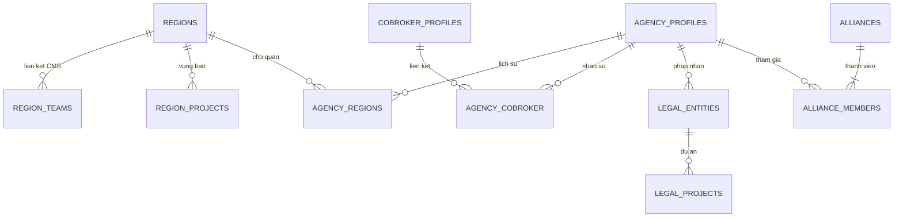

ERD mô tả các aggregate và quan hệ nghiệp vụ. LEGAL_ENTITIES biểu diễn aggregate pháp nhân; mapping bảng vật lý thuộc L3-DATA. Thành viên liên minh được chuẩn hóa theo quan hệ tại mục 7.1.2. Organization scope được kiểm tại agency và resource liên quan; scope vùng được resolve qua CMS và quan hệ vùng.

### 7.1.1 Khoảng hiệu lực và kiểm soát đồng thời

Khoảng hiệu lực bao gồm ngày đầu và ngày cuối; ngày kết thúc null biểu thị không giới hạn. Chuyển chủ quản tại D đóng bản ghi cũ ở D−1 trước khi mở bản ghi mới. Kiểm tra overlap tại dịch vụ trả lỗi nghiệp vụ; DB bảo vệ cùng ràng buộc bằng exclusion constraint trên khóa quan hệ và `daterange(effective_from, effective_to, '[]')` với `btree_gist`. PostgreSQL chuẩn hóa khoảng ngày sang dạng nửa mở nhưng không thay ý nghĩa ngày cuối trong nghiệp vụ. Xem [tài liệu PostgreSQL về ràng buộc khoảng](https://www.postgresql.org/docs/current/rangetypes.html#RANGETYPES-CONSTRAINT).

| Quan hệ | Khóa không được chồng khoảng | Index phục vụ đọc |
| --- | --- | --- |
| Chủ quản đại lý | Đại lý, không phân biệt vùng | Đại lý + ngày bắt đầu; vùng + ngày hiệu lực |
| Vùng bán–dự án | Vùng + dự án, không phân biệt giai đoạn | Vùng + dự án + ngày bắt đầu |
| Pháp nhân–dự án | Pháp nhân + dự án | Pháp nhân + dự án + ngày bắt đầu |

Query chỉ tìm `EXISTS` trên đúng khóa và khoảng đang kiểm tra, không tải toàn bộ lịch sử để lọc trong bộ nhớ. Lịch sử phân trang theo khóa/ngày/ID; thống kê kế hoạch truy vấn phải bao phủ phân bố lệch và đối tượng có lịch sử dài. Không phân vùng bảng nếu cách phân vùng làm mất ràng buộc toàn cục. DBA kiểm overlap dữ liệu cũ và quyền cài extension trước migration; không tắt constraint để chạy SQL vận hành. DDL và kiểm thử phải chứng minh hai writer, kể cả writer không đi qua API, không tạo được khoảng chồng.

Core thống nhất thứ tự khóa: **Vùng → Đại lý → Pháp nhân → Liên minh → Yêu cầu cập nhật → Bản ghi quan hệ**, mỗi nhóm khóa theo ID tăng dần. Mỗi thao tác xác định tập tài nguyên, lấy khóa theo thứ tự, rồi đọc lại và kiểm version/trạng thái/quan hệ. Nếu sau khi đọc lại xuất hiện tài nguyên chưa được khóa, rollback và thực hiện lại với tập khóa đầy đủ; không bổ sung khóa ngược thứ tự. Ngừng vùng, chuyển chủ quản, thay thành viên và duyệt snapshot đều tuân cùng thứ tự. Không gọi hệ thống ngoài trong khi giữ khóa.

Timeout chờ khóa 2 giây trả lỗi xung đột có thể thử lại. Với deadlock/serialization failure, chỉ retry tối đa 2 lần toàn transaction khi chưa phát tác động ngoài và vẫn giữ idempotency; không retry riêng câu lệnh cuối.

### 7.1.2 Thành viên liên minh

`alliance_members` lưu `alliance_id, agency_id, project_id, role, status` và version. Mọi vai trò, kể cả đại lý đứng đầu, đều có một dòng. Foreign key bảo đảm đại lý tồn tại và cặp liên minh–dự án thuộc đúng bản ghi liên minh; unique `(alliance_id, agency_id)` chống lặp thành viên. Partial unique `(project_id, agency_id) WHERE status='ACTIVE'` ngăn một đại lý tham gia hai liên minh đang hoạt động cùng dự án. Một liên minh có đúng một vai trò đứng đầu và từ 1 đến 10 thành viên còn lại. Mỗi thành viên có bản ghi quan hệ riêng.

Trạng thái tham gia phải đồng bộ với trạng thái liên minh trong cùng transaction khi ngừng/kích hoạt. Constraint trigger hoãn đến cuối transaction kiểm trạng thái cha–con, đúng một đại lý đứng đầu và giới hạn thành viên; không dùng partial index để kiểm điều kiện nằm ở bảng cha. Kích hoạt lại phải kiểm unique trên toàn bộ tập thành viên, không chỉ đổi trạng thái cha. Thiết kế index theo [PostgreSQL partial indexes](https://www.postgresql.org/docs/current/indexes-partial.html).

### 7.1.3 Snapshot yêu cầu cập nhật

Mỗi yêu cầu giữ `requestVersion` và `baseProfileVersion` tại lúc lấy snapshot; các quan hệ nằm trong phạm vi cập nhật cũng có version. Sửa nháp, gửi duyệt, phản hồi và phê duyệt đều yêu cầu expected version. Hai người sửa cùng một phiên bản: chỉ một người thành công, người còn lại nhận HTTP 409 và phải đọc lại thay đổi.

Khi duyệt, Core khóa các tài nguyên theo thứ tự mục 7.1.1, kiểm yêu cầu còn chờ duyệt và đối chiếu version hồ sơ live với base snapshot. Hồ sơ live đã đổi làm thao tác duyệt thất bại toàn bộ; UI hiển thị phần khác biệt, người xử lý tạo lại snapshot trên dữ liệu mới và gửi duyệt lại. Không tự ghi đè hoặc tự hợp nhất các trường chưa được người duyệt xem. Cập nhật live, kết thúc yêu cầu và ghi audit/outbox cùng transaction; cạnh tranh với hết hạn/hủy chỉ có một kết quả hợp lệ.

## 7.2 Dữ liệu ranking

### 7.2.1 Mô hình dữ liệu

| Bảng/nhóm | Trách nhiệm |
| --- | --- |
| `users`, `organization_units` | Profile cung cấp dữ liệu nhân sự và tổ chức cho Analytics phục vụ báo cáo |
| `transactions` | Dữ kiện giao dịch nguồn, eligibility riêng ranking/cycle |
| `sale_ranking_configs`, `sale_ranking_config_details` | Cấu hình kỳ và các nhóm áp dụng |
| `sale_ranking_month_buckets` | Slot doanh số/số lượng theo ngày trong tháng |
| `sale_ranking_grouping_buckets` | Tổng hợp QUARTER |
| `sale_ranking_aggregation_runs`, `sale_ranking_aggregation_batches` | Tiến độ và trạng thái tổng hợp |
| `sale_ranking_cycle_runs`, `sale_ranking_results` | Lượt xếp hạng; tập công bố bất biến theo quý/nhóm, lưu doanh số hai quý, điểm, hạng, phiên bản cấu hình và mốc nguồn |
| `sale_ranking_bucket_snapshots`, `sale_ranking_transaction_reconciles` | Mốc dữ liệu và hiệu chỉnh |
| `historical_events`, outbox | Lịch sử/công việc tích hợp |

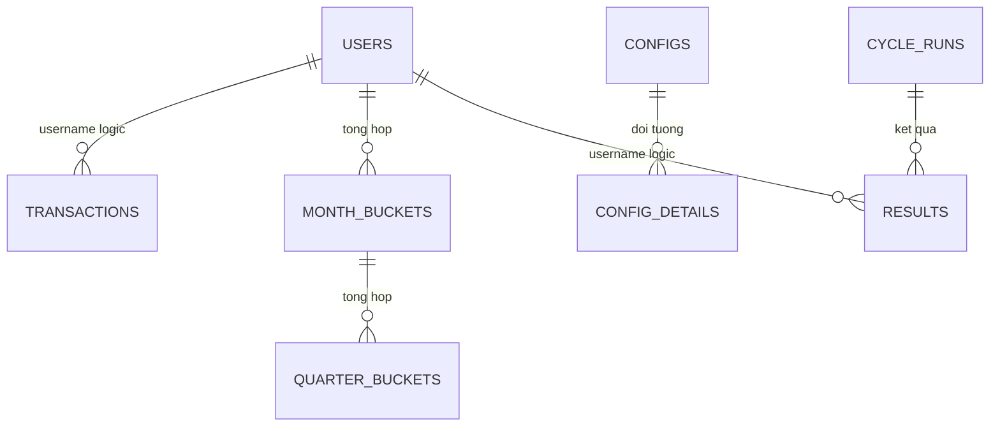

Sơ đồ mô tả quan hệ logic giữa các nhóm dữ liệu. DDL quản lý khóa ngoại và index theo L3-DATA. Tên rút gọn tương ứng các bảng ở trên.

Tập kết quả có khóa duy nhất theo quý, đối tượng áp dụng và Sale; trạng thái công bố chuyển một lần sau khi đủ dữ liệu. Sau công bố, DB và quyền ghi bảo vệ tập này khỏi cập nhật/xóa qua luồng hiệu chỉnh; bucket nguồn vẫn được đối soát riêng. Tên bộ phận/nội dung chứng nhận dùng khi công bố được chụp cùng dữ liệu chứng nhận để tải lại không phụ thuộc việc Sale chuyển đơn vị.

## 7.3 Dữ liệu Watchlist

| Bảng | Trách nhiệm / thuộc tính |
| --- | --- |
| `sale_control` | UUIDv7, mã CB/HC, type/status/source/publicStatus, CCCD/mã nhân viên, mảng phones/usernames, snapshot accounts, đơn vị, effective_date, content, attributes, version, lý do gỡ |
| `import_job`, `import_item` | Tham chiếu tệp, dữ liệu tạm từng dòng, lỗi, tiến độ xác nhận/ghi dữ liệu và thời hạn lưu |
| `scan_run` | Loại quét, snapshot/watermark, dry-run, ứng viên/mẫu số, ratio, trạng thái, quyết định ngoại lệ và hạn áp dụng |
| `outbox_message` | PROFILE_SALE_CONTROLS và HISTORY_EVENT; event ID, aggregate ID/version, commit time, retry/lease/outcome và xác nhận đích |

History nghiệp vụ được phát sang BI qua Kafka và đọc qua query runner. Watchlist lưu domain state và outbox để theo dõi delivery. CCCD/mã nhân viên BANNED có unique xuyên trạng thái; phone là array và khóa định danh, không có cùng unique constraint đơn giản như CCCD.

Import đi qua PENDING/PROCESSING/VALIDATED/APPLYING/APPLIED hoặc FAILED/EXPIRED theo job. Các dòng phải giữ lỗi và kết quả áp dụng để caller phân biệt validate thành công với đã có tác động nghiệp vụ. Dữ liệu import tạm chưa được xác nhận hết hạn sau 24 giờ; job đã bắt đầu áp dụng giữ dữ liệu tới khi đối soát xong để không mất khả năng tiếp tục; giới hạn xử lý 20.000 dòng được quản lý tại DEC-02 cùng quyền hiển thị/export dữ liệu.

## 7.4 Dữ liệu chu kỳ bán hàng

### 7.4.1 Mô hình

| Bảng | Dữ liệu chính |
| --- | --- |
| `users` | username, tổ chức/role/status, `sales_start_date`, version nguồn |
| `transactions` | PIC, deposit/contract date, eligibility và lý do loại |
| `sales_cycle_configs` | audience, effective date, mode, tháng/target, reminder |
| `sales_cycle_results` | Một kết quả theo Sale, calculation status/reason, classification, roomExcluded, applied start |
| `sales_cycle_periods` | Các kỳ có số thứ tự, type, start/scheduled end/actual end, target/count/achieved date, config snapshot |
| `sales_cycle_notifications` | Lịch, trạng thái, lease/thử gửi, tham chiếu kỳ và version kết quả; receipt giữ nguyên sau tính lại |
| `sales_cycle_recalculations` | Lịch sử hiệu chỉnh: lý do, nguồn/cấu hình, version trước/sau, các kỳ thay đổi và mã yêu cầu/sự kiện |
| `background_jobs` | Lease và checkpoint của công việc nền |
| Outbox | Sự kiện thay đổi dữ liệu; không thay thế bảng lịch thông báo |

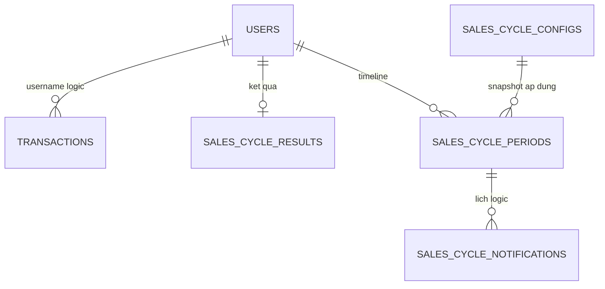

ERD biểu diễn quan hệ logic; snapshot trong kỳ lưu thông số cấu hình đã áp dụng. Khóa và index vật lý được quản lý trong L3-DATA.

### 7.4.2 Hiển thị và dữ liệu thiếu

Đang chính thức: hiển thị kỳ chính thức hiện tại, cột thử thách trống. Đang thử thách: hiển thị chính thức liền trước + thử thách hiện tại. Terminal: hiển thị cặp kỳ cuối.

Query có trạng thái stale khi ngày bán và kết quả áp dụng chưa khớp. BLOCKED có thể giữ lịch sử cũ để đối soát; consumer không được coi lịch sử giữ lại là quyết định mới còn hợp lệ.

### 7.4.3 Lưu giữ dữ liệu chu kỳ và lịch sử xuất báo cáo

Kỳ bán hàng, lịch thông báo và xác nhận gửi được quản lý thời hạn lưu riêng theo mục 7.6. Lịch sử xuất báo cáo ghi nhận người thực hiện, thời điểm và phạm vi dữ liệu.

## 7.5 Luồng dữ liệu giữa các dịch vụ

| Dữ liệu | Nguồn chuẩn → bản sao/đích | Kiểm soát |
| --- | --- | --- |
| Nhân sự, role, đơn vị | Profile → Core/Analytics/Watchlist theo contract | Phiên bản dữ liệu nguồn; thay đổi inactive hủy lịch chờ, sender kiểm lại trước gửi |
| Giao dịch | Pipeline → Analytics → facts cho các nghiệp vụ | Ngày cọc khác ngày hợp đồng; eligibility riêng; correction/replay |
| Chủ quản/vùng bán | Core mapping và scope dự án → API tiêu thụ | Theo ngày hiệu lực, không suy ngược chủ quản từ dự án |
| Dữ liệu xác minh hồ sơ | OCR/eKYC → Core | Gắn đúng hồ sơ/yêu cầu; kiểm quyền truy cập và đối soát thông tin khai báo |
| Cấm/hạn chế | Watchlist → Profile/caller check/market | Outbox lag, tập kiểm soát hiện hành, công khai đúng trạng thái |
| Chu kỳ/hạn mức | Analytics result → consumer | BLOCKED/null không được chuyển thành đủ điều kiện |

## 7.6 Retention, Consent & Ownership

| Nhóm dữ liệu | Chủ sở hữu | Quy tắc quản lý |
| --- | --- | --- |
| Hồ sơ và hợp đồng Cobroker | Core/Data Owner | Giới hạn mục đích, quyền truy cập và thời hạn lưu theo loại hồ sơ |
| Tham chiếu tài liệu và kết quả đối soát hồ sơ | Core/Data Owner | Lưu dữ liệu tối thiểu phục vụ duyệt; quyền xem theo hồ sơ và retention của Cobroker |
| Facts/projection và kết quả ranking/cycle | Analytics/Data Owner | Giữ dữ liệu đủ cho đối soát và tái dựng; purge theo kỳ và quan hệ phụ thuộc |
| Sale control và lịch sử quyết định | Watchlist/Data Owner | Bảo toàn lịch sử áp dụng/gỡ; công khai tuân theo status và quyền |
| Quan hệ vùng/đại lý/pháp nhân | Core/Data Owner | Lưu lịch sử hiệu lực phục vụ kiểm toán; thay đổi bằng nghiệp vụ có audit |
| File import/export/chứng nhận | Service tạo file | File riêng tư, download có thời hạn, audit và cleanup |

SEC-01 quản lý lịch retention, legal hold, quyền xóa và kiểm soát mã hóa theo nhóm dữ liệu. Purge phải xử lý cả record, object và bản sao được quản lý, đồng thời giữ audit tối thiểu của thao tác. Chính sách dữ liệu được phê duyệt tại Data production gate trước vận hành dữ liệu thật.

### 7.6.1 Thời hạn lưu phục vụ thiết kế dung lượng

Các thời hạn dưới đây là baseline kỹ thuật sơ bộ để tính dung lượng, được Data Owner thẩm định trước APPROVED; không thay thời hạn pháp lý hoặc chính sách lưu hồ sơ của doanh nghiệp.

| Nhóm | Baseline thiết kế |
| --- | --- |
| Dữ liệu kết quả, cấu hình và lịch sử quan hệ | 5 năm để đối soát; tách dữ liệu truy vấn thường xuyên và lịch sử, vẫn giữ khả năng tra cứu |
| Audit nghiệp vụ và phiên bản tính lại | 5 năm, gắn kết quả/kỳ liên quan; không xóa trong khi có yêu cầu bảo toàn |
| Log vận hành | 30 ngày tra cứu trực tiếp, 90 ngày tổng cộng |
| Outbox đã xác nhận / receipt chống lặp | Tối thiểu 90 ngày; không xóa pending/failed/unknown theo TTL |
| Backup DB và WAL | Cửa sổ PITR 35 ngày; bảo đảm RPO 5 phút |
| File export/chứng nhận sinh lại được | 7 ngày; tải lại theo quyền và phiên bản kết quả, không giữ vô hạn |
| Dữ liệu import tạm / khóa API chống lặp | Watchlist chờ xác nhận 24 giờ; giữ job đang áp dụng tới khi đối soát xong; preview hạng đại lý 15 phút; idempotency tối thiểu 72 giờ |

Đợt replay/restore vượt cửa sổ receipt không tự mở sender: phải đối soát trạng thái đích trước khi phát tác động. Khi cần bảo toàn dữ liệu phục vụ đối soát, việc dọn dữ liệu dừng theo phạm vi được ghi nhận, không dừng vô hạn cho toàn hệ thống.

# 8. Luồng nghiệp vụ chi tiết

## 8.1 Tổng hợp luồng

| ID | Luồng | Điểm commit / kết quả |
| --- | --- | --- |
| CB-01 | Xác minh danh tính và phê duyệt hồ sơ Sale | Kết quả đối soát → hồ sơ nộp/duyệt theo nghiệp vụ |
| CB-02 | Yêu cầu cập nhật hồ sơ | Snapshot → duyệt → hồ sơ live; terminal không sửa tiếp |
| RANK-01 | Tổng hợp/tính hạng quý | Run/batch hoàn tất, công bố results |
| WL-01 | Tạo/gỡ/công khai | Sale control + outbox; side effect theo dõi riêng |
| WL-02 | Import/quét tự động | Validate/dry-run trước áp dụng, ratio guard |
| CYCLE-01 | Tính lại kỳ/lịch | Transaction từng Sale, result + periods + lịch |
| REGION-01 | Gán/chuyển quan hệ | Hiệu lực, overlap, lịch sử trong transaction |
| REGION-02 | Import hạng đại lý | Preview → kiểm version → commit toàn bộ |

## 8.2 Xác minh danh tính và phê duyệt hồ sơ Sale

### 8.2.1 Tiếp nhận và xác minh hồ sơ

Sale hoặc người thao tác được cấp quyền khai báo thông tin, cung cấp tài liệu và gửi yêu cầu xác minh. Core kiểm quyền trên tài khoản/hồ sơ, các trường bắt buộc và điều kiện nghiệp vụ trước khi gọi dịch vụ OCR/eKYC.

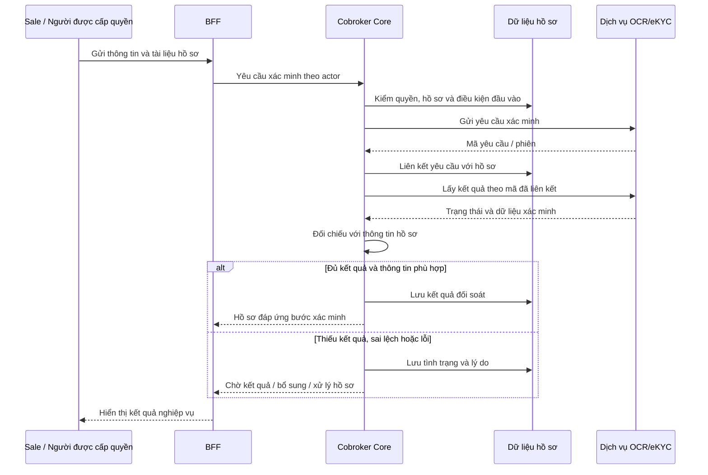

| Kết quả tích hợp | Xử lý hồ sơ tại Cobroker |
| --- | --- |
| Đang xử lý | Giữ liên kết yêu cầu; trả trạng thái chờ để người dùng tra cứu lại |
| Kết quả đầy đủ, thông tin phù hợp | Ghi nhận đối soát; cho phép tiếp tục các bước hồ sơ khi đủ điều kiện |
| Sai lệch thông tin hoặc thiếu tài liệu | Lưu lý do; yêu cầu bổ sung hoặc chuyển kiểm tra thủ công theo quyền |
| Lỗi/timeout dịch vụ | Giữ dữ liệu hồ sơ; đối soát yêu cầu đã gửi trước khi thử lại |
| Kết quả không thuộc hồ sơ/yêu cầu | Từ chối áp dụng kết quả và ghi nhận sự kiện kiểm soát |

Xác minh đạt là một điều kiện của hồ sơ. Quyết định phê duyệt còn phụ thuộc dữ liệu khai báo, tài liệu bắt buộc, điều kiện nghiệp vụ và quyền người duyệt.

### 8.2.2 Nộp và phê duyệt hồ sơ

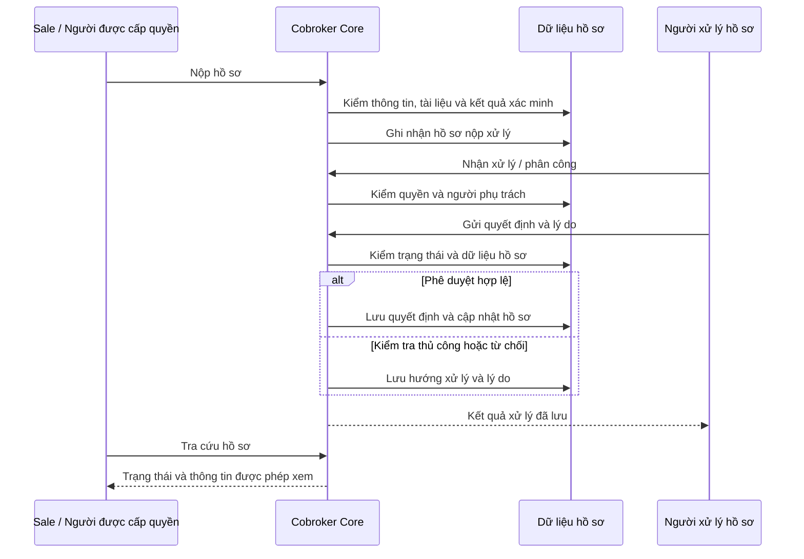

Mỗi quyết định phải ghi người thực hiện, thời điểm và lý do theo action. Quyền nhận xử lý, phân công, duyệt, chuyển kiểm tra thủ công và từ chối được kiểm độc lập. Core kiểm lại trạng thái hồ sơ trong transaction trước khi ghi quyết định để tránh hai người xử lý cạnh tranh.

### 8.2.3 Yêu cầu cập nhật hồ sơ đại lý

ARM tạo yêu cầu và snapshot; ASA chỉnh nháp rồi gửi duyệt; ARM xem thay đổi và quyết định. Core đối chiếu cả `requestVersion` và `baseProfileVersion` theo mục 7.1.3. Duyệt thành công mới áp dữ liệu lên hồ sơ có hiệu lực; phản hồi mở lại chỉnh sửa; từ chối/hủy/hết hạn kết thúc yêu cầu. Dữ liệu hồ sơ, trạng thái yêu cầu và outbox được ghi cùng transaction; email và lịch sử bên ngoài được gửi sau commit.

## 8.3 Xếp hạng Sale

### 8.3.1 Tổng hợp và xếp hạng cuối quý

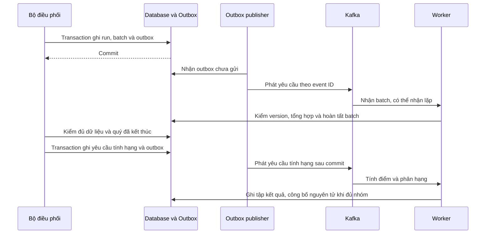

Outbox publisher chỉ gửi sau commit; transaction DB không bao gồm giao dịch Kafka. Worker kiểm event ID, version và trạng thái công việc trước khi ghi. Công bố phải chuyển toàn bộ tập kết quả hợp lệ sang trạng thái được đọc chính thức một cách nguyên tử, không để báo cáo trộn kết quả chưa hoàn tất. Sweeper xử lý công việc treo theo lease và trạng thái DB; replay không cộng thêm doanh thu.

### 8.3.2 Tra cứu và xuất

BFF xác thực người dùng; Analytics kiểm actor token, quyền chức năng và phạm vi tổ chức hiện hành rồi giao phạm vi này với bộ lọc. Query và export sử dụng cùng điều kiện. Bộ phận đang quản lý Sale quyết định quyền xem báo cáo, kể cả kỳ cũ, trong phạm vi được cấp; đơn vị cũ không giữ quyền chỉ vì đã quản lý Sale ở kỳ đó. Bộ phận hiển thị là bộ phận hiện hành, còn doanh số và hạng chính thức lấy từ tập kết quả đã công bố. Chuyển đơn vị không viết lại doanh số, hạng hoặc lịch sử quan hệ.

### 8.3.3 Ma trận lỗi

| Tình huống | Xử lý |
| --- | --- |
| Thiếu config cho nhóm | Không gán hạng giả; trả trạng thái/remark và cảnh báo |
| Giao dịch thiếu tiền/ngày | Gắn lý do loại; đối soát nguồn |
| Message lặp hoặc batch cũ | Kiểm trạng thái/lease; tránh ghi lặp |
| Nguồn đến muộn | Cập nhật dữ kiện nguồn và báo cáo chênh lệch; giữ nguyên kết quả đã công bố theo mục 8.3.4 |
| Không có scope | Từ chối, không fallback toàn hệ thống |
| Chứng nhận đang xử lý hoặc render lỗi | Trả trạng thái tương ứng; chỉ cấp URL khi file sẵn sàng và actor có quyền |

### 8.3.4 Công bố, chuyển quý và dữ liệu đến muộn

Kết quả xếp hạng đã công bố **không được công bố lại**. Tập công bố lưu kỳ, phiên bản cấu hình, mốc dữ liệu và các số liệu dùng tính điểm; báo cáo kỳ đã công bố luôn đọc tập này. Giao dịch đến muộn hoặc hiệu chỉnh sau công bố được lưu ở dữ kiện nguồn và báo cáo chênh lệch riêng, không sửa hạng/điểm/doanh số của tập công bố. Điểm của kỳ chưa công bố sử dụng dữ kiện nguồn mới nhất đã đối soát; việc hiệu chỉnh dữ kiện quý trước có thể ảnh hưởng điểm kỳ sau nhưng không thay kết quả quý trước đã công bố.

Badge trong quý Q chỉ lấy hạng đã công bố của Q−1. Từ đầu quý tới khi Q−1 được công bố, giao diện ẩn badge và hiển thị trạng thái chờ cập nhật; không tiếp tục gắn hạng Q−2 và không diễn giải chờ công bố thành không đạt hạng. Nút tải chứng nhận chỉ mở khi có hạng chính thức. Chứng nhận gắn kỳ, mã kết quả công bố và phiên bản template; dữ liệu nguồn hiệu chỉnh không làm thu hồi hoặc sinh lại chứng nhận với hạng khác. File hết hạn có thể được tạo lại từ cùng tập công bố.

Kiểm thử bắt buộc: 00:00 chuyển quý, job chưa hoàn tất, không có cấu hình, dữ liệu đến muộn trước/sau công bố, công bố đồng thời và tải lại chứng nhận sau sửa nguồn.

## 8.4 Watchlist: ghi nhận, đồng bộ, import và scan

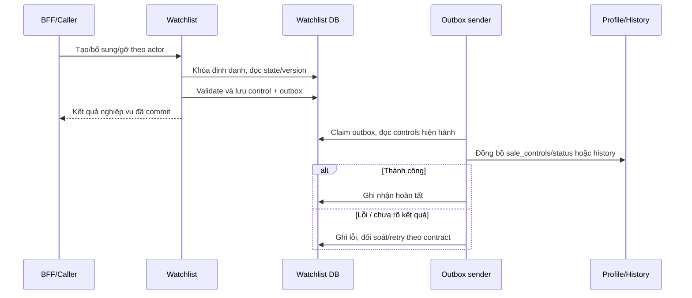

Identity locks được lấy theo thứ tự ổn định để serialize các yêu cầu trùng CCCD/mã nhân viên/phone. Version cũ trả xung đột; không silently overwrite. Sender đọc dữ liệu hiện hành để tránh outbox DISABLE cũ khóa lại người đã được gỡ nếu không còn kiểm soát chặn.

Import: lấy mẫu → prepare-upload → upload file → tạo job bằng file ref → validate từng dòng → xem lỗi → confirm → apply và xem kết quả. Không dùng trạng thái VALIDATED để báo “đã cấm bán”. File XLSX tối đa 10 MB; giới hạn dòng và chính sách dữ liệu theo DEC-02.

Scan: khóa chạy → lấy facts theo cursor → xác định mốc và ngưỡng → ghi ứng viên → tính tỷ lệ → nếu bất thường thì hủy ứng viên, không phát hành → nếu dry-run chỉ báo cáo → nếu thực thi mới ACTIVE và outbox. Bản ghi gracePending được bỏ qua lượt đầu và xóa cờ, lượt sau đánh giá lại. INT-01 phải đạt contract test và đối soát dry-run trước khi bật quét thực thi.

## 8.5 Chu kỳ bán hàng và lịch thông báo

### 8.5.1 Tính lại một Sale

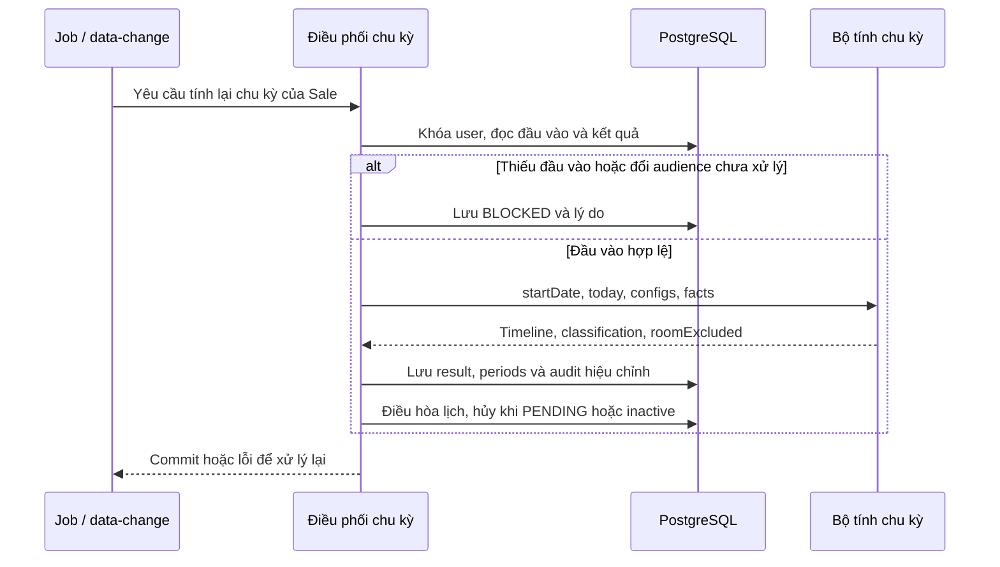

### 8.5.2 Trạng thái nghiệp vụ

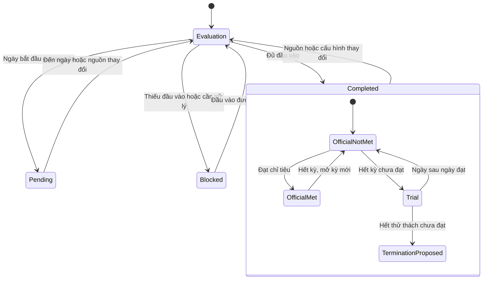

`PENDING`, `BLOCKED`, `COMPLETED` là trạng thái tính toán; các trạng thái bên trong `COMPLETED` là phân loại nghiệp vụ. Khi sửa/hủy giao dịch hoặc đổi ngày bán, bộ tính dựng lại các kỳ bị ảnh hưởng từ nguồn, không chỉ chuyển sang trạng thái kế tiếp trên sơ đồ.

### 8.5.3 Lịch sử tính lại chu kỳ

Mỗi lần tính lại làm thay đổi kết quả phải ghi `recalculationId`, Sale, nguyên nhân, mã sự kiện/yêu cầu, phiên bản nguồn/cấu hình, khoảng kỳ bị ảnh hưởng, version kết quả trước/sau và thời điểm. Bản chênh lệch phải cho biết ngày kỳ, số giao dịch, phân loại và điều kiện hạn mức đã đổi thế nào. Kết quả mới và lịch sử thay đổi được commit cùng transaction; replay không đổi kết quả không tạo một lần hiệu chỉnh nghiệp vụ mới.

Thông báo đã gửi giữ nguyên receipt và version kết quả đã dùng; tính lại chỉ hủy/điều hòa lịch chưa gửi. Đối soát phải tái dựng được vì sao kỳ cũ thay đổi mà không dựa vào log vận hành ngắn hạn. Audit chu kỳ không tự điều chỉnh hoa hồng hoặc quyết toán của hệ thống khác.

### 8.5.4 Lịch thông báo

Nhắc trước x ngày: ngày gửi không trước đầu kỳ; x vượt độ dài kỳ thì nhắc ngày đầu. Kết thúc: gửi ngày sau kết thúc vào giờ cấu hình. Đạt chỉ tiêu thì ngừng nhắc; lịch trùng cùng kỳ/loại/thời điểm được gộp.

Job chuẩn bị bằng dữ liệu mới dưới khóa, gửi ngoài transaction rồi ghi kết quả. BLOCKED giữ lịch nhưng tạm không gửi và không tăng số lần thử; PENDING do ngày bán tương lai hủy lịch không còn phù hợp. Chỉ bù trong ngày; không tự gửi thông báo quá hạn ngày trước.

Sale ngừng hoạt động **không nhận thông báo chu kỳ**. Khi nhận thay đổi trạng thái, Analytics hủy lịch chưa gửi cho Sale đó; ngay trước gửi phải kiểm lại trạng thái hoạt động và version kết quả. Sale được kích hoạt lại chỉ có lịch phù hợp với trạng thái hiện hành, không gửi bù thông báo của giai đoạn ngừng hoạt động. Lệnh đã được kênh tiếp nhận trước khi trạng thái ngừng có hiệu lực được ghi receipt để đối soát; không tuyên bố có thể thu hồi thông báo đã gửi.

Trạng thái ngừng hoạt động không tự xóa dữ kiện hoặc lịch sử chu kỳ. Phép tính chu kỳ vẫn phục vụ báo cáo theo ngày bán và giao dịch; `TERMINATION_PROPOSED` là kết quả phân loại, không phát lệnh chấm dứt hay thông báo cho tài khoản ngừng hoạt động.

Nếu kênh đã nhận nhưng ghi receipt thất bại, công việc chuyển UNKNOWN theo cơ chế lease để đối soát. Retry sử dụng notification ID ổn định; kênh đích phải hỗ trợ dedup hoặc truy vấn receipt trước khi gửi lại.

### 8.5.5 Ca biên

| Ca | Expected |
| --- | --- |
| Đúng ngày cuối kỳ | Kỳ còn được tính đến hết ngày |
| Thử thách đạt D | D vẫn thử thách; D+1 chính thức |
| Có 1/2 GD lúc thử thách hết hạn | Đề xuất chấm dứt |
| GD ký trong kỳ nhưng đến muộn | Tính lại theo ngày ký, có thể sửa kết quả cũ |
| GD ký sau terminal | Không tự mở lại |
| Thiếu config ở giữa timeline | BLOCKED, không tự chọn cấu hình tương lai |
| Sale inactive | Chu kỳ tiếp tục chạy |
| Reset tại D | Kỳ cũ hết D−1, không có GD của D trong kỳ cũ |

## 8.6 Vùng, chủ quản, liên minh và pháp nhân

### 8.6.1 Gán dự án cho vùng

1. Đọc danh mục dự án/CMS và kiểm actor; nhận vùng, dự án, giai đoạn, ngày hiệu lực, quyết định.
2. Kiểm vùng ACTIVE có SELLER; ngày kết thúc không trước bắt đầu; file quyết định đúng contract.
3. Khóa quan hệ cha, kiểm overlap từng cặp trong batch và dữ liệu hiện có.
4. Tạo N bản ghi vùng × dự án và lịch sử trong transaction; một phần tử sai thì không lưu một phần batch.
5. API đọc vùng bán suy theo mapping mới; consumer cập nhật scope/cache theo contract; UI đọc lại dữ liệu sau mutation và tại mốc thay đổi hiệu lực.

### 8.6.2 Chuyển vùng chủ quản

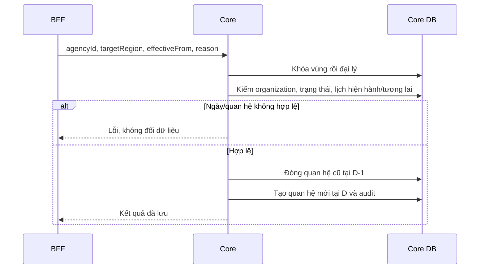

Chuyển chủ quản không thay tập dự án/vùng bán. Chuyển có hiệu lực tương lai không làm API “chủ quản hiện tại” trả vùng mới trước ngày D.

### 8.6.3 Liên minh / pháp nhân

Liên minh khóa các đại lý theo ID, kiểm đại lý hoạt động và quyền trên đại lý đứng đầu, dự án hợp lệ, số thành viên, trùng tham gia cùng dự án; sau đó lưu. Kích hoạt lại phải kiểm lại membership, không chỉ đổi status. Việc đại lý đứng đầu mất phân dự án cần hiển thị/đối soát theo contract, không tự cấp lại quyền bán vì tồn tại liên minh.

Pháp nhân khóa resource và kiểm ASA được phân công/organization; kiểm dự án thuộc tập dự án đại lý; kiểm ngày và overlap; lưu mapping hoặc kết thúc hiệu lực. Lịch sử được giữ cho đối soát.

### 8.6.4 Import hạng đại lý

Upload XLSX → parse/validate A/B/C và độc quyền → lưu preview Redis gắn actor/organization/version → hiển thị lỗi → confirm còn hạn → đọc và đối chiếu snapshot → cập nhật với optimistic version → commit toàn bộ. Xung đột 409 hoặc mất preview yêu cầu upload/preview lại; không tự cập nhật trên snapshot mới mà chưa cho người dùng xem.

## 8.7 Ma trận xử lý lỗi chung

| Tình huống | Hành vi / phục hồi |
| --- | --- |
| Dịch vụ xác minh timeout | Tra cứu retry tối đa 3 lần theo mục 6.3.1; mutation chưa rõ kết quả không tự gửi lại; hết ngân sách chuyển xử lý tích hợp |
| Dịch vụ xác minh trả lỗi hoặc kết quả sai lệch | Lưu lý do, yêu cầu bổ sung hoặc kiểm tra thủ công theo quyền |
| Profile/history lỗi sau commit Core/Watchlist | Giữ outbox, đo độ trễ và sai lệch đích theo mục 13.2.1; đọc lại quyết định hiện hành trước khi gửi |
| Watchlist timeout/không khả dụng tại điểm kiểm soát | Theo phương án DEC-07: dừng mutation cần quyết định, trả 503 có thể thử lại; không kết luận bị cấm, không kích hoạt hoặc cấp thêm quyền. Cho lưu nháp và đọc trong quyền hiện có |
| Thiếu ngày bán/config chu kỳ | BLOCKED có lý do; không coi là không đạt hoặc đủ điều kiện |
| Scan tỷ lệ bất thường / dry-run | Không phát lệnh khóa hàng loạt |
| Overlap vùng/pháp nhân | Từ chối toàn bộ thao tác/batch liên quan |
| Version hồ sơ/import thay đổi | Conflict, yêu cầu đọc/preview lại |
| Mapping/nguồn ngoài không khả dụng | Không tạo dữ liệu thay thế giả; trả lỗi phù hợp và cho thử lại thao tác an toàn |
| Actor không có scope | Từ chối hoặc tập rỗng theo contract; không mở toàn hệ thống |

# 9. Security & Compliance Architecture

## 9.1 Xác thực caller và người thao tác

BFF xác thực người dùng rồi phát actor token có chữ ký, thời hạn tối đa 60 giây, audience là dịch vụ đích. Token chứa issuer, subject, caller, action, resource/organization scope, thời điểm phát/hết hạn và mã yêu cầu duy nhất; quyền trong token phải được lấy từ nguồn tin cậy. Token ràng buộc method, đường dẫn tài nguyên, query và hash body cho mutation. Kết nối S2S dùng TLS cùng định danh workload được xác thực; mTLS và danh sách caller giới hạn đường gọi trực tiếp.

Core, Analytics và Watchlist cùng xác minh chữ ký, issuer, audience, thời hạn, caller và ràng buộc request trước khi dựng actor context. Job dùng service principal riêng với quyền theo công việc, không giả actor người dùng. Header `X-VHMAgent-UserId`, `X-VHMAgent-Role`, `X-User-Id` nếu được giữ để tương thích chỉ là dữ liệu dẫn xuất, không được dùng độc lập để cấp quyền. BFF loại header do client tự cung cấp; mạng nội bộ/CIDR không thay xác thực.

Mutation kiểm replay của token theo mã yêu cầu và phối hợp với `Idempotency-Key`: request hợp lệ gửi lại chỉ được đọc lại kết quả hoặc báo đang xử lý, không thực thi lần hai. Kho chống replay dùng chung giữa các replica và giữ ít nhất thời hạn token cộng độ lệch đồng hồ cho phép 30 giây. L3-SEC kiểm giả chữ ký, sai audience/caller, hết hạn, thay body, token phát lại và gọi trực tiếp service. Không có chế độ fallback tin header khi xác thực token lỗi.

## 9.2 Authorization & Access Control

Quyền được đánh giá theo ba lớp: service principal → quyền chức năng của actor → phạm vi resource. Mọi API trả dữ liệu hoặc tạo tác động phải vượt cả ba lớp. Header actor và bộ lọc FE không tự cấp quyền.

| Nhóm resource/action | Quyền và phạm vi thiết kế | Enforcement / tiêu chí nghiệm thu |
| --- | --- | --- |
| Hồ sơ, đại lý, yêu cầu cập nhật | Actor thuộc organization và có quyền trên đại lý/yêu cầu; snapshot theo requestId | Core kiểm ownership và trạng thái trước đọc/ghi; test cross-organization và live/snapshot |
| Ranking list/detail | 11/100 toàn phạm vi; 60 vùng, 23 phòng, 20 nhóm; 21 đơn vị thấp nhất; 64 danh sách đại lý được cấp | Resolver giao scope với bộ lọc; scope rỗng không mở toàn hệ thống |
| Ranking config/export | Config 11/100; export theo role được cấp, role21 đơn lẻ không được xuất | Kiểm quyền độc lập với quyền xem; export giữ cùng predicate dữ liệu |
| Chu kỳ list/detail/export | Phạm vi Sale theo tổ chức/đại lý/vùng của actor | BFF cung cấp context tin cậy; INT-05 nghiệm thu cả list và truy cập trực tiếp detail |
| Chu kỳ config | Quyền quản trị cấu hình riêng | Kiểm actor, ngày hiệu lực và expectedUpdatedAt; audit trước/sau |
| Watchlist | Realm Internal/Check/Market tách biệt; reveal/export/công khai là action riêng | Kiểm action và PII policy DEC-02; caller check chỉ nhận dữ liệu phục vụ quyết định |
| Vùng | PCS/Admin theo REG-UC-08; phạm vi quản lý xác định qua CMS | Core/BFF thực thi action matrix; INT-05 bao phủ vùng ngoài phạm vi |
| Import hạng đại lý | ARM roles11/1101 theo contract; preview gắn actor/organization | Confirm kiểm lại quyền và version; mở rộng role theo DEC-06 |
| Liên minh | Đại lý đứng đầu quản lý; thành viên được xem theo quyền | Kiểm organization, membership và trạng thái trước mutation |
| Pháp nhân/dự án | Operator và ASA được phân công trên đại lý | Kiểm agencyId/legalId/projectId trong cùng phạm vi |
| Kết quả xác minh/tài liệu hồ sơ | Actor có quyền trên hồ sơ và đúng mục đích xem | Kiểm account/hồ sơ/yêu cầu liên kết; kết quả ngoài phạm vi không được trả hoặc áp dụng |

Scope đọc của người có nhiều vai trò là hợp các phạm vi hợp lệ; sau đó giao với bộ lọc yêu cầu. Quyền sửa, công khai, xuất hoặc cấu hình được kiểm riêng từng action. Các mã role trong từng hệ thống được ánh xạ tại L3-SEC; thay mapping phải có compatibility test và audit.

## 9.3 PII, Secrets & Threat Model

| Nguy cơ | Kiểm soát thiết kế / tiêu chí kiểm thử |
| --- | --- |
| Giả actor/scope | Xác minh actor token và định danh caller theo mục 9.1; kiểm request trực tiếp và token thay body |
| IDOR hồ sơ/media/history | Kiểm resource ownership, organization, source và action trước trả dữ liệu |
| Lộ CCCD/phone qua list/export | Policy masking/reveal/export theo DEC-02; audit actor và phạm vi dữ liệu |
| Dò quét tra cứu thị trường | Chỉ exact match, không tìm gần đúng/prefix hoặc liệt kê; giới hạn theo caller, actor và IP; audit quyết định truy cập, phát hiện chuỗi tra cứu bất thường |
| File độc hại hoặc quá lớn | Allowlist loại/size, kiểm parser/upload, private storage, kiểm quyền download |
| Outbox cũ khóa lại tài khoản | Tính lại kiểm soát hiện hành lúc gửi, đối soát trạng thái Profile |
| Gửi yêu cầu xác minh trùng | Lưu tham chiếu yêu cầu và đối soát trước khi gửi lại |
| Lộ thông tin xác thực hoặc dữ liệu hồ sơ qua log | Secret manager theo môi trường, redaction và audit truy cập |
| Quyền vùng sai sau thay mapping | Scope server-side theo ngày hiệu lực, kiểm cả read/export và thao tác |

Credential được quản lý theo môi trường, cấp quyền tối thiểu và rotation có kiểm soát. Secret, raw media và signed URL bị loại khỏi log/event. Kiểm soát dữ liệu hồ sơ, ranking, chu kỳ, cấm/hạn chế và quan hệ đại lý theo L3-SEC và SEC-01. Thay đổi consent, retention hoặc quyền truy cập đặc quyền phải qua Security/Data production gate.

### 9.3.1 Kiểm soát tra cứu thị trường

API thị trường chỉ trả dữ liệu được công khai của bản ghi đang áp dụng. Người gọi không được tải toàn bộ danh sách, dò theo prefix hoặc phân biệt bản ghi không tồn tại với bản ghi không được công khai. Tra cứu dùng body, không đặt giá trị tìm kiếm trên URL. Mức khởi tạo: tối đa 10 yêu cầu/phút cho mỗi actor, burst 3; 60 yêu cầu/phút cho mỗi IP; 300 yêu cầu/phút cho mỗi caller. Bộ đếm dùng chung các replica; vượt ngưỡng trả 429 và `Retry-After`. Kênh không có actor phải có phiên tra cứu được xác thực tại BFF, không bỏ qua giới hạn actor.

Theo dõi tỷ lệ không tìm thấy, số khóa tra cứu khác nhau và số lần bị chặn để phát hiện enumeration. Khóa thống kê định danh dùng HMAC và có thời hạn, không đưa nguyên giá trị vào log. Kết hợp hai trường định danh hay cho phép một trường phải được BO/Security chốt trong DEC-02; không tự mở rộng dữ liệu trả về vì người gọi biết một định danh.

Phạm vi công khai và mục đích xử lý phải được Pháp chế/Data Owner phê duyệt trước khi mở kênh thị trường. Căn cứ thẩm định gồm [Luật Bảo vệ dữ liệu cá nhân số 91/2025/QH15, có hiệu lực từ 01/01/2026](https://vanban.chinhphu.vn/?pageid=27160&docid=214590). Hồ sơ phê duyệt phải xác định căn cứ xử lý/công khai, đối tượng được truy cập và cơ chế tiếp nhận yêu cầu liên quan; việc có bản ghi BANNED không tự tạo quyền công khai. Tài liệu này không mở rộng phạm vi sang dữ liệu hoặc xử lý nội bộ của OCR/eKYC.

# 10. Deployment & Infrastructure Topology

## 10.1 Environments & Topology

Core, Analytics và Watchlist được triển khai độc lập. Mỗi dịch vụ sở hữu schema, kế hoạch chuyển đổi dữ liệu, cấu hình và lifecycle phát hành. API/worker sử dụng PostgreSQL, Kafka và Redis theo phụ thuộc domain; ingress/egress được kiểm soát bằng danh sách caller và đích tích hợp. Deployment manifest L3-OPS xác định namespace, image, replica, resource, probe và secret reference cho từng môi trường.

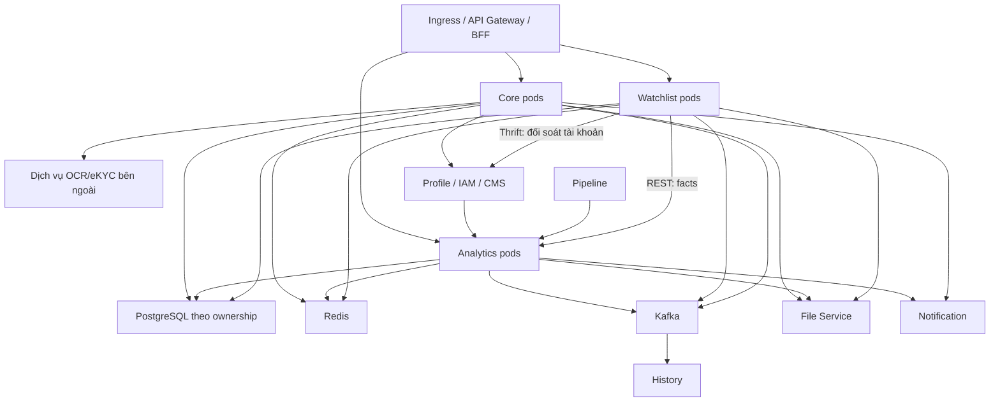

Sơ đồ biểu diễn topology logic. Việc phân bổ database instance, broker và cache theo môi trường được xác định bằng capacity plan và yêu cầu cô lập dữ liệu tại OPS-01.

## 10.2 Configuration & Rollout Controls

| Nhóm | Cấu hình khởi tạo | Điều kiện rollout |
| --- | --- | --- |
| Ranking jobs | Tổng hợp lúc 02:00, múi giờ Việt Nam | Điều phối triển khai sau khi import/backfill hoàn tất; không dùng lịch chạy để thay điều kiện đủ dữ liệu |
| Kỳ đầu ranking | Q3/2026 | REL-03: chuẩn bị dữ liệu kỳ đầu và dữ liệu kỳ trước phục vụ trọng số |
| Cycle | Job 00:00; notification claim tối đa 100 mục/worker, kiểm lịch mới mỗi 30 giây khi rỗng | Khi có backlog, worker xử lý liên tục; mục tiêu 100 lượt gửi/giây toàn cụm theo mục 11.1.1 |
| Watchlist scanner | Disabled, dry-run=true; 02:00; batch 500; maxRatio 0,05; minSample 1.000 | INT-01 contract test và dry-run report đạt trước bật thực thi |
| Rank import đại lý | Redis preview 15 phút, 5 MB/1.000 dòng | Kiểm giới hạn gateway và lỗi preview hết hạn |
| Watchlist import | Thời hạn xác nhận 24 giờ, tối đa 20.000 dòng | DEC-02 chốt giới hạn; job đang áp dụng được giữ tới khi đối soát xong |
| Tích hợp xác minh hồ sơ | Địa chỉ dịch vụ, thông tin xác thực S2S và timeout caller | Kiểm liên kết hồ sơ/yêu cầu và xử lý kết quả theo L3-IDV |

## 10.3 Migration & Release Strategy

1. Chốt contract và quyết định mở ảnh hưởng dữ liệu/quyền; pin image, schema và configuration cho từng môi trường.
2. Chạy migration trên bản sao dữ liệu đại diện, kiểm lock/duration/rollback compatibility; không chạy thử destructive migration trên production.
3. Kiểm DDL cho vùng, dự án, quan hệ chủ quản, liên minh và pháp nhân: khóa, index, ràng buộc ngày và quyền chuyển đổi dữ liệu. Kiểm thử đồng thời phải bảo đảm invariant không chồng hiệu lực.
4. Nhập/đối soát nguồn Profile/Pipeline và quan hệ đại lý/vùng; giữ scanner dry-run, không tạo ngày bán giả để vượt BLOCKED.
5. Triển khai consumer/BFF theo thứ tự tương thích; chạy smoke API và kiểm quyền âm; backfill ranking trước công bố.
6. Bật job/side effect sau kiểm dữ liệu và quan sát backlog; nghiệm thu đăng ký/xác minh/duyệt hồ sơ, Profile và history.

Rollback image chỉ khi tương thích schema hiện tại. Không xóa results, periods hoặc outbox để xử lý nhanh; side effect đã gửi Profile/dịch vụ tích hợp không được rollback chỉ bằng restore DB.

### 10.3.1 Cutover Miền và Vùng chủ quản

Trước cutover, Core phân loại đại lý thành: đầy đủ/hợp lệ; thiếu dữ liệu nhưng ánh xạ được từ nguồn đã xác nhận; thiếu hoặc mâu thuẫn cần người quản lý xử lý. Backfill chỉ áp nhóm ánh xạ được, có bản đối soát trước/sau và không ghi đè dữ liệu đã được chỉnh sau thời điểm chụp danh sách. Không tự suy Miền từ tên vùng hoặc chọn vùng mặc định để lấp chỗ trống.

| Nhóm hồ sơ | Hành vi sau cutover |
| --- | --- |
| Tạo đại lý mới | Bắt buộc Miền và Vùng chủ quản hợp lệ |
| Hồ sơ cũ đầy đủ | Áp validation thông thường |
| Hồ sơ cũ thiếu dữ liệu | Cho đọc và cập nhật các trường không phụ thuộc vùng/Miền theo quyền hiện có; không bắt gửi lại toàn hồ sơ để sửa một trường độc lập |
| Thao tác cần vùng/Miền | Từ chối thao tác đó với mã `AGENCY_ORGANIZATION_INCOMPLETE` và danh sách trường cần bổ sung; không khóa toàn bộ hồ sơ |
| Yêu cầu cập nhật mở trước cutover | Giữ snapshot; kiểm version và validation theo phạm vi thay đổi; bổ sung vùng/Miền phải được người duyệt xem lại |

Danh sách thiếu dữ liệu có người phụ trách và hạn khắc phục. BO/Core phê duyệt phạm vi chuyển tiếp và ngày kết thúc trước release theo REL-02; không tự coi hết thời hạn là có đủ dữ liệu. Cuối đợt phải đối soát số hồ sơ còn thiếu bằng 0 hoặc có ngoại lệ được phê duyệt rõ phạm vi. Tắt rollback validation không được làm mất dữ liệu đã backfill hoặc thay đổi lịch sử hiệu lực.

## 10.4 Network & Infrastructure Security

Ingress chỉ nhận caller được cấp; DB/Redis/Kafka đặt trong mạng riêng. Egress giới hạn theo OCR-eKYC/File/Profile/History và các tích hợp được đăng ký. Credential tách theo môi trường. L3-OPS quy định NetworkPolicy, TLS, backup/PITR, secret injection, probes và requests/limits; OAT kiểm tra thực thi từng kiểm soát trên cấu hình phát hành.

# 11. Cost & Capacity/Performance

## 11.1 Capacity Model

| Năng lực | Biến tải | Giới hạn/điểm đo |
| --- | --- | --- |
| Core | Hồ sơ, media refs, đại lý/Sale, quan hệ vùng/dự án | p95 list/detail, lock wait, file throughput, số mapping hiệu lực |
| Ranking | N Sale × H tháng; T giao dịch; tối đa 4 quý mỗi query | DB bucket/WAL, batch, export 50.000, timeout query 10 giây |
| Chu kỳ | N Sale × số kỳ + facts mỗi Sale | Batch đọc 500, transaction từng Sale; tài khoản lịch sử dài |
| Watchlist | Số bản ghi/định danh, check rps, scan population, import rows | p95 check, khóa định danh, parser memory, scan duration, outbox lag |
| Vùng/liên minh | Số mapping ngày, dự án và membership | EXISTS trước phân trang, batch enrich, lock contention |
| Xác minh hồ sơ tại Core | Số hồ sơ gửi xác minh, lượt tra cứu kết quả, thời gian chờ | Tỷ lệ đủ điều kiện, sai lệch, lỗi tích hợp và thời gian xử lý hồ sơ |

Capacity test sử dụng dữ liệu nhiều năm và chạy đồng thời query, export/import, job cùng cập nhật hồ sơ trên nhiều pod. Đo riêng tài khoản có timeline dài, thời gian giữ khóa và memory khi xuất file. Batch 500 giới hạn số Sale mỗi lượt đọc; preview 15 phút giới hạn thời gian xác nhận thao tác.

### 11.1.1 Tập tải thẩm định và cao điểm thông báo

Baseline thử tải giả định 50.000 Sale, 2 triệu giao dịch, 1 triệu bản ghi quan hệ có lịch sử và tối thiểu 10.000 khoảng lịch sử trên một đối tượng có mật độ cao. Đây là tập tải để kiểm chứng thiết kế, không suy quy mô thực tế từ giới hạn export. Tải đồng thời gồm Core 100 rps, Ranking 30 rps, Cycle 30 rps, Watchlist check 50 rps, 2 export và các job nền. Đo cả truy vấn overlap, khóa chéo ngừng vùng/chuyển chủ quản và kích hoạt liên minh.

Nếu mỗi 30 giây chỉ xử lý 100 thông báo cho toàn cụm thì năng lực tối đa là 12.000/giờ, cần khoảng 4 giờ 10 phút cho 50.000 thông báo, chưa tính retry. Thiết kế vì vậy tách lịch phát hiện công việc khỏi tốc độ gửi: mỗi worker nhận tối đa 100 mục theo lease DB, xử lý xong lấy batch tiếp khi còn việc, không ngủ thêm 30 giây giữa các batch.

Mục tiêu sơ bộ gửi 50.000 thông báo trong 15 phút cần tối thiểu 55,6 lượt/giây. Thiết kế tải đỉnh 100 lượt/giây **toàn cụm**, có dự phòng cho retry; rate limiter chung phải nằm trong hạn mức được kênh đích chấp nhận. Replica có thể tăng tốc xử lý nhưng không tăng hạn mức toàn cụm. Nếu kênh không đáp ứng 55,6 lượt/giây, INT-03 phải chốt lại cửa sổ gửi hoặc phân bố lịch trước rollout IMMEDIATE, không che thiếu năng lực bằng tăng batch.

Queue ưu tiên thời điểm đến hạn rồi ID để xử lý ổn định; đo tuổi công việc và dự báo thời gian giải phóng backlog. Thông báo hết ngày không được gửi bù sang ngày sau: ghi nhận hết hạn, đưa vào báo cáo sự cố và không báo là đã gửi. Nghiệm thu gồm peak 50.000 lịch cùng giờ, kênh chậm, retry, chuyển inactive trong lúc chờ và thời điểm sát hết ngày.

## 11.2 Cost Model

Chi phí gồm compute API/worker, PostgreSQL data/index/WAL/backup, Redis, Kafka retention, file storage/egress, observability của Core, Analytics và Watchlist. Chứng nhận ảnh phát sinh storage/render khi RANK-US-05, RANK-US-06 được triển khai. Dự toán được tính từ population, peak traffic, retention và đơn giá môi trường trong capacity report OPS-01; báo cáo ghi chi phí cố định, chi phí biến đổi và dự phòng tăng trưởng.

Capacity report bao gồm N/T theo tháng, tăng trưởng, kích thước file, tỷ lệ retry, lịch sử lưu giữ, cửa sổ batch, peak traffic và ngân sách SRE/FinOps. Kết quả đo là căn cứ chọn replica, partition, DB pool và giới hạn job đồng thời.

# 12. Scalability & Reliability

## 12.1 Scaling Strategy

Scale API theo tải request; worker theo partition, giới hạn tích hợp và khả năng DB. Phân trang/query lọc trước khi tải dữ liệu; tránh N+1 trong enrich vùng/đại lý. Tăng số pod không thay thế kiểm soát khóa/idempotency hoặc tự làm job chạy nhanh hơn.

Ranking dùng Redis/ShedLock kết hợp run/batch DB; cycle dùng background job lease/checkpoint và khóa user; Watchlist scanner dùng Redisson và scan_run. Lease hết hoặc nhận lặp phải kiểm state/version ở DB trước tạo side effect.

## 12.2 Failure & Recovery Boundaries

| Sự cố | Thiết kế phục hồi / giới hạn |
| --- | --- |
| Kafka/outbox gián đoạn | Domain đã commit, side effect chờ; theo dõi oldest pending và retry đúng channel |
| Ranking worker chết | Sweeper/run state kiểm batch treo; không cộng lại doanh số vì message phát lặp |
| Cycle một Sale lỗi | Transaction Sale đó rollback; các Sale khác có thể chạy, checkpoint không vượt lỗi đầu tiên |
| Notification gửi rồi ghi trạng thái lỗi | UNKNOWN để đối soát receipt; chỉ retry với notification ID và cơ chế dedup của kênh |
| Scan facts thiếu/sai | Không dùng dữ liệu thiếu để khóa hàng loạt; dry-run/ratio guard không thay chất lượng facts |
| Redis mất preview | Import hạng yêu cầu preview lại; không confirm từ dữ liệu client tự gửi |
| Dịch vụ xác minh không khả dụng | Bảo toàn hồ sơ và mã yêu cầu; đối soát kết quả khi kết nối được khôi phục |
| Concurrent transfer/membership | Khóa cha/thứ tự khóa, kiểm overlap và version; không bypass bằng SQL |

## 12.3 Backup & Restore

Backup/PITR phải bao gồm facts/config/results/periods/notifications và outbox tương ứng. Sau restore cần đối soát những event đã phát hoặc side effect đã tới Profile/dịch vụ tích hợp; tránh phát lại mù toàn bộ. File/media backup và DB reference phải đồng bộ về khả năng truy cập. RTO, RPO và thời hạn backup theo mục 4 và 7.6.1, được kiểm chứng tại OPS-01; biên bản diễn tập ghi thời gian khôi phục thực tế, điểm dữ liệu phục hồi và kết quả đối soát.

### 12.3.1 Diễn tập khôi phục và chống phát lặp

1. SRE/DBA chặn sender, consumer tạo tác động và scheduler trước restore; lưu mốc sự cố và phạm vi khôi phục.
2. Khôi phục DB/outbox tại cùng điểm nhất quán. Đối soát các commit có thể mất trong cửa sổ RPO với mã sự kiện, dữ liệu nguồn có thể replay và xác nhận phía đích; receipt nằm cùng DB được restore không phải bằng chứng đầy đủ cho giai đoạn sau điểm khôi phục. Trước khi mở sender phải khôi phục hoặc xử lý rõ các quyết định mới hơn mà đích đã áp dụng, không dùng domain state cũ để đảo ngược chúng.
3. Phân loại từng tác động: đích đã nhận; xác nhận chưa nhận; hoặc chưa xác định. Tác động đã nhận được đánh dấu đối soát, không gửi lại. Tác động chưa xác định giữ chờ xử lý; không suy rằng DB còn pending thì đích chưa nhận.
4. Với Profile, đọc lại tập kiểm soát hiện hành rồi so sánh trạng thái đích; chỉ gửi quyết định còn hiệu lực. Với History/Notification, giữ event ID/notification ID và đối soát receipt hoặc chống lặp của đích. Nếu đích không có cả hai khả năng, không tự phát lại.
5. Khôi phục từng kênh với tập mẫu có kiểm soát; kiểm không nhân đôi, không áp lệnh cũ và không bỏ sót lệnh hợp lệ rồi mới mở toàn bộ. Ghi thời gian khôi phục, dữ liệu mất, backlog và kết quả đối soát.

Kịch bản bắt buộc: đích nhận nhưng sender chưa ghi ACK; gỡ cấm sau một lệnh khóa đang pending; nhiều kiểm soát cùng tài khoản; restore về trước lúc gửi thông báo; receipt hết hạn; nguồn/đích tạm không tra được. OPS-01 chỉ đạt khi chứng minh không có tác động trùng, không kích hoạt sai và RTO/RPO đạt mục tiêu mục 4. Diễn tập trước go-live và tối thiểu mỗi 6 tháng hoặc sau thay đổi cơ chế delivery.

# 13. Observability & Monitoring

## 13.1 Signals & Dashboard

| Nhóm | Chỉ số bắt buộc | Chiều phân tích |
| --- | --- | --- |
| API | Request rate, p95/p99, 4xx/5xx, timeout, auth deny | Service, route, method, outcome |
| Ranking | Data lag, aggregation oldest pending, reconciles failed, orphan usernames | Run/batch/quarter qua log; metric labels hữu hạn |
| Chu kỳ | COMPLETED/PENDING/BLOCKED theo reason, stale, lease/checkpoint, notification status | Audience, job type, reason và delivery outcome |
| Watchlist | Outbox oldest/failed, Profile sync lag, scan candidates/ratio/abort, import failures | Channel, scan type, dry-run, outcome |
| Core vùng | Overlap/version conflict, history lag, preview expired, CMS unavailable | Action và loại quan hệ |
| Xác minh hồ sơ | Số hồ sơ chờ, tuổi hồ sơ, lỗi/timeout, retry đã hết và trạng thái circuit breaker | Loại yêu cầu và kết quả xử lý tại Core |

Application log liên kết request/job/outbox bằng correlation ID và domain ID. Metric không dùng username, CCCD, session ID hoặc giá trị có cardinality không giới hạn. Dashboard phải cho phép đi từ cảnh báo tới log/trace và runbook tương ứng.

## 13.2 Alert Catalogue

| Điều kiện | Tác động | Xử lý |
| --- | --- | --- |
| Dữ liệu ranking ngày trước không hoàn tất vào mốc kiểm soát 04:00 | Bảng số liệu bị trễ | Kiểm mốc đồng bộ dữ liệu nguồn, run/batch và outbox |
| Batch ranking chờ quá 1 giờ | Pipeline tổng hợp tắc | Kiểm lease, worker, DB và sweeper |
| BLOCKED/stale tăng vượt ngưỡng vận hành | Ngày bán/config/facts không hợp lệ | Phân nhóm reason và đối soát producer |
| Scan abort hoặc tỷ lệ ứng viên vượt guard | Nguy cơ khóa sai diện rộng | Giữ dry-run, kiểm mẫu số/mốc ngày/eligibility |
| Profile/history outbox lỗi hoặc backlog tăng | Side effect chậm hơn quyết định nghiệp vụ | Kiểm dependency và retry theo channel |
| Notification UNKNOWN | Outcome delivery không xác định | Đối soát receipt trước retry |
| Dịch vụ xác minh hết retry, circuit mở hoặc hồ sơ chờ quá 30 phút | Hồ sơ không hoàn tất bước xác minh | Theo mục 6.3.1: đối soát mã yêu cầu, giao danh sách cần xử lý; không tự gửi lại mutation |

Ngưỡng theo môi trường, thời gian duy trì cảnh báo, mức độ và người trực được quản lý tại L3-OPS. Mỗi cảnh báo phải có owner và đường dẫn runbook trước go-live.

### 13.2.1 Giám sát outbox và trạng thái đích

Core và Watchlist đo riêng từng kênh Profile/History: số pending/failed, tuổi bản ghi chưa xác nhận cũ nhất, thời gian từ commit đến đích xác nhận p95/p99, số lần thử, tỷ lệ lỗi và thời điểm thành công gần nhất. Profile có thêm số tài khoản mà trạng thái đích khác quyết định hiện hành. ACK vận chuyển không tự chứng minh trạng thái nghiệp vụ đã áp dụng đúng.

| Mức khởi tạo | Điều kiện | Hành động |
| --- | --- | --- |
| Cảnh báo | Bản ghi chưa xác nhận lâu hơn 2 phút, duy trì 2 phút | Báo owner kênh; kiểm dependency, worker và lease |
| Nghiêm trọng | Lâu hơn 5 phút, hoặc backlog có việc nhưng không có delivery thành công trong 5 phút | Gọi người trực; đối soát tập ảnh hưởng và dừng retry dồn dập khi đích lỗi |
| Sai lệch trạng thái | Profile không khớp quyết định còn hiệu lực sau cửa sổ 2 phút | Đối soát theo tài khoản, đọc lại controls và chạy đồng bộ có quyền |

Bộ đối soát chạy mỗi phút trên tập tài khoản có thay đổi chưa được xác nhận, phân trang và giới hạn tải. Alert liên kết tới correlation/event ID trong log; không dùng tài khoản làm nhãn metric. Màn hình vận hành phân biệt quyết định đã lưu, đang chờ đồng bộ, đồng bộ lỗi và đã đối soát.

`RELEASED` không đồng nghĩa `ENABLE`. Gỡ cấm mà Profile vẫn khóa chỉ là sai lệch nếu quyết định hợp lệ của luồng đó yêu cầu mở lại và không còn điều kiện chặn khác. Khi quyết định là `NONE`, không phát lệnh mở chỉ để làm dashboard hết cảnh báo. Replay đọc lại quyết định hiện hành, không gửi lại payload khóa/mở đã cũ.

Mỗi tài khoản có revision đồng bộ tăng dần; sender tuần tự hóa theo tài khoản, còn Profile phải bỏ qua revision cũ và nhận lặp cùng event ID một cách an toàn. Đọc state trước gửi đơn thuần không ngăn được request cũ đến muộn sau request mới. Hợp đồng revision/đối soát này là điều kiện INT-05; kênh History dùng event ID và thứ tự aggregate để giữ lịch sử đúng. Sau restore phải khôi phục/đối soát revision đã được đích nhận trước khi tiếp tục, không ép đích nhận revision thấp hơn.

## 13.3 SLI/SLO

SLI đo riêng API availability, data freshness, job completion, side-effect delivery và notification delivery. Thông báo gửi thành công phải có xác nhận từ kênh. Đo riêng tỷ lệ hồ sơ hoàn tất xác minh, tỷ lệ sai lệch và tỷ lệ được phê duyệt.

Mục 4 xác định mục tiêu sơ bộ và cửa sổ availability theo tháng; mục 13.2.1 xác định ngưỡng delivery. OPS-01 đối chiếu phép đo với các mục tiêu này, ghi error budget và mọi điều chỉnh đã được phê duyệt. Dashboard sử dụng cùng định nghĩa với báo cáo nghiệm thu.

# 14. Operational Readiness

## 14.1 Runbook Register

| Sự cố / thao tác | Bước chẩn đoán và phục hồi | Owner |
| --- | --- | --- |
| Hồ sơ thiếu kết quả xác minh/tài liệu | Kiểm mã hồ sơ, tham chiếu yêu cầu, dữ liệu trả về và quyền truy cập; đối soát trước khi gửi lại | Core/Integration |
| Yêu cầu cập nhật kẹt | Kiểm state, assignee, hạn, version và snapshot/live; xử lý qua nghiệp vụ | Core |
| Ranking lệch doanh số | Đối soát nguồn và tập công bố; backfill dữ kiện có phạm vi, không sửa tập đã công bố; lập báo cáo chênh lệch | Analytics |
| Chu kỳ BLOCKED/stale | Kiểm ngày bán/audience/config/facts/version; tính lại sau sửa nguồn | Analytics + Profile |
| Lịch thông báo UNKNOWN | Đối soát receipt kênh trước retry; giữ notification ID để dedup | Analytics + Notification |
| Watchlist đã gỡ nhưng Profile chưa đúng | Kiểm controls hiện hành, outbox, action và Profile; preview sync trước chạy | Watchlist + Profile |
| Scan abort | Kiểm dữ kiện, mẫu số và tỷ lệ; chạy dry-run; tồn đọng hợp lệ đi qua phê duyệt ngoại lệ theo snapshot tại mục 3.3.4 | Watchlist |
| Import hạng conflict | Đọc thay đổi hồ sơ, preview lại và confirm; không override version | Core |
| Vùng sai phạm vi | Kiểm CMS team, ngày mapping, scope dự án Sale và actor; không sửa vùng chủ quản để chữa vùng bán | Core + BFF |
| Restore | Restore domain data/outbox, đối soát side effect, chạy mẫu E2E trước mở lại | SRE/DBA + owners |

## 14.2 Readiness Checklist

- Có owner, release ticket, phiên bản phát hành và cấu hình của từng service.
- Các quyết định nghiệp vụ/quyền tại mục 16 có người phê duyệt, trạng thái, ngày chốt và bằng chứng; không còn quyết định chưa chốt ảnh hưởng phạm vi phát hành.
- Contract facts, ngày bán, notification, scope vùng được nghiệm thu trước bật tính năng phụ thuộc.
- Migration/backfill/preview được kiểm trên dữ liệu đại diện; có kế hoạch xử lý dữ liệu cũ thiếu vùng/Miền.
- Scanner chạy dry-run được đối soát; không bật thực thi khi chưa có nguồn tin cậy.
- Dashboard, alert, quyền vận hành, runbook và contact trực đã kiểm.
- RTO/RPO và restore drill được duyệt; rollback không làm phát lại side effect nguy hiểm.

Go-live record ghi kết quả từng tiêu chí, reviewer và evidence của môi trường phát hành. Hạng mục được miễn phải có risk acceptance, biện pháp bù và ngày hết hạn.

# 15. Testing & Quality Strategy

## 15.1 Test Matrix

| Phạm vi | Ca kiểm thử bắt buộc |
| --- | --- |
| Đăng ký/xác minh/duyệt hồ sơ | Thiếu thông tin/tài liệu; kết quả đúng/sai hồ sơ; sai lệch định danh; timeout; nộp khi thiếu điều kiện; reviewer ngoài quyền; hai quyết định đồng thời |
| Hồ sơ cập nhật | Hai người sửa nháp; live đổi sau snapshot; duyệt cạnh tranh hết hạn/hủy; 409 không ghi một phần; snapshot cũ không đổi hạng/trạng thái |
| Ranking tiền/eligibility | contractDate vs depositDate; hủy vẫn tính ranking; thiếu VAT/KPBT; precision/overflow; so điểm không làm tròn |
| Ranking tier | Điểm tối thiểu, quota từng hạng, nhóm đồng điểm; trọng số, Sale mới/nguồn thiếu; quý hiện tại không có hạng chính thức |
| Ranking API | Tối đa 4 quý, export cắt có thông báo, role21, scope rỗng, agency scope giả, detail ngoài quyền |
| Badge/chứng nhận | Đầu quý chờ công bố; dữ kiện sửa sau công bố không đổi hạng/chứng nhận; chuyển đơn vị và tải lại; tên dài/có dấu, file lỗi, quyền tải |
| Watchlist | Định danh chuẩn hóa/trùng; bổ sung/reapply; create/release cùng lúc; account subset; trạng thái công khai; reveal/export quyền âm |
| Watchlist outbox | Release trước sender; nhiều controls; mất ACK; alert 2/5 phút; đích sai lệch và NONE; không tự bật lại do gỡ cấm |
| Watchlist import/scan | File/dòng sai, confirm lặp/hết hạn; population < 1.000, ratio > 5%, phê duyệt ngoại lệ hết hạn/đổi snapshot; grace theo ngày không phụ thuộc lượt quét; thiếu trang/nguồn |
| Cycle calculator | Chuỗi nhiều kỳ từ ngày31/năm nhuận; IMMEDIATE cắt kỳ chưa đạt/thử thách và không tạo kỳ rỗng; audit trước/sau khi late/cancel; replay không thêm hiệu chỉnh |
| Cycle nguồn/config | Late/cancel/đổi PIC/ngày, version cũ, IMMEDIATE/SEQUENTIAL, ngày bán tương lai, đổi audience, thiếu config |
| Cycle job/notice | Peak 50.000 cùng giờ; hạn mức toàn cụm; inactive trước/sau claim; không gửi bù ngày trước; lease mất, BLOCKED/PENDING, crash sau gửi |
| Vùng | CMS trùng/không khả dụng, tên chuẩn hóa, ít nhất một role, stop khi còn lịch tương lai, overlap khác giai đoạn |
| Chủ quản/vùng bán | Chuyển D−1/D, lịch tương lai, hai chuyển đồng thời, không đổi dự án, ASSIGNED khác ADDITIONAL, thu hồi scope |
| Liên minh/pháp nhân | Hai liên minh kích hoạt cùng đại lý/dự án; trạng thái cha–con; FK/unique/giới hạn; ASA ngoài quyền; thu hồi dự án không để mapping cũ cấp quyền; overlap ngày |
| Import hạng đại lý | A yêu cầu EXCLUSIVE, file/dòng limit, preview expired/khác actor/tổ chức, version conflict rollback toàn bộ |
| REG-UC-07, REG-UC-08 | AND/OR filter trước pagination, count không trùng, union scope đọc, thao tác ngoài quyền vùng |
| Reliability/performance | Tải mục 11; overlap 10.000 kỳ/đối tượng; khóa chéo vùng/đại lý/liên minh; restore sau đích nhận trước ACK; RTO/RPO và không phát lặp |
| Hợp đồng bảo mật | Token giả/hết hạn/sai audience/body/replay; idempotency cùng/khác payload; Watchlist timeout fail-closed; market enumeration và rate limit nhiều pod |
| Cutover | Đại lý thiếu Miền/vùng vẫn sửa trường độc lập; thao tác phụ thuộc bị chặn đúng; backfill không đè chỉnh sửa mới; snapshot mở trước cutover |

## 15.2 Quality Gates & Test Evidence

Test specification được tổ chức theo calculator, API, persistence, contract, security và E2E. QA duy trì truy vết từ mã yêu cầu nghiệp vụ (US/UC/BR) qua mục thiết kế và tiêu chí nghiệm thu đến ca kiểm thử và kết quả chạy.

| Gate | Điều kiện đạt |
| --- | --- |
| Unit/Persistence | Các rule tiền, ngày, trạng thái, lock/version và transaction có test xác định; toàn bộ test trong phạm vi phát hành pass |
| API/Contract | Schema, validation, error mapping, backward compatibility và consumer contracts pass |
| Security | Test giả actor, ngoài organization/source/scope, export/reveal/media trái quyền bị từ chối |
| Integration/UAT | Hoàn tất INT-01…INT-05 và các quyết định DEC ảnh hưởng nghiệp vụ; kết quả nguồn/đích được đối soát |
| Performance/OAT | Workload mục 11 đạt NFR; migration, retry, backup/restore và alert được diễn tập |

Test report ghi phiên bản phát hành, cấu hình, dữ liệu, môi trường, thời điểm và kết quả thực thi. Lỗi còn tồn tại phải có mức độ, tác động và quyết định release; report được gắn vào workflow nghiệm thu của phiên bản phát hành.

## 15.3 Test Data & Acceptance

Sử dụng dữ liệu giả lập cho kiểm thử. Tập dữ liệu phải bao gồm ngày cuối tháng, nhiều quý, lịch tương lai, nhiều kiểm soát một tài khoản và user đa role/đa vùng. Contract tests xác minh cả successful và forbidden/conflict/unknown path, không chỉ HTTP 200.

# 16. Risks & Open Issues

## 16.1 Architecture Risks & Controls

| ID | Rủi ro | Tác động | Biện pháp kiểm soát | Chủ sở hữu |
| --- | --- | --- | --- | --- |
| RISK-01 | Scope tổ chức và scope vùng không đồng nhất | Lộ dữ liệu hoặc thao tác sai đại lý/vùng | Action + resource policy; hợp scope đọc, giao bộ lọc; test quyền âm INT-05 | Core/BFF/Security |
| RISK-02 | Facts thiếu, trễ hoặc thay đổi sau quét | Phân loại/khóa tài khoản sai | Version/watermark; đối soát population; dry-run và ratio guard | Analytics/Watchlist |
| RISK-03 | Side effect chậm hơn transaction nghiệp vụ | Profile/history khác trạng thái domain | Outbox delivery status, dashboard lag và runbook reconcile | Backend/Integration |
| RISK-04 | Phát lại yêu cầu tích hợp sau timeout | Trùng yêu cầu xác minh hoặc thông báo | Liên kết yêu cầu với hồ sơ, dedup và đối soát receipt trước retry | Core/Analytics/Integration |
| RISK-05 | Cập nhật quan hệ đồng thời hoặc bypass writer | Overlap chủ quản/dự án, trùng membership | Khóa cha theo thứ tự, version, overlap query; giới hạn quyền DB | Core/DBA |
| RISK-06 | Restore DB sau khi side effect đã thực thi | Phát lại lệnh, sai trạng thái bên ngoài | Đối soát source/event/outbox/receipt trước mở lại xử lý | SRE/DBA/Integration |

Risk acceptance phải ghi owner, phạm vi ảnh hưởng, biện pháp bù, ngày hết hạn và điều kiện thu hồi. Rủi ro dữ liệu/quyền được thẩm định tại Security/Data production gate.

## 16.2 Integration & Release Requirements

Các phụ thuộc dưới đây là điều kiện để nghiệm thu thiết kế tích hợp và đưa nghiệp vụ vào vận hành. Mỗi hạng mục quy định contract, trách nhiệm và kết quả phải đạt.

| ID | Phạm vi thiết kế | Tiêu chí nghiệm thu | Chủ sở hữu / gate |
| --- | --- | --- | --- |
| INT-01 | Hợp đồng dữ liệu hoạt động bán giữa Analytics và Watchlist | Facts giao dịch không kèm định danh cá nhân; Profile cung cấp tập Sale; kiểm snapshot/version, đủ trang và đối soát dry-run theo mục 6.5.1 | Analytics/Watchlist — Integration |
| INT-02 | Đồng bộ ngày bắt đầu bán từ Profile vào Analytics | Bổ sung contract Profile, phiên bản dữ liệu nguồn, backfill và tính lại; nghiệm thu thay đổi ngày/late event | Profile/Analytics — Integration/UAT |
| INT-03 | Gửi thông báo chu kỳ trên Web/App | Hợp đồng Web/App, receipt/dedup; ≥ 55,6 lượt/giây cho peak thiết kế; không gửi Sale inactive; timeout và mất ACK không gửi trùng | Analytics/Notification — Integration/UAT |
| INT-04 | Badge/chứng nhận: triển khai pipeline RANK-US-05, RANK-US-06 | API self-access, template version, resolve/render, private file; test đổi quý, tên tiếng Việt và lỗi render | Analytics/BFF — Integration/UAT |
| INT-05 | Phạm vi vùng và điểm chặn liên dịch vụ | Actor token, scope và checks tại mutation; fail-closed theo DEC-07; E2E quyền, revoke và đối soát Profile/outbox | Core/BFF/Profile/Security — Security/UAT |
| REL-01 | Truy cập tài liệu phục vụ duyệt hồ sơ | Người xử lý chỉ xem tài liệu thuộc hồ sơ được cấp quyền; kiểm URL hết hạn và truy cập ngoài phạm vi | Core/Integration — Security/UAT |
| REL-02 | Thiết lập vùng chủ quản và Miền cho đại lý | Phân loại/backfill, xử lý hồ sơ thiếu, kiểm PATCH độc lập và snapshot mở trước cutover theo mục 10.3.1 | Core/BFF — Migration/UAT |
| REL-03 | Dữ liệu xếp hạng từ Q3/2026 | Thiết lập kỳ xếp hạng đầu tiên là Q3/2026, backfill dữ liệu trọng số và đối soát trước công bố | Analytics — Migration/UAT |
| OPS-01 | Capacity, SLO, RTO/RPO và deployment profile | Capacity report đạt mục 4/11; outbox alert mục 13.2.1; DR không phát lặp và đạt RTO/RPO theo mục 12.3.1 | SRE/DBA — OAT |
| SEC-01 | Retention và quyền truy cập dữ liệu Cobroker | Retention schedule, encryption/access matrix, purge/hold rules; test quyền hồ sơ, tài liệu, báo cáo và export | Data Owner/Security — Data production |

## 16.3 Business Decision Register

Các quyết định dưới đây ảnh hưởng hành vi sản phẩm hoặc compatibility. Phương án kỹ thuật được trình rõ để BO/BA phê duyệt tại Business gate; thiết kế chi tiết và kiểm thử phải bám quyết định được ghi nhận.

| ID | Quyết định và căn cứ | Phương án trình duyệt | Tác động / tiêu chí đóng | Chủ sở hữu |
| --- | --- | --- | --- | --- |
| DEC-01 | Tính duy nhất của hồ sơ cấm bán và lịch sử áp dụng theo WL-BR-03 | Giữ một hồ sơ định danh xuyên vòng đời, dùng supplement/reapply và lưu lịch sử từng lần | BO xác nhận UX/API; nếu cho tạo hồ sơ mới phải đổi unique và migration trước release | BO/Watchlist |
| DEC-02 | Quyền xem PII theo WL-BR-17 và giới hạn dữ liệu mỗi lần import | Kiểm full PII theo quyền riêng và audit; giữ giới hạn xử lý file có thông báo rõ | Chốt quyền hiển thị, điều kiện tra cứu một/hai trường, rate limit và căn cứ công khai; Pháp chế/Data Owner xác nhận trước mở kênh | BO/Security/Watchlist |
| DEC-03 | Hạn chế bán: mốc fallback Đại lý, lượt khóa sau grace và xử lý GD trong thời gian cấm | Ưu tiên ngày cọc hợp lệ, sau đó ngày kích hoạt đầu; chốt fallback và thời lượng gia hạn theo graceUntil; kiểm ngoại lệ scan theo snapshot, không theo số lượt quét | Decision table bao phủ thiếu ngày, ngày biên, lượt quét và giao dịch bị hủy; QA lấy cùng expected | BO/Integration |
| DEC-04 | Chu kỳ: ưu tiên IMMEDIATE so với terminal và chuyển audience | Giữ terminal cho tới quyết định mở lại; audience change đưa BLOCKED để bảo toàn lịch sử | BO xác định ngày hiệu lực, chính sách giữ/reset kỳ và thông báo; calculator tests cập nhật đồng bộ | BO/Analytics |
| DEC-05 | Điều kiện hiệu chỉnh liên kết CMS của vùng INACTIVE | Cho phép ngoại lệ hiệu chỉnh CMS để khôi phục liên kết hợp lệ; khóa tên/vai trò và audit đầy đủ | BO xác nhận ngoại lệ, actor được cấp và điều kiện kích hoạt lại | BO/Core |
| DEC-06 | Phạm vi tùy chọn ranking, quyền import hạng và tập Sale dùng cho thống kê | Giữ `ALLOW_TIE`; trình điều kiện a+b=100 và quota độc lập khi mở rộng đồng hạng; xác định role import và mẫu số thống kê | Ma trận chức năng/role, metric definition và Schema/OpenAPI được phê duyệt trước UAT | BO/Core/Analytics |

### 16.3.1 Quyết định bổ sung và trạng thái phê duyệt

| ID | Nội dung / phương án | Trạng thái | Chủ sở hữu / hạn chốt | Điều kiện đóng và tác động khi trễ |
| --- | --- | --- | --- | --- |
| DEC-07 | Watchlist lỗi: fail-closed tại thao tác tăng quyền/kích hoạt/nộp; cho lưu nháp và đọc theo quyền hiện có | Phương án trình duyệt | BO/Security/Core — trước APPROVED | Chốt các điểm chặn và UX thử lại; chưa chốt thì không phát hành luồng phụ thuộc checks |
| DEC-08 | Xếp hạng đã công bố đóng băng, không công bố lại; chứng nhận giữ kết quả công bố | Đã chốt trong review ngày 14/10/2026 | Product/Analytics — ghi vào hồ sơ thẩm định | Mục 8.3.4 và kiểm thử trước/sau công bố thống nhất; xác nhận chính sách được lưu trong workflow |
| DEC-09 | Sale ngừng hoạt động không nhận thông báo chu kỳ | Đã chốt trong review ngày 14/10/2026 | Product/Analytics/Notification — ghi vào hồ sơ thẩm định | Hủy lịch chưa gửi, kiểm lại trước gửi và không gửi bù giai đoạn inactive |

DEC-01…DEC-06 giữ trạng thái **Chờ phê duyệt BO**, hạn chốt trước APPROVED. Mỗi quyết định phải có người xác nhận, ngày xác nhận, phương án cuối và liên kết bằng chứng trong workflow. Chưa có bằng chứng không được đổi trạng thái sang đã duyệt. Quy tắc đã có căn cứ như IMMEDIATE cho Sale đang thử thách không bị đưa trở lại thành câu hỏi; DEC-04 chỉ giải quyết ngoại lệ terminal và chuyển audience.

### 16.3.2 Trạng thái phụ thuộc và hạn hoàn tất

Bảng dưới theo dõi trạng thái thẩm định và nghiệm thu của các phụ thuộc. Hạn hoàn tất gắn với mốc phê duyệt/phát hành. Release Owner cùng nhóm phụ trách xác lập ngày lịch cụ thể cho từng mốc trước APPROVED.

| Hạng mục | Trạng thái nghiệm thu | Hạn hoàn tất | Tác động khi trễ / cách cô lập |
| --- | --- | --- | --- |
| INT-01 | Chờ producer/consumer xác nhận contract và kết quả kiểm thử | Contract trước BASELINE; kiểm thử trước bật scanner | Scanner chỉ dry-run, không phát hạn chế tự động |
| INT-02 | Chờ xác nhận nguồn ngày bán, mapping và backfill | Contract trước BASELINE; đối soát trước bật chu kỳ | Sale thiếu ngày giữ BLOCKED; không bật phân hệ trên tập thiếu dữ liệu, không tạo ngày giả |
| INT-03 | Chờ nghiệm thu kênh, hạn mức và chống lặp | Trước bật gửi thông báo | Không báo gửi thành công bằng log; chưa đạt peak thì chưa rollout lịch đồng loạt |
| INT-04 | Chờ nghiệm thu chứng nhận | Trước bật tải chứng nhận | Badge chỉ dùng kết quả công bố; không cấp file chưa sẵn sàng |
| INT-05 | Chờ nghiệm thu actor/scope/checks | Trước phát hành API phụ thuộc | Chặn phát hành API chưa qua test quyền và sự cố Watchlist |
| REL-01 | Chờ nghiệm thu quyền xem tài liệu | Trước phát hành duyệt hồ sơ | Không mở quyền truy cập rộng để xử lý thiếu tích hợp |
| REL-02 | Chờ BO duyệt chuyển tiếp và báo cáo backfill | Chính sách trước APPROVED; dữ liệu trước cutover | Áp hành vi hồ sơ cũ thiếu dữ liệu ở mục 10.3.1; không bật validation toàn hồ sơ |
| REL-03 | Chờ đối soát dữ liệu kỳ đầu | Trước công bố Q3/2026 | Không công bố xếp hạng từ dữ liệu thiếu |
| OPS-01 | Chờ capacity/alert/DR rehearsal | Target trước APPROVED; bằng chứng trước GO-LIVE | Chặn go-live nếu chưa đạt phục hồi hoặc chống phát lặp |
| SEC-01 | Chờ Data Owner/Security/Pháp chế xác nhận | Chính sách trước APPROVED; kiểm thử trước GO-LIVE | Không mở kênh công khai khi chưa có căn cứ và quyền truy cập được phê duyệt |

### 16.3.3 Khớp nối artefact trước baseline

OpenAPI phải ánh xạ được sang ràng buộc dữ liệu và kịch bản kiểm thử: enum/trạng thái, version/idempotency, uniqueness/overlap, actor/scope, lỗi và timeout. L3-DATA bao gồm kế hoạch migration/backfill, kiểm dữ liệu cũ và rollback tương thích; L3-SEC bao gồm kịch bản giả actor, vượt scope, replay và enumeration. Người thẩm định ký cùng một tập phiên bản, không ghép API mới với DDL hoặc ma trận quyền cũ. Kết quả chạy kiểm thử và diễn tập là bằng chứng go-live sau triển khai; không yêu cầu có code chạy trước khi viết/phê duyệt thiết kế.

## 16.4 Migration & Compatibility Controls

Tích hợp xác minh danh tính tuân theo L3-IDV; quyền xem tài liệu phục vụ duyệt được nghiệm thu theo REL-01. Hạng đại lý dùng A/B/C; cập nhật hạng qua import có preview/version. Quan hệ vùng/dự án bảo vệ bằng khóa cha và kiểm overlap tại service. Thay đổi schema, quyền hoặc event contract phải có migration, API-diff và consumer compatibility report.

Lịch sử dữ liệu cũ được giữ phục vụ đối soát. Cutover không phát lại notification hoặc lệnh Profile hàng loạt; mỗi side effect được xử lý theo trạng thái thực tế và runbook đã nghiệm thu.

# Appendix

## A. Glossary

| Thuật ngữ | Nghĩa trong tài liệu |
| --- | --- |
| TTD L2 | Tài liệu thiết kế kỹ thuật hệ thống Cobroker thống nhất |
| ASA / ARM | Vai trò vận hành đại lý / quản lý; quyền chức năng theo L3-SEC |
| Vùng chủ quản | Vùng quản lý đại lý theo quan hệ có hiệu lực |
| Vùng bán | Vùng được gán cho dự án; suy ra từ dự án được phân của Sale/đại lý |
| Hạng Sale | Kim cương/Bạch kim/Vàng theo doanh số/điểm/quota |
| Hạng đại lý | A/B/C, phụ thuộc điều kiện độc quyền và import được cấp quyền |
| BLOCKED / PENDING | Chu kỳ thiếu/xung đột đầu vào / chưa đến ngày bán |
| TERMINATION_PROPOSED | Đề xuất ngừng hợp tác; không phải lệnh khóa tài khoản |
| roomExcluded | Điều kiện loại do chu kỳ; không là số hạn mức hoặc lệnh thu hồi căn |
| UNKNOWN / SENT | Outcome gửi không xác định / đã có xác nhận từ kênh |
| Effective-dated | Lưu lịch sử khoảng ngày bắt đầu/kết thúc hiệu lực |
| Outbox / side effect | Bản ghi gửi tích hợp cùng transaction nghiệp vụ / tác động thực thi ở hệ thống đích |
| Snapshot / version | Bản chụp dữ liệu dùng để xem/duyệt / phiên bản kiểm soát thay đổi đồng thời |
| Fail-closed | Tạm dừng thao tác cần kiểm soát khi chưa nhận được quyết định hợp lệ; không tự kết luận đối tượng bị cấm |
| Baseline | Tập thiết kế và hợp đồng cùng phiên bản được dùng làm căn cứ triển khai |

## B. Tài liệu nghiệp vụ tham chiếu

Mã truy vết trong TTD gồm tiền tố phân hệ và mã gốc: `RANK-US-01` tương ứng US-01 của xếp hạng; `CYC-US-01` tương ứng US-01 của chu kỳ; `WL-BR-03` tương ứng BR-03 của cấm/hạn chế; `REG-UC-01` tương ứng UC-01 của vùng/đại lý. Tiền tố là một phần bắt buộc của mã trong ma trận thiết kế và kiểm thử. Mã gốc trong tài liệu nghiệp vụ không thay đổi.

| Tài liệu | Phạm vi nghiệp vụ |
| --- | --- |
| [SRS xếp hạng Sale](https://vin3s.atlassian.net/wiki/spaces/BMAS/pages/3174598094) | Bảng quý, cấu hình, badge và chứng nhận |
| [SRS cấm/hạn chế bán](https://vin3s.atlassian.net/wiki/spaces/BMAS/pages/3174272140) | Quản lý đối tượng, kiểm soát tài khoản, import và tra cứu |
| [SRS chu kỳ bán hàng](https://vin3s.atlassian.net/wiki/spaces/BMAS/pages/3174532173) | Chính thức/thử thách, chỉ tiêu, cảnh báo và ngày bắt đầu bán |
| [SRS vùng/đại lý/liên minh/pháp nhân](https://vin3s.atlassian.net/wiki/spaces/BMAS/pages/3196028657) | Vùng chủ quản, vùng bán, hạng đại lý, liên minh và pháp nhân |

## C. Đầu vào bắt buộc trước production

Go-live package gồm approval record, contract INT-01…INT-05, quyết định DEC-01…DEC-09, backfill Q3, cấu hình job/scanner/tích hợp, migration rehearsal, report UAT/security/load/restore, SLO, retention và RTO/RPO. Mỗi artefact gắn phiên bản, owner và kết quả nghiệm thu tại Governance Gates.

## D. Danh mục quyết định kiến trúc (ADR)

| ID | Quyết định mô tả trong TTD | Lý do / hệ quả |
| --- | --- | --- |
| ADR-01 | Một TTD, domain thuộc các service riêng | Tránh trùng tài liệu nhưng vẫn giữ ownership dữ liệu |
| ADR-02 | Xác minh danh tính qua dịch vụ bên ngoài | Core sở hữu hồ sơ, liên kết yêu cầu và quyết định nghiệp vụ; hợp đồng tách biệt xử lý nội bộ của dịch vụ xác minh |
| ADR-03 | Ranking dùng bucket và run/batch công bố | Đọc nhanh; đối soát dữ kiện tách khỏi tập kết quả đã công bố bất biến |
| ADR-04 | Cycle calculator từ facts, transaction theo Sale | Tái tính được lịch sử, cần đủ nguồn và xử lý late/cancel |
| ADR-05 | Watchlist ghi quyết định cùng outbox, đọc lại state và gửi revision có thứ tự | Đối soát đích và loại revision cũ; kiểm soát tác động đến muộn sau quyết định mới |
| ADR-06 | Vùng chủ quản độc lập vùng bán; dự án đại lý từ Sale assigned | Quan hệ rõ ràng, đòi hỏi scope nguồn chính xác |
| ADR-07 | Kiểm overlap dưới khóa cha và exclusion constraint tại DB | Lỗi nghiệp vụ rõ ràng, DB ngăn writer ngoài API tạo overlap; cần kiểm dữ liệu cũ và btree_gist trước migration |
| ADR-08 | Import hạng preview/version, commit toàn bộ | Người dùng cần preview lại khi dữ liệu thay đổi |
| ADR-09 | Badge/chứng nhận là luồng render riêng | Tách tải render khỏi API bảng; private storage và self-access, nghiệm thu theo INT-04 |
| ADR-10 | Chuẩn hóa alliance_members và ràng buộc thành viên | FK, unique theo dự án/đại lý và kiểm cha–con cùng transaction; không dùng mảng làm nguồn membership |
| ADR-11 | Actor token chung và idempotency API | Không cấp quyền từ header không xác thực; retry không lặp nghiệp vụ |
| ADR-12 | Đóng băng xếp hạng sau công bố | Dữ kiện mới phục vụ đối soát và kỳ chưa công bố, không ghi đè chứng nhận hoặc kết quả đã công bố |

ADR là căn cứ triển khai và review thay đổi kiến trúc. Mọi thay đổi quyết định phải cập nhật tác động dữ liệu, contract, migration và tiêu chí kiểm thử liên quan.
