# L2 - VHMKDO2O - Cobroker

| Thuộc tính | Nội dung |
| --- | --- |
| Trạng thái thiết kế | DRAFT — phục vụ review; chưa có biên bản phê duyệt |
| Phiên bản tài liệu | 0.1 — 14/10/2026; hợp nhất nội dung Cobroker và bốn phân hệ mới |
| Hệ thống | VHM Agent / Cobroker |
| Phạm vi service | CoBroker Core, Sales Analytics, Watchlist; tích hợp OCR/eKYC FPT |
| Chủ sở hữu / người phê duyệt | Cần bổ sung tên người chịu trách nhiệm từ các nhóm bên dưới |
| Mẫu | [L2 OCR/eKYC](https://vin3s.atlassian.net/wiki/spaces/VARW/pages/3014268156), v29 |
| Nội dung kế thừa | [TTD Cobroker](https://vin3s.atlassian.net/wiki/spaces/VARW/pages/3000048322), v5 trước lần cập nhật này |
| Nguồn nghiệp vụ | Bốn SRS và phiên bản tại Appendix B |
| L1 / L3 | Chưa có L1 bổ sung; controller/DTO, migration, test và OpenAPI là đầu vào L3 |
| Phạm vi xác minh | Đọc source và tài liệu tại các commit ở Appendix B; không đồng nghĩa đã deploy hoặc đã chạy kiểm thử |

**Review Responsibility Matrix**

| Vai trò | Nội dung chịu trách nhiệm | Đầu ra review |
| --- | --- | --- |
| BO/BA | Quy tắc xếp hạng, cấm/hạn chế, chu kỳ, vùng và liên minh | Chốt các chênh lệch tại mục 16 |
| Backend / Integration | Hợp đồng BFF, Profile, Pipeline, OCR/eKYC, lịch sử, thông báo | API/event schema, mapping, bằng chứng E2E |
| Kiến trúc / Security | Ranh giới service, phạm vi dữ liệu, quyền truy cập PII | Review thiết kế và ma trận quyền |
| QA | Đối chiếu SRS và ca biên nghiệp vụ | Test/UAT report theo từng năng lực |
| SRE / DBA | Migration, cấu hình, tải, quan sát, khôi phục | OAT, dashboard, runbook, RTO/RPO |

**Governance Gates**

| Gate | Điều kiện hoàn tất | Trạng thái |
| --- | --- | --- |
| G1 — Business/Design | Chốt các mâu thuẫn làm thay đổi nghiệp vụ và quyền | Chờ review |
| G2 — Integration | Contract producer/consumer tương thích; các phần thiếu đã hoàn thành | Chờ bằng chứng |
| G3 — UAT/Security | Nghiệp vụ, quyền âm, PII, replay và concurrency đạt | Chưa cung cấp report |
| G4 — OAT/Release | Cấu hình môi trường, restore, tải và vận hành được duyệt | Chưa cung cấp report |

**L3 Artefact Register**

| Artefact | Nguồn kiểm chứng | Trạng thái |
| --- | --- | --- |
| API nghiệp vụ | Controller/DTO của Core, Analytics, Watchlist | Có source; mục 6 inventory các contract liên quan |
| API OCR/eKYC | Controller và OpenAPI của `ocr-ekyc` | Có source; cần kiểm tương thích consumer |
| Data model / migration | Entity, repository, Liquibase từng service | Có source; mục 7 và 10 |
| Test nghiệp vụ | Test calculator, API, persistence, integration trong repository | Có mã; chưa chạy lại trong tác vụ tài liệu |
| Badge/chứng nhận | Plan US-05/06 của Analytics | Chưa có implementation tại baseline |
| Scan facts / notification / scope vùng | Contract tích hợp cần hoàn tất | Các điểm mở mục 16 |
| Deployment / dashboard / DR | Artefact môi trường và report vận hành | Chưa được cung cấp |

Quy ước: **HIỆN CÓ** là đã tìm thấy implementation; **YÊU CẦU SRS** là hành vi sản phẩm cần đáp ứng; **ĐỀ XUẤT** chưa là contract đã triển khai; **CẦN CHỐT** là thiếu quyết định hoặc có chênh lệch. Trạng thái source và trạng thái triển khai được phân biệt trong toàn tài liệu.

# 1. Business Objectives & Scope

## 1.1 Business Context & Objectives

Cobroker quản lý vòng đời hồ sơ cộng tác viên/Sale và đại lý: đăng ký, xác minh danh tính, duyệt hồ sơ, cập nhật hồ sơ, nhân sự, chi nhánh và pháp nhân. Bốn năng lực bổ sung đưa việc quản trị hiệu quả bán hàng, kiểm soát điều kiện hoạt động và phân vùng tổ chức vào cùng kiến trúc nghiệp vụ.

| Năng lực | Mục tiêu | Service sở hữu |
| --- | --- | --- |
| Nền tảng Cobroker | Onboarding, OCR/eKYC, hồ sơ, phê duyệt, đại lý, ASA/nhân sự, cập nhật hồ sơ | CoBroker Core |
| 1. Xếp hạng Sale | Báo cáo doanh số quý, phân hạng, cấu hình, vinh danh | Sales Analytics |
| 2. Cấm/hạn chế bán | Quản lý đối tượng, phạm vi tài khoản, công khai/tra cứu, kiểm soát tự động | Watchlist |
| 3. Chu kỳ bán hàng | Chính thức/thử thách, cảnh báo, đề xuất ngừng hợp tác và điều kiện hạn mức | Sales Analytics |
| 4. Vùng/đại lý/liên minh/pháp nhân | Vùng chủ quản, vùng bán theo dự án, liên minh, dự án pháp nhân, hạng đại lý | CoBroker Core |

## 1.2 In Scope

Giữ và cập nhật các nghiệp vụ Cobroker hiện có còn phù hợp; bổ sung cả bốn phân hệ trong **một tài liệu L2**. Tài liệu mô tả trách nhiệm service, quy tắc, API, dữ liệu, luồng thành công/lỗi, quyền, triển khai và kiểm thử.

Tích hợp danh tính hiện hành dùng **FPT qua service OCR/eKYC**, theo xác nhận của chủ hệ thống ngày 14/10/2026 và source `ocr-ekyc`. Core không quản lý credential FPT và không gọi trực tiếp API xác thực/upload của nhà cung cấp cũ.

## 1.3 Out of Scope

Không thiết kế lại Pipeline/SAP, Profile/IAM, CMS, File Service hoặc nội bộ thuật toán FPT. Không đồng nhất đề xuất chấm dứt chu kỳ với khóa tài khoản. Chức năng check-in trong SRS cấm/hạn chế đang chờ đặc tả được để ngoài phạm vi triển khai hiện tại. Chi tiết UI/BFF chưa có source trong đầu vào phải được kiểm chứng tại G2/G3.

## 1.4 Assumptions, Constraints & Dependencies

Ngày nghiệp vụ dùng múi giờ Việt Nam. Profile là nguồn nhân sự/đơn vị; Pipeline là nguồn giao dịch; Core sở hữu hồ sơ đại lý và liên kết vùng; Analytics sở hữu projection/báo cáo; Watchlist sở hữu quyết định cấm/hạn chế. Không ghi chéo database giữa các service.

“Vùng” trong cây CMS, vùng chủ quản đại lý và vùng bán dự án là các khái niệm có mapping riêng. “Hạng Sale” Kim cương/Bạch kim/Vàng khác “hạng đại lý” A/B/C. Không sử dụng chung enum hoặc suy ra quyền từ sự giống nhau về tên.

# 2. Architecture Overview & Principles

## 2.1 System Context & Component Diagram

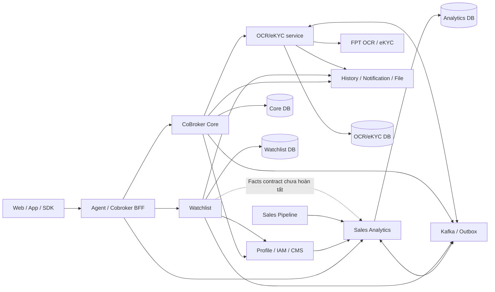

Các mũi tên thể hiện phụ thuộc logic, không mặc định cùng giao thức. Watchlist→Analytics là phụ thuộc chưa có producer contract hoàn chỉnh tại baseline; không được xem đường nét đứt là tích hợp đã chạy.

## 2.2 Architecture Principles

| Nguyên tắc | Áp dụng |
| --- | --- |
| Sở hữu dữ liệu theo domain | Core không tính xếp hạng; Watchlist không thay calculator chu kỳ; OCR/eKYC sở hữu provider integration |
| Tách đọc nguồn, tính toán và ghi kết quả | Calculator ranking/cycle nhận đầu vào; service điều phối transaction; job điều phối lịch |
| Nhất quán trong DB, tích hợp eventual consistency | Cập nhật domain/outbox cùng transaction khi implementation hỗ trợ; theo dõi side effect ngoài DB |
| Không giữ transaction khi chờ hệ thống ngoài | OCR chờ provider bằng lịch poll; notification chuẩn bị/gửi/ghi kết quả tách pha |
| Bảo vệ retry theo tác động | Consumer nhận lặp phải an toàn; không tự retry mutation eKYC hoặc submit OCR không rõ kết quả |
| Phân quyền trên dữ liệu | Scope phải đi từ actor tin cậy; list/detail/export đều phải kiểm; filter không thay authorization |
| Lịch sử có hiệu lực | Vùng chủ quản/dự án lưu ngày bắt đầu/kết thúc; không suy quyền hiện tại cho giao dịch lịch sử |

## 2.3 Ranh giới nhất quán

Core dùng transaction và khóa để bảo vệ thay đổi quan hệ, snapshot yêu cầu cập nhật và gán khoảng hiệu lực. Import hạng dùng optimistic version và rollback toàn bộ khi xung đột. Analytics dùng run/batch, facts, result và reconcile; chu kỳ tính riêng từng Sale dưới khóa user. Watchlist dùng khóa định danh, version bản ghi và outbox cho đồng bộ Profile/lịch sử.

Không có transaction phân tán bao phủ Core, Analytics, Watchlist, Profile và FPT. Tài liệu không cam kết exactly-once cho toàn bộ chuỗi. Trạng thái công việc, idempotency và đối soát là phần bắt buộc của luồng lỗi.

# 3. Functional Requirements

## 3.1 Nền tảng Cobroker hiện có

| Nhóm | Quy tắc và kết quả |
| --- | --- |
| Đăng ký và hồ sơ | Tạo hồ sơ theo account; chọn đội nhóm, bổ sung thông tin định danh, chứng chỉ môi giới, ảnh đại diện và tài liệu |
| OCR tài liệu | Chuẩn bị upload, tạo phiên OCR, thăm dò và đối soát CCCD hai mặt/phụ lục lao động; không chờ FPT trong request tạo OCR |
| eKYC SDK | Khởi tạo phiên, SDK OCR/liveness/NFC qua service FPT; Core đọc kết quả theo session và áp dụng kiểm tra hồ sơ |
| Nộp và duyệt | Nộp hồ sơ, nhận xử lý/phân công, phê duyệt, chuyển kiểm tra thủ công hoặc từ chối theo quyền |
| Đại lý | Tạo/xem/cập nhật hồ sơ, nhân sự, chi nhánh, pháp nhân, kích hoạt/ngừng và lịch sử |
| Yêu cầu cập nhật | ARM tạo yêu cầu; ASA cập nhật bản nháp, gửi duyệt; ARM duyệt/phản hồi/từ chối/hủy; job hết hạn |
| Liên kết nhân sự | Quản lý thông tin Sale, tài liệu, chuyển đại lý và trạng thái liên kết; đồng bộ với Profile theo contract |

Yêu cầu cập nhật có trạng thái riêng với đại lý: `PENDING_UPDATE → PENDING_APPROVAL → APPROVED`; phản hồi quay về `PENDING_UPDATE`; `REJECTED`, `CANCELLED`, `EXPIRED` là trạng thái kết thúc. Bản nháp không tự trở thành hồ sơ đang có hiệu lực. Hạng đại lý và trạng thái đại lý phải đi qua nghiệp vụ chuyên biệt, không được cập nhật gián tiếp bằng snapshot hồ sơ.

Kết quả OCR/eKYC `COMPLETED` chỉ thể hiện kết thúc xử lý kỹ thuật. Core phải kiểm outcome, nội dung kết quả và quy tắc đối soát trước khi chấp thuận danh tính; không coi HTTP 2xx hoặc completed là tự động duyệt hồ sơ.

## 3.2 Phân hệ 1 — Xếp hạng Sale theo doanh số

### 3.2.1 Ma trận năng lực

| SRS | Thiết kế/đối chiếu | Trạng thái |
| --- | --- | --- |
| US-01 | Bảng nhiều quý, dữ liệu Sale, doanh số, điểm, hạng; API search/detail | HIỆN CÓ phần backend |
| US-02 | Từ khóa, đơn vị, trạng thái, tối đa 4 quý, tier, sort | HIỆN CÓ; lọc dự án chưa có trong DTO |
| US-03 | Excel theo cùng bộ lọc/quyền, mặc định tối đa 50.000 Sale | HIỆN CÓ |
| US-04 | Cấu hình theo kỳ/đối tượng; lưu, kích hoạt, ngừng, lịch sử; khóa kỳ cũ | HIỆN CÓ |
| US-05/06 | Hạng quý trước trên avatar và chứng nhận cá nhân | Có plan; chưa hiện thực tại baseline |

### 3.2.2 Công thức và quy tắc

1. Giao dịch xếp hạng phải là mua sơ cấp và có ngày ký HĐMB/VBCN trong kỳ. `PipelineEligibility` hiện ánh xạ `businessType=1`, `serviceType=2`; đây là mã contract nguồn.
2. `netRevenue = gross − VAT − maintenance`. Thiếu thành phần không coi là 0; tiền âm, vượt độ chính xác hoặc thiếu ngày bị loại với lý do.
3. Giao dịch bị hủy sau ký vẫn được tính cho ranking. Không tái sử dụng điều kiện loại giao dịch hủy của chu kỳ.
4. Điểm theo SRS: `a% × doanh số quý trước + b% × doanh số quý hiện tại`. So sánh trên số chính xác; làm tròn 2 chữ số ở hiển thị.
5. Xét lần lượt Kim cương → Bạch kim → Vàng, đồng thời thỏa điểm tối thiểu và quota. Người đủ điểm nhưng vượt quota xét hạng kế tiếp.
6. SRS cho hai Sale đồng điểm ở ranh giới cùng nhận hạng. Code hỗ trợ `ALLOW_TIE` và `STRICT`; khi cấu hình theo SRS phải chọn cơ chế cho phép hòa điểm, không mặc nhiên dùng mọi tùy chọn code.
7. Ngưỡng điểm Kim cương > Bạch kim > Vàng khi bật kiểm tra ưu tiên điểm. Các tùy chọn `ALL`, nhiều kỳ lookback và tie-breaker là khả năng kỹ thuật rộng hơn SRS, cần quản lý ở contract sản phẩm.

Ví dụ minh họa: doanh số quý trước 10 tỷ, quý này 20 tỷ, trọng số 30/70 → 17 tỷ điểm. Có 101 người đủ ngưỡng Kim cương, người thứ 100 và 101 đồng điểm → quota 100 có thể cấp 101 hạng Kim cương theo quy tắc hòa điểm.

## 3.3 Phân hệ 2 — Quản lý Sale cấm bán/hạn chế bán

### 3.3.1 Ma trận năng lực

| Nhóm SRS | Thiết kế | Trạng thái |
| --- | --- | --- |
| Danh sách/chi tiết/tìm kiếm/export | Một model `sale_control`, phân biệt BANNED/RESTRICTED; lọc và phân trang | HIỆN CÓ backend |
| Tạo, bổ sung, áp dụng lại | Khóa định danh; kiểm trùng; quản lý các tài khoản liên kết | HIỆN CÓ; quy tắc trùng khác SRS |
| Gỡ | Chuyển RELEASED, lưu lý do/lịch sử; không tự mở tài khoản cấm bán | HIỆN CÓ; cần E2E Profile |
| Công khai/ngừng công khai | Trạng thái công khai độc lập trạng thái áp dụng | HIỆN CÓ |
| Import | Upload file, validate staging, xác nhận, áp dụng và tải file lỗi | HIỆN CÓ; giới hạn dòng cần chốt |
| Tra cứu thị trường | Tra chính xác định danh, chỉ dữ liệu ACTIVE và PUBLISHED | HIỆN CÓ API |
| Chặn tại điểm nghiệp vụ | API checks/statuses phục vụ đăng ký, kích hoạt, đổi định danh, gán role, eKYC | API có; chưa rà toàn bộ caller |
| Tự động hạn chế bán | Quét facts, kiểm ngưỡng, bảo vệ tỷ lệ, đồng bộ tài khoản | Có scanner; facts producer chưa hoàn tất |
| Check-in | SRS còn chờ chi tiết | Ngoài phạm vi hiện tại |

### 3.3.2 Định danh, trạng thái và tài khoản

CCCD theo SRS có 12 chữ số; số điện thoại chuẩn hóa về dạng bắt đầu bằng 0, xử lý đầu +84/84; mã nhân viên trim/so sánh không phân biệt hoa thường. SRS cho nhiều số điện thoại; dữ liệu xác thực đầu vào phải bám DTO và bộ validate, không nhập tự do vào JSON.

Một bản ghi có loại `BANNED` hoặc `RESTRICTED`, trạng thái `PENDING/ACTIVE/RELEASED/CANCELED`, nguồn `MANUAL/IMPORT/AUTOMATIC`. Công khai dùng `NOT_PUBLISHED/PUBLISHED/UNPUBLISHED`, không phải trạng thái cấm bán.

Cấm bán có thể ghi nhận khi chưa tìm được tài khoản. Luồng thủ công chọn tài khoản liên quan; import áp theo các tài khoản khớp được xử lý. Các tài khoản được chọn và thông tin định danh là hai lớp dữ liệu khác nhau; không mặc định mọi người có cùng tên là cùng đối tượng.

Code giữ ràng buộc CCCD/mã nhân viên cho BANNED trên mọi trạng thái, trong khi SRS BR-03 nêu không trùng bản ghi đang áp dụng. Thiết kế hiện tại dùng bổ sung bản ghi đang áp dụng hoặc áp dụng lại bản ghi đã gỡ. Đây là chênh lệch cần BO xác nhận, không tự đổi thành tạo bản ghi thứ hai.

### 3.3.3 Công khai, gỡ và kiểm tra điều kiện

Chỉ công khai bản ghi đang áp dụng có CCCD hoặc số điện thoại phù hợp; bản ghi chỉ có mã nhân viên không đủ điều kiện tra cứu công khai. API market phải trả đúng contract cho các trường hợp tìm thấy/không tìm thấy hoặc dữ liệu không được công khai, không lộ lịch sử nội bộ.

Gỡ cấm không đồng nghĩa tự kích hoạt lại tài khoản. Khi phát outbox sang Profile, sender đọc lại tập kiểm soát hiện hành: chỉ DISABLE nếu còn điều kiện đang chặn, chỉ ENABLE trong luồng cho phép khi không còn kiểm soát đang chặn, còn lại NONE. Việc revoke session/push notification và chặn ở từng hệ thống cần nghiệm thu xuyên service.

### 3.3.4 Hạn chế bán tự động

Mốc tham chiếu ưu tiên ngày cọc hợp lệ gần nhất. Khi không có: Đại lý dùng ngày kích hoạt đầu, code có fallback ngày tạo tài khoản; O2O/Tự doanh dùng ngày tạo tài khoản. Ngưỡng tháng của scanner không dùng công thức trừ một ngày của chu kỳ.

Scanner lập danh sách ứng viên PENDING, kiểm tỷ lệ bất thường trước khi ACTIVE và phát outbox. Mặc định chưa bật, dry-run bật. Cơ chế grace hiện bỏ qua lượt đầu và cho lượt sau đánh giá lại; các câu SRS về thời điểm khóa sau gia hạn cần thống nhất trước bật thực thi. Các mốc fallback và eligibility giao dịch phải được chốt trong contract facts.

## 3.4 Phân hệ 3 — Theo dõi chu kỳ bán hàng

### 3.4.1 Ma trận SRS

| SRS | Thiết kế | Đối chiếu |
| --- | --- | --- |
| US-01 | Bảng phân loại và kỳ gần nhất | Có service/repository |
| US-02 | Search, đơn vị, trạng thái, đối tượng, phân loại và sort | Có DTO/query; scope người dùng cần BFF |
| US-03 | Xuất toàn bộ bộ lọc, tối đa 50.000 | Có export backend |
| US-04 | Chính thức/thử thách, chỉ tiêu, ngày hiệu lực, tức thì/tuần tự | Có config API và tính lại qua sự kiện |
| US-05 | Nhắc/kết thúc trên Web/App | Có lịch và job; chưa gửi thật |
| US-06 | Tự ghi ngày sau xác thực và cho quản trị sửa | Analytics dùng `users.sales_start_date`; mapping nguồn chưa hoàn tất |

### 3.4.2 Ngày và giao dịch

`end = start.plusMonths(months).minusDays(1)`; ngày đầu/cuối đều thuộc kỳ. Đây là phép cộng tháng lịch của Java: 31/01/2026 + 1 tháng − 1 ngày = 27/02/2026; không dùng công thức này cho ngưỡng hạn chế bán của watchlist vốn không trừ một ngày.

Count chỉ lấy facts đúng username, `cycleEligible=true`, ngày ký cọc không sau ngày đang xét. Nguồn kỹ thuật hiện ánh xạ mua sơ cấp `businessType=1, serviceType=2`, có deposit date, liquidation `not_liquidated`; `liquidated` bị loại. Mã nguồn không thay thế việc xác nhận contract sự kiện SAP/Pipeline.

### 3.4.3 Quy tắc chuyển kỳ

| Điều kiện | Kết quả |
| --- | --- |
| Chưa tới ngày bắt đầu bán | `PENDING`; chưa có quyết định chu kỳ |
| Thiếu ngày bán/cấu hình/dữ liệu bắt buộc | `BLOCKED` với lý do; không tự gán không đạt |
| Chính thức chưa đủ GD | `OFFICIAL_NOT_MET` |
| Chính thức đủ GD giữa kỳ | `OFFICIAL_MET`, giữ đến hết hạn |
| Hết chính thức đã đạt | Ngày kế tiếp mở chính thức mới |
| Hết chính thức chưa đạt | Ngày kế tiếp mở thử thách |
| Thử thách đạt ngày D | Đóng thử thách ở D; chính thức mới từ D+1 |
| Hết thử thách chưa đạt, kể cả đạt 1/2 | D+1 thành `TERMINATION_PROPOSED`, dừng sinh kỳ |

Mọi giao dịch cùng ngày đạt thử thách thuộc kỳ thử thách, không chuyển phần vượt chỉ tiêu sang ngày đầu kỳ mới. Trong ngày D vẫn là thử thách; ngày D+1 mới khôi phục điều kiện chính thức.

`roomExcluded=false` cho chính thức; `true` cho thử thách/đề xuất chấm dứt. Đây là điều kiện loại do chu kỳ, không phải số hạn mức và không phải lệnh thu hồi căn.

### 3.4.4 Đổi cấu hình và dữ liệu nguồn

- Cấu hình mới chỉ được lưu với ngày hiệu lực tương lai, số tháng/chỉ tiêu dương, đối tượng/ngày không trùng; kiểm xung đột bằng `expectedUpdatedAt`.
- `IMMEDIATE`: cắt kỳ đang chạy tại D−1, mở chính thức mới tại D. GD trước D không mang vào kỳ mới.
- `SEQUENTIAL`: hoàn thành kỳ hiện tại rồi chọn cấu hình hiệu lực cho kỳ kế tiếp.
- Giao dịch hủy/đến muộn có thể làm dựng lại lịch sử; giao dịch ký sau khi thử thách đã hết không tự mở lại.
- Đổi ngày bán đã đến dựng lại từ ngày mới; ngày bán tương lai chuyển PENDING và hủy lịch cũ phù hợp.
- Chuyển đối tượng Đại lý/O2O/Tự doanh hiện có nhánh `AUDIENCE_CHANGE_REQUIRES_REVIEW`; chưa coi là chính sách cuối cùng.
- Cấu hình tức thì sau mốc terminal hiện không tự vượt điểm dừng thử thách. SRS có câu “tất cả reset” và “terminal không tự reset”; cần BO chốt ngoại lệ.

## 3.5 Phân hệ 4 — Quản lý vùng, đại lý, liên minh, pháp nhân

### 3.5.1 Ma trận Use Case

| SRS | Thiết kế | Trạng thái baseline |
| --- | --- | --- |
| UC-01 | CRUD vùng, liên kết một/nhiều vùng CMS, lịch sử | Có backend; gate BFF chưa chứng minh quyền PCS đầy đủ |
| UC-02 | Ngừng/kích hoạt vùng theo điều kiện quan hệ hiện hành/tương lai | Có backend |
| UC-03 | Gán dự án cho vùng bán theo giai đoạn và ngày hiệu lực | Có backend, batch all-or-nothing |
| UC-04 | Miền, vùng chủ quản, vùng bán, import hạng A/B/C | Có backend; contract cũ còn cho thiếu region/area |
| UC-05 | Liên minh một dự án, đại lý đứng đầu và thành viên | Có backend |
| UC-06 | Gán dự án cho pháp nhân theo hiệu lực | Có backend và kiểm ASA được phân công |
| UC-07 | Hiển thị/lọc vùng trên danh sách Sale | Có backend; chưa nghiệm thu UI |
| UC-08 | Phạm vi dữ liệu hợp từ vùng chủ quản/vùng bán và quyền chức năng | Chưa đủ bằng chứng triển khai xuyên hệ thống |

### 3.5.2 Vùng và dự án vùng bán

Vùng có mã tự sinh, tên chuẩn hóa không trùng, ít nhất một vai trò `OWNER/SELLER`, trạng thái `ACTIVE/INACTIVE`. Một vùng liên kết một hoặc nhiều ID CMS; một ID CMS chỉ thuộc một vùng Agent. Core đọc CMS/Profile để kiểm loại đơn vị, khối và trạng thái; không tạo/sửa cây CMS.

Vùng SELLER được gán dự án trực tiếp. Một cặp vùng–dự án có nhiều bản ghi lịch sử nhưng không được chồng khoảng hiệu lực, kể cả khác giai đoạn. Một dự án có thể đồng thời thuộc nhiều vùng bán. `effectiveTo` là ngày cuối còn hiệu lực; null nghĩa không có ngày kết thúc.

Ngừng vùng bị chặn khi còn quan hệ chủ quản/dự án hiện hành hoặc chờ hiệu lực. Kích hoạt lại phải kiểm liên kết CMS hợp lệ. Code hiện cho vùng INACTIVE sửa liên kết CMS nhưng không sửa tên/vai trò; cần chốt khác biệt với SRS cấm sửa vùng đã ngừng.

### 3.5.3 Đại lý: chủ quản, vùng bán và hạng

Mỗi đại lý có tối đa một vùng chủ quản hiệu lực tại một thời điểm. Chuyển tại D đóng bản ghi cũ D−1 và mở bản ghi mới D; ngày D không trước hôm nay và phải sau ngày bắt đầu bản ghi hiện tại. Không tạo chồng một lịch chuyển tương lai đang tồn tại. Miền Bắc/Trung/Nam độc lập với vùng chủ quản.

Nguồn dự án của đại lý hiện là tập DISTINCT dự án được phân công cho Sale liên kết đang ACTIVE: scope `PROJECT/ASSIGNED/ACTIVE`; không lấy từ vùng chủ quản và không lấy scope `ADDITIONAL`. Vùng bán được suy từ dự án này kết hợp mapping vùng–dự án còn hiệu lực. Thu hồi phân dự án của Sale có thể làm mất dự án/vùng bán suy ra của đại lý. Dự án chưa có mapping vùng vẫn là dự án của đại lý.

Hạng đại lý gồm A/B/C; mặc định C đối với không độc quyền. Hạng A yêu cầu EXCLUSIVE. Import hạng không đổi loại độc quyền, không cập nhật hạng bằng PUT hồ sơ thông thường. File tối đa 5 MB/1.000 dòng; preview có hiệu lực 15 phút, gắn actor/tổ chức và version snapshot. Confirm thành công toàn bộ hoặc rollback toàn bộ nếu dữ liệu đã thay đổi. Đây là hạng đại lý, không liên quan quota hạng Sale.

SRS yêu cầu vùng chủ quản/Miền bắt buộc khi tạo đại lý; contract tương thích cũ còn cho phép thiếu đồng thời hai trường. Phải chốt điểm áp dụng bắt buộc và kế hoạch bổ sung dữ liệu cũ.

### 3.5.4 Liên minh và pháp nhân

Một liên minh gắn một dự án, một đại lý đứng đầu và từ 1 đến 10 đại lý thành viên. Các đại lý phải đang hoạt động. Một đại lý không đồng thời tham gia nhiều liên minh đang hoạt động trên cùng dự án, kể cả vai trò đứng đầu. Đại lý đứng đầu quản lý; thành viên xem. Không đổi dự án/đại lý đứng đầu trên bản ghi hiện hữu; ngừng/kích hoạt kiểm lại điều kiện. Liên minh không tự cấp quyền bán dự án.

Pháp nhân được gán các dự án thuộc đại lý, lưu lịch sử hiệu lực. Cùng pháp nhân–dự án không chồng ngày; kết thúc bằng ngày hiệu lực cuối, không xóa vật lý lịch sử. Kiểm đại lý/pháp nhân còn hiệu lực và ASA được phân công trước thao tác. Việc gán này không thay quyền dự án của Sale.

### 3.5.5 Hiển thị và phân quyền vùng

Danh sách Sale nhận `ownerRegionIds`, `sellingRegionIds`: OR trong mỗi danh sách, AND giữa hai nhóm; lọc trong DB trước phân trang. Response bổ sung vùng chủ quản/vùng bán với ID, mã, tên. Các count phải chỉ rõ tập Sale và trạng thái liên kết được đếm; count chủ quản và count Sale ACTIVE không mặc định cùng mẫu số.

Quản lý vùng được xác định từ CMS; quyền đọc là hợp các phạm vi được cấp, còn quyền thao tác theo chức năng riêng. Không lấy vùng bán của đại lý để mặc định cấp quyền sửa hồ sơ đại lý hoặc cấu hình ranking/cycle.

# 4. Non-Functional Requirements

| ID | Thuộc tính | Thiết kế / tiêu chí nghiệm thu |
| --- | --- | --- |
| NFR-01 | Tính đúng tiền | Transaction numeric(24,2); bucket VND × 100, scale 2; so điểm trước làm tròn; kiểm tràn tổng |
| NFR-02 | Tính đúng thời gian | Múi giờ Việt Nam, tháng lịch, quý/năm, ngày cuối inclusive; kiểm 29/02, ngày 31, D−1/D+1 |
| NFR-03 | Nhất quán | Khóa/version, ghi domain/outbox, replay không nhân đôi doanh số hoặc quan hệ |
| NFR-04 | Phân quyền | Test âm list/detail/export/history/media/config; actor/scope chỉ từ caller tin cậy |
| NFR-05 | Hiệu năng | Watchlist có mục tiêu tham chiếu p95 ≤ 50 ms ở 50 rps cho check; chưa có kết quả đo trong tác vụ |
| NFR-06 | Tải lớn | Phân trang DB, batch giới hạn, import staging, export có giới hạn; không load toàn bộ tập lớn vào bộ nhớ |
| NFR-07 | Độ trễ | Ranking tổng hợp ngày trước; cycle chạy ngày/sự kiện; Profile/history sau outbox có độ trễ |
| NFR-08 | OCR/eKYC | OCR accepted bất đồng bộ; eKYC synchronous proxy; timeout không tự trở thành quyền retry |
| NFR-09 | Quan sát | Trace/correlation, lag, backlog, job lease, xung đột, BLOCKED/UNKNOWN; không log PII |
| NFR-10 | Khôi phục | Backup/restore cùng domain data, job và outbox; RTO/RPO chưa có số phê duyệt |

Không kế thừa các số TPS, concurrent users, replica, SLA hoặc chi phí minh họa từ TTD cũ/mẫu. Query timeout 10 giây của ranking là giới hạn bảo vệ, không phải SLO trả kết quả. Mục tiêu đo tải và giá trị nghiệm thu phải được QA/SRE chốt theo môi trường thực.

# 5. Technology Stack & Justification

| Thành phần | Công nghệ / trách nhiệm | Lý do và giới hạn |
| --- | --- | --- |
| Runtime | Java 25, Spring Boot 4; version patch theo pom từng service | Đồng bộ nền tảng, không suy mọi repo cùng patch |
| Persistence | PostgreSQL, Spring Data JPA, Liquibase | Transaction, unique/version, lịch sử hiệu lực; migration là artefact quản lý |
| Messaging | Kafka và outbox | Tách tích hợp khỏi request, chấp nhận phát lặp và xử lý idempotent |
| Điều phối | Redis/ShedLock cho ranking; Redisson cho scan; DB background job cho cycle | Các cơ chế khác nhau, không mô tả bằng một distributed lock chung |
| Excel | Apache POI và file service | Import có staging/preview, export kiểm giới hạn bộ nhớ |
| Media/OCR | File Service và service OCR/eKYC FPT | Credential/provider semantics tách khỏi Core |
| History | Outbox và dịch vụ lịch sử/BI tùy domain | History bên ngoài có độ trễ, không thay transaction nghiệp vụ |
| Quan sát | Logging/metrics/tracing theo nền tảng chung | Cần xác nhận instrumentation/dashboard thực tế |

Không đưa RLS, field encryption toàn bộ Core, circuit breaker tự chuyển provider hoặc topology Multi-AZ vào trạng thái HIỆN CÓ khi chưa có bằng chứng. Các quyết định kiến trúc quan trọng được tổng hợp ở Appendix D.

# 6. Integration Architecture

## 6.1 Integration Catalogue

| Nguồn → đích | Mục đích | Giao thức / chế độ | Dữ liệu / ràng buộc |
| --- | --- | --- | --- |
| BFF → Core | Hồ sơ, đại lý, vùng, liên minh, pháp nhân | REST/HTTPS, sync | Actor/role, organization, resource IDs; gate BFF |
| BFF → Analytics | Ranking/cycle/config/export | REST/HTTPS, sync | ServiceResponse hoặc XLSX; scope tin cậy |
| BFF / caller được cấp → Watchlist | CRUD/check/lookup | REST/HTTPS, sync | Tách realm Internal/Check/Market và CIDR |
| Core → OCR/eKYC | OCR và đọc kết quả eKYC | REST/HTTPS | Basic S2S; referenceId/session; không truyền credential FPT từ client |
| OCR/eKYC → FPT | Submit/poll OCR và SDK eKYC | REST/HTTPS | OCR async orchestration; SDK sync, không auto retry mutation |
| Profile / Pipeline → Analytics | Nhân sự/tổ chức/giao dịch | Import và event | Version nguồn, dữ kiện eligibility riêng từng nghiệp vụ |
| Watchlist → Analytics | Facts quét hạn chế bán | REST, sync theo batch | Contract giả định; chưa thấy producer tương ứng |
| Watchlist → Profile | sale_controls/trạng thái tài khoản | Outbox → Thrift | Tính lại trạng thái hiệu lực lúc gửi |
| Core / Watchlist → History | Audit nghiệp vụ | Outbox/Kafka; đọc history qua API | Có thể đến trễ, không xác nhận đồng bộ tức thời |
| Core / OCR/eKYC → File Service | Upload/download tài liệu | REST và URL có thời hạn | Private media, quyền theo resource |
| Analytics → Notification | Nhắc chu kỳ/kết thúc | Chưa hoàn tất contract | Sender baseline mới LOGGED |

## 6.2 API nền tảng Cobroker

Base `C=/internal/v1/cobrokers/onboarding`, `A=/internal/v1/agencies`, `R=/internal/v1/admin/cobrokers/registrations`. Các path bên dưới là service API, không mặc định là public URL FE.

| Method | Path | Chức năng |
| --- | --- | --- |
| GET / POST | `C/config` / `C/register` | Cấu hình và đăng ký |
| POST | `C/{accountId}/team`, `C/{accountId}/prepare-upload` | Đội nhóm và upload |
| PATCH | `C/{accountId}/identity-data`, `/broker-license`, `/avatar` | Cập nhật thành phần hồ sơ; hai path cuối cùng dưới cùng account |
| POST | `C/{accountId}/submit` | Nộp hồ sơ |
| POST | `C/{accountId}/ocr/prepare-upload`, `C/ocr` | Chuẩn bị tài liệu và tạo OCR |
| GET | `C/ocr/session/{sessionId}/status` | Trạng thái/kết quả OCR qua Core |
| POST | `C/ocr/reconcile`, `C/identity-verification/check` | Đối soát/kiểm tra định danh |
| POST / GET | `C/ekyc/token` / `C/ekyc/token/check` | Quản lý phiên eKYC; còn biến thể theo agencyId |
| POST | `C/ekyc/validate`, `C/ekyc/submit` | Kiểm và nộp eKYC |
| GET | `/internal/v1/cobrokers/profile`, `/profile/{accountId}` | Hồ sơ; path thứ hai dưới `/internal/v1/cobrokers` |
| GET | `R/search`, `R/{registrationId}` | Tìm/chi tiết hồ sơ đăng ký |
| POST | `R/{registrationId}/assign-to-me`, `/assignee`, `/reassign` | Phân công; các action cùng registrationId |
| POST | `R/{registrationId}/approval`, `/manual-review`, `/force-reject` | Xử lý hồ sơ; các action cùng registrationId |
| GET | `R/{registrationId}/ocr/result`, `/iv-logs`, `/iv-history` | Kết quả và lịch sử đối soát |
| GET / POST | `A` | Danh sách / tạo đại lý |
| GET / PUT | `A/{id}` | Chi tiết / cập nhật đại lý |
| GET | `A/options`, `A/team-ids`, `A/classification-count` | Danh mục và thống kê |
| POST | `A/{id}/activate`, `A/{id}/deactivate` | Đổi trạng thái |
| GET / POST | `A/{id}/branches` | Chi nhánh |
| PUT / DELETE | `A/{id}/branches/{branchId}` | Sửa/xóa chi nhánh theo quyền/trạng thái |
| GET / POST | `A/{id}/update-requests` | Danh sách / tạo yêu cầu cập nhật |
| GET / PUT | `A/{id}/update-requests/{requestId}` / `.../{requestId}/draft` | Chi tiết / lưu nháp |
| POST | `A/{id}/update-requests/{requestId}/{action}` | action: claim, reassign, submit-approval, approve, feedback, reject, cancel |
| GET | `A/{id}/history`, `A/cobrokers/{cobrokerProfileId}/history` | Lịch sử đại lý/Sale |
| GET / POST | `A/cobrokers` | Danh sách/tạo Sale theo contract hiện hữu |
| POST | `A/{id}/cobrokers`, `A/{id}/cobrokers/from-ocr` | Thêm Sale vào đại lý |
| PUT | `A/{id}/cobrokers/{cobrokerProfileId}` | Cập nhật Sale |
| POST | `A/{id}/cobrokers/{cobrokerProfileId}/deactivate`, `/reactivate` | Đổi trạng thái liên kết; cùng prefix Sale |
| PUT / POST | `A/cobrokers/{cobrokerProfileId}/phone` / `.../{cobrokerProfileId}/transfer` | Số điện thoại / chuyển đại lý |

Các biến thể `requestId` trên endpoint nhân sự/chi nhánh thao tác snapshot yêu cầu cập nhật, khác cập nhật live. Contract chính xác về params/body phải lấy từ Controller/DTO tại baseline; không gửi cùng một payload cho hai chế độ khi chưa kiểm tra.

## 6.3 OCR/eKYC FPT — contract hiện hành

| Method | Path tại OCR/eKYC | Request / kết quả |
| --- | --- | --- |
| POST | `/v1/media/prepare-upload` | Chuẩn bị media refs/URL upload theo contract |
| POST | `/v1/ocrs` | Header Idempotency-Key; media refs CCCD trước/sau và phụ lục; trả accepted |
| GET | `/v1/ocrs/{id}` | Request, outcome/error, normalized result và media theo quyền |
| POST | `/v1/ekyc-sdk/init_session` | Khởi tạo phiên; Core client hiện không truyền body |
| POST | `/v1/ekyc-sdk/ocr` | Multipart `files`; giữ contract SDK |
| POST | `/v1/ekyc-sdk/face/liveness` | Multipart `selfies` hoặc `video` theo contract |
| POST | `/v1/ekyc-sdk/check_chip` | Dữ liệu NFC theo contract SDK |
| GET | `/v1/ekyc-sdk/by-session/{sessionId}` | Core lấy kết quả/evidence eKYC |
| POST | `/v1/media/{mediaId}/prepare-download` | Chuẩn bị download theo resource và quyền |
| DELETE | `/v1/media` | Chọn request/session/roles cần xóa theo contract |

Core `VhmOcrEKycClient` dùng referenceId làm Idempotency-Key cho OCR. Cùng source/key/fingerprint trả request cũ; cùng key khác fingerprint phải từ chối. Không có endpoint `GET /v1/media/{mediaId}` trong provider service hiện tại; call site deprecated còn trong Core cần rà luồng xem media và chuyển sang contract được hỗ trợ, không đưa path này vào tích hợp đích.

eKYC SDK phải giữ payload/status/header trong allowlist; credential FPT do service inject. Không wrap tùy ý SDK raw response bằng JSON nghiệp vụ Core. Khi timeout mutation, đối soát trạng thái trước quyết định gọi lại; không coi timeout là provider chưa xử lý.

Các endpoint xác thực SDK/upload trực tiếp VinBigdata của TTD cũ được loại khỏi catalogue hiện hành theo xác nhận chuyển toàn bộ sang FPT. Chi tiết nội bộ provider tham chiếu TTD OCR/eKYC, không nhân bản vào TTD Cobroker.

## 6.4 API xếp hạng Sale

### 6.4.1 API hiện có

Các path dưới đây là API analytics nội bộ, không phải URL FE. JSON dùng `ServiceResponse`; export trả file XLSX.

| Method | Path | Mục đích |
| --- | --- | --- |
| POST | `/v1/sale-ranking/board/search` | Bảng xếp hạng |
| POST | `/v1/sale-ranking/board/filter-options` | Danh mục lọc theo scope |
| GET | `/v1/sale-ranking/board/sales/{username}` | Một Sale theo danh sách quý |
| POST | `/v1/sale-ranking/board/export` | Xuất cùng bộ lọc, quyền riêng |
| POST | `/v1/sale-ranking/board/visualize` | So sánh/biểu đồ |
| GET | `/v1/sale-ranking/board/visualize/sale/{username}` | Chi tiết nguồn số liệu một Sale |
| GET / POST | `/v1/sale-ranking/configs` | Danh sách / lưu cấu hình |
| GET | `/v1/sale-ranking/configs/{configId}` | Chi tiết cấu hình |
| GET | `/v1/sale-ranking/configs/options`, `/effective`, `/check` | Danh mục, cấu hình hiệu lực, cảnh báo thiếu cấu hình |
| POST | `/v1/sale-ranking/configs/check/submit` | Ghi nhận đã xem cảnh báo |
| POST | `/v1/sale-ranking/configs/{configId}/activate`, `/deactivate` | Đổi trạng thái |
| GET | `/v1/sale-ranking/configs/{configId}/historical` | Lịch sử |

Search nhận `keyword, orgUnit, activityStatuses, cycles, tierFilter, sort, page, size, scope`. Mặc định `page=1, size=20`, quý trước, tên tăng dần; `cycles` tối đa 4. `scope.agencyTeamIds` phải do BFF cấp, không lấy nguyên giá trị từ FE.

```json
{"keyword":"","cycles":[{"cycleYear":2026,"cycleIndex":3}],"page":1,"size":20}
```

Ví dụ là request minh họa; quý được chọn phải thuộc danh mục API trả về. Nếu quý chưa nằm trong baseline hoặc chưa công bố, client phải xử lý trạng thái tương ứng, không suy hạng từ số 0.

### 6.4.2 Nguồn và bảo vệ contract

- Profile nhập ban đầu qua Thrift và cập nhật sự kiện; Pipeline nhập/cập nhật dữ kiện giao dịch. Timestamp/version nguồn dùng chống ghi lùi.
- Actor ranking qua `X-VHMAgent-UserId` và `X-VHMAgent-Role`, chỉ từ S2S caller được tin cậy.
- Lỗi validation ranking dùng nhóm `19400`; thiếu quyền `19403`; tài nguyên ngoài scope không trả dữ liệu. Không suy HTTP status chỉ từ business code; dùng handler/API docs.
- Thay enum, scale tiền, quy tắc hạng hoặc mặc định kỳ là thay đổi contract cần test BFF và báo cáo cũ.

### 6.4.3 Badge/chứng nhận — thiết kế đích

SRS: quý này hiển thị hạng quý trước, reset khi đổi quý; chỉ Sale có hạng tải ảnh. Plan trong repo đề xuất upload nền PNG qua File Service, RESOLVE thông tin Sale/đại lý rồi RENDER và lưu ảnh riêng tư; đọc badge/chứng nhận theo actor.

Chưa công bố các URL trong plan là API đã tồn tại. Cần hoàn thành contract tra cứu đại lý, quyền tự xem, template/fonts, thời hạn tải, trạng thái chờ/lỗi và test tên tiếng Việt. Nội dung nhãn bộ phận theo SRS v33 phải được cập nhật vào plan cũ.

## 6.5 API Watchlist

Base `W=/internal/v1/sale-controls`.

| Method | Path | Contract chính |
| --- | --- | --- |
| POST | `W/search`, `W/export` | Tìm kiếm/phân trang, XLSX theo quyền |
| POST | `W/account-lookups` | Tra tài khoản theo định danh |
| POST / GET | `W` / `W/{id}` | Tạo / chi tiết |
| POST | `W/{id}/reveal` | Mở thông tin bị che theo quyền |
| POST | `W/{id}/supplements`, `/reapplications`, `/accounts` | Bổ sung, áp dụng lại, liên kết tài khoản; cùng prefix ID |
| POST | `W/releases`, `W/publications`, `W/unpublications` | Gỡ, công khai, ngừng công khai |
| GET | `W/{id}/history` | Lịch sử từ hệ thống history |
| POST | `W/checks`, `W/statuses` | Contract cho caller kiểm điều kiện |
| POST | `/internal/v1/market/sale-control-lookups` | Tra cứu thị trường theo định danh |
| POST | `W/profile-sync/preview`, `W/profile-sync` | Xem trước/chạy đối soát Profile; quyền vận hành |
| GET / POST | `W/outbox` / `W/outbox/{id}/retry` | Theo dõi/retry side effect |
| GET / POST | `W/scan-runs` | Xem/chạy scan theo type/dryRun |
| GET | `/internal/v1/imports/template` | Mẫu theo type |
| POST | `/internal/v1/imports/prepare-upload` | Chuẩn bị upload file |
| POST | `/internal/v1/imports` | Tạo import từ file ref, không phải multipart trực tiếp |
| GET | `/internal/v1/imports/{id}`, `.../{id}/items`, `.../{id}/failed-file` | Tiến độ, dòng và file lỗi |
| POST | `/internal/v1/imports/{id}/confirm` | Xác nhận áp dụng |

Caller nội bộ dùng actor tin cậy; `X-User-Id` không phải bằng chứng end-user được phép xem PII. Realm Check và Market có xác thực/CIDR riêng; không dùng credential của Internal để mặc định cho mọi kênh.

**Phụ thuộc chưa hoàn tất:** `SalesAnalyticsFactsClient` gọi `GET /internal/v1/sale-activity-facts?cursor&size`. Client kỳ vọng `items` có username, channel, accountStatus, roleIds, định danh/liên hệ, lastValidDepositDate, lastDepositReference, firstActivatedAt, accountCreatedAt; response có nextCursor. Chưa tìm thấy endpoint producer này trong analytics baseline. Đây là contract cần Integration chốt, không là API Analytics đã có.

## 6.6 API chu kỳ bán hàng

### 6.6.1 API hiện có

Base path `/v1/sales-cycle`, JSON `ServiceResponse`; đây là API analytics nội bộ.

| Method | Path tương đối | Nội dung |
| --- | --- | --- |
| POST | `/statistics` | Danh sách có phân trang |
| POST | `/statistics/{username}` | Chi tiết kỳ/giao dịch, query `periodNo, cycleEligible, page, size` |
| POST | `/export` | XLSX `sales-cycle.xlsx` |
| GET | `/filter-options` | Danh mục lọc |
| GET | `/configs` | Danh sách cấu hình |
| PUT | `/configs` | Lưu danh sách cấu hình |

Statistics nhận `search, regions, departments, teams, bus, statuses, audiences, classifications, sortField, descending, page, size`; mặc định `page=1, size=20, descending=false`. Bộ lọc là điều kiện truy vấn, chưa tự chứng minh đó là scope được phân quyền.

Config request gồm `effectiveDate, audience, applyMode, officialMonths, officialTarget, trialMonths, trialTarget, reminderRules, endNoticeTime, expectedUpdatedAt`. Reminder gồm `periodType, daysBefore, time`. Danh sách phải có phần tử, không nhận phần tử null.

### 6.6.2 Nguồn dữ liệu và phụ thuộc bên ngoài

Profile → users và Pipeline → transactions là hai luồng riêng. `UserSyncData` hiện không có trường salesStartDate; không được tuyên bố US-06 đã end-to-end chỉ vì entity có cột này.

Sự kiện thay đổi user/transaction/config kích hoạt tính lại; khi chuyển PIC hoặc ngày giao dịch phải tính cả Sale cũ và mới theo thông tin trước/sau. Phiên bản nguồn cũ và message lặp không được làm dữ liệu quay lùi.

Thông báo Web/App là contract còn thiếu. Kết quả `LOGGED` chỉ ghi giả lập, không tương đương `SENT`. Hệ thống Quỹ căn có thể đọc điều kiện chu kỳ khi có contract; không khẳng định đã có tích hợp phát lệnh.

### 6.6.3 Contract lỗi và version

Validation phải trả lỗi trường đầu vào; xung đột config khi `expectedUpdatedAt` cũ yêu cầu đọc lại. Kết quả BLOCKED là trạng thái nghiệp vụ thiếu đầu vào, khác lỗi HTTP và khác Sale không đạt.

Thay đổi field nguồn ngày bán, enum phân loại hoặc ý nghĩa `roomExcluded` phải có test tương thích BFF và consumer; không đổi nullable thành false khi thiếu dữ liệu.

## 6.7 API vùng/đại lý/liên minh/pháp nhân

| Method | Path | Nội dung / lưu ý |
| --- | --- | --- |
| GET / POST | `/internal/v1/regions` | CRUD kế thừa list/create |
| GET / PUT | `/internal/v1/regions/{id}` | Chi tiết/cập nhật |
| PATCH | `/internal/v1/regions/{id}/status` | Ngừng/kích hoạt |
| GET | `/internal/v1/regions/team` | Danh mục CMS; path số ít `team` |
| GET | `/internal/v1/regions/{id}/history` | Lịch sử qua framework outbox/history |
| GET | `/internal/v1/regions/projects` | Danh mục dự án |
| POST | `/internal/v1/regions/project-assignments` | Batch vùng × dự án |
| GET | `/internal/v1/regions/{regionId}/projects` | Mapping dự án |
| PUT | `/internal/v1/regions/{regionId}/projects/{id}` | Cập nhật thuộc tính mapping |
| POST | `/internal/v1/regions/{regionId}/projects/{id}/end` | Kết thúc hiệu lực |
| POST | `/internal/v1/regions/decision-files/upload` | Upload quyết định |
| GET | `/internal/v1/regions/{regionId}/projects/{id}/decision-file` | File quyết định theo quyền |
| GET | `/internal/v1/agencies/{id}/owner-region/history` | Lịch sử chủ quản |
| POST | `/internal/v1/agencies/{id}/owner-region/transfer` | Chuyển chủ quản theo ngày hiệu lực |
| GET | `/internal/v1/agencies/{id}/projects`, `.../{id}/selling-regions` | Dự án/vùng bán suy từ Sale được phân dự án |
| GET | `/internal/v1/agencies/rank-imports/template` | Mẫu hạng đại lý |
| POST | `/internal/v1/agencies/rank-imports` | Multipart file, preview |
| GET / POST | `/internal/v1/agencies/rank-imports/{id}/errors` / `.../{id}/confirm` | File lỗi / xác nhận |
| GET / POST | `/internal/v1/agencies/{agencyId}/alliances` | Danh sách/tạo liên minh |
| GET | `.../{agencyId}/alliances/member-options` | Danh mục thành viên |
| GET / PUT | `.../{agencyId}/alliances/{id}` | Chi tiết/cập nhật |
| PATCH | `.../{agencyId}/alliances/{id}/status` | Ngừng/kích hoạt |
| GET / POST | `/internal/v1/agencies/{agencyId}/tax-codes/{legalId}/project-assignments` | Xem/gán dự án pháp nhân |
| GET | `.../{legalId}/projects` | Dự án có thể chọn |
| POST | `.../{legalId}/project-assignments/{id}/end` | Kết thúc gán |
| GET | `/internal/v1/agencies/cobrokers` | Bổ sung query ownerRegionIds/sellingRegionIds |

Prefix `...` trong các hàng liền nhau kế thừa resource đầy đủ tương ứng, không phải ký tự URL. Region có gate BFF; legal thêm kiểm operator/ASA; rank import hiện dùng ARM roles 11/1101. Không mặc định role 100 hoặc quản lý vùng đã có đủ quyền theo SRS.

## 6.8 Error Contract & Versioning

JSON nghiệp vụ theo response wrapper của từng service; file XLSX và SDK raw response là ngoại lệ có contract riêng. Không đổi HTTP status chỉ từ business code. Xung đột version phải yêu cầu đọc lại/preview lại; lỗi ngoài scope không trả dữ liệu nhạy cảm. Watchlist optimistic conflict có business code 21004/HTTP 409 theo implementation.

Breaking change gồm đổi eligibility, scale tiền, enum hạng/trạng thái, ý nghĩa nullable, ngày hiệu lực, scope hoặc contract events. Cần consumer contract tests, kế hoạch rollout và backfill/reconcile. OpenAPI/DTO là artefact L3 cho kiểu trường/validation; các bảng L2 này không thay schema machine-readable.

# 7. Data Architecture & Data Flow

## 7.1 Sở hữu và mô hình Core

| Entity/bảng | Dữ liệu chính / quan hệ |
| --- | --- |
| `agency_profiles` | Hồ sơ, trạng thái, hạng, organization và Miền |
| `cobroker_profiles`, `agency_cobroker` | Hồ sơ Sale và quan hệ Sale–đại lý |
| `agency_branch` | Chi nhánh đại lý |
| Pháp nhân / yêu cầu cập nhật | MST/pháp nhân, snapshot yêu cầu, người nhận, phản hồi và trạng thái duyệt theo entity hiện hữu |
| `regions`, `region_teams` | Vùng Agent và liên kết ID CMS duy nhất |
| `region_projects` | Vùng–dự án, giai đoạn, quyết định, ngày hiệu lực |
| `agency_regions` | Đại lý–vùng chủ quản có lịch sử hiệu lực |
| `alliances` | Dự án, đại lý đứng đầu, mảng UUID thành viên, trạng thái |
| `legal_projects` | Pháp nhân–dự án có hiệu lực |
| `user_registered_scope` | Nguồn scope dự án của Sale dùng suy ra dự án đại lý |
| History/outbox | Audit và side effect; không thay bảng quan hệ hiệu lực |

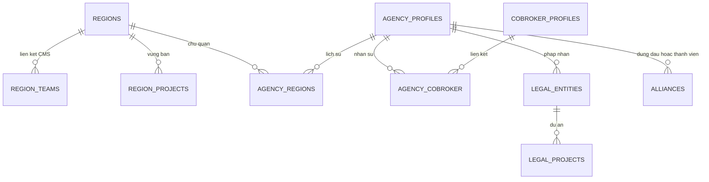

ERD là quan hệ logic; LEGAL_ENTITIES là tên mô tả, không phải khẳng định tên bảng vật lý. Thành viên liên minh nằm trong UUID array, không có nghĩa đã có bảng liên kết riêng. Region không được tự giả định có organization column như agency.

### 7.1.1 Ràng buộc thời gian và concurrency

Khoảng hiệu lực inclusive: hai khoảng chồng nhau khi start1 ≤ end2 và start2 ≤ end1; null end là vô hạn. Chủ quản đóng D−1 trước khi mở tại D. Các mapping dùng khóa bản ghi cha rồi kiểm overlap trong service/repository. Migration 0087/0088/0090 hiện không dựa vào exclusion GiST; thao tác SQL trực tiếp có thể bỏ qua bảo vệ nghiệp vụ.

Khóa agency trong liên minh theo thứ tự ID để giảm deadlock. Import hạng dùng snapshot version/optimistic lock, không mô tả là SELECT FOR UPDATE. Hết preview hoặc version thay đổi phải preview lại; không áp một phần danh sách.

## 7.2 Dữ liệu ranking

### 7.2.1 Mô hình dữ liệu

| Bảng/nhóm | Trách nhiệm |
| --- | --- |
| `users`, `organization_units` | Projection nhân sự/đơn vị |
| `transactions` | Dữ kiện giao dịch nguồn, eligibility riêng ranking/cycle |
| `sale_ranking_configs`, `sale_ranking_config_details` | Cấu hình kỳ và các nhóm áp dụng |
| `sale_ranking_month_buckets` | Slot doanh số/số lượng theo ngày trong tháng |
| `sale_ranking_grouping_buckets` | Tổng hợp QUARTER |
| `sale_ranking_aggregation_runs`, `sale_ranking_aggregation_batches` | Tiến độ và trạng thái tổng hợp |
| `sale_ranking_cycle_runs`, `sale_ranking_results` | Lượt xếp hạng, kết quả từng Sale |
| `sale_ranking_bucket_snapshots`, `sale_ranking_transaction_reconciles` | Mốc dữ liệu và hiệu chỉnh |
| `historical_events`, outbox | Lịch sử/công việc tích hợp |

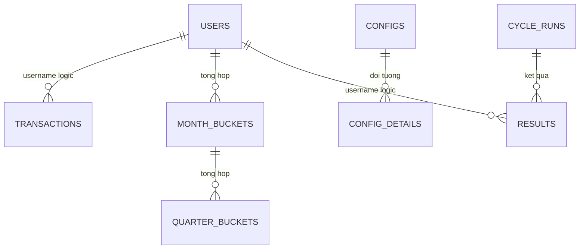

Sơ đồ là quan hệ logic, không khẳng định tất cả là khóa ngoại vật lý. Tên rút gọn trong sơ đồ tương ứng bảng ở trên.

### 7.2.2 Dữ liệu cá nhân và sở hữu

Analytics lưu họ tên, định danh, điện thoại/email và tổ chức phục vụ báo cáo; không là nguồn chỉnh sửa hồ sơ. Hạn chế log các trường này, kiểm soát export và file chứng nhận. Thời hạn lưu projection, báo cáo, ảnh chứng nhận và lịch sử cần chủ sở hữu xác nhận; không lấy thời hạn OCR/sinh trắc từ tài liệu mẫu áp vào ranking.

## 7.3 Dữ liệu Watchlist

| Bảng | Trách nhiệm / thuộc tính |
| --- | --- |
| `sale_control` | UUIDv7, mã CB/HC, type/status/source/publicStatus, CCCD/mã nhân viên, mảng phones/usernames, snapshot accounts, đơn vị, effective_date, content, attributes, version, lý do gỡ |
| `import_job`, `import_item` | File ref, staging từng dòng, lỗi, tiến độ confirm/apply và thời hạn |
| `scan_run` | Loại quét, dry-run, số ứng viên, mẫu số, ratio, trạng thái/kết quả |
| `outbox_message` | PROFILE_SALE_CONTROLS và HISTORY_EVENT, retry/lease/outcome |

History nghiệp vụ đầy đủ được phát sang BI qua Kafka và đọc qua query runner; không khẳng định có một bảng history đầy đủ tại Watchlist. CCCD/mã nhân viên BANNED có unique xuyên trạng thái; phone là array và khóa định danh, không có cùng unique constraint đơn giản như CCCD.

Import đi qua PENDING/PROCESSING/VALIDATED/APPLYING/APPLIED hoặc FAILED/EXPIRED theo job. Các dòng phải giữ lỗi và kết quả áp dụng để caller phân biệt validate thành công với đã có tác động nghiệp vụ. Mặc định staging hết hạn 24 giờ và tối đa 20.000 dòng, khác SRS không đặt giới hạn dòng.

## 7.4 Dữ liệu chu kỳ bán hàng

### 7.4.1 Mô hình

| Bảng | Dữ liệu chính |
| --- | --- |
| `users` | username, tổ chức/role/status, `sales_start_date`, version nguồn |
| `transactions` | PIC, deposit/contract date, eligibility và lý do loại |
| `sales_cycle_configs` | audience, effective date, mode, tháng/target, reminder |
| `sales_cycle_results` | Một kết quả theo Sale, calculation status/reason, classification, roomExcluded, applied start |
| `sales_cycle_periods` | Các kỳ có số thứ tự, type, start/scheduled end/actual end, target/count/achieved date, config snapshot |
| `sales_cycle_notifications` | Lịch, trạng thái, lease/thử gửi và tham chiếu kỳ |
| `background_jobs` | Quyền chạy/checkpoint công việc; đối chiếu migration hiện tại |
| Outbox | Sự kiện thay đổi dữ liệu; không thay thế bảng lịch thông báo |

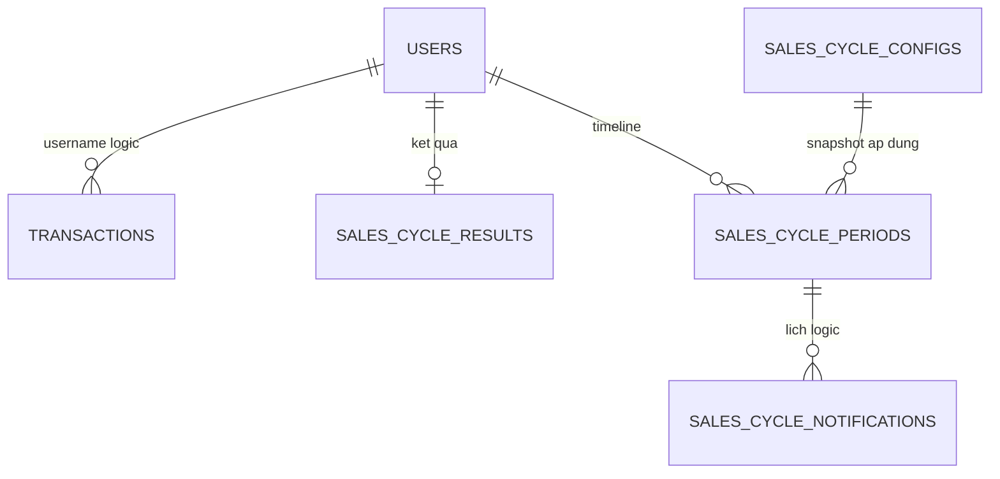

Đây là ERD logic; config snapshot trong kỳ giữ thông số đã áp dụng. Không suy toàn bộ đường nối là FK vật lý.

### 7.4.2 Hiển thị và dữ liệu thiếu

Đang chính thức: hiển thị kỳ chính thức hiện tại, cột thử thách trống. Đang thử thách: hiển thị chính thức liền trước + thử thách hiện tại. Terminal: hiển thị cặp kỳ cuối.

Query có trạng thái stale khi ngày bán và kết quả áp dụng chưa khớp. BLOCKED có thể giữ lịch sử cũ để đối soát; consumer không được coi lịch sử giữ lại là quyết định mới còn hợp lệ.

### 7.4.3 PII và lưu giữ

Thông tin liên hệ/định danh chỉ phục vụ người có quyền báo cáo. Export chứa dữ liệu cá nhân cần audit truy cập và quản lý file. Lưu giữ kỳ, lịch và kết quả gửi cần chính sách riêng; chưa có retention/purge được nghiệm thu trong đầu vào.

## 7.5 Data Flow và dữ liệu cá nhân

| Dữ liệu | Nguồn chuẩn → bản sao/đích | Kiểm soát cần có |
| --- | --- | --- |
| Nhân sự, role, đơn vị | Profile → Core/Analytics/Watchlist theo contract | Source version, đối soát thiếu user; không sửa projection như nguồn chuẩn |
| Giao dịch | Pipeline → Analytics → facts cho các nghiệp vụ | Ngày cọc khác ngày hợp đồng; eligibility riêng; correction/replay |
| Chủ quản/vùng bán | Core mapping và scope dự án → API tiêu thụ | Theo ngày hiệu lực, không suy ngược chủ quản từ dự án |
| Định danh/media | Người dùng → File/OCR/eKYC → kết quả Core | Private refs, source/resource authorization, URL ngắn hạn |
| Cấm/hạn chế | Watchlist → Profile/caller check/market | Outbox lag, tập kiểm soát hiện hành, công khai đúng trạng thái |
| Chu kỳ/hạn mức | Analytics result → consumer | BLOCKED/null không được chuyển thành đủ điều kiện |

CCCD, điện thoại, email, giấy tờ, selfie/video và nội dung vi phạm cần kiểm soát theo mục đích truy cập. Không log raw request/response, signed URL hoặc credential. Xóa media không mặc định xóa lịch sử quyết định; giữ lịch sử không đồng nghĩa cho phép giữ media vô thời hạn.

## 7.6 Retention, Consent & Ownership

Thời hạn lưu hồ sơ/giấy tờ, giao dịch projection, ranking, lịch chu kỳ, import, lịch sử và audit provider phải được owner phê duyệt riêng. SRS vùng yêu cầu giữ lịch sử lâu dài; cần thống nhất chính sách lưu trữ/PII và dung lượng trước production. Không sao chép retention OCR hoặc số năm từ tài liệu mẫu sang các domain khác.

OCR/eKYC sở hữu mã hóa kết quả/evidence theo contract của service. Chưa có bằng chứng để tuyên bố toàn bộ trường PII trong Core/Analytics/Watchlist được field-encrypt hoặc có purge job đáp ứng mọi retention. Đây là đầu vào review Security/Data Owner.

# 8. Luồng nghiệp vụ chi tiết

## 8.1 Tổng hợp luồng

| ID | Luồng | Điểm commit / kết quả |
| --- | --- | --- |
| CB-01 | OCR/eKYC và onboarding | Kết quả đối soát → hồ sơ nộp/duyệt theo nghiệp vụ |
| CB-02 | Yêu cầu cập nhật hồ sơ | Snapshot → duyệt → hồ sơ live; terminal không sửa tiếp |
| RANK-01 | Tổng hợp/tính hạng quý | Run/batch hoàn tất, công bố results |
| WL-01 | Tạo/gỡ/công khai | Sale control + outbox; side effect theo dõi riêng |
| WL-02 | Import/quét tự động | Validate/dry-run trước áp dụng, ratio guard |
| CYCLE-01 | Tính lại kỳ/lịch | Transaction từng Sale, result + periods + lịch |
| REGION-01 | Gán/chuyển quan hệ | Hiệu lực, overlap, lịch sử trong transaction |
| REGION-02 | Import hạng đại lý | Preview → kiểm version → commit toàn bộ |

## 8.2 OCR/eKYC và phê duyệt hồ sơ

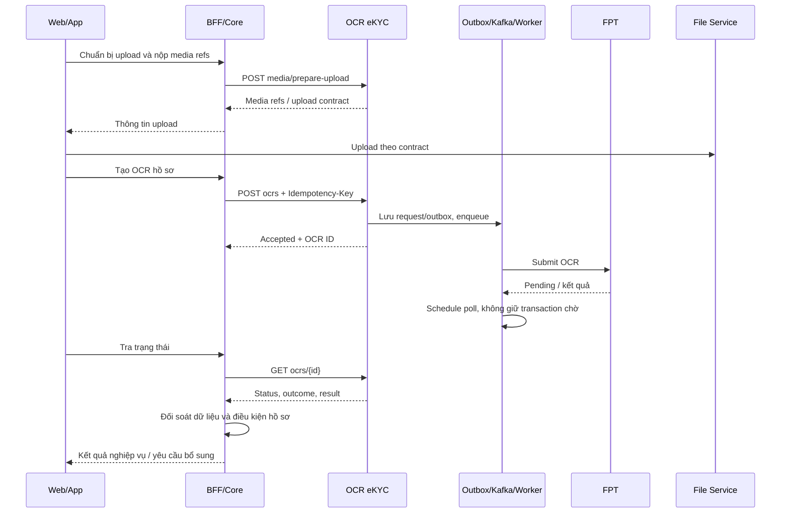

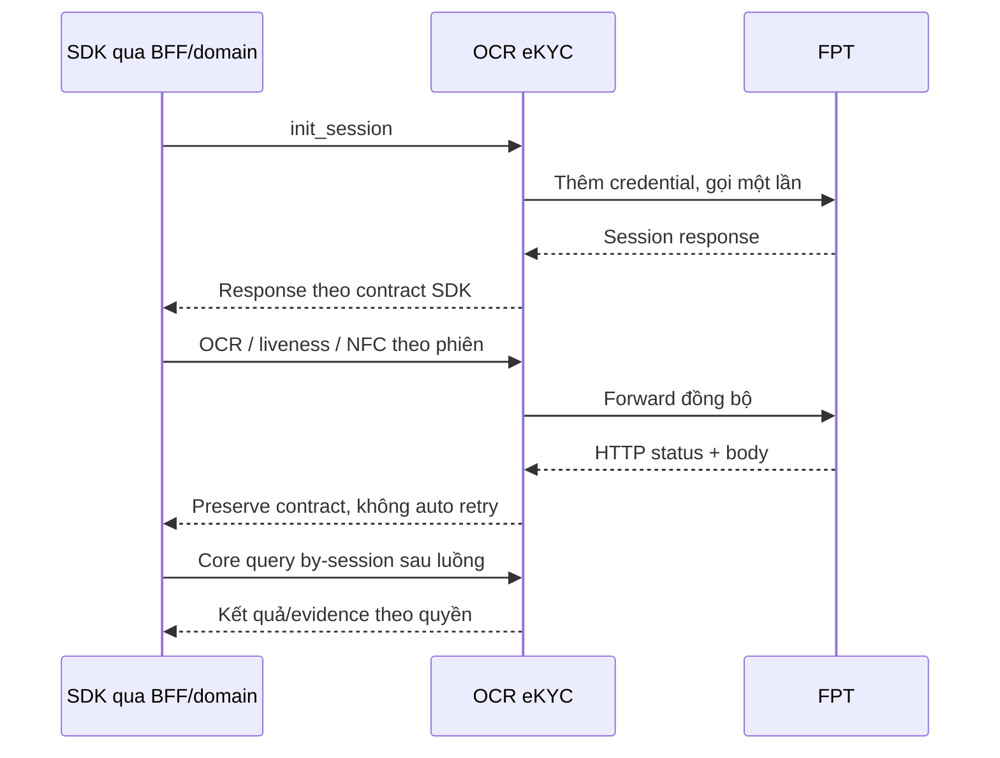

eKYC không đi qua Kafka OCR worker. Evidence có thể hoàn tất sau response SDK; Core phải xử lý trạng thái thiếu/chưa có media mà không tự tạo kết quả xác minh thành công.

### 8.2.1 Yêu cầu cập nhật hồ sơ

ARM tạo yêu cầu và snapshot → ASA chỉnh nháp → gửi duyệt → ARM xem diff và xử lý. Duyệt thành công mới áp dữ liệu hợp lệ lên hồ sơ live; phản hồi mở lại chỉnh sửa; từ chối/hủy/hết hạn kết thúc yêu cầu. Thao tác cạnh tranh với job hết hạn hoặc reviewer khác phải kiểm trạng thái/version trước commit. Email/history ngoài DB không được dùng làm điều kiện xác định hồ sơ đã commit.

## 8.3 Xếp hạng Sale

### 8.3.1 Tổng hợp và xếp hạng cuối quý

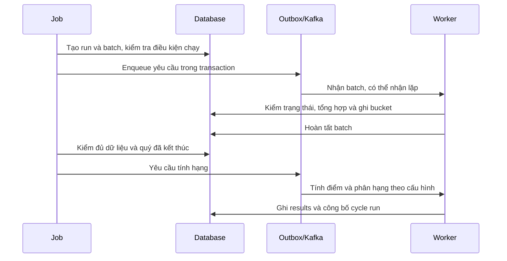

Sweeper xử lý công việc treo/phát lại theo trạng thái DB. Không cộng thêm doanh thu chỉ vì nhận lại cùng message.

### 8.3.2 Tra cứu và xuất

BFF xác thực → analytics kiểm actor/role → resolve scope → giao scope với bộ lọc → truy vấn có phân trang → trả số liệu và trạng thái kỳ. Export giữ cùng tiêu chí và bỏ phân trang UI, áp giới hạn riêng. Bộ phận hiển thị là dữ liệu hiện tại theo nguồn; không tự tuyên bố có snapshot tổ chức lịch sử nếu contract không lưu.

### 8.3.3 Ma trận lỗi

| Tình huống | Xử lý |
| --- | --- |
| Thiếu config cho nhóm | Không gán hạng giả; trả trạng thái/remark và cảnh báo |
| Giao dịch thiếu tiền/ngày | Gắn lý do loại; đối soát nguồn |
| Message lặp hoặc batch cũ | Kiểm trạng thái/lease; tránh ghi lặp |
| Nguồn đến muộn | Reconcile theo chính sách source; quan sát kết quả công bố |
| Không có scope | Từ chối, không fallback toàn hệ thống |
| Chứng nhận chưa sinh | ĐỀ XUẤT trả trạng thái chờ/lỗi, không trả URL giả |

## 8.4 Watchlist: ghi nhận, đồng bộ, import và scan

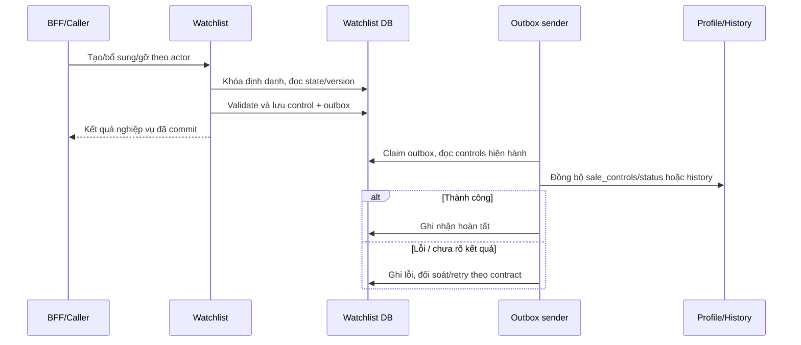

Identity locks được lấy theo thứ tự ổn định để serialize các yêu cầu trùng CCCD/mã nhân viên/phone. Version cũ trả xung đột; không silently overwrite. Sender đọc dữ liệu hiện hành để tránh outbox DISABLE cũ khóa lại người đã được gỡ nếu không còn kiểm soát chặn.

Import: lấy mẫu → prepare-upload → upload file → tạo job bằng file ref → validate từng dòng → xem lỗi → confirm → apply và xem kết quả. Không dùng trạng thái VALIDATED để báo “đã cấm bán”. SRS giới hạn XLSX 10 MB; code còn giới hạn số dòng cần chốt.

Scan: khóa chạy → lấy facts theo cursor → xác định mốc và ngưỡng → ghi ứng viên → tính tỷ lệ → nếu bất thường thì hủy ứng viên, không phát hành → nếu dry-run chỉ báo cáo → nếu thực thi mới ACTIVE và outbox. Bản ghi gracePending được bỏ qua lượt đầu và xóa cờ, lượt sau đánh giá lại. Thiếu facts producer là blocker bật quét thực thi, không thay bằng ngày giả.

## 8.5 Chu kỳ bán hàng và lịch thông báo

### 8.5.1 Tính lại một Sale

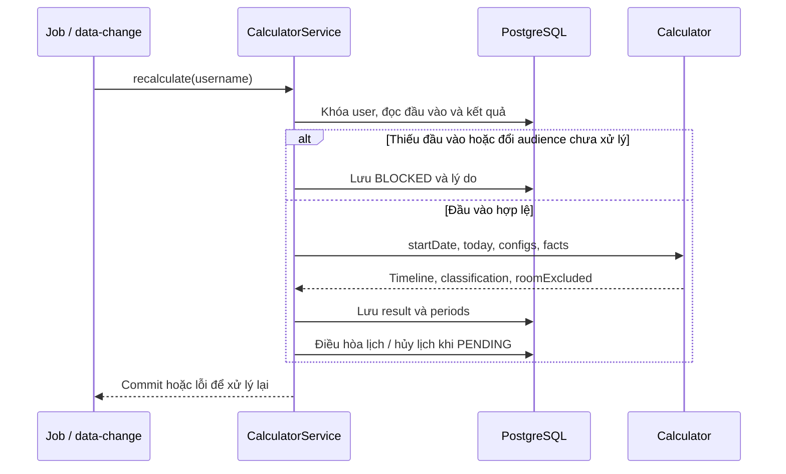

### 8.5.2 Trạng thái nghiệp vụ

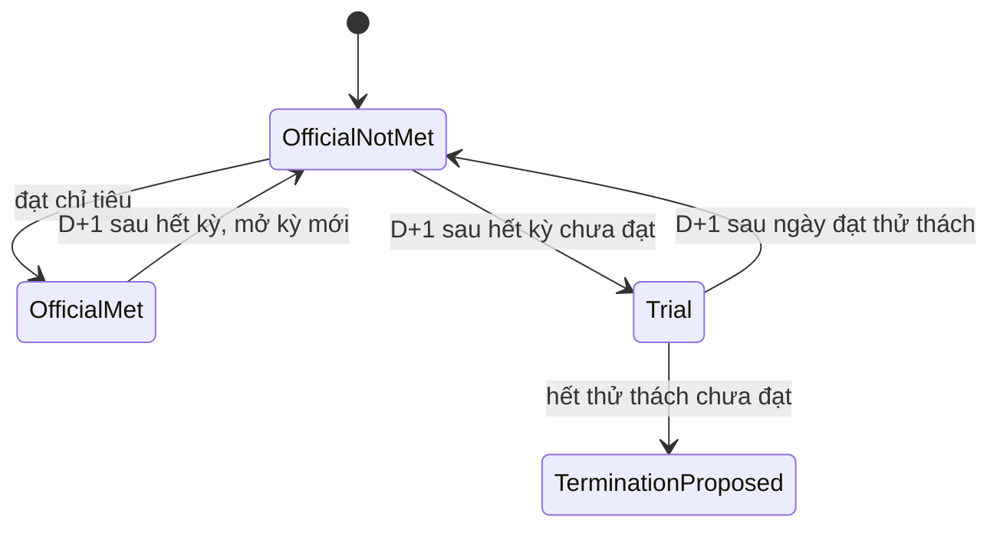

Sơ đồ mô tả diễn tiến khi nguồn không đổi; tái tính do sửa/hủy giao dịch hoặc ngày bắt đầu bán có thể dựng lại toàn timeline, không phải thao tác chuyển trạng thái tuyến tính.

### 8.5.3 Lịch thông báo

Nhắc trước x ngày: ngày gửi không trước đầu kỳ; x vượt độ dài kỳ thì nhắc ngày đầu. Kết thúc: gửi ngày sau kết thúc vào giờ cấu hình. Đạt chỉ tiêu thì ngừng nhắc; lịch trùng cùng kỳ/loại/thời điểm được gộp.

Job chuẩn bị bằng dữ liệu mới dưới khóa, gửi ngoài transaction rồi ghi kết quả. BLOCKED giữ lịch nhưng tạm không gửi và không tăng số lần thử; PENDING do ngày bán tương lai hủy lịch không còn phù hợp. Chỉ bù trong ngày; không tự gửi thông báo quá hạn ngày trước.

Nếu đã log/gửi nhưng ghi nhận kết quả lỗi, lease hết có thể chuyển UNKNOWN để đối soát; không tuyên bố gửi exactly-once. Khi thay sender thật phải kiểm chứng idempotency của kênh đích.

### 8.5.4 Ca biên

| Ca | Expected |
| --- | --- |
| Đúng ngày cuối kỳ | Kỳ còn được tính đến hết ngày |
| Thử thách đạt D | D vẫn thử thách; D+1 chính thức |
| Có 1/2 GD lúc thử thách hết hạn | Đề xuất chấm dứt |
| GD ký trong kỳ nhưng đến muộn | Tính lại theo ngày ký, có thể sửa kết quả cũ |
| GD ký sau terminal | Không tự mở lại |
| Thiếu config ở giữa timeline | BLOCKED, không tự chọn cấu hình tương lai |
| Sale inactive | Chu kỳ tiếp tục chạy |
| Reset tại D | Kỳ cũ hết D−1, không có GD của D trong kỳ cũ |

## 8.6 Vùng, chủ quản, liên minh và pháp nhân

### 8.6.1 Gán dự án cho vùng

1. Đọc danh mục dự án/CMS và kiểm actor; nhận vùng, dự án, giai đoạn, ngày hiệu lực, quyết định.
2. Kiểm vùng ACTIVE có SELLER; ngày kết thúc không trước bắt đầu; file quyết định đúng contract.
3. Khóa quan hệ cha, kiểm overlap từng cặp trong batch và dữ liệu hiện có.
4. Tạo N bản ghi vùng × dự án và lịch sử trong transaction; một phần tử sai thì không lưu một phần batch.
5. API đọc vùng bán suy theo mapping mới; quyền các hệ thống tiêu thụ cần đồng bộ theo contract, không khẳng định mọi UI cập nhật tức thì.

### 8.6.2 Chuyển vùng chủ quản

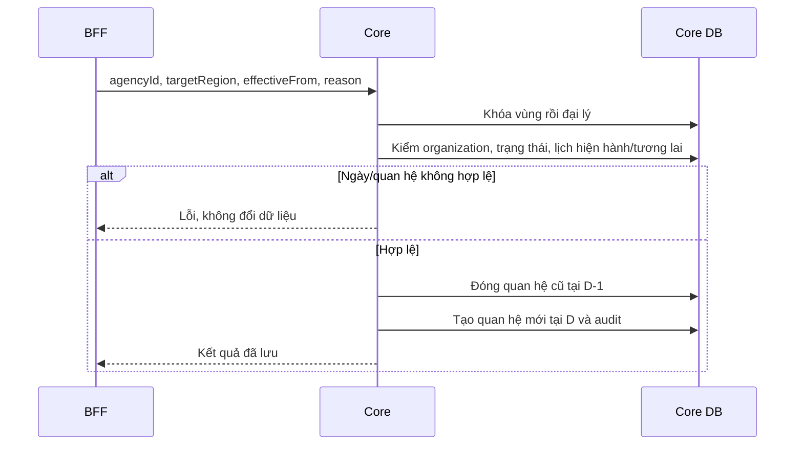

Chuyển chủ quản không thay tập dự án/vùng bán. Chuyển có hiệu lực tương lai không làm API “chủ quản hiện tại” trả vùng mới trước ngày D.

### 8.6.3 Liên minh / pháp nhân

Liên minh khóa các đại lý theo ID, kiểm đại lý hoạt động và quyền trên đại lý đứng đầu, dự án hợp lệ, số thành viên, trùng tham gia cùng dự án; sau đó lưu. Kích hoạt lại phải kiểm lại membership, không chỉ đổi status. Việc đại lý đứng đầu mất phân dự án cần hiển thị/đối soát theo contract, không tự cấp lại quyền bán vì tồn tại liên minh.

Pháp nhân khóa resource và kiểm ASA được phân công/organization; kiểm dự án thuộc tập dự án đại lý; kiểm ngày và overlap; lưu mapping hoặc kết thúc hiệu lực. Lịch sử được giữ cho đối soát.

### 8.6.4 Import hạng đại lý

Upload XLSX → parse/validate A/B/C và độc quyền → lưu preview Redis gắn actor/organization/version → hiển thị lỗi → confirm còn hạn → đọc và đối chiếu snapshot → cập nhật với optimistic version → commit toàn bộ. Xung đột 409 hoặc mất preview yêu cầu upload/preview lại; không tự cập nhật trên snapshot mới mà chưa cho người dùng xem.

## 8.7 Ma trận xử lý lỗi chung

| Tình huống | Hành vi / phục hồi |
| --- | --- |
| OCR/eKYC timeout mutation | Không tự submit lại; giữ outcome chưa xác định và đối soát |
| OCR completed với provider error | Trả outcome/error; không duyệt hồ sơ từ status |
| Profile/history lỗi sau commit Watchlist | Giữ outbox để xử lý; hiển thị/truy vết độ trễ side effect |
| Thiếu ngày bán/config chu kỳ | BLOCKED có lý do; không coi là không đạt hoặc đủ điều kiện |
| Scan tỷ lệ bất thường / dry-run | Không phát lệnh khóa hàng loạt |
| Overlap vùng/pháp nhân | Từ chối toàn bộ thao tác/batch liên quan |
| Version hồ sơ/import thay đổi | Conflict, yêu cầu đọc/preview lại |
| Mapping/nguồn ngoài không khả dụng | Không tạo dữ liệu thay thế giả; trả lỗi phù hợp và cho thử lại thao tác an toàn |
| Actor không có scope | Từ chối hoặc tập rỗng theo contract; không mở toàn hệ thống |

# 9. Security & Compliance Architecture

## 9.1 Identity & Authentication

BFF xác thực end-user và truyền actor context qua caller nội bộ được tin cậy. Core có gate `hasRole('BFF')` trên các controller liên quan; Analytics dùng security nội bộ và header actor; Watchlist tách Internal/Check/Market. Basic/S2S credential phải dùng trên transport bảo mật, không gửi xuống FE hoặc ghi log.

BFF phải bỏ header actor/scope do FE tự gửi rồi dựng context theo principal đã xác thực. Caller được xác thực không đồng nghĩa người dùng cuối có quyền trên mọi resource. Các API vận hành, import confirm, reveal và retry outbox cần quyền riêng.

## 9.2 Authorization & Access Control

| Năng lực | Kiểm soát thấy trong source | Khoảng trống cần kiểm chứng |
| --- | --- | --- |
| Core hồ sơ/đại lý | BFF gate; organization/actor guard theo nghiệp vụ | End-user matrix đầy đủ trên mọi endpoint/live/snapshot |
| Ranking | Resolver 11/100 toàn scope; 60 vùng, 23 phòng, 20 nhóm; 21 đơn vị thấp nhất; 64 agencyTeamIds từ BFF | Mapping vùng mới khác cây organization cũ |
| Ranking config/export | Config 11/100; role 21 không export nếu không có role xuất khác | Test BFF và policy multi-role |
| Chu kỳ | Security S2S; filter theo request | Chưa có resolver end-user tương đương ranking, không coi filter là scope |
| Watchlist | Realm/CIDR/actor; reveal tách riêng | Quyền chức năng BO/PCS và quyền xem PII cần BFF/E2E |
| Vùng | Gate BFF | UC-08 và quyền PCS/quản lý vùng chưa được chứng minh đầy đủ |
| Import hạng đại lý | BFF + ARM 11/1101, actor/organization preview | Khác ma trận SRS có role khác như 100 |
| Liên minh | Đại lý đứng đầu quản lý, thành viên xem theo service | Quyền vùng tổng thể và cross-organization tests |
| Pháp nhân/dự án | Operator và ASA được phân công | Negative tests resource ngoài phạm vi |
| OCR/eKYC | Detail/by-session có source check; provider credential phía server | Policy list/raw audit/media download còn gap trong tài liệu OCR/eKYC |

Role trong SRS Watchlist (20/21/23/71/73/75/77) và role cây Analytics không được hợp nhất chỉ theo tên Sale. Cần mapping vai trò–chức năng–phạm vi chính thức. Hợp nhiều scope đọc không tự mở quyền cấu hình hoặc export.

## 9.3 PII, Secrets & Threat Model

| Nguy cơ | Kiểm soát thiết kế / ca cần kiểm |
| --- | --- |
| Giả actor/scope | S2S trusted caller, header sanitization ở BFF, test request trực tiếp |
| IDOR hồ sơ/media/history | Kiểm resource ownership, organization, source và action trước trả dữ liệu |
| Lộ CCCD/phone qua list/export | Policy masking/reveal và audit; chốt chênh lệch SRS BR-17 trước release |
| File độc hại hoặc quá lớn | Allowlist loại/size, kiểm parser/upload, private storage, kiểm quyền download |
| Outbox cũ khóa lại tài khoản | Tính lại kiểm soát hiện hành lúc gửi, đối soát trạng thái Profile |
| Retry provider tạo tác động trùng | Idempotency OCR và không auto retry eKYC mutation |
| Lộ credential / raw provider response | Secret manager theo môi trường; redaction; hạn chế raw audit |
| Quyền vùng sai sau thay mapping | Scope server-side theo ngày hiệu lực, kiểm cả read/export và thao tác |

Khóa/credential có owner, quyền tối thiểu và quy trình rotation. Không ghi giá trị secret vào TTD. Mã hóa audit/result OCR/eKYC theo service đó không chứng minh mọi database domain có field encryption. Chính sách consent, retention, truy cập đặc quyền và xử lý yêu cầu dữ liệu cần owner xác nhận; tài liệu không tự đưa ra kết luận tuân thủ pháp lý.

# 10. Deployment & Infrastructure Topology

## 10.1 Environments & Topology

Các service độc lập dùng PostgreSQL, Kafka, Redis và hệ thống nền tảng theo phụ thuộc tương ứng. TTD v5 có mô tả AWS/EKS/RDS/MSK/Redis/S3; đây là thông tin kế thừa chưa được đối chiếu deployment manifest trong tác vụ này. Không coi region cloud, số pod, phiên bản DB, Multi-AZ hoặc sizing của bản cũ là cấu hình đã xác nhận.

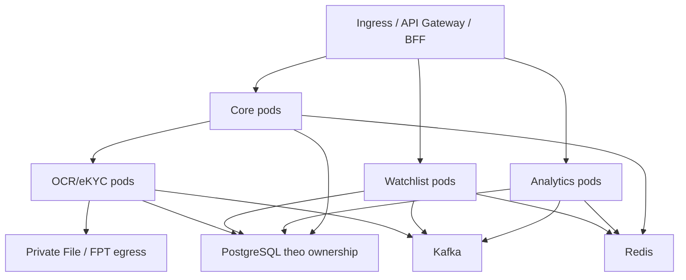

Đây là topology logic phục vụ review, không khẳng định các database chung một instance hoặc mọi đường mạng đã mở.

## 10.2 Cấu hình vận hành cần đối chiếu

| Nhóm | Default/baseline source | Hành động trước rollout |
| --- | --- | --- |
| Ranking jobs | SALE_ANALYTICS_JOBS_ENABLED=false; aggregation 02:00 | Kiểm manifest và bật sau import/backfill |
| Kỳ đầu ranking | SALE_RANKING_START_DATE=2026-10-01 | Chốt Q3/2026 với SRS, chuẩn bị dữ liệu kỳ trước phục vụ trọng số |
| Cycle | Job 00:00; notification mỗi 30 giây, batch 100 | Không suy phụ thuộc flag ranking; kiểm nguồn ngày bán |
| Watchlist scanner | Disabled, dry-run=true; 02:00; batch 500; maxRatio 0,05; minSample 1.000 | Chốt facts và dry-run report trước bật thực thi |
| Rank import đại lý | Redis preview 15 phút, 5 MB/1.000 dòng | Kiểm giới hạn gateway và lỗi preview hết hạn |
| Watchlist import | Staging 24 giờ, 20.000 dòng | Chốt giới hạn khác SRS và cơ chế cleanup |
| OCR/eKYC | Credential FPT server-side, contract SDK/OCR riêng | Xác nhận endpoint/media compatibility và timeout theo service |

## 10.3 Migration & Release Strategy

1. Chốt contract và quyết định mở ảnh hưởng dữ liệu/quyền; pin image, schema và configuration cho từng môi trường.
2. Chạy migration trên bản sao dữ liệu đại diện, kiểm lock/duration/rollback compatibility; không chạy thử destructive migration trên production.
3. Core kiểm migrations 0086–0090: region, project, owner-region, alliance, legal-project; 0086 còn schema `cobroker_db` cố định cần đối chiếu cấu hình môi trường. Không yêu cầu btree_gist cho các mapping khi source hiện dùng khóa cha/overlap query.
4. Nhập/đối soát nguồn Profile/Pipeline và quan hệ đại lý/vùng; giữ scanner dry-run, không tạo ngày bán giả để vượt BLOCKED.
5. Triển khai consumer/BFF theo thứ tự tương thích; chạy smoke API và kiểm quyền âm; backfill ranking trước công bố.
6. Bật job/side effect sau kiểm dữ liệu và quan sát backlog; nghiệm thu FPT onboarding/duyệt, Profile và history.

Rollback image chỉ khi tương thích schema hiện tại. Không xóa results, periods hoặc outbox để xử lý nhanh; side effect đã gửi Profile/FPT không được rollback chỉ bằng restore DB.

## 10.4 Network & Infrastructure Security

Chỉ mở ingress service từ caller được cấp; DB/Redis/Kafka không public. Egress FPT/File/Profile/History theo danh sách cần thiết. Credential mỗi môi trường tách riêng. NetworkPolicy, TLS, backup/PITR, secret injection, replica/probes và resource requests/limits là artefact cần review; không đánh dấu đã áp dụng chỉ từ sơ đồ.

# 11. Cost & Capacity/Performance

## 11.1 Capacity Model

| Năng lực | Biến tải | Giới hạn/điểm đo |
| --- | --- | --- |
| Core | Hồ sơ, media refs, đại lý/Sale, quan hệ vùng/dự án | p95 list/detail, lock wait, file throughput, số mapping hiệu lực |
| Ranking | N Sale × H tháng; T giao dịch; tối đa 4 quý mỗi query | DB bucket/WAL, batch, export 50.000, timeout query 10 giây |
| Chu kỳ | N Sale × số kỳ + facts mỗi Sale | Batch đọc 500, transaction từng Sale; tài khoản lịch sử dài |
| Watchlist | Số bản ghi/định danh, check rps, scan population, import rows | p95 check, khóa định danh, parser memory, scan duration, outbox lag |
| Vùng/liên minh | Số mapping ngày, dự án và membership | EXISTS trước phân trang, batch enrich, lock contention |
| OCR/eKYC | Số tài liệu/phiên, kích thước file, provider latency | Queue lag, thời gian hoàn tất, concurrency và chi phí provider |

Cần đo workload tương đương production: dữ liệu nhiều năm, nhiều pod, export/import đồng thời với job và cập nhật hồ sơ. Batch 500 không giới hạn tổng timeline của một Sale. 15 phút preview không phải cam kết thời gian xử lý import.

## 11.2 Cost Model

Chi phí gồm compute API/worker, PostgreSQL data/index/WAL/backup, Redis, Kafka retention, file storage/egress, observability và phí FPT. Chứng nhận ảnh phát sinh storage/render khi US-05/06 được triển khai. Chưa có population, traffic, retention hoặc đơn giá được duyệt nên không đưa tổng tiền ước đoán thành ngân sách.

Đầu vào cần bổ sung: N/T theo tháng, tăng trưởng, kích thước trung bình file, tỷ lệ retry, lịch sử cần giữ, cửa sổ batch, peak traffic và ngân sách SRE/FinOps.

# 12. Scalability & Reliability

## 12.1 Scaling Strategy

Scale API theo tải request; worker theo partition, provider quota và khả năng DB. Phân trang/query lọc trước khi tải dữ liệu; tránh N+1 trong enrich vùng/đại lý. Tăng số pod không thay thế kiểm soát khóa/idempotency hoặc tự làm job chạy nhanh hơn.

Ranking dùng Redis/ShedLock kết hợp run/batch DB; cycle dùng background job lease/checkpoint và khóa user; Watchlist scanner dùng Redisson và scan_run. Lease hết hoặc nhận lặp phải kiểm state/version ở DB trước tạo side effect.

## 12.2 Failure & Recovery Boundaries

| Sự cố | Thiết kế phục hồi / giới hạn |
| --- | --- |
| Kafka/outbox gián đoạn | Domain đã commit, side effect chờ; theo dõi oldest pending và retry đúng channel |
| Ranking worker chết | Sweeper/run state kiểm batch treo; không cộng lại doanh số vì message phát lặp |
| Cycle một Sale lỗi | Transaction Sale đó rollback; các Sale khác có thể chạy, checkpoint không vượt lỗi đầu tiên |
| Notification gửi rồi ghi trạng thái lỗi | UNKNOWN để đối soát; không giả định exactly-once; baseline mới LOGGED |
| Scan facts thiếu/sai | Không dùng dữ liệu thiếu để khóa hàng loạt; dry-run/ratio guard không thay chất lượng facts |
| Redis mất preview | Import hạng yêu cầu preview lại; không confirm từ dữ liệu client tự gửi |
| FPT timeout mutation | Không auto retry; theo runbook OCR/eKYC về UNKNOWN/reconcile |
| Concurrent transfer/membership | Khóa cha/thứ tự khóa, kiểm overlap và version; không bypass bằng SQL |

## 12.3 Backup & Restore

Backup/PITR phải bao gồm facts/config/results/periods/notifications và outbox tương ứng. Sau restore cần đối soát những event đã phát hoặc side effect đã tới Profile/FPT; tránh phát lại mù toàn bộ. File/media backup và DB reference phải đồng bộ về khả năng truy cập. RTO/RPO/retention backup và bằng chứng diễn tập chưa được cung cấp.

# 13. Observability & Monitoring

## 13.1 Signals & Dashboard

| Nhóm | Chỉ số / bằng chứng cần có | Trạng thái |
| --- | --- | --- |
| API | Request rate, p95/p99, 4xx/5xx, timeout, auth deny | Cần xác nhận dashboard môi trường |
| Ranking | sale_ranking_data_lag_days, aggregation_oldest_pending_seconds, reconciles_failed, orphan_usernames | Có nhóm metric trong source; kiểm tên đầy đủ theo registry |
| Chu kỳ | COMPLETED/PENDING/BLOCKED theo reason; stale; job checkpoint/lease; notification LOGGED/UNKNOWN | Danh mục cần nghiệm thu instrumentation |
| Watchlist | Outbox oldest/failed, Profile sync lag, scan candidates/ratio/abort, import failed | Cần dashboard và routing |
| Core vùng | Overlap/version conflict, history lag, preview expired, CMS unavailable | Cần theo dõi theo endpoint/action |
| OCR/eKYC | Queue/poll/processing age, provider latency/error/UNKNOWN, evidence pending/dead | Theo dashboard/runbook service OCR/eKYC |

Không gắn username/CCCD/sessionId vào nhãn metric gây cardinality lớn hoặc lộ PII. Log/trace dùng correlation ID và ID nghiệp vụ cần thiết trong phạm vi truy cập được cấp.

## 13.2 Alerts & SLI/SLO

Alert cần owner trực: dữ liệu ranking ngày trước chưa sẵn sàng, batch/outbox tồn lâu, tỷ lệ BLOCKED tăng, thiếu ngày bán, scan abort hoặc tăng mạnh, Profile sync lỗi, provider timeout và evidence không hoàn tất. README ranking có ngưỡng tham khảo 04:00 chưa tổng hợp, batch chờ hơn 1 giờ; cần xác nhận môi trường trước áp dụng.

SLI tách API availability, data freshness, tỷ lệ job hoàn tất, tỷ lệ side effect đồng bộ và notification delivery. Không dùng số LOGGED báo tỷ lệ gửi thành công, không dùng OCR completed báo tỷ lệ xác minh danh tính đạt. SLO và error budget chưa có phê duyệt trong đầu vào.

# 14. Operational Readiness

## 14.1 Runbook Register

| Sự cố / thao tác | Bước chẩn đoán và phục hồi | Owner |
| --- | --- | --- |
| Onboarding thiếu kết quả/media | Kiểm Core referenceId/session, OCR outcome, evidence pending và quyền; không tự gọi lại mutation | Core + OCR/eKYC |
| Yêu cầu cập nhật kẹt | Kiểm state, assignee, hạn, version và snapshot/live; xử lý qua nghiệp vụ | Core |
| Ranking lệch doanh số | Đối soát eligibility, tiền/scale, contractDate, run/bucket/reconcile; chỉ backfill có phạm vi | Analytics |
| Chu kỳ BLOCKED/stale | Kiểm ngày bán/audience/config/facts/version; tính lại sau sửa nguồn | Analytics + Profile |
| Lịch thông báo UNKNOWN | Đối soát receipt kênh trước retry; baseline chưa có kênh thật | Analytics + Notification |
| Watchlist đã gỡ nhưng Profile chưa đúng | Kiểm controls hiện hành, outbox, action và Profile; preview sync trước chạy | Watchlist + Profile |
| Scan abort | Kiểm facts/mẫu số/mốc ngày/ratio, chạy dry-run; không nới guard chỉ để hết lỗi | Watchlist |
| Import hạng conflict | Đọc thay đổi hồ sơ, preview lại và confirm; không override version | Core |
| Vùng sai phạm vi | Kiểm CMS team, ngày mapping, scope dự án Sale và actor; không sửa vùng chủ quản để chữa vùng bán | Core + BFF |
| Restore | Restore domain data/outbox, đối soát side effect, chạy mẫu E2E trước mở lại | SRE/DBA + owners |

## 14.2 Readiness Checklist

- Có owner, release ticket, image/commit và cấu hình của từng service.
- Các quyết định nghiệp vụ/quyền tại mục 16 có người chịu trách nhiệm và trạng thái.
- Contract facts, ngày bán, notification, scope vùng được nghiệm thu trước bật tính năng phụ thuộc.
- Migration/backfill/preview được kiểm trên dữ liệu đại diện; có kế hoạch xử lý dữ liệu cũ thiếu vùng/Miền.
- Scanner chạy dry-run được đối soát; không bật thực thi khi chưa có nguồn tin cậy.
- Dashboard, alert, quyền vận hành, runbook và contact trực đã kiểm.
- RTO/RPO và restore drill được duyệt; rollback không làm phát lại side effect nguy hiểm.

Đây là tiêu chí readiness của thiết kế, chưa phải checklist đã hoàn thành hoặc biên bản phê duyệt triển khai.

# 15. Testing & Quality Strategy

## 15.1 Test Matrix

| Phạm vi | Ca kiểm thử bắt buộc |
| --- | --- |
| Onboarding/FPT | Upload thiếu/sai media; OCR accepted/poll; completed error; key trùng giống/khác fingerprint; SDK timeout không retry; source/session ngoài quyền; evidence đến muộn |
| Hồ sơ cập nhật | Nháp không sửa live; approve/feedback/reject/cancel/expiry; reviewer cạnh tranh; không đổi hạng/trạng thái gián tiếp |
| Ranking tiền/eligibility | contractDate vs depositDate; hủy vẫn tính ranking; thiếu VAT/KPBT; precision/overflow; so điểm không làm tròn |
| Ranking tier | Đúng minScore, quota, hòa điểm ranh giới, dồn hạng, config thiếu; Q4→Q1, Q3/2026, quý hiện tại |
| Ranking API | Tối đa 4 quý, export cắt có thông báo, role21, scope rỗng, agency scope giả, detail ngoài quyền |
| Badge/chứng nhận | Đổi quý, không có hạng, tên có dấu/dài, File Service lỗi, tải ảnh cá nhân; chỉ chạy khi có implementation |
| Watchlist | Định danh chuẩn hóa/trùng; bổ sung/reapply; create/release cùng lúc; account subset; trạng thái công khai; reveal/export quyền âm |
| Watchlist outbox | Release trước sender; nhiều controls cùng tài khoản; retry/Profile lỗi; không tự bật lại do gỡ cấm |
| Watchlist import/scan | File sai/oversize, dòng lỗi/trùng, confirm lặp, hết hạn; dry-run, ratio, grace, ngày cuối tháng, nguồn facts thiếu |
| Cycle calculator | Đạt/chưa đạt, 1/2 GD cuối thử thách, ngày cuối, 29/02, ngày31, nhiều GD cùng ngày đạt |
| Cycle nguồn/config | Late/cancel/đổi PIC/ngày, version cũ, IMMEDIATE/SEQUENTIAL, ngày bán tương lai, đổi audience, thiếu config |
| Cycle job/notice | Nhiều pod, lease mất, checkpoint lỗi đầu, BLOCKED/PENDING, đạt dừng nhắc, lịch trùng, bù trong ngày, crash sau gửi |
| Vùng | CMS trùng/không khả dụng, tên chuẩn hóa, ít nhất một role, stop khi còn lịch tương lai, overlap khác giai đoạn |
| Chủ quản/vùng bán | Chuyển D−1/D, lịch tương lai, hai chuyển đồng thời, không đổi dự án, ASSIGNED khác ADDITIONAL, thu hồi scope |
| Liên minh/pháp nhân | Lead/member quyền, trùng dự án giữa liên minh, kích hoạt lại, giới hạn thành viên, ASA ngoài phạm vi, overlap ngày |
| Import hạng đại lý | A yêu cầu EXCLUSIVE, file/dòng limit, preview expired/khác actor/tổ chức, version conflict rollback toàn bộ |
| UC-07/08 | AND/OR filter trước pagination, count không trùng, union scope đọc, thao tác ngoài quyền vùng |
| Reliability/performance | Replay, DB/Kafka/Redis failover, outbox backlog, load đồng thời import/export/jobs, restore + đối soát |

## 15.2 Existing Evidence & Quality Gates

Source có các nhóm test ranking calculator/board/config/persistence, sales cycle calculator/PostgreSQL/job/notification; Watchlist có API/import/persistence/Profile sender/PII/performance tests; Core có các test vùng/đại lý và nghiệp vụ liên quan; OCR/eKYC có controller, persistence, service, security và OpenAPI contract tests.

**Trong tác vụ viết tài liệu này chỉ rà source và tài liệu, không chạy lại backend test suite, load test hoặc E2E.** Tên test và báo cáo lịch sử không được dùng làm kết quả nghiệm thu mới. QA cần gắn test report với commit/image/môi trường tại G3/G4.

## 15.3 Test Data & Acceptance

Dùng dữ liệu giả, không đưa CCCD/ảnh/video/credential/signed URL thật vào fixture hoặc report. Tập dữ liệu phải bao gồm ngày cuối tháng, nhiều quý, lịch tương lai, nhiều kiểm soát một tài khoản và user đa role/đa vùng. Contract tests xác minh cả successful và forbidden/conflict/unknown path, không chỉ HTTP 200.

# 16. Risks & Open Issues

## 16.1 Architecture Risks & Acceptance

| Risk | Tác động | Kiểm soát / điều kiện chấp nhận |
| --- | --- | --- |
| Scope vùng chưa hoàn chỉnh | Lộ dữ liệu hoặc thao tác sai phạm vi | BFF/service matrix và test âm trước release UC-08 |
| Facts/ngày bán thiếu | Scan khóa sai hoặc cycle BLOCKED | Contract producer, đối soát import, dry-run; không dùng fallback chưa chốt |
| Eventual consistency | Trạng thái UI khác Profile/history trong một khoảng | Outbox dashboard, sync/reconcile, thông báo trạng thái phù hợp |
| Nghiệp vụ SRS khác code | Báo cáo/trạng thái không đúng mong đợi | BO chốt từng issue; không mặc định code là business approval |
| Retry mutation/side effect | Trùng xử lý, khóa lại hoặc gửi lặp | Idempotency, hiện trạng trước send, UNKNOWN/reconciliation |
| Migration/restore | Chồng quan hệ hoặc replay side effect | Kiểm schema, khóa qua service, restore drill và đối soát |

Chấp nhận rủi ro phải có owner, phạm vi, thời hạn và bằng chứng. TTD này không tự chấp nhận rủi ro thay BO/Security/SRE.

## 16.2 Open Issues

| ID | Nội dung cần xử lý | Owner / điều kiện đóng |
| --- | --- | --- |
| CB-01 | Core còn call media deprecated `GET /v1/media/{id}`, provider hiện dùng prepare-download/detail | Core/OCR: rà call site màn quản trị và test xem media |
| CB-02 | Provider COMPLETED không phải identity pass; result/evidence policy có điểm mở trong docs OCR | Core/BO/OCR: chốt decision rule và E2E |
| RANK-01 | SRS bắt đầu Q3/2026, default code 01/10/2026 | BO/Analytics: chốt config và backfill |
| RANK-02 | Badge/chứng nhận mới là plan; SRS v33 có nhãn bộ phận mới | Analytics/BFF: hoàn thành contract/render/quyền và QA |
| RANK-03 | STRICT, ALL, lookback mở rộng ngoài SRS; lọc dự án chưa có | BO: chốt phạm vi UI/config và tie rule |
| RANK-04 | Scope vùng mới chưa được chứng minh bởi resolver tổ chức cũ | Core/Analytics/BFF: mapping và contract test |
| WL-01 | `/internal/v1/sale-activity-facts` là contract giả định, chưa có producer Analytics | Integration: API/schema/version/eligibility và E2E |
| WL-02 | Unique BANNED xuyên trạng thái khác SRS BR-03 chỉ ACTIVE | BO: xác nhận create mới hay reapply và lịch sử |
| WL-03 | SRS BR-17 yêu cầu full PII list/export; code masking + reveal | BO/Security: quyết định quyền/hiển thị/audit |
| WL-04 | Import code max 20.000 dòng, SRS chưa giới hạn dòng | BO/QA: chốt limit/message và tải |
| WL-05 | Fallback ngày tạo cho Đại lý; grace khóa lượt nào; vai trò export và xử lý GD trong thời gian cấm có mô tả chồng chéo | BO/Integration: bảng quyết định theo ngày/role/giao dịch |
| WL-06 | Các caller chặn, revoke session, notification chưa được rà E2E | BFF/Profile/callers: test từng điểm kiểm soát |
| CYCLE-01 | UserSyncData chưa map salesStartDate | Profile/Analytics: hoàn thiện US-06 và dữ liệu thật |
| CYCLE-02 | Sender mới LOGGED, chưa gửi Web/App | Notification/Analytics: contract, receipt, retry và xử lý lịch cũ |
| CYCLE-03 | IMMEDIATE sau terminal và chuyển audience chưa có quyết định thống nhất | BO: chốt reset/giữ lịch sử/ngày hiệu lực |
| CYCLE-04 | Quyền cycle, role export và vùng cần BFF; roomExcluded chưa chứng minh tích hợp Quỹ căn | BFF/Quỹ căn: scope và E2E, null/BLOCKED semantics |
| CYCLE-05 | SRS có ví dụ ngày/nhãn đạt chưa nhất quán | BA/QA: sửa expected theo rule được duyệt |
| REGION-01 | UC-08 chưa đầy đủ; region controller gate BFF không thay quyền PCS | Core/BFF/Security: action + resource matrix |
| REGION-02 | Code cho INACTIVE sửa CMS links; SRS cấm sửa | BO: chốt ngoại lệ và audit |
| REGION-03 | Core còn cho thiếu region/area theo contract cũ; SRS bắt buộc mới | BO/Core: cutover/backfill/validation |
| REGION-04 | Import rank roles11/1101 khác ma trận có role100; các count dùng tập trạng thái khác nhau | BO/Core: chốt role và mẫu số thống kê |
| OPS-01 | Sizing, SLO, retention, RTO/RPO và deployment manifest chưa có | SRE/DBA/Data Owner: artefact và OAT |
| SEC-01 | OCR list/raw audit/media source policy còn gap; PII toàn hệ thống cần review | Security/owners: access matrix và negative tests |

## 16.3 Tech Debt / Nội dung thay thế

Catalogue và sơ đồ hiện hành đã bỏ tích hợp trực tiếp VinBigdata, hạng đại lý D, tên API/bảng đại lý cũ và các số capacity/retention/HA không có bằng chứng. Các nhánh legacy còn trong repository không đại diện cho luồng vận hành đã được chủ hệ thống xác nhận; việc dọn code là tác vụ riêng.

Không kế thừa trạng thái Approved, cam kết RLS, mã hóa toàn bộ field, tự chuyển nhà cung cấp hoặc thông số chi phí từ tài liệu trước. Những phần thực sự cần triển khai được theo dõi bằng issue cụ thể ở trên.

# Appendix

## A. Glossary

| Thuật ngữ | Nghĩa trong tài liệu |
| --- | --- |
| TTD / TDD L2 | Tài liệu thiết kế kỹ thuật hệ thống Cobroker thống nhất |
| ASA / ARM | Vai trò vận hành đại lý / quản lý theo contract hiện hành; mã quyền cần đối chiếu policy |
| Vùng chủ quản | Vùng quản lý đại lý theo quan hệ có hiệu lực |
| Vùng bán | Vùng được gán cho dự án; suy ra từ dự án được phân của Sale/đại lý |
| Hạng Sale | Kim cương/Bạch kim/Vàng theo doanh số/điểm/quota |
| Hạng đại lý | A/B/C, phụ thuộc điều kiện độc quyền và import được cấp quyền |
| BLOCKED / PENDING | Chu kỳ thiếu/xung đột đầu vào / chưa đến ngày bán |
| TERMINATION_PROPOSED | Đề xuất ngừng hợp tác; không phải lệnh khóa tài khoản |
| roomExcluded | Điều kiện loại do chu kỳ; không là số hạn mức hoặc lệnh thu hồi căn |
| UNKNOWN / LOGGED | Chưa rõ outcome side effect / chỉ ghi log; không tương đương SENT |
| Effective-dated | Lưu lịch sử khoảng ngày bắt đầu/kết thúc hiệu lực |

## B. References & Baselines

| Tài liệu | Phiên bản khảo sát |
| --- | --- |
| [TTD mẫu OCR/eKYC](https://vin3s.atlassian.net/wiki/spaces/VARW/pages/3014268156) | v29 — 02/10/2026 |
| [TTD Cobroker gốc](https://vin3s.atlassian.net/wiki/spaces/VARW/pages/3000048322) | v5 — 02/10/2026, trước cập nhật |
| [SRS xếp hạng Sale](https://vin3s.atlassian.net/wiki/spaces/BMAS/pages/3174598094) | v33 — 14/10/2026 |
| [SRS cấm/hạn chế bán](https://vin3s.atlassian.net/wiki/spaces/BMAS/pages/3174272140) | v38 — 13/10/2026 |
| [SRS chu kỳ bán hàng](https://vin3s.atlassian.net/wiki/spaces/BMAS/pages/3174532173) | v12 — 08/10/2026 |
| [SRS vùng/đại lý/liên minh/pháp nhân](https://vin3s.atlassian.net/wiki/spaces/BMAS/pages/3196028657) | v6 — 07/10/2026 |

| Repository | Commit khảo sát | Artefact trọng tâm |
| --- | --- | --- |
| vhm-cobroker-core | b0fb618b044b61b8c87584ff14f4460fcebedda7 | AgencyProfileInternalController; onboarding/admin controllers; VhmOcrEKycClient; Region/AgencyRegion/AgencyRanking/Alliance/LegalProject services; migrations0086–0090 |
| vhm-sales-analytics-service | 438de8d36dc9403dc3e126e90c48ba5ed630a0b2 | ranking/cycle controllers, calculators, PipelineEligibility, UserSyncData, jobs, migrations/config/tests |
| vhm-watchlist-service | 24b3be53165095881788ab1574bcfb3a2454cef0 | SaleControlWriter, ProfileSaleControlsSender, SalesAnalyticsFactsClient, scanner, import/controllers/migrations/tests |
| ocr-ekyc | 8a10f1428414ed0343e64244decfe5bc4d770729 | Ocr/Ekyc/Media controllers; Fpt clients; docs invariants/contracts/workflows/security/reliability; OpenAPI |

Baseline xác định phạm vi source được mô tả; không khẳng định các branch đã merge hoặc commit đã triển khai production. Xác nhận chuyển toàn bộ tích hợp hiện hành sang FPT được chủ hệ thống cung cấp ngày 14/10/2026.

## C. Đầu vào bắt buộc trước production

Owner phê duyệt; contract facts và ngày bán; kênh thông báo thật; UC-08 và ma trận role; các quyết định chênh lệch SRS/code; dữ liệu backfill Q3; cấu hình job/scanner/FPT; migration rehearsal; report UAT/security/load/restore; SLO, retention và RTO/RPO. Theo dõi từng đầu vào tại gate G1–G4, không dùng tài liệu nháp thay release approval.

## D. Danh mục quyết định kiến trúc (ADR)

| ID | Quyết định mô tả trong TTD | Đánh đổi / trạng thái |
| --- | --- | --- |
| ADR-01 | Một TTD, domain thuộc các service riêng | Tránh trùng tài liệu nhưng vẫn giữ ownership dữ liệu |
| ADR-02 | FPT qua OCR/eKYC; OCR async, SDK sync | Core không sở hữu credential; phải giữ hai contract/retry khác nhau |
| ADR-03 | Ranking dùng bucket và run/batch công bố | Đọc nhanh, cần reconcile và giám sát độ trễ |
| ADR-04 | Cycle calculator từ facts, transaction theo Sale | Tái tính được lịch sử, cần đủ nguồn và xử lý late/cancel |
| ADR-05 | Watchlist dùng domain record + outbox, đọc state lúc send | Có độ trễ nhưng tránh lệnh cũ áp sai trạng thái hiện hành |
| ADR-06 | Vùng chủ quản độc lập vùng bán; dự án đại lý từ Sale assigned | Quan hệ rõ ràng, đòi hỏi scope nguồn chính xác |
| ADR-07 | Khoảng hiệu lực kiểm dưới khóa cha | Không phụ thuộc GiST exclusion; phải cấm bypass writer nghiệp vụ |
| ADR-08 | Import hạng preview/version, commit toàn bộ | Người dùng cần preview lại khi dữ liệu thay đổi |
| ADR-09 | Badge/chứng nhận là luồng render riêng | Đề xuất chưa triển khai, cần contract/storage/quyền riêng |

Các ADR này ghi nhận thiết kế/implementation hoặc đề xuất được gắn nhãn; chưa thay biên bản kiến trúc được phê duyệt.
